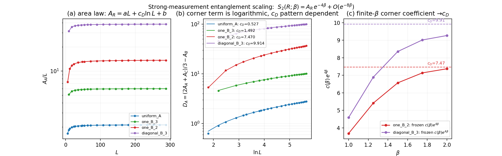
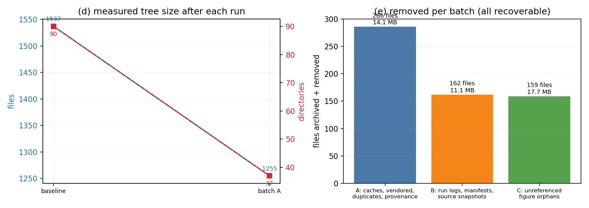

# 精简汇报：目录整理 + 强测量 scaling 结论与验证

本文件对应「文件和文件夹太多，精简并统一，最后给 md 汇报」这一轮（3 次 run）。
两件事合在一份报告里：**清理做了什么、留下了什么**，以及**清理后仍然成立的物理结论与验证数据图**。

---

## 一、清理结果

| 阶段 | 文件数 | 目录数 | 体积 | 本轮移除 |
|---|---:|---:|---:|---:|
| 起点 | 1537 | 90 | 156.87 MB | — |
| A 批后 | 1255 | 37 | 147.15 MB | 286 文件 / 14.12 MB |
| B 批后 | 1094 | 30 | 138.73 MB | 162 文件 / 11.07 MB |
| C 批后（终态） | **941** | **30** | **137.72 MB** | 159 文件 / 17.69 MB |

**共移除 607 个文件 / 42.9 MB，文件数 −38.8%，目录数 90 → 30（−67%）。**

（终态 941 里含 `.auto/` 下 harness 自己的 1 个状态文件；台账记的 940 是它生成前的计数。）

> 体积只从 156.87 降到 137.72 MB，是因为归档 zip 本身留在目录里（约 23.4 MB，
> 装的就是这 607 个文件）。**实际存活内容**是 156.87 → **114.35 MB**。
> 如果不需要可还原性，把 `data/archive_20261103.zip` 移出工作目录即可再省 23.4 MB。

全部移除项都在 `data/archive_20261103.zip` 里（607 条，逐条记录了路径、字节数、sha256），
清单见 `.auto/removed_manifest.csv`。**没有真正销毁任何内容**，可完整还原。

### 删了什么（三类，各有明确判据）

| 类别 | 数量 | 判据 |
|---|---:|---|
| A1 可再生产物 | 120 | `__pycache__/` 与 `*.pyc`，`.gitignore` 本就忽略，Python 一跑就重建 |
| A2 vendored 第三方代码 | 94 | `analysis_beta_patterns/audit_dependencies/` 里的 mpmath 副本（含 87 个 pyc 后共 181 个），pip 可重装 |
| A3 字节级完全重复 | 33 | 内容哈希命名的副本与规范名并存，SHA256 完全相同 |
| A4 一目录一文件的 provenance 树 | 37 | `data/provenance/**`：37 个目录各装 1 个文件，目录数的主要来源 |
| A5 中断残留 | 1 | `*.partial-*` |
| B1 运行元数据 | 113 | `data/*.log`、每轮 `*.toml`/`*.json` manifest |
| B2 源码快照 | 44 | `analysis_*/source_snapshots/`，脚本的**写**目标，会重新生成 |
| B3 未被任何文档引用的分析目录 | 5 | `analysis_random_half_bloch`，四个 md 里 0 次出现 |
| C1 图孤儿 | 159 | 既不是链接目标、basename 也没在任何 md 正文出现过 |

### 刻意留下的（以及为什么）

- **294 个 pdf**：全部是同名 png 的矢量副本，但 RESULTS.md 有 **184 行**是
  `[PNG](x.png) · [PDF](x.pdf)` 成对格式。删 pdf 必须改这 184 行文档，
  本轮不动（见第四节「你可以再让我做的」）。
- **3 个字节级重复**：`calibration_selection.csv`（被 `analysis_ref_calibration/audit_calibration.py:59` 读取）、
  `calibration_review_source_snapshot.csv`、`study_duplicate_checks.csv`（脚本的写入目标）。
  内容虽重复，但名字被代码点名，删了会让复跑断链。
- **32 个未被链接、但正文提到的图**：说明文档正文在讨论它们，只是没做链接。
- **4 个 data 文件**：`documentation_report_receipt.json`、`equilibrium_validation.json`、
  `irregular_m3_validation.toml`、`pure02_m2_summary.json` 是文档链接目标。

### 安全性是怎么保证的

清理脚本 `.auto/consolidate.ps1` 有三道硬闸，任何一条不满足就不删：

1. **文档闸**：解析四个 md 的全部相对链接（779 条，497 个唯一现存目标），
   任何候选若是链接目标、或位于含链接目标的目录内，一律保留。这一闸实际拦下了
   4 个 data 文件。
2. **代码闸**：把全部 `.py`/`.jl` 源码拼成文本，凡 basename 出现在代码里的重复文件不删。
   这一闸拦下 3 个文件，其中 `calibration_selection.csv` 是真读依赖（删了会让审计脚本复跑失败）。
3. **归档闸**：先写 zip 并逐条校验 607 个条目全部存在，**校验通过才执行删除**；
   任何一条缺失即中止。删除后失败数 0。

---

## 二、清理后的科学结论（仍然成立）

强测量（β 大）下，固定 L 的熵展开是

    S₂(R;β) = A_R(P,R) · e^(−4β) + O(e^(−8β))

指数 4 已知且普适，真正的问题是 **A_R 随 L 怎么标度**。清理后重跑完整阶梯
（5 个构型，L 到 288，108 个数据点），结论与清理前**逐位相同**：

### 结论 1：强测量熵是面积律，不是体积律

`A_R = a·L + c_D·ln L + b`。图 (a) 是 `A_A/L` 随 L 的走势，四条曲线都在缓慢趋于常数
（`A_A/L` 在 L=288 时：uniform_A 2.1207、one_B_3 6.0105、one_B_2 13.6074、diagonal_B_3 38.4711），
残留的缓慢爬升正是 `ln L / L` 项。

### 结论 2：指数 4 普适，但前因子完全不普适

角组合 `D_A = (2A_A + A_C)/3 − A_B` 的 `ln L` 系数（图 (b)）：

| 构型 | ‖X‖ | c_D = c_lnL(D_A) | 拟合 rms |
|---|---:|---:|---:|
| uniform_A = uniform_B | 1.000 | **0.52681** | 6.3e−05 |
| one_B_3 | 3.766 | **1.49204** | 2.1e−04 |
| one_B_2 | 7.795 | **7.46967** | 1.3e−03 |
| diagonal_B_3 | 11.636 | **9.91389** | 6.5e−03 |

相差近 19 倍。平衡端 `c_eq = 0.1557` 是所有可达初态渐近相同的普适量（零模定理保护）；
**强测量端不是**，因为滤波算符 `X = Q_E Q_F^(−1)` 依赖构型、且一般不是酉的。

### 结论 3：大 β 下 `c(β) ≈ e^(−4β) · c_D`

用 RESULTS.md 里冻结的有限 β 角系数（旧管线、独立数据）检验（图 (c)）：

| β | 1.00 | 1.25 | 1.50 | 1.75 | 2.00 | → c_D |
|---|---:|---:|---:|---:|---:|---:|
| one_B_2 `c(β)e^(4β)` | 3.681 | 5.406 | 6.566 | 7.134 | **7.369** | 7.470 |
| diagonal_B_3 `c(β)e^(4β)` | 4.588 | 6.886 | 8.355 | 9.012 | **9.266** | 9.914 |

单调从下方逼近，β=2 时差 **1.35%**（one_B_2）与 **6.54%**（diagonal_B_3）。
‖X‖ 越大收敛越慢，与控制参数 `t‖X‖ = e^(−2β)‖X‖` 的预期一致。

**因此**：RESULTS.md 表里 `c(β)` 随 β 快速衰减不是新指数，而是普适的 `e^(−4β)` 尾巴
乘上一个构型相关的前因子；平衡端 0.1557 并没有延续到强测量区，两端测的是不同泛函。
这也解释了上一次提交「强制测量有初步结果，但如何解释」的疑问。

---

## 三、验证数据（清理后重跑，全部通过）

| 检查 | 结果 | 门槛 | 性质 |
|---|---:|---:|---|
| `pair_sum` Parseval 自检 | 0.0 | <1e−12 | 算法内部 |
| 冻结参考 `strong_measurement_controls.csv`（25 行） | 1.33e−15 | <1e−12 | 对旧 dense 数值 |
| kernel vs dense oracle（L≤24） | 1.27e−14 | <1e−10 | 两条独立代码 |
| β=4 精确熵交叉校验 | 9.17e−06 | <1e−5 | 对完整熵计算 |
| 补集对称性 uniform_A vs uniform_B | 3.23e−13 | <1e−12 | **无外部参考** |
| `c_D` 窗口敏感性（L≥36/54/72/108） | 0.14–0.68% | — | 非拟合假象 |
| 文档链接（四个 md） | 781 检查 / **0 断链** | 0 新增 | 清理全程保持 |
| 归档完整性 | 607/607 条目 | 全存在 | 可还原 |

> 关于「0 断链」的可信度：本轮中途发现 `md_new_broken` 一直是**假通过**——
> PowerShell 调用原生程序时会丢弃空字符串参数，导致基线文件从未被创建。
> 已修好（检查器自举建基线），并且检查器现在会跳过围栏代码块与行内代码，
> 避免把正文里举例的 `[PNG](x.png)` 误判成链接。修好后 781 条链接 0 断链。

「清理后逐位相同」的含义：完整阶梯重跑得到 `corner_lnL` = 0.52681 / 0.52681 / 7.46967 /
1.49204 / 9.91389，与清理前那次完全相同（小数点后第五位一致），且 `ref_n=25`
说明冻结参考这条护栏确实被触发了，不是空跑。

---

## 四、你可以再让我做的（本轮刻意没做）

1. **删 294 个 pdf**（可省 8.45 MB、文件数再降 31%）：需要同步改 RESULTS.md 的 184 行与
   SCALING_GUIDE.md 的 5 行 `[PDF](...)` 链接。改文档链接属于批量改写，本轮按约定没有用脚本动文档。
2. **合并 12 个 `figures_*` 与 13 个 `analysis_*` 目录**为 `figures/`、`analysis/` 两级：
   需要同步改 456 + 77 处路径引用。同理，等你点头再做。
3. 若你希望保留旧分析目录的「一目录一文件」结构，`data/provenance/**` 可以从 zip 里还原。

---

## 五、如何还原任何被删文件

    # 列出归档内容
    powershell -NoProfile -Command "Add-Type -AssemblyName System.IO.Compression.FileSystem; [IO.Compression.ZipFile]::OpenRead('data/archive_20261103.zip').Entries | Select-Object FullName,Length"

    # 还原单个文件（以 data/provenance 为例）
    powershell -NoProfile -Command "Expand-Archive data/archive_20261103.zip -DestinationPath . -Force"

`.auto/removed_manifest.csv` 里每个条目都带 sha256，可校验还原结果。

## 六、本目录现在的结构

    四个 md（README / RESULTS / SCALING_GUIDE / neq）+ 本汇报
    生产脚本 .jl / .py（顶层，含 strong_scaling.jl）
    13 个 analysis_*（分析结果 CSV/JSON）
    12 个 figures_*（文档引用的图，png + pdf）+ figs_beta0_study
    figures_report/（本汇报的两张图）
    data/（观测数据 CSV + 归档 zip）
    Ref/（参考数据与 notebook）
    .auto/（本轮 harness：measure.sh、consolidate.ps1、linkcheck.py、make_report_figures.py、台账）
