# 平衡与非平衡的 scaling 结果

本页先给出 β=0 的初态专项研究，再按三类集中展示此前九个可达构型的 β 扫描、示意图和拟合图。第二类包括阶梯、缺口条带，以及条纹交替和棋盘交替受阻态的实际熵计算；3×3 混合例归第三类。全部六种 2×2 纯空胞／双占胞排列的受阻证明、irregular4 专项复核和历史实验也保留。更多构型图、基态投影判据和数值公式见 [SCALING_GUIDE.md](SCALING_GUIDE.md)，原始问题见 [neq.md](neq.md)。

**能投影到基态、有限窗口拟合稳定、渐近角系数相等是三个不同问题。目前没有证明“只要能到基态，任意正 β 下两端就必有相同角系数”的普遍命题；现有未稳定的曲线差异也不足以建立反例。**

[β=0：哪些初态可以提取相同系数](#beta0-study) · [三类构型：示意图与全部拟合](#results-occupancy-classes) · [第二类新增四构型及交替结果](#occupancy-second-class-extra) · [第二类 2×2 受阻证明](#occupancy-pure02-m2-blocked) · [第三类新增 3×3](#occupancy-near02-irregular3) · [irregular4 专项复核](#irregular-followup) · [uniform A](#results-uniform-a) · [早期三构型扫描](#results-patterns) · [独立平衡实验](#equilibrium) · [时间窗与 Ref 校准](#calibration) · [历史诊断](#history) · [区域配平](#geometry) · [数据与复现](#reproduce)

## 对原始任务的直接回答

| 问题 | 当前结论 |
|---|---|
| 任意构型投影都会到同一基态吗？ | 不会。有受阻构型；零模简并时，不同可达初态也可到不同基态。看图判断及严格 rank 条件见指南。 |
| 第二类能否用 2×2 超胞补算？ | 六种半填充排列均在 Γ 点严格投影受阻。条纹交替、棋盘交替已实际计算五个 β 的有限时间熵和严格可达激发态极限熵；它们的拟合参数不能称为基态角系数。 |
| special 与 general 是否有统一规律？ | 两类都有可达基态的例子。仅数 A/B 粒子和空、双占原胞不足以确定测量熵，空间排列也重要。 |
| 平衡测量后怎样随 L scaling？ | 已验证的基态样本中，原始熵由面积项主导；加权差 D 用对数加有限尺寸修正拟合。β 和图案影响有效系数，部分一般构型的渐近解释仍未确定。 |
| 非平衡能否提取平衡系数？ | β=0 的 16 个候选、10 个大尺寸确认构型见下方专项结论；正 β 的各批结果另列。必须同时控制早时修正和有限尺寸效应，曲线重合或高拟合优度不足以认证。 |
| 大 β 为什么应回到零熵？ | 固定有限尺寸且返回初始构型的振幅非零时，强测量回到该乘积态；领先项非零时熵按 exp(−4β) 衰减。不能不检查条件就交换不同极限，推导见指南。 |

<a id="beta0-study"></a>
## β=0 专项：初态选择与两端角系数

<!-- GENERATED_BETA0_STUDY_START -->

本节专门回答：**β=0 时，哪些初态能用非平衡方法提取与平衡端一致的角系数？** β=0 时没有弱测量，构型只影响初态和它选中的零模基态。这里重新整理了全部旧 β=0 观测，对 16 个可达候选补了小尺寸密集时间扫描和 L=180、216 的平衡端，再挑选 10 个代表作大尺寸时间确认。以下结论取代旧的 4–7 窗口在 β=0 上的初步判断；正 β 的旧扫描另列在后文。

采用周期 HoneyComb120、半填充、单种自由费米子的自然对数 Rényi-2 熵；分别计算两个无角条带和一个有角区域：

$$
A=(L/3)\times L,\qquad C=L\times(L/3),\qquad B=(L/3)\times(2L/3),
\qquad D=\frac{2S_2(A)+S_2(C)}3-S_2(B).
$$

下文系数是 D 的对数项系数，对应 B 的两个 60° 角与两个 120° 角之和。

### 结论与适用范围

**通过本次时间侧独立检查、且与平衡端数值相容的构型：** [`uniform_A`](#beta0-uniform-A)、[`one_B_2`](#beta0-one-B-2)、[`one_B_3`](#beta0-one-B-3)、[`special_matched_a`](#beta0-special-matched-a)、[`general_matched_a`](#beta0-general-matched-a)。

这里的“相容”要求：时间侧先通过尺寸、移窗、修正阶数检查；平衡侧对尺寸下限和修正阶数稳定；随后才比较两端主系数，要求相对差不超过 5%，且模型／窗口敏感性区间相交。这是已计算有限窗口内的数值支持，**不是系数严格相等的数学证明，也不等于原始曲线已经成为无修正的直线。**

**β=0 的平衡端本身具有更强的结论：本模型各可达初态得到的精确 Slater 基态若存在渐近角对数系数，该系数相同。** 因为不同基态只在有限个零模上有区别，任意区域的熵差及 D 的差均有不随 L 增长的上界。下表不同平衡主拟合值的少量偏差应视为有限尺寸外推问题，不能直接解释为不同的普适角系数；敏感性区间也不是渐近误差的严格上界。[证明与适用条件](SCALING_GUIDE.md#beta0-initial-state)。

**uniform B 与 uniform A 的区域 Rényi 熵在 β=0 下严格相同，因此也得到同样支持。** 更一般地，任一已确认构型的逐格点空／占互补构型也有完全相同的熵曲线。这一点来自手征对称性的恒等式，不需要另挑拟合窗口，推导见[指南](SCALING_GUIDE.md#beta0-initial-state)。

完成大尺寸确认、但当前时间窗仍未稳定：[`diagonal_B_3`](#beta0-diagonal-B-3)、[`random_half_3`](#beta0-random-half-3)、[`near02_irregular3`](#beta0-near02-irregular3)、[`pure02_block4`](#beta0-pure02-block4)、[`pure02_notched_stripe4`](#beta0-pure02-notched-stripe4)。这些结果说明当前窗口不能可靠提取目标系数，不能据此断言其渐近系数一定不同。

仅完成本次探索网格、未补齐统一大尺寸确认的六个构型：[`two_B_3`](#beta0-two-B-3)、[`special_matched_b`](#beta0-special-matched-b)、[`general_matched_b`](#beta0-general-matched-b)、[`full_empty_cluster3`](#beta0-full-empty-cluster3)、[`pure02_irregular4`](#beta0-pure02-irregular4)、[`pure02_staircase4`](#beta0-pure02-staircase4)。它们仍保留全部原始数据及可比时间范围的图，**缺少确认数据不记作物理上的失败，也不列作反例。**

### 16 个构型的统一比较

| 构型 | 类别 / 超胞 | 平衡 c | 非平衡 c | 两端相对差 | 本次结论 |
|---|---|---:|---:|---:|---|
| [`uniform_A`](#beta0-uniform-A) | 1 / 1×1 | 0.1557508 | 0.1551969 | -0.36% | 有限窗口支持一致 |
| [`one_B_2`](#beta0-one-B-2) | 1 / 2×2 | 0.1589958 | 0.1586475 | -0.22% | 有限窗口支持一致 |
| [`one_B_3`](#beta0-one-B-3) | 1 / 3×3 | 0.157568 | 0.1589481 | 0.88% | 有限窗口支持一致 |
| [`two_B_3`](#beta0-two-B-3) | 1 / 3×3 | 0.1588176 | — | — | 仅探索，缺大尺寸确认 |
| [`diagonal_B_3`](#beta0-diagonal-B-3) | 1 / 3×3 | 0.159249 | 0.1580697 | -0.74% | 确认网格已齐，时间侧未稳定 |
| [`special_matched_a`](#beta0-special-matched-a) | 1 / 3×3 | 0.1580849 | 0.1569667 | -0.71% | 有限窗口支持一致 |
| [`special_matched_b`](#beta0-special-matched-b) | 1 / 3×3 | 0.1583244 | — | — | 仅探索，缺大尺寸确认 |
| [`general_matched_a`](#beta0-general-matched-a) | 3 / 3×3 | 0.1559045 | 0.1569995 | 0.70% | 有限窗口支持一致 |
| [`general_matched_b`](#beta0-general-matched-b) | 3 / 3×3 | 0.1582251 | — | — | 仅探索，缺大尺寸确认 |
| [`random_half_3`](#beta0-random-half-3) | 3 / 3×3 | 0.1570898 | 0.1565461 | -0.35% | 确认网格已齐，时间侧未稳定 |
| [`full_empty_cluster3`](#beta0-full-empty-cluster3) | 3 / 3×3 | 0.1548772 | — | — | 仅探索，缺大尺寸确认 |
| [`near02_irregular3`](#beta0-near02-irregular3) | 3 / 3×3 | 0.155691 | 0.1560375 | 0.22% | 确认网格已齐，时间侧未稳定 |
| [`pure02_block4`](#beta0-pure02-block4) | 2 / 4×4 | 0.1532204 | 0.140675 | -8.19% | 确认网格已齐，时间侧未稳定 |
| [`pure02_irregular4`](#beta0-pure02-irregular4) | 2 / 4×4 | 0.1517899 | — | — | 仅探索，缺大尺寸确认 |
| [`pure02_staircase4`](#beta0-pure02-staircase4) | 2 / 4×4 | 0.1524626 | — | — | 仅探索，缺大尺寸确认 |
| [`pure02_notched_stripe4`](#beta0-pure02-notched-stripe4) | 2 / 4×4 | 0.1527847 | 0.1570034 | 2.76% | 确认网格已齐，时间侧未稳定 |

表中非平衡数值统一指 L=216、θ=4–9 的四参数主拟合；未稳定的参数保留用于诊断，不能直接称为渐近角系数。六个仅探索构型不填统一主时间系数。类别 1 为每原胞单占，类别 2 为纯空／双占，类别 3 为混合。全部构型示意图见[指南构型索引](SCALING_GUIDE.md#patterns)。

本轮支持名单包含第一类的 uniform A、one_B_2、one_B_3、special_matched_a，以及第三类的 general_matched_a。因此，**不能只凭单占原胞就认定当前窗口已稳定；混合构型也能获得数值支持。** 第一类的 diagonal_B_3 仍未通过全部时间检查；第二类两个完成确认的例子也未通过，但另外两个第二类例子只完成探索，不能把这一结果推广成整类禁止。

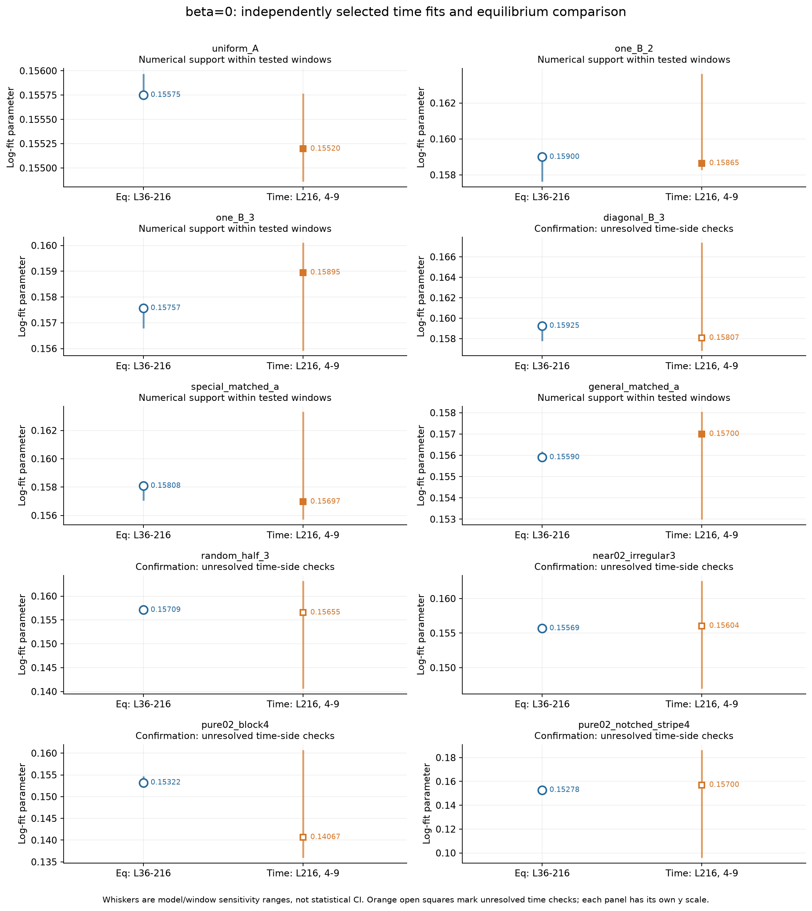

[PNG](figs_beta0_study/coefficient_comparison.png) · [PDF](figs_beta0_study/coefficient_comparison.pdf)


每个小图单独设置纵轴，便于看到该构型两端的差异，跨小图比较时须按各自纵轴标尺读取数值。蓝色空心圆表示平衡端，橙色方块表示非平衡端；区间来自模型与窗口变化，不是统计误差棒。橙色空心标记表示时间侧未稳定，即使两端位置接近也不算通过；实心仅代表时间检查通过，两端是否相容还须看表中结论。

### 这次怎样避免拟合出想要的答案

先冻结探索网格，完整得到 L=72、108 上 θ=1,1.5,…,10 的时间数据；根据时间侧覆盖和重叠诊断选定 10 个确认构型，再冻结确认网格。选取不使用与平衡系数的接近程度。两份计划及选取理由均保存。

| 检查 | 本次实际设置 |
|---|---|
| 平衡主拟合 | L=36–216，使用每个构型实际相容的尺寸网格；对数、常数、1/L 三项 |
| 平衡敏感性 | 改变下限：4×4 使用 36、48、72，其余使用 36、54、72；另加 1/L² 修正 |
| 时间主比较 | L=180、216，θ=4,4.5,…,9，共 11 个同点；主系数取 L=216 |
| 第三尺寸 | L=144、180、216，在 θ=4,4.5,…,7 的共同网格检查尺寸漂移是否递减 |
| 移窗 | 4–7、4–8、4–9、4.5–9、4–8.5、5–9、5–10；最后一个只在 L=216 作完整移窗检查 |
| 修正项 | 比较 1/θ、1/θ+1/θ²、1/θ+1/θ²+1/θ³；三阶模型至少 11 点才纳入正式阶数比较 |
| 时间尺度 | 拟合点须满足 θ≥4、θ/L≤0.05；探索扫描中不满足的点仅用于观察交叉和有限尺寸效应 |
| 时间侧门槛 | 主系数尺寸漂移≤2%；同点 D 差／拟合对数变化≤1%；移窗和阶数漂移≤5%；无变号、覆盖完整；第三尺寸检查中，180→216 的漂移≤2%且小于 144→180 的漂移 |

$$
D_{\rm eq}(L)=c_{\rm eq}\ln L+b+\frac dL,
\qquad
D_{\rm neq}(\theta)=c_{\rm neq}\ln\theta+b+\frac d\theta+\frac e{\theta^2}.
$$

θ/L 的数值预筛不是尺度分离定理：区域最窄宽度为 L/3，还要考虑速度。主窗口虽然由 7 点扩大为 11 点，仍只有 2.25 倍的时间跨度；因此同时展示原始相邻点对数斜率和同 θ 的尺寸差，不能仅看修正拟合线与数据贴合。**没有强制非平衡系数等于平衡值，也没有用文献值约束拟合。**

| 确认构型 | 尺寸漂移 | 同点 D 差 / 对数变化 | 阶数漂移 | 移窗漂移 | 平衡敏感性 |
|---|---:|---:|---:|---:|---:|
| [`uniform_A`](#beta0-uniform-A) | 0.39% | 0.02% | 0.37% | 0.17% | 0.14% |
| [`one_B_2`](#beta0-one-B-2) | 0.33% | 0.01% | 3.14% | 0.23% | 0.86% |
| [`one_B_3`](#beta0-one-B-3) | 0.37% | 0.01% | 1.90% | 0.88% | 0.49% |
| [`diagonal_B_3`](#beta0-diagonal-B-3) | 0.39% | 0.01% | 5.89% | 0.78% | 0.93% |
| [`special_matched_a`](#beta0-special-matched-a) | 0.35% | 0.01% | 4.05% | 0.80% | 0.65% |
| [`general_matched_a`](#beta0-general-matched-a) | 0.43% | 0.02% | 2.56% | 0.79% | 0.18% |
| [`random_half_3`](#beta0-random-half-3) | 6.12% | 0.47% | 10.18% | 6.60% | 0.20% |
| [`near02_irregular3`](#beta0-near02-irregular3) | 4.93% | 0.22% | 5.81% | 4.24% | 0.11% |
| [`pure02_block4`](#beta0-pure02-block4) | 0.64% | 0.03% | 14.28% | 3.59% | 0.94% |
| [`pure02_notched_stripe4`](#beta0-pure02-notched-stripe4) | 0.94% | 0.04% | 38.82% | 16.57% | 1.08% |

两个值得单独看的例子：random_half_3 的两端主值仅差 0.35%，但时间系数的尺寸漂移为 6.12%、阶数漂移为 10.18%，所以不能凭主值接近就确认；缺口条带的两端差为 2.76%，其阶数漂移却达到 38.82%。diagonal_B_3 则属于接近门槛的情况，主要问题是阶数漂移 5.89% 略高于预定 5%，不能把这个操作判定解读为突然出现了不同的物理类别。

### 为什么不能单看占据分类或基态可达性

能投影到基态只回答无限虚时极限是否落在基态子空间；它不控制进入临界时间区需要多久。不同构型在折叠动量空间的最小重叠可以差很多，有能隙模式也可能因初始重叠很小而衰减得很晚。本次独立诊断还检查了 Dirac 附近的有效边界子空间：它由整个超胞决定，不能用 A/B 总数或空／双占计数替代。详细推导、数值扫描及它们的局限放在[β=0 初态判断指南](SCALING_GUIDE.md#beta0-initial-state)。**目前不能把“可达基态”直接升级成“当前 θ 窗口必有相同角系数”，也没有把未稳定构型认定为渐近反例。**

### 全部左右 scaling 图与时间诊断

每张图左侧为原始 D 对 ln L，蓝色实线为平衡拟合；右侧为原始 D 对 ln θ，彩色实线连接原始观测，黑色虚线为时间拟合。拟合线只绘制在所标窗口内。确认组统一使用上述大尺寸网格；仅探索组明确标注 pilot，其右侧保留已有尺寸的原始曲线，并标明缺少统一的大尺寸拟合，不能与确认组等同。各构型下的时间诊断图显示不依赖平衡目标的相邻对数斜率与同时间尺寸差。诊断右图的尺寸差按对应尺寸对、所标窗口的大尺寸原始 D 跨度归一化，各尺寸对分母分别计算。

<a id="beta0-uniform-A"></a>
#### uniform_A

**有限窗口支持一致。** 平衡敏感性范围：[0.1557508, 0.1559708]；时间敏感性范围：[0.1548616, 0.1557667]。

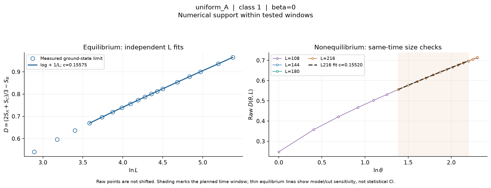

[PNG](figs_beta0_study/uniform_A_scaling.png) · [PDF](figs_beta0_study/uniform_A_scaling.pdf)


[原始斜率与尺寸差 PNG](figs_beta0_study/uniform_A_time_diagnostics.png) · [PDF](figs_beta0_study/uniform_A_time_diagnostics.pdf)

<a id="beta0-one-B-2"></a>
#### one_B_2

**有限窗口支持一致。** 平衡敏感性范围：[0.1576357, 0.1589958]；时间敏感性范围：[0.158279, 0.1636343]。

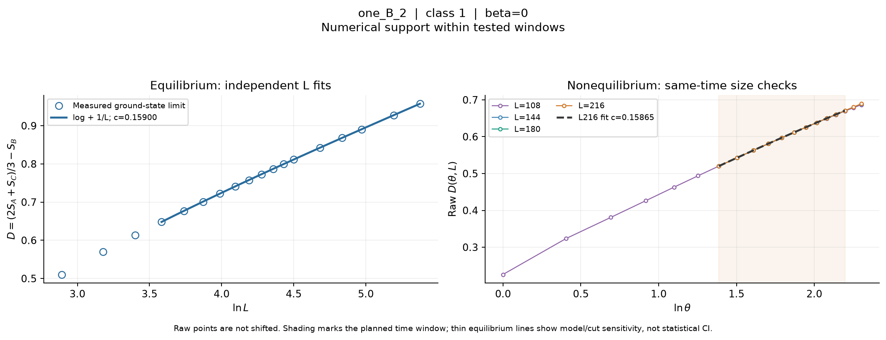

[PNG](figs_beta0_study/one_B_2_scaling.png) · [PDF](figs_beta0_study/one_B_2_scaling.pdf)


[原始斜率与尺寸差 PNG](figs_beta0_study/one_B_2_time_diagnostics.png) · [PDF](figs_beta0_study/one_B_2_time_diagnostics.pdf)

<a id="beta0-one-B-3"></a>
#### one_B_3

**有限窗口支持一致。** 平衡敏感性范围：[0.1567916, 0.157568]；时间敏感性范围：[0.1559256, 0.1601065]。


[PNG](figs_beta0_study/one_B_3_scaling.png) · [PDF](figs_beta0_study/one_B_3_scaling.pdf)


[原始斜率与尺寸差 PNG](figs_beta0_study/one_B_3_time_diagnostics.png) · [PDF](figs_beta0_study/one_B_3_time_diagnostics.pdf)

<a id="beta0-two-B-3"></a>
#### two_B_3

**仅探索，缺大尺寸确认。** 平衡敏感性范围：[0.1574333, 0.1588176]。

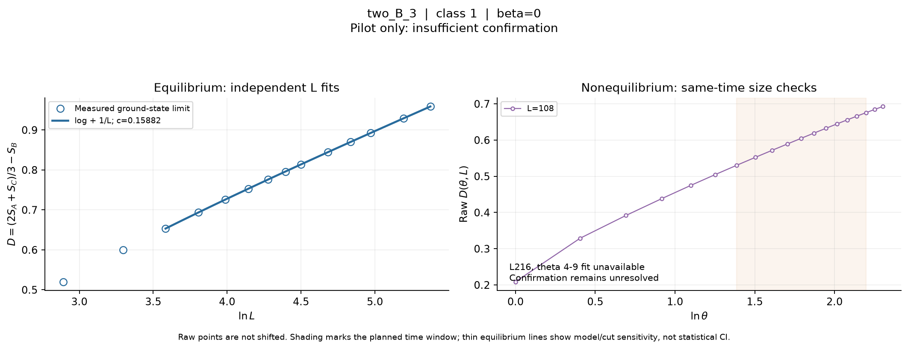

[PNG](figs_beta0_study/two_B_3_scaling.png) · [PDF](figs_beta0_study/two_B_3_scaling.pdf)


[原始斜率与尺寸差 PNG](figs_beta0_study/two_B_3_time_diagnostics.png) · [PDF](figs_beta0_study/two_B_3_time_diagnostics.pdf)

<a id="beta0-diagonal-B-3"></a>
#### diagonal_B_3

**确认网格已齐，时间侧未稳定。** 平衡敏感性范围：[0.1577669, 0.159249]；时间敏感性范围：[0.1568439, 0.1673843]。

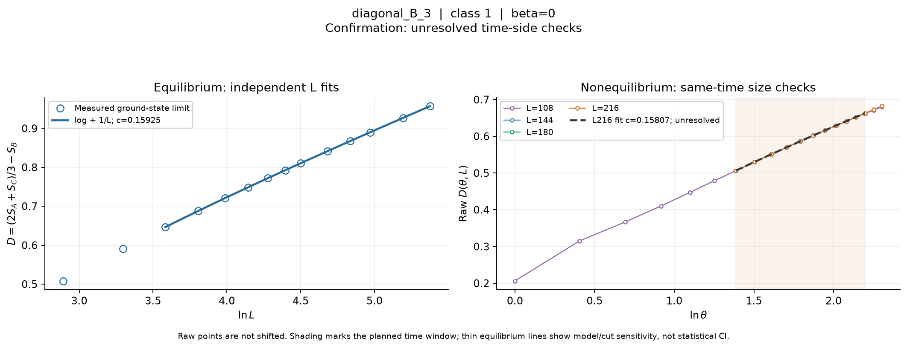

[PNG](figs_beta0_study/diagonal_B_3_scaling.png) · [PDF](figs_beta0_study/diagonal_B_3_scaling.pdf)


[原始斜率与尺寸差 PNG](figs_beta0_study/diagonal_B_3_time_diagnostics.png) · [PDF](figs_beta0_study/diagonal_B_3_time_diagnostics.pdf)

<a id="beta0-special-matched-a"></a>
#### special_matched_a

**有限窗口支持一致。** 平衡敏感性范围：[0.1570631, 0.1580849]；时间敏感性范围：[0.1557093, 0.1633183]。

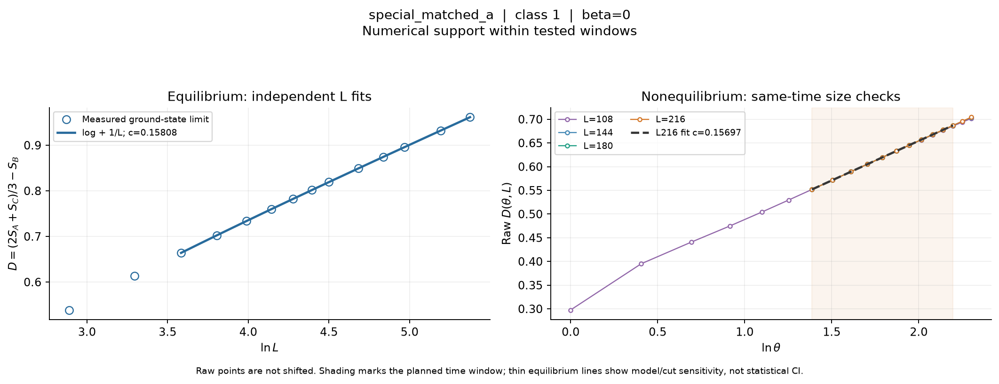

[PNG](figs_beta0_study/special_matched_a_scaling.png) · [PDF](figs_beta0_study/special_matched_a_scaling.pdf)


[原始斜率与尺寸差 PNG](figs_beta0_study/special_matched_a_time_diagnostics.png) · [PDF](figs_beta0_study/special_matched_a_time_diagnostics.pdf)

<a id="beta0-special-matched-b"></a>
#### special_matched_b

**仅探索，缺大尺寸确认。** 平衡敏感性范围：[0.1573599, 0.1583244]。

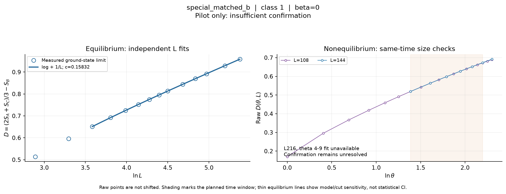

[PNG](figs_beta0_study/special_matched_b_scaling.png) · [PDF](figs_beta0_study/special_matched_b_scaling.pdf)


[原始斜率与尺寸差 PNG](figs_beta0_study/special_matched_b_time_diagnostics.png) · [PDF](figs_beta0_study/special_matched_b_time_diagnostics.pdf)

<a id="beta0-general-matched-a"></a>
#### general_matched_a

**有限窗口支持一致。** 平衡敏感性范围：[0.1559045, 0.1561873]；时间敏感性范围：[0.1529839, 0.1580456]。

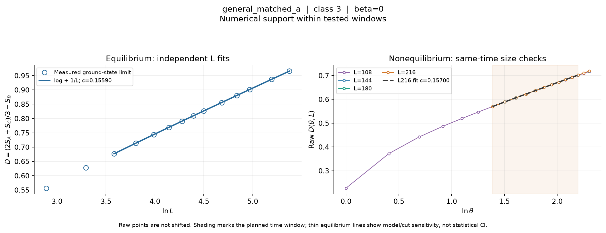

[PNG](figs_beta0_study/general_matched_a_scaling.png) · [PDF](figs_beta0_study/general_matched_a_scaling.pdf)


[原始斜率与尺寸差 PNG](figs_beta0_study/general_matched_a_time_diagnostics.png) · [PDF](figs_beta0_study/general_matched_a_time_diagnostics.pdf)

<a id="beta0-general-matched-b"></a>
#### general_matched_b

**仅探索，缺大尺寸确认。** 平衡敏感性范围：[0.157322, 0.1582251]。


[PNG](figs_beta0_study/general_matched_b_scaling.png) · [PDF](figs_beta0_study/general_matched_b_scaling.pdf)


[原始斜率与尺寸差 PNG](figs_beta0_study/general_matched_b_time_diagnostics.png) · [PDF](figs_beta0_study/general_matched_b_time_diagnostics.pdf)

<a id="beta0-random-half-3"></a>
#### random_half_3

**确认网格已齐，时间侧未稳定。** 平衡敏感性范围：[0.1567827, 0.1570898]；时间敏感性范围：[0.1406132, 0.1632017]。

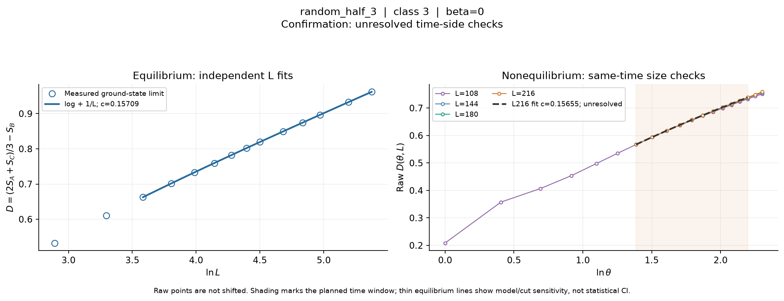

[PNG](figs_beta0_study/random_half_3_scaling.png) · [PDF](figs_beta0_study/random_half_3_scaling.pdf)


[原始斜率与尺寸差 PNG](figs_beta0_study/random_half_3_time_diagnostics.png) · [PDF](figs_beta0_study/random_half_3_time_diagnostics.pdf)

<a id="beta0-full-empty-cluster3"></a>
#### full_empty_cluster3

**仅探索，缺大尺寸确认。** 平衡敏感性范围：[0.1548772, 0.1551655]。

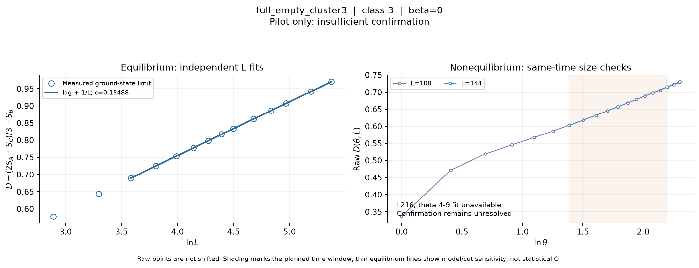

[PNG](figs_beta0_study/full_empty_cluster3_scaling.png) · [PDF](figs_beta0_study/full_empty_cluster3_scaling.pdf)


[原始斜率与尺寸差 PNG](figs_beta0_study/full_empty_cluster3_time_diagnostics.png) · [PDF](figs_beta0_study/full_empty_cluster3_time_diagnostics.pdf)

<a id="beta0-near02-irregular3"></a>
#### near02_irregular3

**确认网格已齐，时间侧未稳定。** 平衡敏感性范围：[0.155691, 0.1558569]；时间敏感性范围：[0.1469648, 0.162571]。


[PNG](figs_beta0_study/near02_irregular3_scaling.png) · [PDF](figs_beta0_study/near02_irregular3_scaling.pdf)


[原始斜率与尺寸差 PNG](figs_beta0_study/near02_irregular3_time_diagnostics.png) · [PDF](figs_beta0_study/near02_irregular3_time_diagnostics.pdf)

<a id="beta0-pure02-block4"></a>
#### pure02_block4

**确认网格已齐，时间侧未稳定。** 平衡敏感性范围：[0.1532204, 0.1546596]；时间敏感性范围：[0.1359727, 0.1607581]。

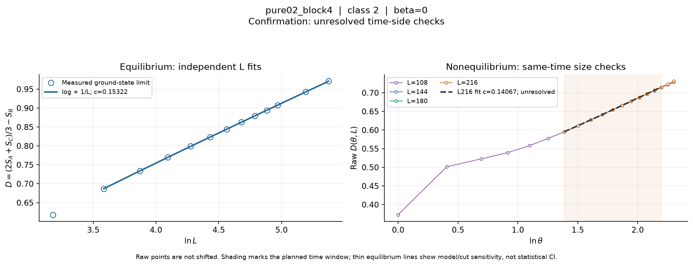

[PNG](figs_beta0_study/pure02_block4_scaling.png) · [PDF](figs_beta0_study/pure02_block4_scaling.pdf)


[原始斜率与尺寸差 PNG](figs_beta0_study/pure02_block4_time_diagnostics.png) · [PDF](figs_beta0_study/pure02_block4_time_diagnostics.pdf)

<a id="beta0-pure02-irregular4"></a>
#### pure02_irregular4

**仅探索，缺大尺寸确认。** 平衡敏感性范围：[0.1517899, 0.1539078]。

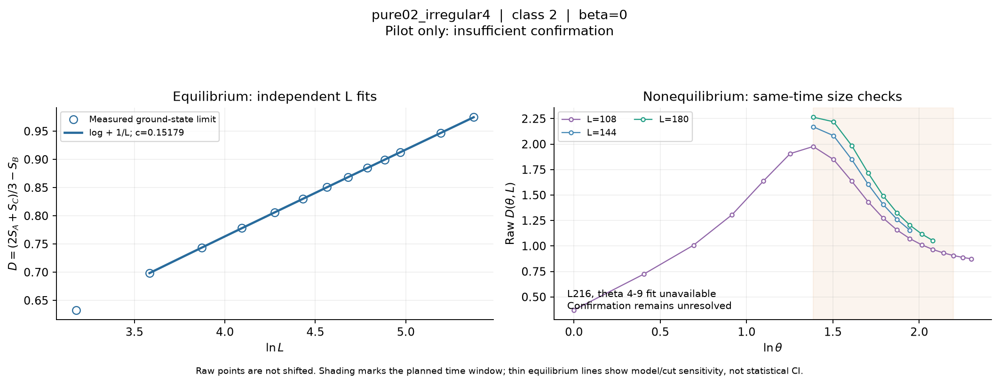

[PNG](figs_beta0_study/pure02_irregular4_scaling.png) · [PDF](figs_beta0_study/pure02_irregular4_scaling.pdf)


[原始斜率与尺寸差 PNG](figs_beta0_study/pure02_irregular4_time_diagnostics.png) · [PDF](figs_beta0_study/pure02_irregular4_time_diagnostics.pdf)

<a id="beta0-pure02-staircase4"></a>
#### pure02_staircase4

**仅探索，缺大尺寸确认。** 平衡敏感性范围：[0.1524626, 0.1542427]。

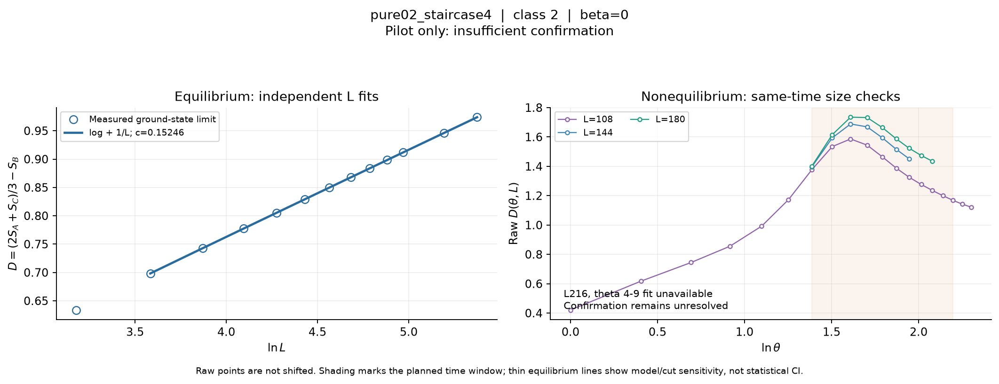

[PNG](figs_beta0_study/pure02_staircase4_scaling.png) · [PDF](figs_beta0_study/pure02_staircase4_scaling.pdf)


[原始斜率与尺寸差 PNG](figs_beta0_study/pure02_staircase4_time_diagnostics.png) · [PDF](figs_beta0_study/pure02_staircase4_time_diagnostics.pdf)

<a id="beta0-pure02-notched-stripe4"></a>
#### pure02_notched_stripe4

**确认网格已齐，时间侧未稳定。** 平衡敏感性范围：[0.1527847, 0.1544334]；时间敏感性范围：[0.09606022, 0.1864792]。

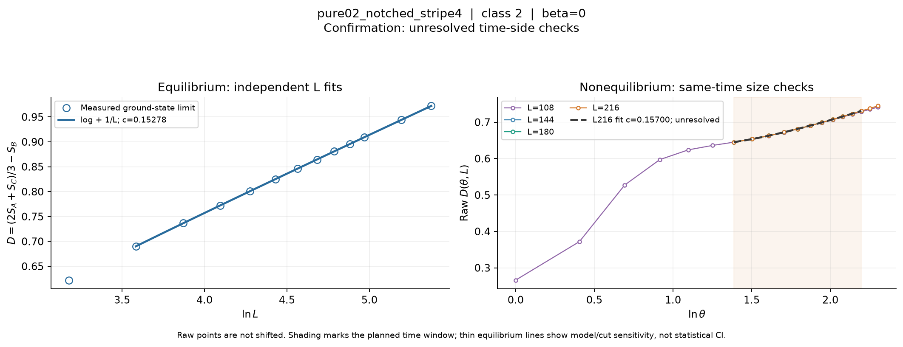

[PNG](figs_beta0_study/pure02_notched_stripe4_scaling.png) · [PDF](figs_beta0_study/pure02_notched_stripe4_scaling.pdf)


[原始斜率与尺寸差 PNG](figs_beta0_study/pure02_notched_stripe4_time_diagnostics.png) · [PDF](figs_beta0_study/pure02_notched_stripe4_time_diagnostics.pdf)

### 数据来源与独立复核

本次实际新增 **530 个观测**；两份冻结计划合计 **950 个参数键全部齐全**，其中 420 个复用已有数据。包括旧库后共有 2075 个唯一 β=0 点，逐点来源、代码快照和计划哈希均保留。独立实空间实现核验了 99 个小系统状态，D 的最大差为 3.66e-13；最终另外用 80 位 QR 重算 1923 组拟合并检查原始斜率、实际网格和判定标签。审计 PASS 表示计算与报告可复核，不表示全部构型都具有稳定 scaling。

[两端主系数](analysis_beta0_study/primary_coefficients.csv) · [合并观测](analysis_beta0_study/study_observations.csv) · [探索计划](analysis_beta0_study/study_design.json) · [确认计划及选择理由](analysis_beta0_study/confirmation_plan.json) · [数据核验](analysis_beta0_study/final_data_validation.json) · [独立拟合核验](analysis_beta0_study/fit_validation.json) · [物理诊断](analysis_beta0_study/physics_summary.json)。

从仓库根目录重做分析与更新本节（读取已完成观测，不重新跑 Julia）：

```powershell
python src/Measure/ai/validate_beta0_study_completion.py
python src/Measure/ai/analyze_beta0_study.py --stage final --plots
python src/Measure/ai/validate_beta0_study_fits.py
python src/Measure/ai/write_results_report.py --sections BETA0_STUDY
```

原始计算的两份冻结任务表和运行参数可按下列命令使用；已有参数键会跳过。逐点记录见[探索运行日志](data/beta0_study_pilot.log)、[确认运行日志](data/beta0_study_confirmation.log)，代码快照和精确参数见同目录 run TOML。

```powershell
julia --startup-file=no src/Measure/ai/beta0_study_experiments.jl --mode=run --backend=openblas --threads=8 --strip-threads=1 --require-ground=true --job-file=src/Measure/ai/analysis_beta0_study/pilot_jobs.csv --plan=src/Measure/ai/analysis_beta0_study/study_design.json
julia --startup-file=no src/Measure/ai/beta0_study_experiments.jl --mode=run --backend=openblas --threads=8 --strip-threads=1 --require-ground=true --job-file=src/Measure/ai/analysis_beta0_study/confirmation_jobs.csv --plan=src/Measure/ai/analysis_beta0_study/confirmation_plan.json
```

两份任务表只列本次需要新增的点，复用的旧点及其来源保存在相邻 reused CSV 中；完整复现还须保留这些旧源文件。

<!-- GENERATED_BETA0_STUDY_END -->

## 此前 β 扫描的共同口径

采用周期 HoneyComb120、实数等强最近邻 hopping、半填充、**单种费米子、自然对数 Rényi-2 熵**。“平衡”指先投影到基态再测量；“非平衡”指有限 θ 演化后再测量。各构型均测量自身初始空位，权重为 exp(−2β)。更换构型也更换测量图案，正 β 下不同构型的系数不必相同。测量后态不要求是原 Hamiltonian 的基态。

两方向条带分别计算。主拟合采用各点等权最小二乘：

$$
D=\frac{2S_2(A)+S_2(C)}3-S_2(B),\qquad
D_{\rm eq}(L)=c_{\rm eq}\ln L+b+\frac dL,
$$

$$
D_{\rm neq}(\theta)=c_{\rm neq}\ln\theta+b+\frac d\theta+\frac e{\theta^2}.
$$

| 项目 | 网格及检查 |
|---|---|
| 平衡 / 可达极限 | uniform A 与 one_B_2：L=18,24,…,90,108,126,144；diagonal_B_3、random_half_3、general_matched_a 及 near02_irregular3：L=18,27,…,90,108,126,144。以上检查下限 18、36、54；第二类四个可达 4×4 构型使用 L=24,36,…,144，检查下限 24、36、48。两种受阻交替态使用 18,24,…,90,108,126,144，但该极限不是基态。各组另检查逆平方修正。 |
| 非平衡主窗口 | L=180、θ=4,4.5,…,7；L=144 在相同时间点检查尺寸。全部 β 另有 L=180 的 5–8 移窗。 |
| 第三尺寸 | uniform A 的 β=0、1；另三构型的 β=0、1、2 补到 L=216，后三者还检查 6–9 窗口。 |
| 尺度预筛 | θ≥4 且 θ/L≤0.05。只是操作筛选，不能单独证明微观时间与有限系统尺度充分分离，还需考虑最窄宽度 L/3 及速度。 |
| 时间侧局部门槛 | 系数尺寸漂移≤2%；同点 D 差/拟合对数变化≤1%；移窗和阶数漂移≤5%；无变号、检查齐全。有第三尺寸时另要求漂移≤2%且递减。 |

主时间窗只跨越 1.75 倍，五参数诊断仅两个残差自由度。局部通过不能替代平衡侧稳定性检查，也不是渐近证明。**窗口不按“更接近平衡系数”选择。**

scaling 图横轴直接显示 ln L / ln θ，纵轴为未平移的 D，拟合线只覆盖实际窗口。β 曲线中蓝色粗实线、大空心圆表示平衡端；橙色虚线、小方块表示有限时间端，重合时仍可区分。可达构型的橙色实心方块表示局部通过，空心表示未稳定；蓝色空心圆仅区分系列。两种受阻交替态的蓝色曲线表示可达激发态极限，其橙色方块始终空心，同时保留投影受阻的物理标签，不能只按数值门槛是否通过解读。阴影是模型/窗口敏感性范围，**不是统计置信区间**。相对差为

$$
\delta_c=\frac{c_{\rm neq}-c_{\rm eq}}{|c_{\rm eq}|}.
$$

<a id="results-occupancy-classes"></a>
## 按三类整理：九个可达构型与 2×2 交替受阻对照

<!-- GENERATED_OCCUPANCY_CLASSES_START -->

本节统一按原胞占据分类：第 1 类两个可达例，第 2 类四个 4×4 可达例并补充全部六种 2×2 受阻排列，第 3 类三个可达例（包括新增的 `near02_irregular3`）。首批七个可达例每个计算 9 个 β（0、0.25、…、2），共 63 组两端主拟合参数和 35 张左右拟合图。**本次另增两个可达 4×4 构型和两种 2×2 交替构型，每个计算 5 个 β，共 590 个新观测点、20 张左右拟合图。** 现在共九个可达构型；两种交替构型的熵也实际计算，但其严格长时极限是激发态，不能计入基态角系数。

原六构型计划的 **1,530 个参数键全部齐全**，其中该批新增观测 CSV 共 **738 行**；`one_B_2`、`diagonal_B_3`、`random_half_3` 复用上一批已有观测，保留逐行来源；新增 3×3 混合构型另有 252 个完整参数点，采用独立的冻结计划与核验记录。每构型展示 β=0、0.5、1、1.5、2；首批九个 β 的系数均收入曲线和完整数据表。[第二类新增四构型及交替结果](#occupancy-second-class-extra) 单列本次五个 β 的全量结果。

### 首批七个可达构型的示意图与索引

[第一类](#occupancy-class-1) · [第二类](#occupancy-class-2) · [第二类新增四构型](#occupancy-second-class-extra) · [第二类 2×2 受阻证明](#occupancy-pure02-m2-blocked) · [第三类](#occupancy-class-3)

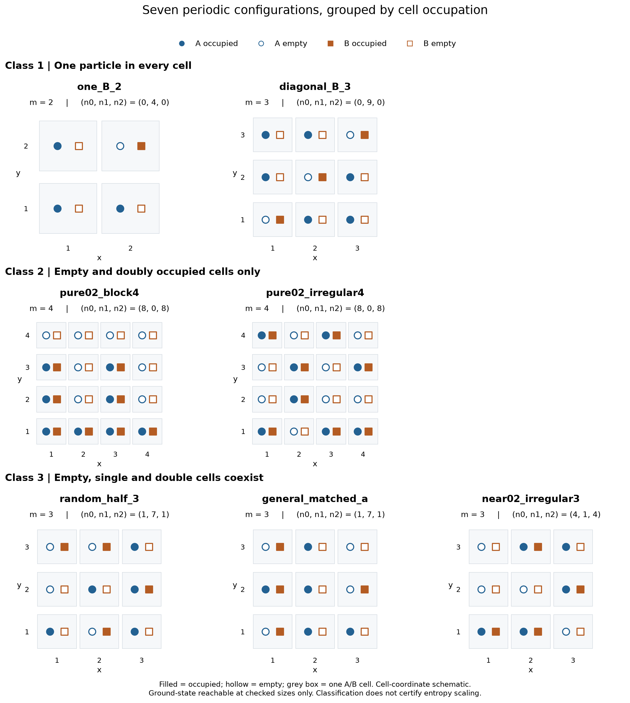

[PNG](figures_pure02_m2/classified_ground_patterns.png) · [PDF](figures_pure02_m2/classified_ground_patterns.pdf)


每个灰框表示一个原胞，蓝圆为 A、橙方为 B；实心表示占据，空心表示空位。每行对应一类，图中 n0、n1、n2 为一个超胞内空、单占、双占原胞的数量。这是原胞坐标示意图，整个系统按超胞周期重复；不是蜂窝晶格的实际键角图。[精确构型定义](occupancy_classes_patterns.jl) · [基态可达性与判据](SCALING_GUIDE.md#patterns)。下表点击构型名可跳到它的系数曲线和全部五组拟合图。受阻的 2×2 图案另在第二类展开，它们不在这张可达图中。

| 类别 | 构型 | 超胞 | 空 / 单占 / 双占原胞数 | 平衡主窗口 | 尺寸下限检查 |
|---|---|---:|---:|---|---|
| 1：每个原胞恰有一个粒子 | [one_B_2](#occupancy-one-B-2) | 2×2 | 0 / 4 / 0 | L=18–144 | 18、36、54 |
| 1：每个原胞恰有一个粒子 | [diagonal_B_3](#occupancy-diagonal-B-3) | 3×3 | 0 / 9 / 0 | L=18–144 | 18、36、54 |
| 2：只含空原胞和双占原胞 | [pure02_block4](#occupancy-pure02-block4) | 4×4 | 8 / 0 / 8 | L=24–144 | 24、36、48 |
| 2：只含空原胞和双占原胞 | [pure02_irregular4](#occupancy-pure02-irregular4) | 4×4 | 8 / 0 / 8 | L=24–144 | 24、36、48 |
| 3：单占、空、双占原胞混合 | [random_half_3](#occupancy-random-half-3) | 3×3 | 1 / 7 / 1 | L=18–144 | 18、36、54 |
| 3：单占、空、双占原胞混合 | [general_matched_a](#occupancy-general-matched-a) | 3×3 | 1 / 7 / 1 | L=18–144 | 18、36、54 |
| 3：单占、空、双占原胞混合 | [near02_irregular3](#occupancy-near02-irregular3) | 3×3 | 4 / 1 / 4 | L=18–144 | 18、36、54 |

<details>
<summary>拟合模型、尺寸与时间窗口</summary>

这里分类依据是每个原胞两个格点的总占据：

$$
n_{\rm cell}=n_A+n_B.
$$

两个 4×4 构型的平衡网格为 L=24,36,…,144，图和表均标注实际的 24–144 窗口；该网格保证尺寸与超胞、切口相位相容。其余构型使用各自的 18–144 网格。平衡主模型为对数加常数与逆尺寸修正，并检查不同下限及逆平方修正：

$$
D_{\rm eq}(L)=c_{\rm eq}\ln L+b+\frac dL,
\qquad
D_{\rm eq}^{(2)}(L)=c_{\rm eq}\ln L+b+\frac dL+\frac e{L^2}.
$$

非平衡仍固定使用 L=180、θ=4,4.5,…,7 的四参数主模型，并以 L=144 的同点网格检查尺寸：

$$
D_{\rm neq}(\theta)=c_{\rm neq}\ln\theta+b+\frac d\theta+\frac e{\theta^2},
\qquad
\theta\geq4,\quad\frac{\theta}{L}\leq0.05.
$$

比较含一、二、三阶逆时间修正的三、四、五参数模型及预定子窗口。全部 β 另有 L=180 的 5–8 移窗；这不等于 L=144、180 都具备满足预筛的完整 5–8 同点尺寸对照。旧数据中存在的额外第三尺寸和窗口保留为诊断，因此每个构型、每个 β 的检查覆盖不完全相同。

这些是操作尺度筛选和有限窗口估计；主窗口只跨越 1.75 倍，不能据此证明真正渐近区已经达到。所有窗口均不按与平衡系数的接近程度选择，也不假设两方向条带熵相等。图中阴影是**模型和窗口敏感性范围，不是统计置信区间**；未稳定的正、负估计均保留。

</details>


### 首批七个可达构型的系数随 β 变化：总览

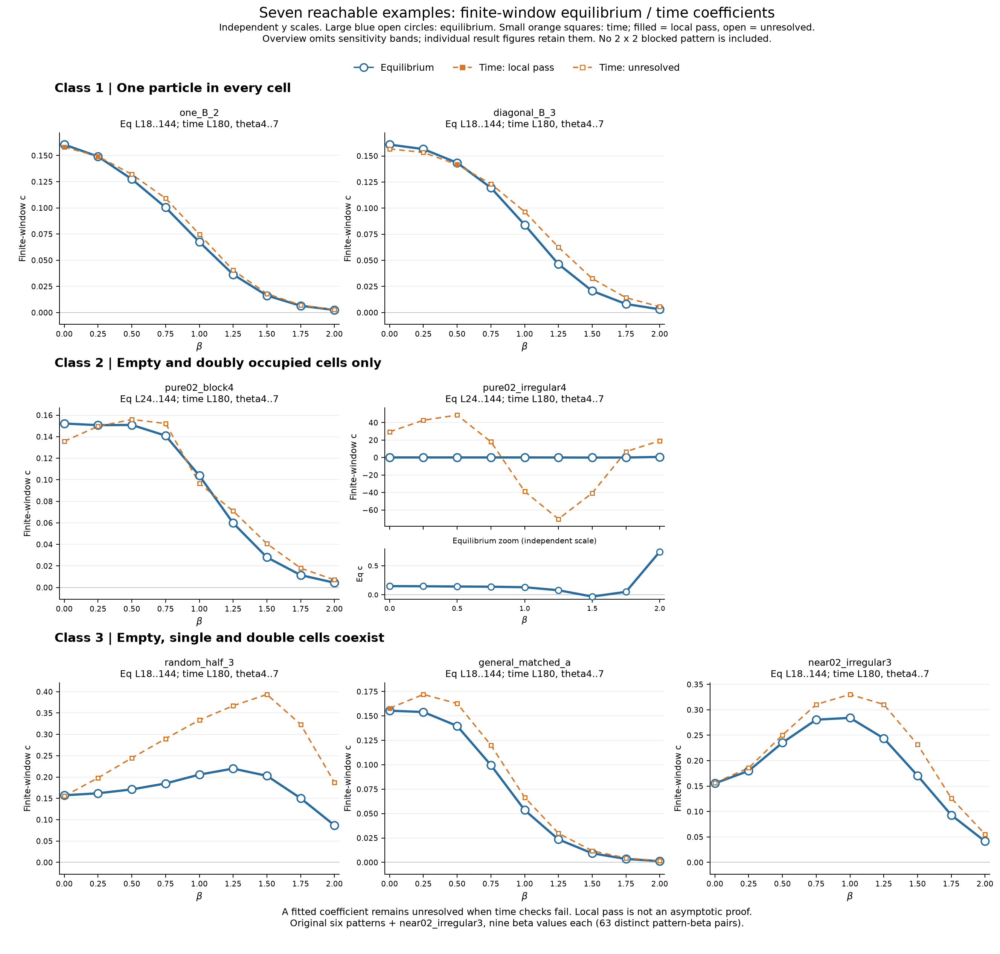

[PNG](figures_pure02_m2/classified_ground_coefficients.png) · [PDF](figures_pure02_m2/classified_ground_coefficients.pdf)


总览每行对应一类，**各 panel 采用独立纵轴范围**，比较大小时需读刻度。蓝色粗实线与大空心圆表示平衡，橙色虚线与小方块表示非平衡；重合处仍可区分。实心/空心非平衡方块表示时间侧局部检查通过/未稳定，蓝色空心圆仅区分系列。总览省略敏感性阴影，完整范围见各构型单图和诊断图。时间主估计幅度超过平衡的十倍时，另附平衡曲线放大面板；原面板仍保留完整正负范围。

| 构型 | 时间侧局部通过的 β | 其中仅有两尺寸检查的 β | β=2 平衡敏感性范围 |
|---|---|---|---|
| `one_B_2` | 0、0.25 | 0.25 | [0.002451172, 0.002472039] |
| `diagonal_B_3` | 0.5 | 0.5 | [0.003108257, 0.003345461] |
| `pure02_block4` | 无 | 无 | [0.004420536, 0.004588296] |
| `pure02_irregular4` | 无 | 无 | [-1.00382, 0.743683] |
| `random_half_3` | 无 | 无 | [0.08563344, 0.08906554] |
| `general_matched_a` | 0 | 0 | [0.001303397, 0.001313401] |
| `near02_irregular3` | 无 | 无 | [0.04143673, 0.04440884] |

局部通过只说明当前时间侧检查没有发现超门槛变化，不认证平衡侧已收敛，更不证明两端渐近角系数相等。**未稳定的有限窗口差异不能当成反例。** 本表和全部图报告的是加权 D 的拟合系数；原始矩形熵的对数项还可能含非角贡献，不能未经检查就把二者等同或简单除以角数。

β=0 时七个平衡主估计位于 **0.1502494–0.1608675**。本轮不将这点有限尺寸差异解释为不同普适值：周期系统的零模占据由各自初态选定，当前有限 L 拟合也未消除全部尺寸修正。

**下面按类别逐一展开全部拟合图。** 每个构型先给出两端系数随 β 的变化，再依次给出 β=0、0.5、1、1.5、2 的数据和拟合。每张左右图的**左侧是平衡 D 对 ln L，右侧是非平衡 D 对 ln θ**；右侧同时显示 L=144、180 的数据，橙线是 L=180、θ=4–7 的主拟合。拟合含逆尺度修正，所以在对数横轴上不一定是直线；`unresolved` 表示时间侧检查未通过。

<a id="occupancy-class-1"></a>

### 第 1 类：每个原胞恰有一个粒子

<a id="occupancy-one-B-2"></a>

#### one_B_2

超胞 2×2；空 / 单占 / 双占原胞数为 0 / 4 / 0。时间侧局部通过的 β：**0、0.25**。 两端主系数随 β 增大而下降；曲线接近还需结合时间侧检查判断。

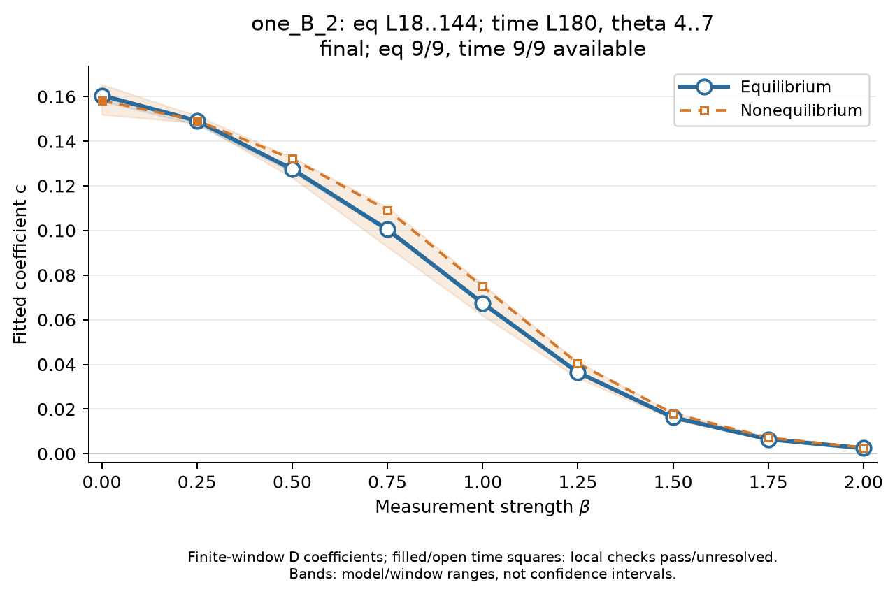

[PNG](figures_occupancy_classes/one_B_2_corner_coefficient_beta.png) · [PDF](figures_occupancy_classes/one_B_2_corner_coefficient_beta.pdf)


[敏感性、比值及相对差诊断 PNG](figures_occupancy_classes/one_B_2_coefficient_diagnostics.png) · [PDF](figures_occupancy_classes/one_B_2_coefficient_diagnostics.pdf)

##### one_B_2，β=0：左平衡，右非平衡

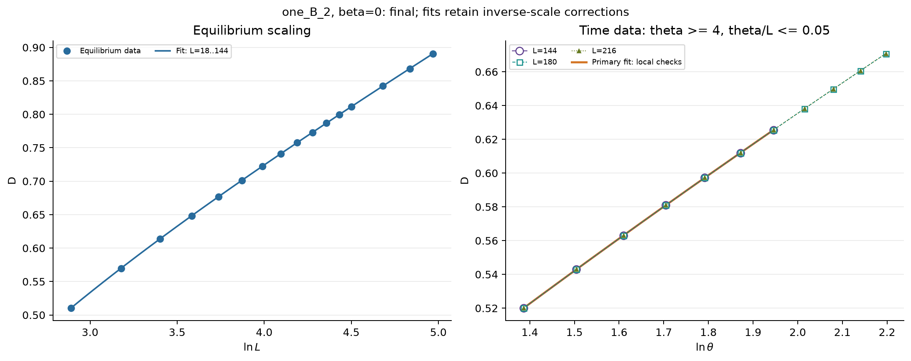

[PNG](figures_occupancy_classes/one_B_2_scaling_beta_0.png) · [PDF](figures_occupancy_classes/one_B_2_scaling_beta_0.pdf)


##### one_B_2，β=0.5：左平衡，右非平衡

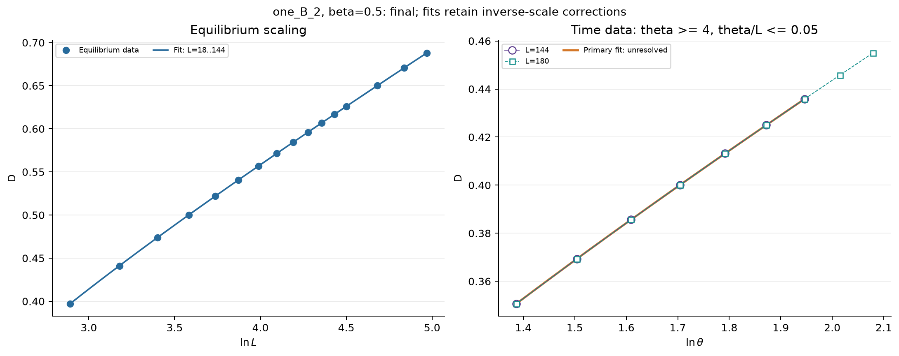

[PNG](figures_occupancy_classes/one_B_2_scaling_beta_0p5.png) · [PDF](figures_occupancy_classes/one_B_2_scaling_beta_0p5.pdf)


##### one_B_2，β=1：左平衡，右非平衡

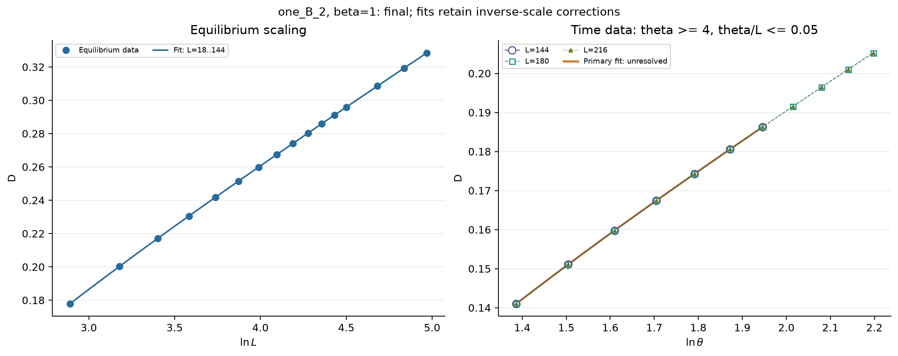

[PNG](figures_occupancy_classes/one_B_2_scaling_beta_1.png) · [PDF](figures_occupancy_classes/one_B_2_scaling_beta_1.pdf)


##### one_B_2，β=1.5：左平衡，右非平衡

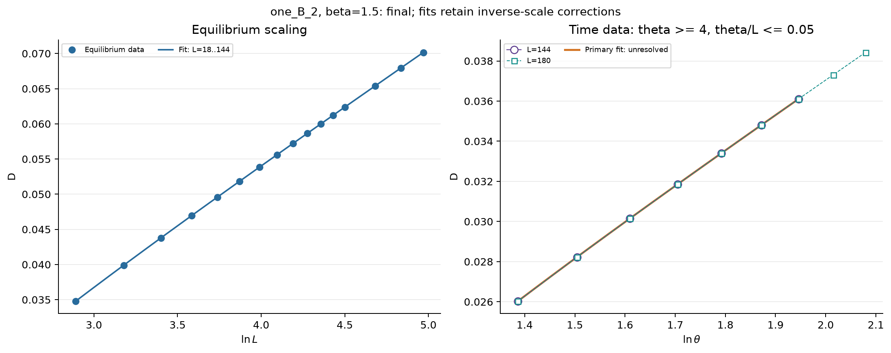

[PNG](figures_occupancy_classes/one_B_2_scaling_beta_1p5.png) · [PDF](figures_occupancy_classes/one_B_2_scaling_beta_1p5.pdf)


##### one_B_2，β=2：左平衡，右非平衡

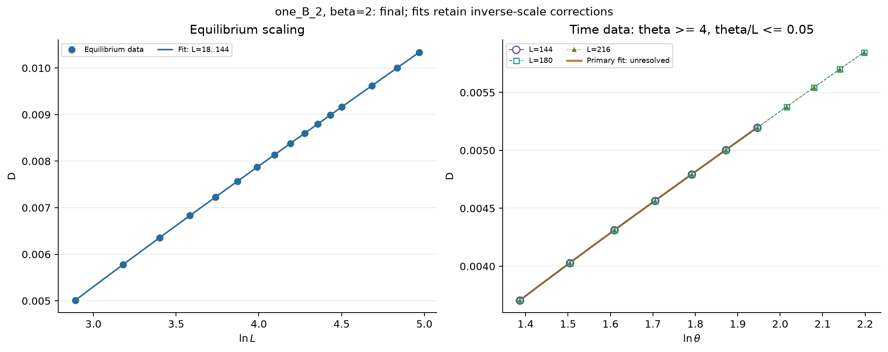

[PNG](figures_occupancy_classes/one_B_2_scaling_beta_2.png) · [PDF](figures_occupancy_classes/one_B_2_scaling_beta_2.pdf)


[返回三类构型索引](#results-occupancy-classes)

<a id="occupancy-diagonal-B-3"></a>

#### diagonal_B_3

超胞 3×3；空 / 单占 / 双占原胞数为 0 / 9 / 0。时间侧局部通过的 β：**0.5**。 两端主系数随 β 增大而下降；只有 β=0.5 通过当前时间侧局部检查。

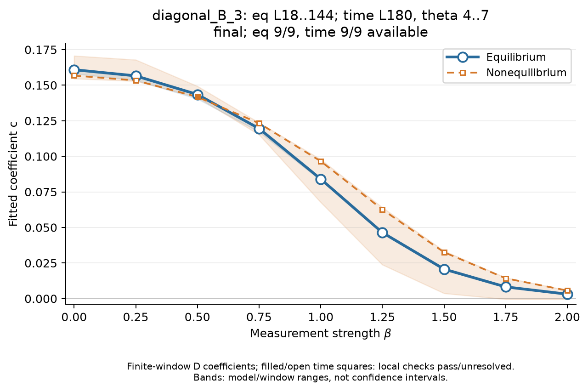

[PNG](figures_occupancy_classes/diagonal_B_3_corner_coefficient_beta.png) · [PDF](figures_occupancy_classes/diagonal_B_3_corner_coefficient_beta.pdf)


[敏感性、比值及相对差诊断 PNG](figures_occupancy_classes/diagonal_B_3_coefficient_diagnostics.png) · [PDF](figures_occupancy_classes/diagonal_B_3_coefficient_diagnostics.pdf)

##### diagonal_B_3，β=0：左平衡，右非平衡

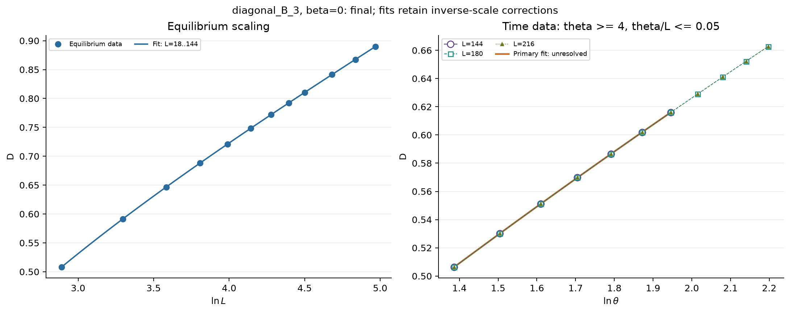

[PNG](figures_occupancy_classes/diagonal_B_3_scaling_beta_0.png) · [PDF](figures_occupancy_classes/diagonal_B_3_scaling_beta_0.pdf)


##### diagonal_B_3，β=0.5：左平衡，右非平衡


[PNG](figures_occupancy_classes/diagonal_B_3_scaling_beta_0p5.png) · [PDF](figures_occupancy_classes/diagonal_B_3_scaling_beta_0p5.pdf)


##### diagonal_B_3，β=1：左平衡，右非平衡

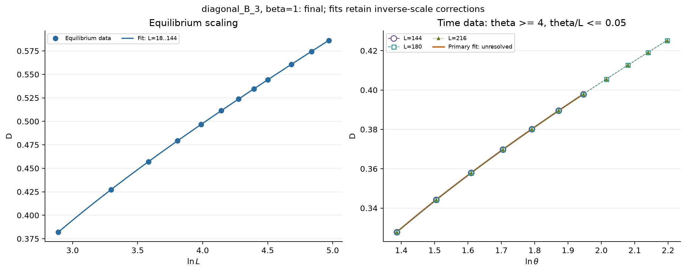

[PNG](figures_occupancy_classes/diagonal_B_3_scaling_beta_1.png) · [PDF](figures_occupancy_classes/diagonal_B_3_scaling_beta_1.pdf)


##### diagonal_B_3，β=1.5：左平衡，右非平衡

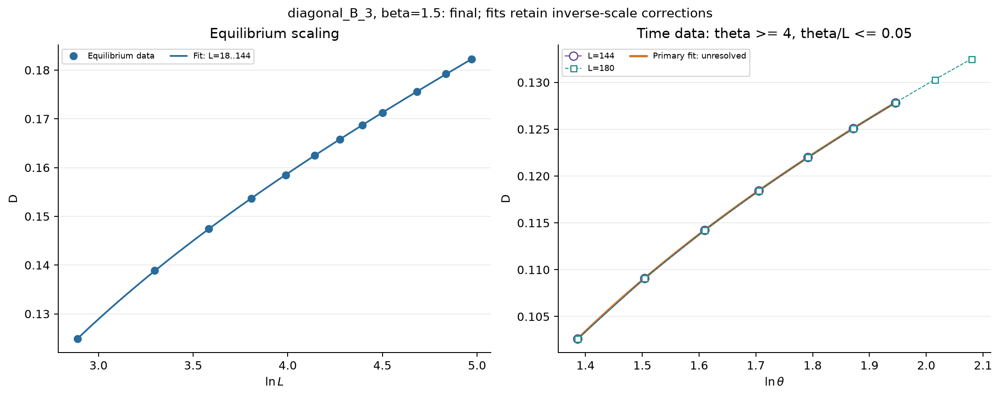

[PNG](figures_occupancy_classes/diagonal_B_3_scaling_beta_1p5.png) · [PDF](figures_occupancy_classes/diagonal_B_3_scaling_beta_1p5.pdf)


##### diagonal_B_3，β=2：左平衡，右非平衡

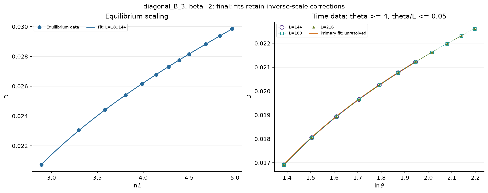

[PNG](figures_occupancy_classes/diagonal_B_3_scaling_beta_2.png) · [PDF](figures_occupancy_classes/diagonal_B_3_scaling_beta_2.pdf)


[返回三类构型索引](#results-occupancy-classes)

<a id="occupancy-class-2"></a>

### 第 2 类：只含空原胞和双占原胞

<a id="occupancy-pure02-block4"></a>

#### pure02_block4

超胞 4×4；空 / 单占 / 双占原胞数为 8 / 0 / 8。时间侧局部通过的 β：**无**。 平衡主值在小 β 近似平台后下降，非平衡主值先有浅峰再下降；九个 β 的时间侧检查均未通过。

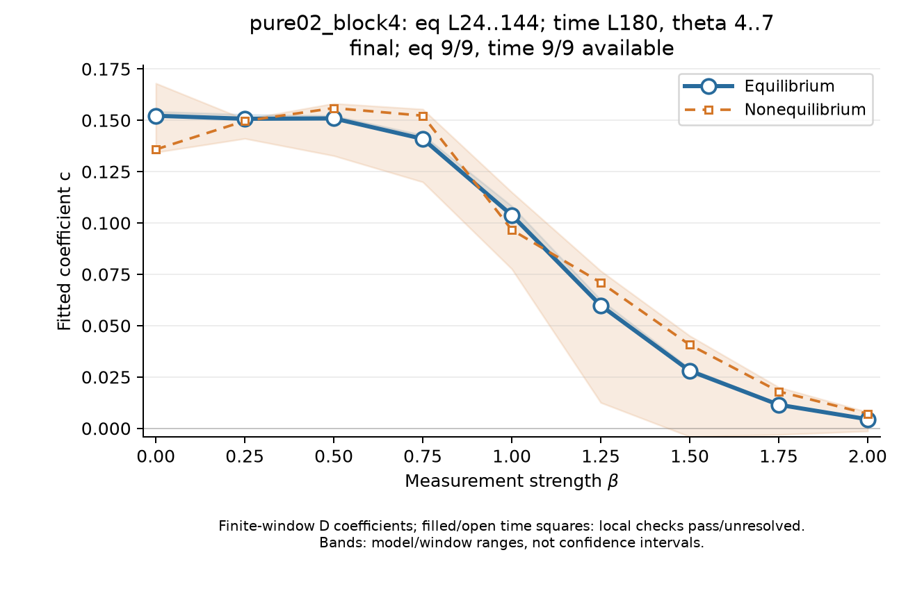

[PNG](figures_occupancy_classes/pure02_block4_corner_coefficient_beta.png) · [PDF](figures_occupancy_classes/pure02_block4_corner_coefficient_beta.pdf)


[敏感性、比值及相对差诊断 PNG](figures_occupancy_classes/pure02_block4_coefficient_diagnostics.png) · [PDF](figures_occupancy_classes/pure02_block4_coefficient_diagnostics.pdf)

##### pure02_block4，β=0：左平衡，右非平衡

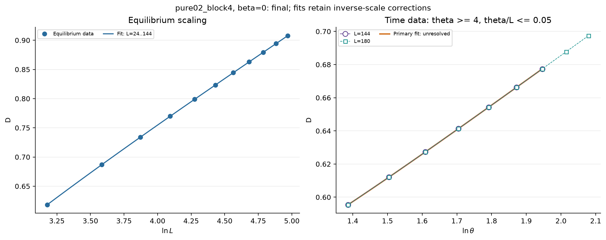

[PNG](figures_occupancy_classes/pure02_block4_scaling_beta_0.png) · [PDF](figures_occupancy_classes/pure02_block4_scaling_beta_0.pdf)


##### pure02_block4，β=0.5：左平衡，右非平衡

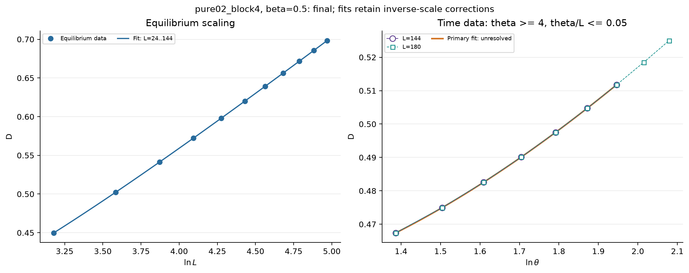

[PNG](figures_occupancy_classes/pure02_block4_scaling_beta_0p5.png) · [PDF](figures_occupancy_classes/pure02_block4_scaling_beta_0p5.pdf)


##### pure02_block4，β=1：左平衡，右非平衡

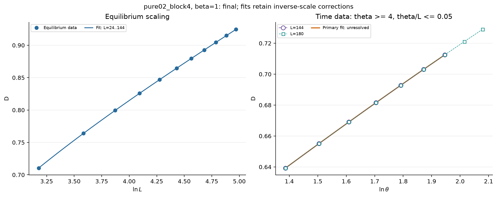

[PNG](figures_occupancy_classes/pure02_block4_scaling_beta_1.png) · [PDF](figures_occupancy_classes/pure02_block4_scaling_beta_1.pdf)


##### pure02_block4，β=1.5：左平衡，右非平衡

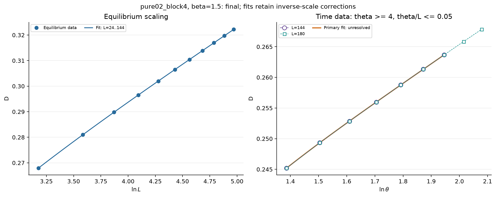

[PNG](figures_occupancy_classes/pure02_block4_scaling_beta_1p5.png) · [PDF](figures_occupancy_classes/pure02_block4_scaling_beta_1p5.pdf)


##### pure02_block4，β=2：左平衡，右非平衡

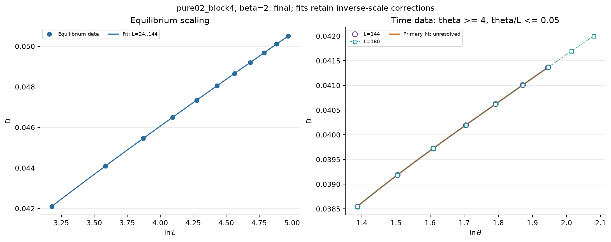

[PNG](figures_occupancy_classes/pure02_block4_scaling_beta_2.png) · [PDF](figures_occupancy_classes/pure02_block4_scaling_beta_2.pdf)


[返回三类构型索引](#results-occupancy-classes)

<a id="occupancy-pure02-irregular4"></a>

#### pure02_irregular4

超胞 4×4；空 / 单占 / 双占原胞数为 8 / 0 / 8。时间侧局部通过的 β：**无**。 **当前窗口无法提取稳定的非平衡对数系数。** 很大的正、负主估计来自对数项与逆时间修正项的补偿，不能解释为渐近角系数；β=1.5、1.75、2 的平衡拟合也有明显敏感性。

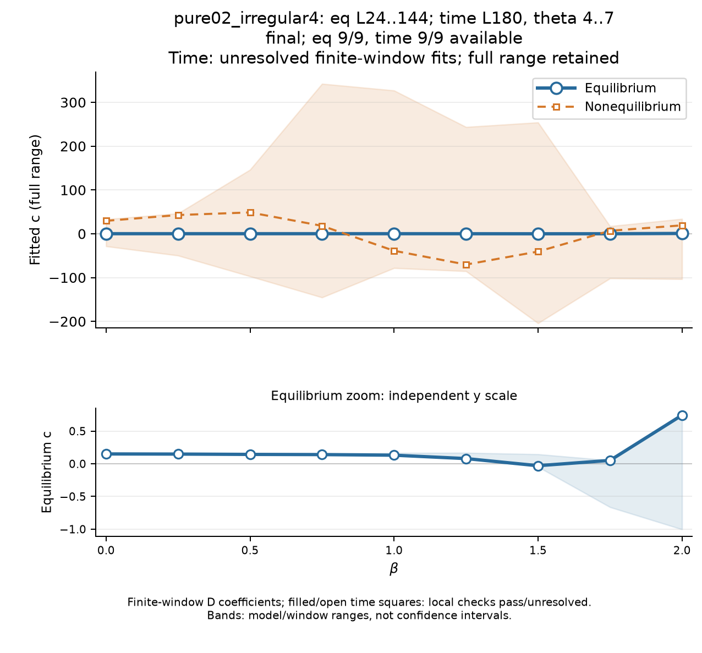

[PNG](figures_occupancy_classes/pure02_irregular4_corner_coefficient_beta.png) · [PDF](figures_occupancy_classes/pure02_irregular4_corner_coefficient_beta.pdf)


[敏感性、比值及相对差诊断 PNG](figures_occupancy_classes/pure02_irregular4_coefficient_diagnostics.png) · [PDF](figures_occupancy_classes/pure02_irregular4_coefficient_diagnostics.pdf)

##### pure02_irregular4，β=0：左平衡，右非平衡

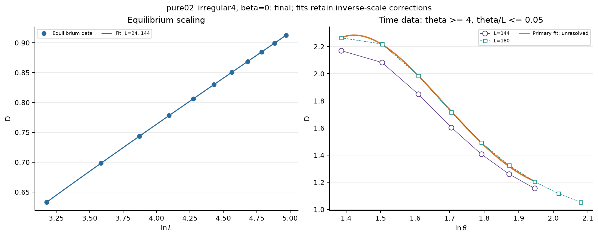

[PNG](figures_occupancy_classes/pure02_irregular4_scaling_beta_0.png) · [PDF](figures_occupancy_classes/pure02_irregular4_scaling_beta_0.pdf)


##### pure02_irregular4，β=0.5：左平衡，右非平衡

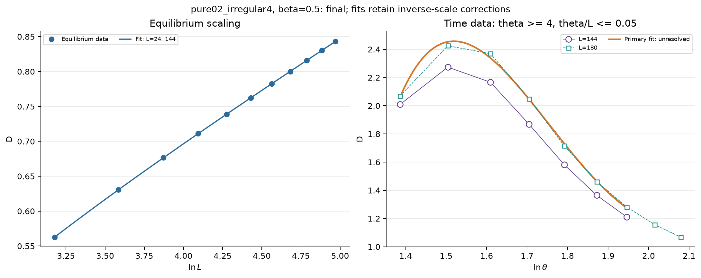

[PNG](figures_occupancy_classes/pure02_irregular4_scaling_beta_0p5.png) · [PDF](figures_occupancy_classes/pure02_irregular4_scaling_beta_0p5.pdf)


##### pure02_irregular4，β=1：左平衡，右非平衡

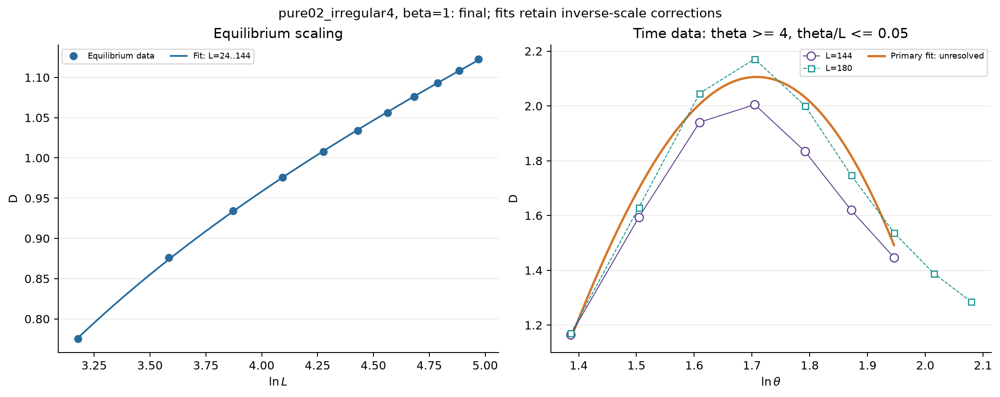

[PNG](figures_occupancy_classes/pure02_irregular4_scaling_beta_1.png) · [PDF](figures_occupancy_classes/pure02_irregular4_scaling_beta_1.pdf)


##### pure02_irregular4，β=1.5：左平衡，右非平衡

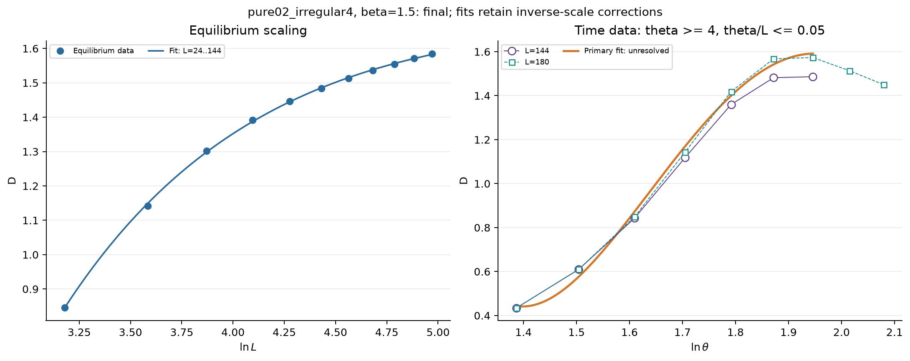

[PNG](figures_occupancy_classes/pure02_irregular4_scaling_beta_1p5.png) · [PDF](figures_occupancy_classes/pure02_irregular4_scaling_beta_1p5.pdf)


##### pure02_irregular4，β=2：左平衡，右非平衡

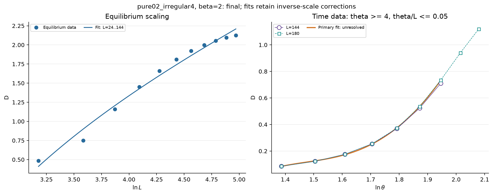

[PNG](figures_occupancy_classes/pure02_irregular4_scaling_beta_2.png) · [PDF](figures_occupancy_classes/pure02_irregular4_scaling_beta_2.pdf)


[返回三类构型索引](#results-occupancy-classes)

<a id="occupancy-second-class-extra"></a>

#### 第二类追加：两种新可达构型与两种交替构型

**新增四种构型均为严格的第二类：每个原胞只有 n=0 或 n=2。** 全部计算 β=0、0.5、1、1.5、2；两种 4×4 各有 135 个观测点，两种 2×2 各有 160 个，共 590 个。两种新 4×4 构型先按几何和投影秩选择，没有按熵系数是否相等筛选。

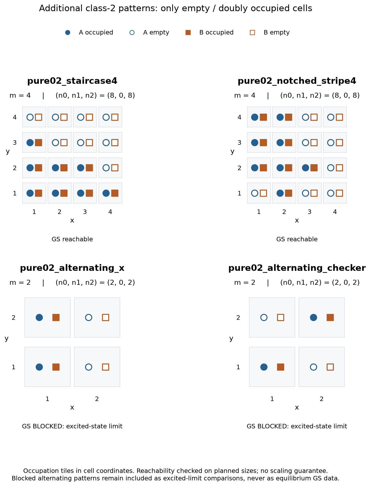

[PNG](figures_second_class_extra/pattern_catalogue.png) · [PDF](figures_second_class_extra/pattern_catalogue.pdf)


**条纹交替、棋盘交替均不能投影到基态，但这次仍完整计算了它们的熵。** 其左端数据使用保持初态谱支撑的严格 θ→∞ 可达激发态，右端使用有限 θ 演化态，随后都测量初态自身空位。所以这两种的左图叫“可达极限”，不叫基态平衡；参数随 β 的曲线是描述性拟合，不能称为基态角系数。[受阻的解析原因](SCALING_GUIDE.md#m2-obstruction-proof) 不因多演化一段时间而消失。

<details>
<summary>本批固定网格、模型和判据</summary>

可达 4×4 的极限网格为 L=24,36,…,144，检查下限 24、36、48；受阻 2×2 的极限网格为 L=18,24,…,90,108,126,144，检查下限 18、36、54。两者均拟合

$$
D_{\rm limit}(L)=c_{\rm limit}^{\rm fit}\ln L+b+\frac dL,
$$

并加入逆平方项检查模型敏感性。只有可达构型的 limit 才对应测量前已准备基态的平衡端。

所有四构型均有 L=144、θ=4,4.5,…,7 和 L=180、θ=4,4.5,…,8 的实测数据。时间主拟合固定为 L=180、θ=4–7：

$$
D(\theta)=c_{\rm time}^{\rm fit}\ln\theta+b+\frac d\theta+\frac e{\theta^2}.
$$

预先固定的比较窗口为 4–7、4.5–7、4–6.5、5–7、5–8，在点数足够的窗口比较一至三阶逆时间修正。主窗 4–7 及其它有共同网格的窗口以 L=144 同点数据检查尺寸；5–8 仅用于 L=180 的移窗敏感性，不能冒称有两尺寸全窗口对照。尺寸、模型、窗口漂移门槛分别为 2%、5%、5%，尺寸间 D 差与主对数变化之比门槛为 1%；缺失必要比较或系数跨零均不通过。

这些数值检查并不证明已进入渐近区。满足 θ≥4、θ/L≤0.05 只是统一的操作筛选，还需要初态相关微观过渡已结束、有限尺寸效应足够小。只跨 1.75 倍的主窗口很容易让多个修正项互相补偿；不能用“曲线拟合得好”替代原始局部斜率的平台检查。

图中范围是预定模型和窗口的敏感性范围，不是统计置信区间。受阻构型即使数值检查通过，也不获得基态角系数的物理解释。
</details>


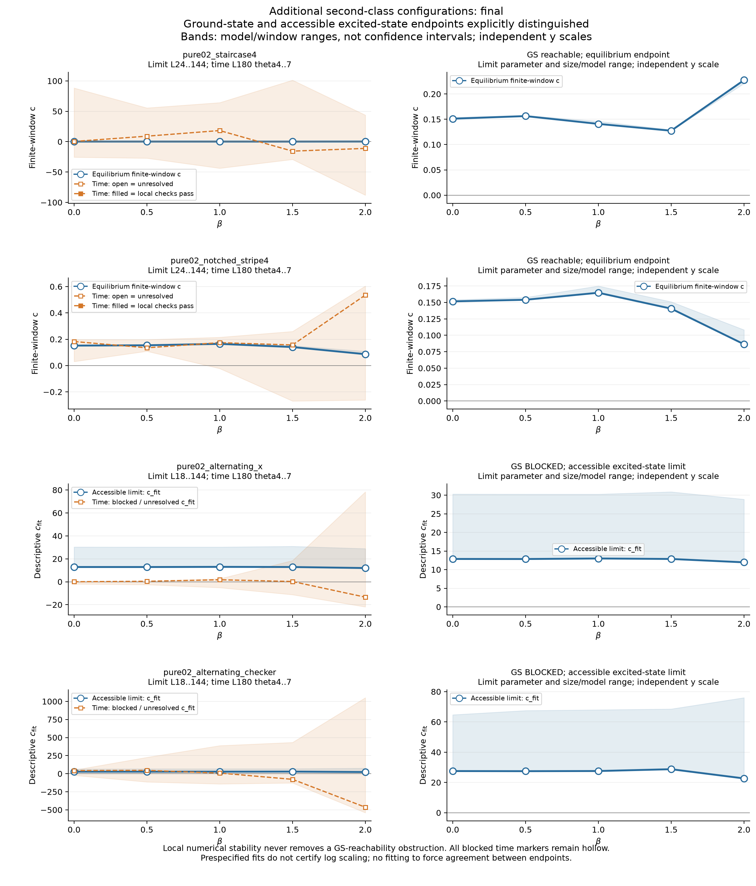

[PNG](figures_second_class_extra/parameters_beta.png) · [PDF](figures_second_class_extra/parameters_beta.pdf)


蓝色粗实线与大空心圆表示极限端，橙色虚线与小方块表示有限时间端，重合时也可区分。每行左栏比较两端，右栏单独放大极限端。各面板采用独立纵轴；很大的正负数值要结合敏感性范围和原始曲线阅读，不能自动当成新的普适角系数。

**先看未经拟合的 β=0 数据：两种交替态的可达极限没有显示常数对数斜率。** 从 36→72 再到 72→144，两个区间的 ln L 跨度相同；若 D 已由 c ln L+b 主导，两段斜率应接近同一 c。下表中交替态的斜率却随尺寸约翻倍，当前范围更接近线性增长。这与两个新增可达构型在 β=0 的近似对数趋势明显不同；不应把它们的大对数拟合参数命名为基态角系数。

| β=0，构型 | D(36) | D(72) | D(144) | 36→72 的 ΔD/ln2 | 72→144 的 ΔD/ln2 |
|---|---:|---:|---:|---:|---:|
| `pure02_staircase4` | 0.6981364 | 0.8054535 | 0.9118002 | 0.1548259 | 0.1534259 |
| `pure02_notched_stripe4` | 0.6900137 | 0.800994 | 0.9092967 | 0.1601107 | 0.1562477 |
| `pure02_alternating_x` | 4.080668 | 8.223253 | 16.40986 | 5.976487 | 11.81078 |
| `pure02_alternating_checker` | 8.204046 | 16.98615 | 34.48765 | 12.6699 | 25.24932 |

这里比较的是先固定有限 L 取 θ→∞ 的不同状态族。交替态保留受阻动量的激发成分；其结果不是“已经投影到基态但失去角 scaling”的反例，也不能直接推断先取大 L、有限 θ 的时间曲线。

<details>
<summary>为什么交替态仅满足 θ/L≪1 仍然不够（β=0 局部诊断）</summary>

独立四轨道计算在指定动量截面上发现：受阻点附近的小基态重叠与虚时指数因子竞争，产生宽度约为

$$
w_\theta=C e^{-2\theta},\qquad C=3\ \text{（条纹）},\quad C=2\ \text{（棋盘）}
$$

的局部动量过渡层。分辨它还需要

$$
\frac{2\pi/L}{w_\theta}\ll1.
$$

条纹在 θ=4 时宽度约为 0.001006，而 L=144 的动量间隔约为 0.04363，L=180 也只有约 0.03491。精确受阻点保留正能粒子，最近的非零网格点却已接近填满负能态。因此小 θ/L 并没有保证这个过渡层被有限网格分辨。

这为本批交替态的有限尺寸影响提供局部机制，**不直接推导完整 D 或角系数，也不自动适用于正 β**。完整推导、26 点独立核验及误差见 [指南](SCALING_GUIDE.md#alternating-momentum-layer) 与 [数值记录](analysis_second_class_extra/alternating_boundary_layer.json)。
</details>


<a id="occupancy-pure02-staircase4"></a>

##### pure02_staircase4

4×4；阶梯形：沿 y 的双占胞行长依次为 4、3、1、0，每行从 x=1 填起。 全部计划尺寸通过基态可达性检查。时间侧数值局部检查通过的 β：**无**。局部通过也不认证渐近角系数。

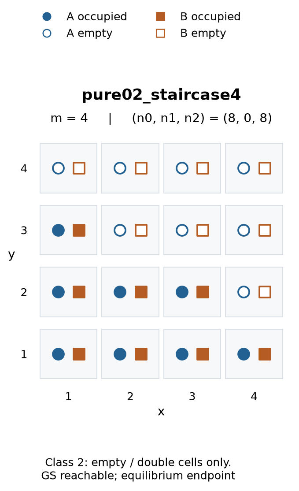

[PNG](figures_second_class_extra/pure02_staircase4_pattern.png) · [PDF](figures_second_class_extra/pure02_staircase4_pattern.pdf)


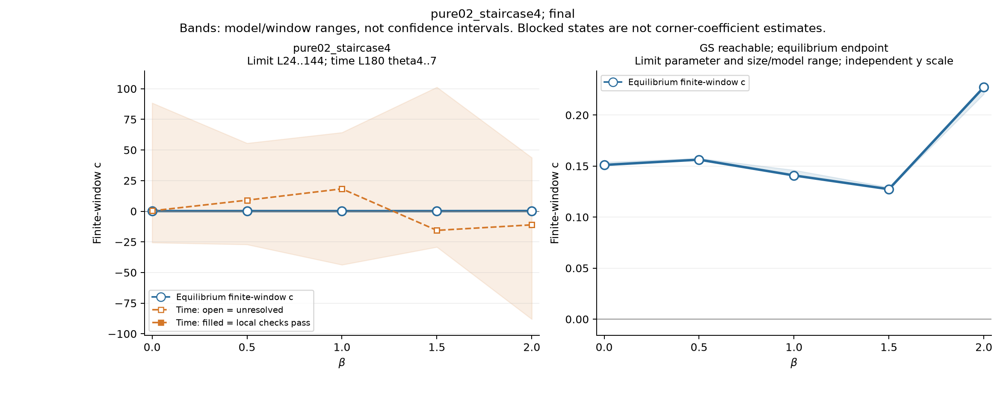

[PNG](figures_second_class_extra/pure02_staircase4_coefficients_beta.png) · [PDF](figures_second_class_extra/pure02_staircase4_coefficients_beta.pdf)


平衡主值在小 β 略升、随后下降，并在采样点 β=2 回升；时间侧明显依赖修正模型。例如 β=0、L=180、θ=4–7 时，包含一、二、三阶逆时间修正的拟合分别给出 -6.89324、0.3570725、88.39958。这说明当前窗口不足以给出稳健时间角系数；不能把某一个主值接近平衡当成提取成功。

| β | 平衡拟合参数 | 极限尺寸 / 模型范围 | 时间拟合参数 | 时间模型 / 窗口范围 | 时间数值检查 |
|---:|---:|---|---:|---|---|
| 0 | 0.1511131 | [0.1511131, 0.1538248] | 0.3570725 | [-25.57183, 88.39958] | 未稳定 |
| 0.5 | 0.1563051 | [0.1563051, 0.1576526] | 9.035281 | [-27.13969, 55.54729] | 未稳定 |
| 1 | 0.1408343 | [0.1408343, 0.1460657] | 18.30158 | [-43.71144, 64.30554] | 未稳定 |
| 1.5 | 0.1273722 | [0.1273722, 0.1292368] | -15.5934 | [-29.19893, 101.2832] | 未稳定 |
| 2 | 0.2273471 | [0.2206294, 0.2273471] | -11.08901 | [-88.06806, 43.77521] | 未稳定 |

###### pure02_staircase4，β=0：左平衡，右有限时间

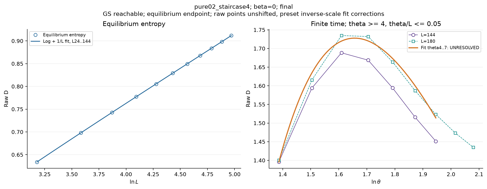

[PNG](figures_second_class_extra/pure02_staircase4_scaling_beta_0.png) · [PDF](figures_second_class_extra/pure02_staircase4_scaling_beta_0.pdf)


[原始局部斜率 PNG](figures_second_class_extra/pure02_staircase4_raw_slopes_beta_0.png) · [PDF](figures_second_class_extra/pure02_staircase4_raw_slopes_beta_0.pdf)

###### pure02_staircase4，β=0.5：左平衡，右有限时间

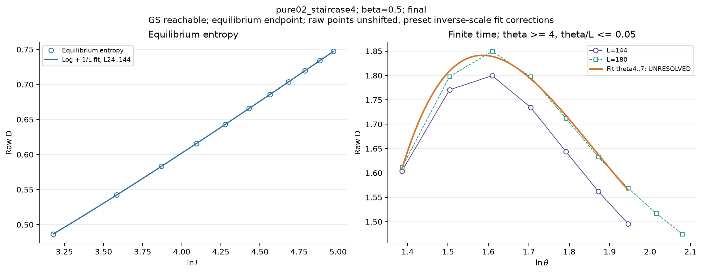

[PNG](figures_second_class_extra/pure02_staircase4_scaling_beta_0p5.png) · [PDF](figures_second_class_extra/pure02_staircase4_scaling_beta_0p5.pdf)


[原始局部斜率 PNG](figures_second_class_extra/pure02_staircase4_raw_slopes_beta_0p5.png) · [PDF](figures_second_class_extra/pure02_staircase4_raw_slopes_beta_0p5.pdf)

###### pure02_staircase4，β=1：左平衡，右有限时间

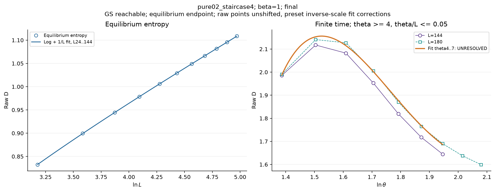

[PNG](figures_second_class_extra/pure02_staircase4_scaling_beta_1.png) · [PDF](figures_second_class_extra/pure02_staircase4_scaling_beta_1.pdf)


[原始局部斜率 PNG](figures_second_class_extra/pure02_staircase4_raw_slopes_beta_1.png) · [PDF](figures_second_class_extra/pure02_staircase4_raw_slopes_beta_1.pdf)

###### pure02_staircase4，β=1.5：左平衡，右有限时间

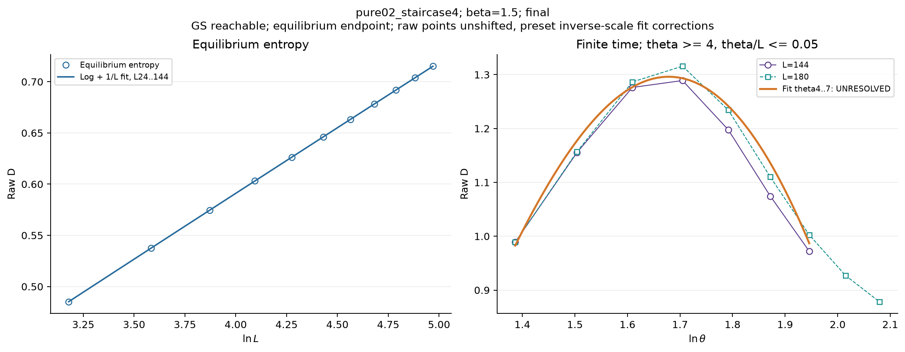

[PNG](figures_second_class_extra/pure02_staircase4_scaling_beta_1p5.png) · [PDF](figures_second_class_extra/pure02_staircase4_scaling_beta_1p5.pdf)


[原始局部斜率 PNG](figures_second_class_extra/pure02_staircase4_raw_slopes_beta_1p5.png) · [PDF](figures_second_class_extra/pure02_staircase4_raw_slopes_beta_1p5.pdf)

###### pure02_staircase4，β=2：左平衡，右有限时间

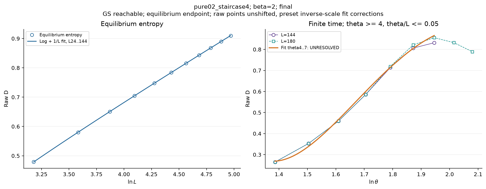

[PNG](figures_second_class_extra/pure02_staircase4_scaling_beta_2.png) · [PDF](figures_second_class_extra/pure02_staircase4_scaling_beta_2.pdf)


[原始局部斜率 PNG](figures_second_class_extra/pure02_staircase4_raw_slopes_beta_2.png) · [PDF](figures_second_class_extra/pure02_staircase4_raw_slopes_beta_2.pdf)

原始局部斜率由相邻点的 ΔD/Δln x 直接计算，不使用修正模型。随尺度持续漂移意味着当前数据尚未显示稳定的对数斜率；它不是对无限尺度行为的否定证明。

<a id="occupancy-pure02-notched-stripe4"></a>

##### pure02_notched_stripe4

4×4；缺口条带：先占满 x=1、2 两列，再把 (1,1) 的双占胞移到 (3,2)。 全部计划尺寸通过基态可达性检查。时间侧数值局部检查通过的 β：**无**。局部通过也不认证渐近角系数。

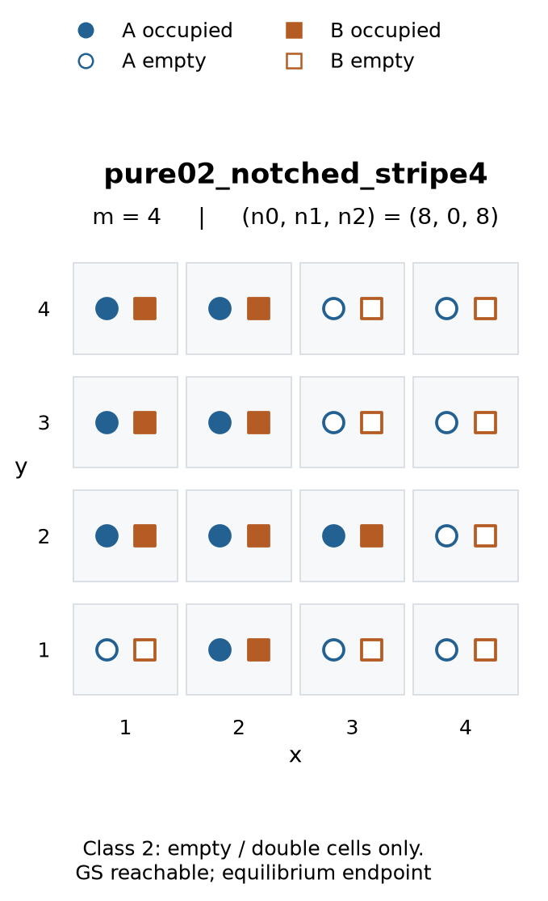

[PNG](figures_second_class_extra/pure02_notched_stripe4_pattern.png) · [PDF](figures_second_class_extra/pure02_notched_stripe4_pattern.pdf)


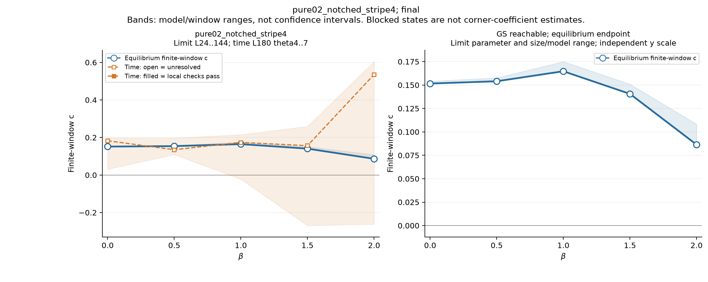

[PNG](figures_second_class_extra/pure02_notched_stripe4_coefficients_beta.png) · [PDF](figures_second_class_extra/pure02_notched_stripe4_coefficients_beta.pdf)


平衡主值在本次五个采样点中以 β=1 较高，随后下降。时间原始曲线较平滑、两尺寸也很接近，但修正阶数仍会显著改变系数。例如 β=0、L=180、θ=4–7 时，包含一、二、三阶逆时间修正的拟合分别给出 0.1942613、0.1825883、0.03070649。这说明当前窗口不足以给出稳健时间角系数；不能把某一个主值接近平衡当成提取成功。

| β | 平衡拟合参数 | 极限尺寸 / 模型范围 | 时间拟合参数 | 时间模型 / 窗口范围 | 时间数值检查 |
|---:|---:|---|---:|---|---|
| 0 | 0.1516024 | [0.1516024, 0.154037] | 0.1825883 | [0.03070649, 0.1972002] | 未稳定 |
| 0.5 | 0.1540378 | [0.1540378, 0.1576262] | 0.1349837 | [0.1090521, 0.1968914] | 未稳定 |
| 1 | 0.1647358 | [0.1647358, 0.1750235] | 0.1739022 | [-0.02223394, 0.2150492] | 未稳定 |
| 1.5 | 0.1405684 | [0.1405684, 0.1510007] | 0.1564692 | [-0.2693103, 0.2592602] | 未稳定 |
| 2 | 0.08639556 | [0.08639556, 0.1083076] | 0.5355134 | [-0.2617363, 0.60441] | 未稳定 |

###### pure02_notched_stripe4，β=0：左平衡，右有限时间


[PNG](figures_second_class_extra/pure02_notched_stripe4_scaling_beta_0.png) · [PDF](figures_second_class_extra/pure02_notched_stripe4_scaling_beta_0.pdf)


[原始局部斜率 PNG](figures_second_class_extra/pure02_notched_stripe4_raw_slopes_beta_0.png) · [PDF](figures_second_class_extra/pure02_notched_stripe4_raw_slopes_beta_0.pdf)

###### pure02_notched_stripe4，β=0.5：左平衡，右有限时间


[PNG](figures_second_class_extra/pure02_notched_stripe4_scaling_beta_0p5.png) · [PDF](figures_second_class_extra/pure02_notched_stripe4_scaling_beta_0p5.pdf)


[原始局部斜率 PNG](figures_second_class_extra/pure02_notched_stripe4_raw_slopes_beta_0p5.png) · [PDF](figures_second_class_extra/pure02_notched_stripe4_raw_slopes_beta_0p5.pdf)

###### pure02_notched_stripe4，β=1：左平衡，右有限时间


[PNG](figures_second_class_extra/pure02_notched_stripe4_scaling_beta_1.png) · [PDF](figures_second_class_extra/pure02_notched_stripe4_scaling_beta_1.pdf)


[原始局部斜率 PNG](figures_second_class_extra/pure02_notched_stripe4_raw_slopes_beta_1.png) · [PDF](figures_second_class_extra/pure02_notched_stripe4_raw_slopes_beta_1.pdf)

###### pure02_notched_stripe4，β=1.5：左平衡，右有限时间


[PNG](figures_second_class_extra/pure02_notched_stripe4_scaling_beta_1p5.png) · [PDF](figures_second_class_extra/pure02_notched_stripe4_scaling_beta_1p5.pdf)


[原始局部斜率 PNG](figures_second_class_extra/pure02_notched_stripe4_raw_slopes_beta_1p5.png) · [PDF](figures_second_class_extra/pure02_notched_stripe4_raw_slopes_beta_1p5.pdf)

###### pure02_notched_stripe4，β=2：左平衡，右有限时间


[PNG](figures_second_class_extra/pure02_notched_stripe4_scaling_beta_2.png) · [PDF](figures_second_class_extra/pure02_notched_stripe4_scaling_beta_2.pdf)


[原始局部斜率 PNG](figures_second_class_extra/pure02_notched_stripe4_raw_slopes_beta_2.png) · [PDF](figures_second_class_extra/pure02_notched_stripe4_raw_slopes_beta_2.pdf)

原始局部斜率由相邻点的 ΔD/Δln x 直接计算，不使用修正模型。随尺度持续漂移意味着当前数据尚未显示稳定的对数斜率；它不是对无限尺度行为的否定证明。

<a id="occupancy-pure02-alternating-x"></a>

##### pure02_alternating_x

2×2；条纹交替：x 为奇数的原胞双占，x 为偶数的原胞全空；沿 y 不变。 全部计划尺寸受阻，超胞 Γ 块负能重叠秩为 3/4。时间侧数值局部检查通过的 β：**无**。该状态的基态角系数始终不适用。


[PNG](figures_second_class_extra/pure02_alternating_x_pattern.png) · [PDF](figures_second_class_extra/pure02_alternating_x_pattern.pdf)


[PNG](figures_second_class_extra/pure02_alternating_x_coefficients_beta.png) · [PDF](figures_second_class_extra/pure02_alternating_x_coefficients_beta.pdf)


| β | 可达激发态极限拟合参数 | 极限尺寸 / 模型范围 | 时间拟合参数 | 时间模型 / 窗口范围 | 时间数值检查 |
|---:|---:|---|---:|---|---|
| 0 | 12.86298 | [12.86298, 30.29877] | 0.0113506 | [-1.95021, 0.01613029] | 未稳定 |
| 0.5 | 12.84712 | [12.84712, 30.26299] | 0.4323789 | [-2.501053, 0.4533191] | 未稳定 |
| 1 | 12.98977 | [12.98977, 30.25587] | 1.775983 | [-5.092169, 2.636141] | 未稳定 |
| 1.5 | 12.85935 | [12.85935, 30.88686] | 0.2163602 | [-11.23748, 18.52973] | 未稳定 |
| 2 | 11.95849 | [11.95849, 28.88593] | -13.41663 | [-21.86931, 78.39139] | 未稳定 |

###### pure02_alternating_x，β=0：左可达激发态极限，右有限时间


[PNG](figures_second_class_extra/pure02_alternating_x_scaling_beta_0.png) · [PDF](figures_second_class_extra/pure02_alternating_x_scaling_beta_0.pdf)


[原始局部斜率 PNG](figures_second_class_extra/pure02_alternating_x_raw_slopes_beta_0.png) · [PDF](figures_second_class_extra/pure02_alternating_x_raw_slopes_beta_0.pdf)

###### pure02_alternating_x，β=0.5：左可达激发态极限，右有限时间


[PNG](figures_second_class_extra/pure02_alternating_x_scaling_beta_0p5.png) · [PDF](figures_second_class_extra/pure02_alternating_x_scaling_beta_0p5.pdf)


[原始局部斜率 PNG](figures_second_class_extra/pure02_alternating_x_raw_slopes_beta_0p5.png) · [PDF](figures_second_class_extra/pure02_alternating_x_raw_slopes_beta_0p5.pdf)

###### pure02_alternating_x，β=1：左可达激发态极限，右有限时间


[PNG](figures_second_class_extra/pure02_alternating_x_scaling_beta_1.png) · [PDF](figures_second_class_extra/pure02_alternating_x_scaling_beta_1.pdf)


[原始局部斜率 PNG](figures_second_class_extra/pure02_alternating_x_raw_slopes_beta_1.png) · [PDF](figures_second_class_extra/pure02_alternating_x_raw_slopes_beta_1.pdf)

###### pure02_alternating_x，β=1.5：左可达激发态极限，右有限时间


[PNG](figures_second_class_extra/pure02_alternating_x_scaling_beta_1p5.png) · [PDF](figures_second_class_extra/pure02_alternating_x_scaling_beta_1p5.pdf)


[原始局部斜率 PNG](figures_second_class_extra/pure02_alternating_x_raw_slopes_beta_1p5.png) · [PDF](figures_second_class_extra/pure02_alternating_x_raw_slopes_beta_1p5.pdf)

###### pure02_alternating_x，β=2：左可达激发态极限，右有限时间


[PNG](figures_second_class_extra/pure02_alternating_x_scaling_beta_2.png) · [PDF](figures_second_class_extra/pure02_alternating_x_scaling_beta_2.pdf)


[原始局部斜率 PNG](figures_second_class_extra/pure02_alternating_x_raw_slopes_beta_2.png) · [PDF](figures_second_class_extra/pure02_alternating_x_raw_slopes_beta_2.pdf)

原始局部斜率由相邻点的 ΔD/Δln x 直接计算，不使用修正模型。随尺度持续漂移意味着当前数据尚未显示稳定的对数斜率；它不是对无限尺度行为的否定证明。

<a id="occupancy-pure02-alternating-checker"></a>

##### pure02_alternating_checker

2×2；棋盘交替：x+y 为偶数的原胞双占，奇数的原胞全空。 全部计划尺寸受阻，超胞 Γ 块负能重叠秩为 3/4。时间侧数值局部检查通过的 β：**无**。该状态的基态角系数始终不适用。


[PNG](figures_second_class_extra/pure02_alternating_checker_pattern.png) · [PDF](figures_second_class_extra/pure02_alternating_checker_pattern.pdf)


[PNG](figures_second_class_extra/pure02_alternating_checker_coefficients_beta.png) · [PDF](figures_second_class_extra/pure02_alternating_checker_coefficients_beta.pdf)


| β | 可达激发态极限拟合参数 | 极限尺寸 / 模型范围 | 时间拟合参数 | 时间模型 / 窗口范围 | 时间数值检查 |
|---:|---:|---|---:|---|---|
| 0 | 27.52029 | [27.52029, 64.715] | 42.44806 | [-22.41572, 50.45403] | 未稳定 |
| 0.5 | 27.44484 | [27.44484, 67.51239] | 45.43296 | [-113.7418, 226.2751] | 未稳定 |
| 1 | 27.54874 | [27.54874, 67.99246] | 8.970582 | [-141.3535, 388.1692] | 未稳定 |
| 1.5 | 28.74737 | [28.74737, 68.54681] | -78.07733 | [-127.6991, 432.6852] | 未稳定 |
| 2 | 22.65744 | [22.65744, 76.0103] | -463.4752 | [-539.7718, 1051.21] | 未稳定 |

###### pure02_alternating_checker，β=0：左可达激发态极限，右有限时间


[PNG](figures_second_class_extra/pure02_alternating_checker_scaling_beta_0.png) · [PDF](figures_second_class_extra/pure02_alternating_checker_scaling_beta_0.pdf)


[原始局部斜率 PNG](figures_second_class_extra/pure02_alternating_checker_raw_slopes_beta_0.png) · [PDF](figures_second_class_extra/pure02_alternating_checker_raw_slopes_beta_0.pdf)

###### pure02_alternating_checker，β=0.5：左可达激发态极限，右有限时间


[PNG](figures_second_class_extra/pure02_alternating_checker_scaling_beta_0p5.png) · [PDF](figures_second_class_extra/pure02_alternating_checker_scaling_beta_0p5.pdf)


[原始局部斜率 PNG](figures_second_class_extra/pure02_alternating_checker_raw_slopes_beta_0p5.png) · [PDF](figures_second_class_extra/pure02_alternating_checker_raw_slopes_beta_0p5.pdf)

###### pure02_alternating_checker，β=1：左可达激发态极限，右有限时间


[PNG](figures_second_class_extra/pure02_alternating_checker_scaling_beta_1.png) · [PDF](figures_second_class_extra/pure02_alternating_checker_scaling_beta_1.pdf)


[原始局部斜率 PNG](figures_second_class_extra/pure02_alternating_checker_raw_slopes_beta_1.png) · [PDF](figures_second_class_extra/pure02_alternating_checker_raw_slopes_beta_1.pdf)

###### pure02_alternating_checker，β=1.5：左可达激发态极限，右有限时间


[PNG](figures_second_class_extra/pure02_alternating_checker_scaling_beta_1p5.png) · [PDF](figures_second_class_extra/pure02_alternating_checker_scaling_beta_1p5.pdf)


[原始局部斜率 PNG](figures_second_class_extra/pure02_alternating_checker_raw_slopes_beta_1p5.png) · [PDF](figures_second_class_extra/pure02_alternating_checker_raw_slopes_beta_1p5.pdf)

###### pure02_alternating_checker，β=2：左可达激发态极限，右有限时间


[PNG](figures_second_class_extra/pure02_alternating_checker_scaling_beta_2.png) · [PDF](figures_second_class_extra/pure02_alternating_checker_scaling_beta_2.pdf)


[原始局部斜率 PNG](figures_second_class_extra/pure02_alternating_checker_raw_slopes_beta_2.png) · [PDF](figures_second_class_extra/pure02_alternating_checker_raw_slopes_beta_2.pdf)

原始局部斜率由相邻点的 ΔD/Δln x 直接计算，不使用修正模型。随尺度持续漂移意味着当前数据尚未显示稳定的对数斜率；它不是对无限尺度行为的否定证明。

##### 本批核验与复现

全部 **590/590** 个冻结参数键完整，逐行来源、代码快照及拟合表通过独立核验。独立 80 位 QR 复算 820 次拟合，对数系数最大数值差为 1.933586e-09；这项数值核对不认证物理渐近区。另用完整实空间关联矩阵核对 **48** 个小系统状态，三个区域熵最大差 2.58171e-10，D 最大差 1.586447e-10。受阻构型的无限时间参考采用独立的能量块／零空间构造，保持严格谱支撑；没有把普通 Float64 长时 QR 混入的基态作为参考。

[新构型定义](second_class_extra_patterns.jl) · [逐尺寸投影秩](data/second_class_extra_reachability.csv) · [原始熵数据](data/second_class_extra_observations.csv) · [20 组参数及诊断](analysis_second_class_extra/primary_parameters.csv) · [极限拟合](analysis_second_class_extra/limit_fits.csv) · [原始局部斜率](analysis_second_class_extra/local_log_slopes.csv) · [冻结计划](analysis_second_class_extra/plan.json) · [独立核验](analysis_second_class_extra/validation.json)

```powershell
# 已有数据的分析、核验和文档刷新
python src/Measure/ai/analyze_second_class_extra.py --stage final
python src/Measure/ai/validate_second_class_extra.py
python src/Measure/ai/write_results_report.py --sections OCCUPANCY_CLASSES
# 复跑熵数据（跳过已有完整行）
& ./src/Measure/ai/run_second_class_extra.ps1
```

[返回三类构型索引](#results-occupancy-classes)

<a id="occupancy-pure02-m2-blocked"></a>

#### 第二类 2×2：全部六种排列的计算结果

**2×2 可以构造半填充的第二类图案，但六种排列全部无法通过本协议投影到基态。** 四个粒子必须放在两个双占胞中，另外两胞全空，因此本次穷举全部六种，而不是只挑一个。对 L=6,12,18,24,36,72,144,180,216 的 **54 个构型／尺寸组合**重新计算，全部受阻。这里报告的是实际可达性和投影结果；平衡角系数为“不适用”，不是零。


[PNG](figures_pure02_m2/pattern_catalogue.png) · [PDF](figures_pure02_m2/pattern_catalogue.pdf)


bits 仍按 A(1,1),B(1,1),A(2,1),B(2,1),… 排列，x 先变；cells_ij 表示按 x 先变编号的第 i、j 个原胞双占。条纹的实际平移周期可能小于画出的 2×2。

| 构型 | 占据 bits | Γ 负能重叠秩 | L=6 严格极限 E−E₀ | L=216 严格极限 E−E₀ |
|---|---|---:|---:|---:|
| `pure02_m2_cells_12` | `11110000` | 3 / 4 | 2 | 94.15729 |
| `pure02_m2_cells_13` | `11001100` | 3 / 4 | 2 | 94.15729 |
| `pure02_m2_cells_14` | `11000011` | 3 / 4 | 6 | 249.1569 |
| `pure02_m2_cells_23` | `00111100` | 3 / 4 | 6 | 249.1569 |
| `pure02_m2_cells_24` | `00110011` | 3 / 4 | 2 | 94.15729 |
| `pure02_m2_cells_34` | `00001111` | 3 / 4 | 2 | 94.15729 |

所有相容的周期系统都包含超胞 Γ 点。这里四个负能级为 −3、−1、−1、−1，没有零模，而每个图案都有

$$
\operatorname{rank}(V_{<0}^{\dagger}P_{\Gamma})=3<4=\dim\mathcal H_{<0}.
$$

因此缺少一个必须填充的负能方向；其它动量处的零模不能补救。这个结论对所有相容偶数 L 成立，依据是 [Γ 块解析证明](SCALING_GUIDE.md#m2-obstruction-proof)，不是把有限尺寸枚举外推为定理。较大尺寸上还有其它受阻动量；一般非对称动量可以满秩，并非每个动量都受阻。


[PNG](figures_pure02_m2/energy_excess_vs_L.png) · [PDF](figures_pure02_m2/energy_excess_vs_L.pdf)


左图是总激发能，右图除以 2L² 得到每格点能量差。即使能量密度随 L 增大而减小，也不代表有限尺寸的态已经是基态，也不会恢复严格为零的多体基态重叠。这张图是投影受阻诊断，不是纠缠熵的 scaling 图。

##### 为什么直接长时间 QR 可能显示“到了基态”

另在 L=6 直接用实空间 exp(−0.25H) 与 QR 逐步演化到 θ=128，并与保持初态精确谱支撑的参考比较。两者早时一致，随后直接 Float64 演化把舍入误差带入原本禁止的负能方向，并指数放大。下面的负能粒子数超过初态谱支撑允许上限，直接表明数值轨迹已经离开原来的严格可达子空间。

| L=6，θ=128 | 保持初态谱支撑的 E−E₀ | 直接 Float64 QR 的 E−E₀ | 超出初态所能占据的负能粒子数 |
|---|---:|---:|---:|
| `pure02_m2_cells_12` | 2 | 1.421085e-14 | 1 |
| `pure02_m2_cells_14` | 6 | 1.421085e-14 | 3 |


[PNG](figures_pure02_m2/projection_energy.png) · [PDF](figures_pure02_m2/projection_energy.pdf)


保持谱支撑的无限时间总能量与另一套逐 Bloch 块计算相符，最大差约 1.42×10⁻¹⁴；早时 θ≤4 的完整关联矩阵之差，其 Frobenius 范数除以 L 后最大约 7.07×10⁻¹³。**更长虚时或 QR 收敛本身不能作为基态可达性的证据。**

**因此这六种 2×2 图案不能提供原协议的基态平衡角系数。** 本次已为条纹交替和棋盘交替两种代表实际计算有限 θ 熵与严格可达极限熵，见 [新增四构型结果](#occupancy-second-class-extra)；它们的拟合参数不能标成基态角系数。直接独立准备某个基态再用相同空位集合测量，会改变此前约定的制备协议。第二类可达结果由本节四个 4×4 构型提供；3×3 混合例位于下一节第三类。

[本次检查代码](check_pure02_m2.py) · [Γ 枚举](data/pure02_m2_gamma.csv) · [逐尺寸结果](data/pure02_m2_reachability.csv) · [投影曲线原始数据](data/pure02_m2_projection.csv) · [全部受阻动量](data/pure02_m2_blocked_momenta.csv) · [结果与哈希](data/pure02_m2_summary.json)。

```powershell
python src/Measure/ai/check_pure02_m2.py
python src/Measure/ai/plot_pure02_m2.py
python src/Measure/ai/write_results_report.py --sections OCCUPANCY_CLASSES
```

[返回三类构型索引](#results-occupancy-classes)

<a id="occupancy-class-3"></a>

### 第 3 类：单占、空、双占原胞混合

<a id="occupancy-random-half-3"></a>

#### random_half_3

超胞 3×3；空 / 单占 / 双占原胞数为 1 / 7 / 1。时间侧局部通过的 β：**无**。 两端主值先升后降，但九个 β 的时间侧检查均未通过，不能从峰位和幅度差异确认渐近不一致。


[PNG](figures_occupancy_classes/random_half_3_corner_coefficient_beta.png) · [PDF](figures_occupancy_classes/random_half_3_corner_coefficient_beta.pdf)


[敏感性、比值及相对差诊断 PNG](figures_occupancy_classes/random_half_3_coefficient_diagnostics.png) · [PDF](figures_occupancy_classes/random_half_3_coefficient_diagnostics.pdf)

##### random_half_3，β=0：左平衡，右非平衡


[PNG](figures_occupancy_classes/random_half_3_scaling_beta_0.png) · [PDF](figures_occupancy_classes/random_half_3_scaling_beta_0.pdf)


##### random_half_3，β=0.5：左平衡，右非平衡


[PNG](figures_occupancy_classes/random_half_3_scaling_beta_0p5.png) · [PDF](figures_occupancy_classes/random_half_3_scaling_beta_0p5.pdf)


##### random_half_3，β=1：左平衡，右非平衡


[PNG](figures_occupancy_classes/random_half_3_scaling_beta_1.png) · [PDF](figures_occupancy_classes/random_half_3_scaling_beta_1.pdf)


##### random_half_3，β=1.5：左平衡，右非平衡


[PNG](figures_occupancy_classes/random_half_3_scaling_beta_1p5.png) · [PDF](figures_occupancy_classes/random_half_3_scaling_beta_1p5.pdf)


##### random_half_3，β=2：左平衡，右非平衡


[PNG](figures_occupancy_classes/random_half_3_scaling_beta_2.png) · [PDF](figures_occupancy_classes/random_half_3_scaling_beta_2.pdf)


[返回三类构型索引](#results-occupancy-classes)

<a id="occupancy-general-matched-a"></a>

#### general_matched_a

超胞 3×3；空 / 单占 / 双占原胞数为 1 / 7 / 1。时间侧局部通过的 β：**0**。 平衡主值随 β 下降，非平衡主值在小 β 有浅峰后下降；它与 random_half_3 的各类原胞数和 A/B 总数相同，但空间排列不同。


[PNG](figures_occupancy_classes/general_matched_a_corner_coefficient_beta.png) · [PDF](figures_occupancy_classes/general_matched_a_corner_coefficient_beta.pdf)


[敏感性、比值及相对差诊断 PNG](figures_occupancy_classes/general_matched_a_coefficient_diagnostics.png) · [PDF](figures_occupancy_classes/general_matched_a_coefficient_diagnostics.pdf)

##### general_matched_a，β=0：左平衡，右非平衡


[PNG](figures_occupancy_classes/general_matched_a_scaling_beta_0.png) · [PDF](figures_occupancy_classes/general_matched_a_scaling_beta_0.pdf)


##### general_matched_a，β=0.5：左平衡，右非平衡


[PNG](figures_occupancy_classes/general_matched_a_scaling_beta_0p5.png) · [PDF](figures_occupancy_classes/general_matched_a_scaling_beta_0p5.pdf)


##### general_matched_a，β=1：左平衡，右非平衡


[PNG](figures_occupancy_classes/general_matched_a_scaling_beta_1.png) · [PDF](figures_occupancy_classes/general_matched_a_scaling_beta_1.pdf)


##### general_matched_a，β=1.5：左平衡，右非平衡


[PNG](figures_occupancy_classes/general_matched_a_scaling_beta_1p5.png) · [PDF](figures_occupancy_classes/general_matched_a_scaling_beta_1p5.pdf)


##### general_matched_a，β=2：左平衡，右非平衡


[PNG](figures_occupancy_classes/general_matched_a_scaling_beta_2.png) · [PDF](figures_occupancy_classes/general_matched_a_scaling_beta_2.pdf)


[返回三类构型索引](#results-occupancy-classes)

<a id="occupancy-near02-irregular3"></a>

#### near02_irregular3

超胞 3×3；空 / 单占 / 双占原胞数为 4 / 1 / 4。时间侧局部通过的 β：**无**。 **归入第三类混合构型。** 半填充的 3×3 超胞有 9 个粒子，纯空胞／双占胞只能给出偶数粒子，因而不能把本例归入第二类。本例有 4 空胞、4 双占胞和 1 个 A 单占胞。预定候选筛选仅检查基态可达性，全部 13 个实验尺寸通过。平衡主值随 β 先升后降，在本次网格 β=1 处最大；有限尺寸稳定性比 irregular4 强测量区好，但九个 β 的时间侧检查均未通过，不能把两端差异当成已确认的渐近差异。


[PNG](figures_pure02_m2/near02_irregular3_pattern.png) · [PDF](figures_pure02_m2/near02_irregular3_pattern.pdf)


β=2 平衡主值为 0.04143673，尺寸下限／模型敏感性范围为 [0.04143673, 0.04440884]。[构型定义](irregular_m3_patterns.jl) · [逐尺寸可达性](data/irregular_m3_reachability.csv) · [独立数据与拟合核验](analysis_irregular_followup/validation.json)。


[PNG](figures_irregular_followup/near02_irregular3_coefficients_beta.png) · [PDF](figures_irregular_followup/near02_irregular3_coefficients_beta.pdf)


##### near02_irregular3，β=0：左平衡，右非平衡


[PNG](figures_irregular_followup/near02_irregular3_scaling_beta_0.png) · [PDF](figures_irregular_followup/near02_irregular3_scaling_beta_0.pdf)


##### near02_irregular3，β=0.5：左平衡，右非平衡


[PNG](figures_irregular_followup/near02_irregular3_scaling_beta_0p5.png) · [PDF](figures_irregular_followup/near02_irregular3_scaling_beta_0p5.pdf)


##### near02_irregular3，β=1：左平衡，右非平衡


[PNG](figures_irregular_followup/near02_irregular3_scaling_beta_1.png) · [PDF](figures_irregular_followup/near02_irregular3_scaling_beta_1.pdf)


##### near02_irregular3，β=1.5：左平衡，右非平衡


[PNG](figures_irregular_followup/near02_irregular3_scaling_beta_1p5.png) · [PDF](figures_irregular_followup/near02_irregular3_scaling_beta_1p5.pdf)


##### near02_irregular3，β=2：左平衡，右非平衡


[PNG](figures_irregular_followup/near02_irregular3_scaling_beta_2.png) · [PDF](figures_irregular_followup/near02_irregular3_scaling_beta_2.pdf)


[返回三类构型索引](#results-occupancy-classes)

### 补充对照、完整系数表与核验

<details>
<summary>展开：相同占据计数的两个 mixed 构型</summary>

两者同属第 3 类，空、单占、双占原胞数均为 (1,7,1)，A/B 粒子数也均为 (5,4)；各自测量自身的初始空位。

| β | 构型 | 平衡主 c | 平衡尺寸 / 模型范围 |
|---:|---|---:|---|
| 1 | `random_half_3` | 0.2057507 | [0.2035085, 0.2057507] |
| 1 | `general_matched_a` | 0.0535626 | [0.05324254, 0.0535626] |
| 2 | `random_half_3` | 0.08699324 | [0.08563344, 0.08906554] |
| 2 | `general_matched_a` | 0.001313401 | [0.001303397, 0.001313401] |

这两个具体图案的平衡有限窗口系数不同，且上述敏感性范围不重合，说明这些占据计数不能唯一决定本批平衡拟合结果，空间排列仍需保留。这项比较只涉及平衡端；非平衡是否稳定仍按各自时间诊断判断。每类少数例子也不足以建立对整类构型的普遍定理。
</details>


<details>
<summary>展开：pure02_irregular4 强测量区的平衡敏感性</summary>

β=1.5：[-0.04761331, 0.145505]；β=1.75：[-0.6639624, 0.05157638]；β=2：[-1.00382, 0.743683]。

| 平衡尺寸下限 | 修正模型 | c | RMSE | 修正变化 / 对数变化 |
|---:|---|---:|---:|---:|
| 24 | 含 1/L | 0.743683 | 0.06883055 | 0.3492207 |
| 24 | 含 1/L、1/L² | -0.9594863 | 0.002880517 | 6.601079 |
| 36 | 含 1/L | 0.08119775 | 0.01865387 | 11.62862 |
| 36 | 含 1/L、1/L² | -0.8491477 | 0.001779807 | 4.753292 |
| 48 | 含 1/L | -0.174503 | 0.008585838 | 6.153983 |
| 48 | 含 1/L、1/L² | -1.00382 | 0.00049741 | 3.710447 |

β=2 的估计随下限和修正模型改变而跨零，平衡端仍未稳定；不能把图中的大正值或负值解释为已提取出的渐近角系数。
</details>


<details>
<summary>展开：63 组主拟合参数与时间侧诊断全表</summary>

**one_B_2**

| β | 平衡 c | 非平衡 c | 相对差 | 尺寸漂移 | 移窗漂移 | 阶数漂移 | 时间侧局部检查 |
|---:|---:|---:|---:|---:|---:|---:|---|
| 0 | 0.1604689 | 0.1581672 | -1.43% | 0.59% | 0.72% | 4.26% | 通过 |
| 0.25 | 0.1490703 | 0.1492134 | 0.10% | 0.12% | 0.12% | 1.36% | 通过 |
| 0.5 | 0.1274274 | 0.1320432 | 3.62% | 0.03% | 1.94% | 5.96% | 未稳定 |
| 0.75 | 0.10042 | 0.109156 | 8.70% | 0.01% | 4.75% | 14.22% | 未稳定 |
| 1 | 0.06742882 | 0.07484606 | 11.00% | 0.00% | 8.40% | 16.26% | 未稳定 |
| 1.25 | 0.03642392 | 0.04046621 | 11.10% | 0.00% | 6.05% | 15.13% | 未稳定 |
| 1.5 | 0.01627426 | 0.01803891 | 10.84% | 0.00% | 5.92% | 14.33% | 未稳定 |
| 1.75 | 0.006505095 | 0.007200186 | 10.69% | 0.00% | 5.84% | 14.02% | 未稳定 |
| 2 | 0.002472039 | 0.002734469 | 10.62% | 0.00% | 8.24% | 13.91% | 未稳定 |


**diagonal_B_3**

| β | 平衡 c | 非平衡 c | 相对差 | 尺寸漂移 | 移窗漂移 | 阶数漂移 | 时间侧局部检查 |
|---:|---:|---:|---:|---:|---:|---:|---|
| 0 | 0.1608675 | 0.156744 | -2.56% | 0.76% | 0.87% | 8.31% | 未稳定 |
| 0.25 | 0.1565537 | 0.1533302 | -2.06% | 0.22% | 0.95% | 8.86% | 未稳定 |
| 0.5 | 0.1434669 | 0.1417491 | -1.20% | 0.06% | 0.47% | 4.99% | 通过 |
| 0.75 | 0.1195466 | 0.1232697 | 3.11% | 0.01% | 1.49% | 6.14% | 未稳定 |
| 1 | 0.08403503 | 0.09656818 | 14.91% | 0.00% | 9.35% | 28.03% | 未稳定 |
| 1.25 | 0.04639887 | 0.06262447 | 34.97% | 0.00% | 11.22% | 57.98% | 未稳定 |
| 1.5 | 0.02070907 | 0.03260606 | 57.45% | 0.00% | 14.91% | 82.93% | 未稳定 |
| 1.75 | 0.008218309 | 0.01426044 | 73.52% | 0.00% | 16.74% | 96.44% | 未稳定 |
| 2 | 0.003108257 | 0.00564634 | 81.66% | 0.00% | 29.75% | 102.23% | 未稳定 |


**pure02_block4**

| β | 平衡 c | 非平衡 c | 相对差 | 尺寸漂移 | 移窗漂移 | 阶数漂移 | 时间侧局部检查 |
|---:|---:|---:|---:|---:|---:|---:|---|
| 0 | 0.1521924 | 0.1357955 | -10.77% | 1.27% | 4.55% | 22.21% | 未稳定 |
| 0.25 | 0.1507297 | 0.1496574 | -0.71% | 1.23% | 1.70% | 5.71% | 未稳定 |
| 0.5 | 0.1508984 | 0.1559419 | 3.34% | 0.75% | 4.44% | 14.89% | 未稳定 |
| 0.75 | 0.1409513 | 0.1522355 | 8.01% | 0.19% | 6.66% | 21.22% | 未稳定 |
| 1 | 0.1037911 | 0.09663929 | -6.89% | 0.03% | 3.60% | 19.68% | 未稳定 |
| 1.25 | 0.05981079 | 0.0709931 | 18.70% | 0.00% | 23.98% | 82.34% | 未稳定 |
| 1.5 | 0.02801958 | 0.04067335 | 45.16% | 0.00% | 34.49% | 109.89% | 未稳定 |
| 1.75 | 0.01149776 | 0.01796285 | 56.23% | 0.00% | 37.51% | 117.04% | 未稳定 |
| 2 | 0.004420536 | 0.007088916 | 60.36% | 0.00% | 38.46% | 119.12% | 未稳定 |


**pure02_irregular4**

| β | 平衡 c | 非平衡 c | 相对差 | 尺寸漂移 | 移窗漂移 | 阶数漂移 | 时间侧局部检查 |
|---:|---:|---:|---:|---:|---:|---:|---|
| 0 | 0.1502494 | 29.4921 | 19528.76% | 15.41% | 73.00% | 115.99% | 未稳定 |
| 0.25 | 0.1481432 | 42.733 | 28745.73% | 13.92% | 71.55% | 119.17% | 未稳定 |
| 0.5 | 0.1431749 | 48.68976 | 33907.19% | 7.11% | 46.80% | 200.22% | 未稳定 |
| 0.75 | 0.1402412 | 18.05635 | 12775.21% | 39.82% | 334.51% | 1795.80% | 未稳定 |
| 1 | 0.1311409 | -38.78572 | -29675.62% | 42.56% | 284.37% | 943.09% | 未稳定 |
| 1.25 | 0.07923201 | -70.30702 | -88835.62% | 18.85% | 157.64% | 108.60% | 未稳定 |
| 1.5 | -0.02951967 | -40.61473 | -137485.31% | 5.91% | 71.28% | 402.79% | 未稳定 |
| 1.75 | 0.05157638 | 6.804117 | 13092.31% | 37.58% | 768.32% | 1193.45% | 未稳定 |
| 2 | 0.743683 | 19.22906 | 2485.65% | 9.85% | 88.11% | 76.69% | 未稳定 |


**random_half_3**

| β | 平衡 c | 非平衡 c | 相对差 | 尺寸漂移 | 移窗漂移 | 阶数漂移 | 时间侧局部检查 |
|---:|---:|---:|---:|---:|---:|---:|---|
| 0 | 0.1573072 | 0.1552769 | -1.29% | 8.31% | 16.79% | 6.65% | 未稳定 |
| 0.25 | 0.1619777 | 0.1981953 | 22.36% | 3.55% | 13.59% | 26.16% | 未稳定 |
| 0.5 | 0.1710592 | 0.2447443 | 43.08% | 1.84% | 18.49% | 40.68% | 未稳定 |
| 0.75 | 0.1850141 | 0.2898901 | 56.69% | 1.98% | 22.13% | 50.17% | 未稳定 |
| 1 | 0.2057507 | 0.3336012 | 62.14% | 1.56% | 33.98% | 55.64% | 未稳定 |
| 1.25 | 0.2198317 | 0.3670684 | 66.98% | 0.63% | 22.62% | 61.56% | 未稳定 |
| 1.5 | 0.2029029 | 0.3936284 | 94.00% | 0.19% | 26.15% | 74.70% | 未稳定 |
| 1.75 | 0.1503602 | 0.3233235 | 115.03% | 0.07% | 25.57% | 80.47% | 未稳定 |
| 2 | 0.08699324 | 0.1875755 | 115.62% | 0.04% | 39.47% | 76.58% | 未稳定 |


**general_matched_a**

| β | 平衡 c | 非平衡 c | 相对差 | 尺寸漂移 | 移窗漂移 | 阶数漂移 | 时间侧局部检查 |
|---:|---:|---:|---:|---:|---:|---:|---|
| 0 | 0.155388 | 0.157929 | 1.64% | 0.79% | 1.33% | 3.80% | 通过 |
| 0.25 | 0.1540567 | 0.1720559 | 11.68% | 0.36% | 6.84% | 16.97% | 未稳定 |
| 0.5 | 0.1397908 | 0.1627431 | 16.42% | 0.06% | 8.88% | 22.65% | 未稳定 |
| 0.75 | 0.09965138 | 0.1201039 | 20.52% | 0.01% | 10.56% | 27.45% | 未稳定 |
| 1 | 0.0535626 | 0.06664235 | 24.42% | 0.00% | 12.08% | 31.37% | 未稳定 |
| 1.25 | 0.02355965 | 0.02981078 | 26.53% | 0.00% | 12.86% | 33.43% | 未稳定 |
| 1.5 | 0.009331646 | 0.01189019 | 27.42% | 0.00% | 13.18% | 34.30% | 未稳定 |
| 1.75 | 0.003532237 | 0.004512707 | 27.76% | 0.00% | 13.30% | 34.64% | 未稳定 |
| 2 | 0.001313401 | 0.001679639 | 27.88% | 0.00% | 13.34% | 34.76% | 未稳定 |


**near02_irregular3**

| β | 平衡 c | 非平衡 c | 相对差 | 尺寸漂移 | 移窗漂移 | 阶数漂移 | 时间侧局部检查 |
|---:|---:|---:|---:|---:|---:|---:|---|
| 0 | 0.1554643 | 0.1564853 | 0.66% | 8.32% | 6.16% | 6.91% | 未稳定 |
| 0.25 | 0.1800107 | 0.1858386 | 3.24% | 4.39% | 5.19% | 8.52% | 未稳定 |
| 0.5 | 0.2353336 | 0.2503444 | 6.38% | 1.39% | 5.31% | 12.05% | 未稳定 |
| 0.75 | 0.2806162 | 0.310518 | 10.66% | 0.36% | 6.86% | 16.69% | 未稳定 |
| 1 | 0.2842062 | 0.3302743 | 16.21% | 0.09% | 8.77% | 23.32% | 未稳定 |
| 1.25 | 0.2439669 | 0.3106279 | 27.32% | 0.02% | 13.16% | 35.86% | 未稳定 |
| 1.5 | 0.1707844 | 0.2318799 | 35.77% | 0.01% | 15.94% | 46.12% | 未稳定 |
| 1.75 | 0.09316715 | 0.1263478 | 35.61% | 0.00% | 15.55% | 49.52% | 未稳定 |
| 2 | 0.04143673 | 0.05544244 | 33.80% | 0.00% | 14.80% | 50.46% | 未稳定 |

</details>


[原六构型 54 组主系数 CSV](analysis_occupancy_classes/primary_coefficients.csv) · [新增 3×3 的来源表（筛选 near02_irregular3 的 9 行）](analysis_irregular_followup/primary_coefficients.csv) · [平衡拟合](analysis_occupancy_classes/equilibrium_fits.csv) · [时间敏感性](analysis_occupancy_classes/time_sensitivity.csv) · [原始区域熵拟合](analysis_occupancy_classes/raw_entropy_fits.csv) · [覆盖情况](analysis_occupancy_classes/coverage.csv)

原六构型的数据与来源核验为 final/PASS；独立 80 位 QR 复算 **4,834 次拟合**（包括尺寸对双方与原始区域熵），核对 54 个主估计的真实尺寸锚点。对数系数最大数值差为 **4.701519e-10**。这项核验检查拟合数值与锚点，不另行宣称每个局部质量判据均由第二套程序重实现。

[最终计划](analysis_occupancy_classes/plan.json) · [分析摘要](analysis_occupancy_classes/summary.json) · [数据与来源核验](analysis_occupancy_classes/data_validation.json) · [80 位拟合核验](analysis_occupancy_classes/independent_fit_validation.json) · [新增观测 CSV](data/occupancy_classes_observations.csv)

CSV 沿用旧字段名：`premeasurement_ground`、`premeasurement_excess` 和 `premeasurement_residual` 记录该构型独立计算的**无限虚时、测量前极限**是否为基态，不表示每个有限 θ 的实际状态已经到达基态。实际熵始终按该行 θ 演化后测量；`energy`、`residual` 等字段描述该行的测量后态。

复现本批最终分析及本节（不重跑熵计算）：

```powershell
python src/Measure/ai/validate_occupancy_classes.py --stage final
python src/Measure/ai/analyze_occupancy_classes.py --stage final
python src/Measure/ai/analyze_occupancy_classes.py --validate-fits
python src/Measure/ai/write_results_report.py --sections OCCUPANCY_CLASSES
```


<!-- GENERATED_OCCUPANCY_CLASSES_END -->

### 三类对照可以得出什么

**占据类别既不唯一决定基态可达性，也不唯一决定 β 响应或拟合稳定性。** 当前已展示九个可达构型的拟合；第二类 2×2 的全部六种排列则严格受阻。条纹、棋盘两种交替态虽已实际计算熵，但仍不能从原协议得到基态准备后的角系数。

| 类别 | 已计算结果 | 可以确认的范围 |
|---|---|---|
| 每原胞恰有一个粒子 | `one_B_2`、`diagonal_B_3` 两端主估计都随 β 增大而减小 | 趋势相似，但只有少数 β 通过时间侧局部检查，不能据曲线接近就认定渐近相等 |
| 只含空胞和双占胞 | 四个 4×4 例子可达，空间排列会显著改变早时过渡；2×2 六种排列全部受阻，两种交替态已补算熵 | “能构造半填充图案”不等于“能投影到基态”；交替态的可达极限也不能冒称基态平衡 |
| 单占、空、双占混合 | `random_half_3` 与新增 `near02_irregular3` 的平衡主值先升后降；`general_matched_a` 的平衡主值下降 | 新 3×3 正式归本类；即使占据计数相同，空间排列仍会改变 β 响应；新例时间侧仍未稳定 |

例如 β=1，两个混合构型的平衡主估计分别为 **0.20575、0.05356**，且改变拟合尺寸下限和修正阶数后的范围不重合。它们的非平衡主估计分别为 **0.33360、0.06664**，但均未通过时间侧稳定性检查，不能据此确认两端渐近不一致。

**`pure02_irregular4` 图中异常大的正、负时间系数不是已提取出的角系数。** β=0 时 D 从 θ=4 的 2.2643 降到 θ=8 的 1.0532，4–7 主拟合却给出 c≈29.49：它依靠很大的逆时间修正项补偿，移到预设的 5–8 窗后 c≈7.96；β=1 则发生拟合系数变号。该构型当前的尺寸、移窗和模型检查均失败，大 β 下平衡端也未稳定。**满足 θ/L≤0.05 不等于已经跨过构型相关的短时过渡区；这些结果尚不构成渐近 scaling 或两端系数相等命题的反例。**

<a id="irregular-followup"></a>
## pure02_irregular4：外推与机制专项复核

<!-- GENERATED_IRREGULAR_FOLLOWUP_START -->

**复核结论：目前未发现原始波函数演化、测量归一化或熵计算的实现错误；但 `pure02_irregular4` 强测量区的平衡数据，以及该构型在当前 θ 窗口内的全部非平衡数据，不能用原先主拟合的 c 认定为已提取出的角贡献系数。** 此前把这些未稳定参数与角系数放在同一张图中容易造成误解；这里将它们明确作为拟合失效的诊断保留。β=0 的平衡数据仍接近对数行为，不能概括为这个构型在所有 β 下都没有对数项。

本次新增 3×3 构型的 252 个参数点，并补算两个 4×4 构型在 L=180、216、β=0、1、2 的 12 个平衡点。连同复用数据，共 **750 个要求的参数点齐全**。原 24–144 的拟合保持冻结，用新增尺寸检验其预测；包含新尺寸的重拟合另表列出。

构型图和全部 β 拟合已按类别集中：[第二类 block4](#occupancy-pure02-block4)、[第二类 irregular4](#occupancy-pure02-irregular4)、[第三类 near02_irregular3](#occupancy-near02-irregular3)。新 3×3 的平衡有限尺寸表现较规则，但它是混合构型，不能当作纯 0/2 类内的严格尺寸对照。本节只保留原始斜率、扩大尺寸外推与机制复核。

### 先看原始数据的斜率，而不是强行给出一个对数系数

问题主要出在当前窗口对拟合模型的支持程度：用“对数＋常数＋逆尺度修正”拟合一段弯曲曲线，即使残差不大，也不代表对数项已经主导。修正项占主导或彼此补偿时，c 只是对模型非常敏感的外推参数。高精度重算能复现这个参数，不能使它自动成为可靠物理系数。

例如 irregular4 的 β=2，保留同一 log＋1/L 模型和 Lmax=144，仅改变尺寸下限便得到：Lmin=24：c=0.743683；Lmin=36：c=0.08119775；Lmin=48：c=-0.174503。这种变号不支持把其中某个值当成已经确定的角系数。

若已经进入主导的对数区，相邻数据点的局部斜率应逐渐接近平台：

$$
c_{\rm loc}(L_i,L_{i+1})=
\frac{D(L_{i+1})-D(L_i)}{\ln L_{i+1}-\ln L_i}.
$$

下面的斜率直接由原始数据作差，未拟合任何修正项。有限尺寸下允许有漂移；持续的大幅漂移表示当前窗口不足以给出稳定的对数系数，并不证明无限尺寸一定没有对数项。

| β | 构型 | 原范围末段 | 该段局部斜率 | 新增末段 | 该段局部斜率 |
|---:|---|---|---:|---|---:|
| 0 | `pure02_block4` | 132–144 | 0.1563078 | 180–216 | 0.1557087 |
| 0 | `pure02_irregular4` | 132–144 | 0.1532685 | 180–216 | 0.1533067 |
| 0 | `near02_irregular3` | 126–144 | 0.1582476 | 未补算 | — |
| 1 | `pure02_block4` | 132–144 | 0.1109291 | 180–216 | 0.1099791 |
| 1 | `pure02_irregular4` | 132–144 | 0.1636993 | 180–216 | 0.1636184 |
| 1 | `near02_irregular3` | 126–144 | 0.2816992 | 未补算 | — |
| 2 | `pure02_block4` | 132–144 | 0.004567468 | 180–216 | 0.004566478 |
| 2 | `pure02_irregular4` | 132–144 | 0.3432678 | 180–216 | 0.1366848 |
| 2 | `near02_irregular3` | 126–144 | 0.03981771 | 未补算 | — |


[PNG](figures_irregular_followup/equilibrium_raw_and_slopes_beta_0.png) · [PDF](figures_irregular_followup/equilibrium_raw_and_slopes_beta_0.pdf)


[PNG](figures_irregular_followup/equilibrium_raw_and_slopes_beta_1.png) · [PDF](figures_irregular_followup/equilibrium_raw_and_slopes_beta_1.pdf)


[PNG](figures_irregular_followup/equilibrium_raw_and_slopes_beta_2.png) · [PDF](figures_irregular_followup/equilibrium_raw_and_slopes_beta_2.pdf)


**β=2 的真正外推检验：新增点不参与原拟合。**

| 构型 | β | 新尺寸 L | 实算 D | 原拟合预测 D | 实算−预测 |
|---|---:|---:|---:|---:|---:|
| `pure02_block4` | 2 | 180 | 0.05152969 | 0.05150867 | 2.102018e-05 |
| `pure02_block4` | 2 | 216 | 0.05236226 | 0.05232737 | 3.489466e-05 |
| `pure02_irregular4` | 2 | 180 | 2.177973 | 2.393335 | -0.215362 |
| `pure02_irregular4` | 2 | 216 | 2.202894 | 2.541334 | -0.3384398 |


[PNG](figures_irregular_followup/pure02_irregular4_extrapolation_beta_2.png) · [PDF](figures_irregular_followup/pure02_irregular4_extrapolation_beta_2.pdf)


图中重新改变尺寸下限和修正阶数只是敏感性检查。不能挑选其中最接近另一个构型或最接近平衡端的值作为答案。[全部外推检验](analysis_irregular_followup/heldout_extrapolation.csv) · [扩大尺寸后的拟合表](analysis_irregular_followup/extended_equilibrium_fits.csv)。

### 异常有何机制线索，是否说明新物理

独立重建 Bloch Hamiltonian，并用另一种子空间演化公式复算后，与原程序的 30 个 Hamiltonian／关联矩阵比较，最大元素误差为 **5.107027e-15**。两个旧 4×4 构型另在 L=12 用完全实空间逐步指数演化与 QR 投影到 θ=128，核对 θ=64→128 收敛和初态选取的零模；测量后区域熵最大差为 **5.595524e-14**，D 最大差为 **3.563816e-14**。新构型另外通过 L=9 的完整实空间指数演化与 QR 检查，区域熵误差约 10⁻¹³；无限虚时参考还比较了 θ=64 与 128，包含初态选取的零模。这些检查支持原始数值的正确性，但不自动认证 scaling。

下表比较各自超胞坐标中的**有能隙、非 Dirac 动量 (π,0)**。两个 4×4 构型的谱与能隙相同，适合隔离初态重叠的影响；3×3 的折叠、能隙和矩阵维度不同，其速度差不能只归因于 s。投影距离是未测量态与基态关联矩阵之差的 Frobenius 范数；s 是该动量的重叠奇异值，不是全动量最小值或多体重叠。

| 构型 | 该模式正负能隙 | 基态重叠最小奇异值 s | θ=4 投影距离 | θ=7 投影距离 | β=2 最弱 F 主方向占据 |
|---|---:|---:|---:|---:|---:|
| `pure02_block4` | 0.8284271 | 0.1116704 | 0.1221585 | 0.01013693 | 0.9741219 |
| `pure02_irregular4` | 0.8284271 | 0.005164339 | 1.188885 | 0.1790566 | 0.07364988 |
| `near02_irregular3` | 2 | 0.07520717 | 0.003581657 | 8.877109e-06 | 0.9443101 |

irregular4 的小重叠让该模式在 θ=4–7 仍跨越明显的投影过渡区。在有能隙且负能重叠 A 可逆的动量块中，令正交初态轨道为 P、正负能基为 V，演化后的占据空间可写成 V[I;X]，其中

$$
P^\dagger P=I,\quad A=V_-^\dagger P,\quad B=V_+^\dagger P,\quad s_{\min}=\sigma_{\min}(A),
$$

$$
X_\theta=e^{-\theta E_+}BA^{-1}e^{\theta E_-},
$$

$$
\|X_\theta\|_2\leq e^{-\Delta\theta}\sqrt{s_{\min}^{-2}-1},
\qquad \Delta=\min E_+-\max E_->0.
$$

两个 4×4 构型的能隙相同，但该界的前因子分别约为 8.90 和 193.63，因此仅有“非零重叠”不足以保证同一个 θ 窗口都已跨过微观过渡区。这个界是保守的单动量收敛界，不是完整熵拟合下限的判据。

对正交基态轨道 Q，令 F 为初始占据位置，s 为 Q 在 F 上的一个奇异值，则测量后相应 F 主方向的占据恰为

$$
p_F(\beta)=\frac{s^2}{s^2+e^{-4\beta}(1-s^2)}.
$$

因此相同 β 不代表不同构型已经处于同一个强测量阶段。irregular4 在这个模式的 β=2 主占据仍很小，另外两个构型已接近 1。**这是构型相关交叉尺度的具体证据，不是新相或新角普适系数的证据。** 单动量的诊断也不能证明它是整个 D(L) 曲率的唯一来源。

对任意有限 β≥0，测量矩阵 M 的最小奇异值是 e^{-2β}，且

$$
e^{-4\beta}I\preceq Q^\dagger M^2Q\preceq I,
\qquad
C_\beta=M Q(Q^\dagger M^2Q)^{-1}Q^\dagger M.
$$

在 0≤β≤2 时中间矩阵的条件数上界约为 2981，不支持“测量归一化已因条件数而失效”的解释；这并不保证熵差的大数相减或拟合外推也稳定。这个有限、可逆滤波不会在原关联投影光滑的动量处凭空产生奇异面；它仍可能产生尖锐但光滑的结构与很长的交叉区。这里没有据此证明所有构型的渐近角系数相同。


[PNG](figures_irregular_followup/mode_crossover.png) · [PDF](figures_irregular_followup/mode_crossover.pdf)


[本批主系数 CSV](analysis_irregular_followup/primary_coefficients.csv) · [相邻点斜率](analysis_irregular_followup/local_log_slopes.csv) · [独立数据／拟合核验](analysis_irregular_followup/validation.json) · [单动量独立诊断](analysis_irregular_followup/mode_diagnostics.json) · [旧4×4基态／零模实空间核验](data/irregular_ground_validation.toml) · [新构型实空间核验](data/irregular_m3_validation.toml)。

下列命令从仓库根目录复现。前两条计算熵（已有参数键会跳过）；后三条生成图表、独立核验并更新本节。扩大尺寸的 12 个点单独保存，不会覆盖旧数据。

```powershell
powershell -NoProfile -File src/Measure/ai/run_irregular_followup.ps1
julia --startup-file=no src/Measure/ai/occupancy_classes_experiments.jl --backend=openblas --threads=8 --patterns=pure02_block4,pure02_irregular4 --Ls=180,216 --thetas=Inf --betas=0,1,2 --output=src/Measure/ai/data/irregular_followup_extended_equilibrium.csv
python src/Measure/ai/analyze_irregular_followup.py --stage final
python src/Measure/ai/validate_irregular_followup.py
python src/Measure/ai/write_results_report.py --sections OCCUPANCY_CLASSES IRREGULAR_FOLLOWUP
```

独立实现检查代码：[旧 4×4 实空间投影](validate_irregular_ground.jl)、[新 3×3 实空间演化](validate_irregular_m3.jl)、[单动量子空间诊断](diagnose_irregular_modes.py)。

<!-- GENERATED_IRREGULAR_FOLLOWUP_END -->

<a id="results-uniform-a"></a>
## uniform A：β=0–2，步长 0.1

<!-- GENERATED_UNIFORM_START -->

21 个 β（0、0.1、…、2），698 个参数点（626 新算、72 复用）。两端主估计相对差最大 **1.98%**；时间侧局部检查通过 β=0、0.1、0.2。较强测量处模型漂移约 7%，所以接近并不等于已证明渐近相等。


[PNG](figures_uniformA_dense/corner_coefficient_beta.png) · [PDF](figures_uniformA_dense/corner_coefficient_beta.pdf)

<details>
<summary>展开：21 个 β 的系数表与诊断图</summary>

| β | 平衡 c | 非平衡 c | 相对差 | 尺寸漂移 | 移窗漂移 | 阶数漂移 | 时间侧局部检查 |
|---:|---:|---:|---:|---:|---:|---:|---|
| 0 | 0.1555236 | 0.1548329 | -0.44% | 0.72% | 0.43% | 0.68% | 通过 |
| 0.1 | 0.1478314 | 0.1488195 | 0.67% | 0.15% | 0.17% | 2.60% | 通过 |
| 0.2 | 0.1284359 | 0.1302423 | 1.41% | 0.03% | 0.42% | 4.54% | 通过 |
| 0.3 | 0.10379 | 0.105623 | 1.77% | 0.01% | 0.56% | 5.75% | 未稳定 |
| 0.4 | 0.0793893 | 0.08090481 | 1.91% | 0.00% | 0.63% | 6.39% | 未稳定 |
| 0.5 | 0.05833027 | 0.05947269 | 1.96% | 0.00% | 0.66% | 6.71% | 未稳定 |
| 0.6 | 0.04164488 | 0.04246655 | 1.97% | 0.00% | 0.67% | 6.86% | 未稳定 |
| 0.7 | 0.0291415 | 0.02971715 | 1.98% | 0.00% | 0.67% | 6.93% | 未稳定 |
| 0.8 | 0.02011174 | 0.02050872 | 1.97% | 0.00% | 0.68% | 6.96% | 未稳定 |
| 0.9 | 0.01374927 | 0.01402035 | 1.97% | 0.00% | 0.68% | 6.98% | 未稳定 |
| 1 | 0.009339438 | 0.009523386 | 1.97% | 0.00% | 0.82% | 6.98% | 未稳定 |
| 1.1 | 0.006316498 | 0.00644081 | 1.97% | 0.00% | 0.68% | 6.99% | 未稳定 |
| 1.2 | 0.004259523 | 0.004343297 | 1.97% | 0.00% | 0.68% | 6.99% | 未稳定 |
| 1.3 | 0.002866753 | 0.002923109 | 1.97% | 0.00% | 0.68% | 6.99% | 未稳定 |
| 1.4 | 0.001926836 | 0.001964708 | 1.97% | 0.00% | 0.68% | 6.99% | 未稳定 |
| 1.5 | 0.001293938 | 0.001319363 | 1.96% | 0.00% | 0.68% | 6.99% | 未稳定 |
| 1.6 | 0.0008684061 | 0.0008854625 | 1.96% | 0.00% | 0.68% | 6.99% | 未稳定 |
| 1.7 | 0.0005825843 | 0.0005940299 | 1.96% | 0.00% | 0.68% | 6.99% | 未稳定 |
| 1.8 | 0.0003907312 | 0.0003984037 | 1.96% | 0.00% | 0.68% | 6.99% | 未稳定 |
| 1.9 | 0.0002620109 | 0.000267156 | 1.96% | 0.00% | 0.68% | 6.99% | 未稳定 |
| 2 | 0.0001756743 | 0.0001791228 | 1.96% | 0.00% | 0.68% | 6.99% | 未稳定 |


[PNG](figures_uniformA_dense/coefficients_beta.png) · [PDF](figures_uniformA_dense/coefficients_beta.pdf)

**系数比较图怎么读：** 左图给出两端系数本身；中、右图把左图不易看清的小差异显示出来。

| 子图 | 表示什么 | 相等时的基准 |
|---|---|---|
| 左：系数 | 平衡与非平衡各自拟合的对数系数随 β 变化；阴影为模型/窗口敏感性范围，不是置信区间 | 两条曲线重合 |
| 中：比值 | 非平衡系数除以平衡系数；例如 1.02 表示大约高 2% | 蓝线 1 |
| 右：相对偏差 | 两端差值除以平衡系数绝对值；正值表示非平衡更大，负值表示更小 | 蓝线 0% |

$$
R=\frac{c_{\rm neq}}{c_{\rm eq}},\qquad
\delta=\frac{c_{\rm neq}-c_{\rm eq}}{|c_{\rm eq}|}\times100\%.
$$

本批平衡系数为正，所以中、右图是同一偏差的两种表示：右图等于中图减 1 后换成百分数。较大 β 下两端系数都很小，左图看似重合，右图仍显示约 1.96%–1.98% 的相对差。实心/空心非平衡方块分别表示局部检查通过/未稳定；这些有限窗口差异不等于已确认的渐近角系数差异。


[PNG](figures_uniformA_dense/time_diagnostics_beta.png) · [PDF](figures_uniformA_dense/time_diagnostics_beta.pdf)

**时间侧检查图怎么读：** 三图均只比较非平衡拟合，检查结果是否依赖尺寸、时间窗口或修正模型，完全不使用平衡系数。

| 子图 | 固定什么、改变什么 | 主要检查 |
|---|---|---|
| 左：尺寸漂移 | 固定 θ=4–7 的相同实测点和四参数模型，比较 L=144 与 180 的系数 | 有限尺寸影响 |
| 中：窗口敏感性 | 固定 L=180 和四参数模型，改变预定且满足筛选的可用时间窗口，取相对主窗口的最大偏差 | 取哪些时间点会不会改变系数；不只是单次 4–7→5–8 比较 |
| 右：模型敏感性 | 固定 L=180、θ=4–7 和相同实测点，比较含一、二、三阶逆时间修正的三、四、五参数模型，取最大偏差 | 早时修正的截断阶数是否受控 |

中图 β=1 的小突起来自额外纳入 5–9 窗口（约 0.816%）；只比较各 β 共有窗口时约为 0.677%，与邻点连续，不能把该突起解释为物理突变。

三图都以主非平衡系数作分母，画绝对相对变化；中、右图再对相应检查集合取最大值：

$$
\Delta=\frac{|c_{\rm variant}-c_*|}{|c_*|}\times100\%,\qquad
c_*=c_{\rm neq}(L=180,\ \theta=4\text{–}7,\ \text{四参数模型}).
$$

左图最大约 0.72%，中图约 0.17%–0.82%，右图在较大 β 时接近 7%。因此当前较强测量区的主要未通过项是**修正模型敏感性**，即使尺寸和移窗变化很小，也不能认定系数已经收敛。本次对应门槛为 2%、5%、5%，且完整局部检查还包括同点 D 差、变号和已有第三尺寸检查。这里方块仅标数据点，不用实心/空心区分通过状态；三图均不是统计误差条。

</details>

<details>
<summary>展开：β=0、0.5、1、1.5、2 的平衡 / 非平衡 scaling 与拟合</summary>


[PNG](figures_uniformA_dense/scaling_beta_0.png) · [PDF](figures_uniformA_dense/scaling_beta_0.pdf)


[PNG](figures_uniformA_dense/scaling_beta_0p5.png) · [PDF](figures_uniformA_dense/scaling_beta_0p5.pdf)


[PNG](figures_uniformA_dense/scaling_beta_1.png) · [PDF](figures_uniformA_dense/scaling_beta_1.pdf)


[PNG](figures_uniformA_dense/scaling_beta_1p5.png) · [PDF](figures_uniformA_dense/scaling_beta_1p5.pdf)


[PNG](figures_uniformA_dense/scaling_beta_2.png) · [PDF](figures_uniformA_dense/scaling_beta_2.pdf)

</details>

将 L=180 的窗口从 4–7 移到 5–8，代表性正 β 点的阶数差由约 6.71%–6.99% 降为 4.12%–4.30%。但只有 β=0、1 具有完整第三尺寸对照，不能据此替换全部 β 的主估计。[逐尺寸与移窗数据](analysis_uniformA_dense/time_individual_fits.csv)。
[完整主系数表](analysis_uniformA_dense/primary_coefficients.csv) · [平衡拟合](analysis_uniformA_dense/equilibrium_fits.csv) · [全部时间敏感性](analysis_uniformA_dense/time_sensitivity.csv)

<!-- GENERATED_UNIFORM_END -->

<a id="results-patterns"></a>
## 早期三构型扫描：已并入上方分类结果

<!-- GENERATED_PATTERNS_START -->

三个构型各 9 个 β（0、0.25、…、2），共 909 个参数点（653 新算、256 复用）、27 组系数对照。各计算尺寸均检查测量前基态可达性；占据图与编码见 [构型指南](SCALING_GUIDE.md#patterns)。


[PNG](figures_beta_patterns/corner_coefficients_comparison.png) · [PDF](figures_beta_patterns/corner_coefficients_comparison.pdf)


`one_B_2`、`diagonal_B_3` 的平衡主估计随 β 下降；`random_half_3` 先升后降。后者的平衡网格峰值在 β=1.25，非平衡网格峰值在 β=1.5，但所有非平衡点均未稳定，不能认定渐近峰位不同。

<details>
<summary>展开 one_B_2：全部系数、诊断与 5 组 scaling 图</summary>


[PNG](figures_beta_patterns/one_B_2_corner_coefficient_beta.png) · [PDF](figures_beta_patterns/one_B_2_corner_coefficient_beta.pdf)

时间侧局部检查通过的 β：**0、0.25**。平衡拟合改变尺寸下限和修正阶数后，最大相对变化为 **1.57%**。

| β | 平衡 c | 非平衡 c | 相对差 | 尺寸漂移 | 移窗漂移 | 阶数漂移 | 时间侧局部检查 |
|---:|---:|---:|---:|---:|---:|---:|---|
| 0 | 0.1604689 | 0.1581672 | -1.43% | 0.59% | 0.72% | 4.26% | 通过 |
| 0.25 | 0.1490703 | 0.1492134 | 0.10% | 0.12% | 0.12% | 1.36% | 通过 |
| 0.5 | 0.1274274 | 0.1320432 | 3.62% | 0.03% | 1.94% | 5.96% | 未稳定 |
| 0.75 | 0.10042 | 0.109156 | 8.70% | 0.01% | 4.75% | 14.22% | 未稳定 |
| 1 | 0.06742882 | 0.07484606 | 11.00% | 0.00% | 8.40% | 16.26% | 未稳定 |
| 1.25 | 0.03642392 | 0.04046621 | 11.10% | 0.00% | 6.05% | 15.13% | 未稳定 |
| 1.5 | 0.01627426 | 0.01803891 | 10.84% | 0.00% | 5.92% | 14.33% | 未稳定 |
| 1.75 | 0.006505095 | 0.007200186 | 10.69% | 0.00% | 5.84% | 14.02% | 未稳定 |
| 2 | 0.002472039 | 0.002734469 | 10.62% | 0.00% | 8.24% | 13.91% | 未稳定 |


[PNG](figures_beta_patterns/one_B_2_coefficient_diagnostics.png) · [PDF](figures_beta_patterns/one_B_2_coefficient_diagnostics.pdf)


[PNG](figures_beta_patterns/one_B_2_scaling_beta_0.png) · [PDF](figures_beta_patterns/one_B_2_scaling_beta_0.pdf)


[PNG](figures_beta_patterns/one_B_2_scaling_beta_0p5.png) · [PDF](figures_beta_patterns/one_B_2_scaling_beta_0p5.pdf)


[PNG](figures_beta_patterns/one_B_2_scaling_beta_1.png) · [PDF](figures_beta_patterns/one_B_2_scaling_beta_1.pdf)


[PNG](figures_beta_patterns/one_B_2_scaling_beta_1p5.png) · [PDF](figures_beta_patterns/one_B_2_scaling_beta_1p5.pdf)


[PNG](figures_beta_patterns/one_B_2_scaling_beta_2.png) · [PDF](figures_beta_patterns/one_B_2_scaling_beta_2.pdf)

</details>


<details>
<summary>展开 diagonal_B_3：全部系数、诊断与 5 组 scaling 图</summary>


[PNG](figures_beta_patterns/diagonal_B_3_corner_coefficient_beta.png) · [PDF](figures_beta_patterns/diagonal_B_3_corner_coefficient_beta.pdf)

时间侧局部检查通过的 β：**0.5**。平衡拟合改变尺寸下限和修正阶数后，最大相对变化为 **7.63%**。

| β | 平衡 c | 非平衡 c | 相对差 | 尺寸漂移 | 移窗漂移 | 阶数漂移 | 时间侧局部检查 |
|---:|---:|---:|---:|---:|---:|---:|---|
| 0 | 0.1608675 | 0.156744 | -2.56% | 0.76% | 0.87% | 8.31% | 未稳定 |
| 0.25 | 0.1565537 | 0.1533302 | -2.06% | 0.22% | 0.95% | 8.86% | 未稳定 |
| 0.5 | 0.1434669 | 0.1417491 | -1.20% | 0.06% | 0.47% | 4.99% | 通过 |
| 0.75 | 0.1195466 | 0.1232697 | 3.11% | 0.01% | 1.49% | 6.14% | 未稳定 |
| 1 | 0.08403503 | 0.09656818 | 14.91% | 0.00% | 9.35% | 28.03% | 未稳定 |
| 1.25 | 0.04639887 | 0.06262447 | 34.97% | 0.00% | 11.22% | 57.98% | 未稳定 |
| 1.5 | 0.02070907 | 0.03260606 | 57.45% | 0.00% | 14.91% | 82.93% | 未稳定 |
| 1.75 | 0.008218309 | 0.01426044 | 73.52% | 0.00% | 16.74% | 96.44% | 未稳定 |
| 2 | 0.003108257 | 0.00564634 | 81.66% | 0.00% | 29.75% | 102.23% | 未稳定 |


[PNG](figures_beta_patterns/diagonal_B_3_coefficient_diagnostics.png) · [PDF](figures_beta_patterns/diagonal_B_3_coefficient_diagnostics.pdf)


[PNG](figures_beta_patterns/diagonal_B_3_scaling_beta_0.png) · [PDF](figures_beta_patterns/diagonal_B_3_scaling_beta_0.pdf)


[PNG](figures_beta_patterns/diagonal_B_3_scaling_beta_0p5.png) · [PDF](figures_beta_patterns/diagonal_B_3_scaling_beta_0p5.pdf)


[PNG](figures_beta_patterns/diagonal_B_3_scaling_beta_1.png) · [PDF](figures_beta_patterns/diagonal_B_3_scaling_beta_1.pdf)


[PNG](figures_beta_patterns/diagonal_B_3_scaling_beta_1p5.png) · [PDF](figures_beta_patterns/diagonal_B_3_scaling_beta_1p5.pdf)


[PNG](figures_beta_patterns/diagonal_B_3_scaling_beta_2.png) · [PDF](figures_beta_patterns/diagonal_B_3_scaling_beta_2.pdf)

</details>


<details>
<summary>展开 random_half_3：全部系数、诊断与 5 组 scaling 图</summary>


[PNG](figures_beta_patterns/random_half_3_corner_coefficient_beta.png) · [PDF](figures_beta_patterns/random_half_3_corner_coefficient_beta.pdf)

时间侧局部检查通过的 β：**无**。平衡拟合改变尺寸下限和修正阶数后，最大相对变化为 **3.29%**。

| β | 平衡 c | 非平衡 c | 相对差 | 尺寸漂移 | 移窗漂移 | 阶数漂移 | 时间侧局部检查 |
|---:|---:|---:|---:|---:|---:|---:|---|
| 0 | 0.1573072 | 0.1552769 | -1.29% | 8.31% | 16.79% | 6.65% | 未稳定 |
| 0.25 | 0.1619777 | 0.1981953 | 22.36% | 3.55% | 13.59% | 26.16% | 未稳定 |
| 0.5 | 0.1710592 | 0.2447443 | 43.08% | 1.84% | 18.49% | 40.68% | 未稳定 |
| 0.75 | 0.1850141 | 0.2898901 | 56.69% | 1.98% | 22.13% | 50.17% | 未稳定 |
| 1 | 0.2057507 | 0.3336012 | 62.14% | 1.56% | 33.98% | 55.64% | 未稳定 |
| 1.25 | 0.2198317 | 0.3670684 | 66.98% | 0.63% | 22.62% | 61.56% | 未稳定 |
| 1.5 | 0.2029029 | 0.3936284 | 94.00% | 0.19% | 26.15% | 74.70% | 未稳定 |
| 1.75 | 0.1503602 | 0.3233235 | 115.03% | 0.07% | 25.57% | 80.47% | 未稳定 |
| 2 | 0.08699324 | 0.1875755 | 115.62% | 0.04% | 39.47% | 76.58% | 未稳定 |


[PNG](figures_beta_patterns/random_half_3_coefficient_diagnostics.png) · [PDF](figures_beta_patterns/random_half_3_coefficient_diagnostics.pdf)


[PNG](figures_beta_patterns/random_half_3_scaling_beta_0.png) · [PDF](figures_beta_patterns/random_half_3_scaling_beta_0.pdf)


[PNG](figures_beta_patterns/random_half_3_scaling_beta_0p5.png) · [PDF](figures_beta_patterns/random_half_3_scaling_beta_0p5.pdf)


[PNG](figures_beta_patterns/random_half_3_scaling_beta_1.png) · [PDF](figures_beta_patterns/random_half_3_scaling_beta_1.pdf)


[PNG](figures_beta_patterns/random_half_3_scaling_beta_1p5.png) · [PDF](figures_beta_patterns/random_half_3_scaling_beta_1p5.pdf)


[PNG](figures_beta_patterns/random_half_3_scaling_beta_2.png) · [PDF](figures_beta_patterns/random_half_3_scaling_beta_2.pdf)

</details>


[27 组主系数](analysis_beta_patterns/primary_coefficients.csv) · [平衡拟合](analysis_beta_patterns/equilibrium_fits.csv) · [时间敏感性](analysis_beta_patterns/time_sensitivity.csv) · [原始区域熵拟合](analysis_beta_patterns/raw_entropy_fits.csv)

<!-- GENERATED_PATTERNS_END -->

<a id="equilibrium"></a>
## 独立平衡实验：原始熵、面积项与排列效应

独立平衡实验共 1,505 行测量：1,005 行测量前达到基态，500 行属于受阻态对照。覆盖原 13 个构型和 4 个匹配排列，主要尺寸至 L=90；另有 576 行平移/互补对照、85 行强测量检查及 15 组全 A 解析核验。[主数据](data/equilibrium_extended.csv) · [匹配排列数据](data/equilibrium_arrangements.csv) · [验证记录](data/equilibrium_validation.json)。

下面是旧独立窗口 L=18–90 的结果，与上面的 L≤144 主估计属于不同窗口：

| uniform A 的 β | 条带面积系数 | 矩形面积系数 | 原始矩形对数系数 | D 对数系数 |
|---:|---:|---:|---:|---:|
| 0 | 0.672961 | 0.672944 | 0.153842 | 0.155402 |
| 0.5 | 0.242685 | 0.242697 | 0.059235 | 0.058136 |
| 1 | 0.0380976 | 0.0380998 | 0.0095051 | 0.0093112 |
| 2 | 0.000714186 | 0.000714226 | 0.000178789 | 0.000175157 |


方向面积配平关系与数据相容，但不同提取方式仍有有限尺寸差异。原始矩形与 D 的系数不同，还应检查条带的非角对数项，不能仅凭差异判定 D 定义错误。[原始区域拟合](analysis_equilibrium/raw_region_fits.csv) · [D 拟合](analysis_equilibrium/difference_fits.csv) · [联合拟合](analysis_equilibrium/geometry_joint_fits.csv)。

**数量统计不足以分类。** 以下每一对具有相同 A/B 数量、空与双占原胞数量，均可达基态；β=1 的固定切口结果不同：

| 构型 | A 条带面积系数 | C 条带面积系数 | D 系数，L=18–90 | D 系数，L=45–90 |
|---|---:|---:|---:|---:|
| special_matched_a | 0.113210 | 0.113210 | 0.042503 | 0.042185 |
| special_matched_b | 0.247595 | 0.130588 | 0.047975 | 0.047639 |
| general_matched_a | 0.133385 | 0.162598 | 0.053687 | 0.053416 |
| general_matched_b | 0.539512 | 0.522541 | 0.185800 | 0.182106 |

这些是筛选出的控制例子，不是全部构型的普查。L=18 对所有超胞平移平均后，原始矩形熵仍有差异；尚无该平均协议的大尺寸角系数结论。图案统一见 [构型指南](SCALING_GUIDE.md#patterns)。

<details>
<summary>展开：排列、方向性与受阻态控制图</summary>


测量后的熵不必随 β 单调下降。例如 full_empty_cluster3、L=90 的 C 条带熵，在 β=0、0.5、0.75、1、1.5、2、4 时依次为 60.3535、55.7807、72.0116、86.2152、34.0525、5.47214、0.00188649，最终趋于零。

一般构型仍需检查非角项和有限尺寸修正：[general_matched_b 的提取方法比较](figures_equilibrium/coefficients_general_matched_b_ground.png)。受阻 checker_AB 在 β=0 的 D 中残留明显线性项（约 0.12126），不能用作基态角系数：[原始熵](figures_equilibrium/raw_entropy_checker_AB_obstructed.png) · [D scaling](figures_equilibrium/D_scaling_checker_AB_obstructed.png)。

</details>

[完整平衡摘要](analysis_equilibrium/equilibrium_summary.csv) · [全部 62 组 PNG/PDF 图](figures_equilibrium/)。强测量指数、前因子及全 A 解析核推导已合并到指南。

<a id="calibration"></a>
## 时间窗口与参考数据校准

### 三构型的独立时间侧复核

只使用 L=180、216，β=0、1、2 的 198 个有限时间点。每窗 7 点，三、四、五参数共 162 个拟合；不读取平衡系数，不替换上文 L=144、180 的统一主估计，二者通过标记不能混用。

<!-- GENERATED_CALIBRATION_START -->

| 构型 | β | 通过的局部窗口 | 通过的相邻窗口比较 |
|---|---:|---|---|
| one_B_2 | 0 | 4-7、5-8、6-9 | 4-7 -> 5-8；5-8 -> 6-9 |
| one_B_2 | 1 | 6-9 | 无 |
| one_B_2 | 2 | 6-9 | 无 |
| diagonal_B_3 | 0 | 5-8、6-9 | 5-8 -> 6-9 |
| diagonal_B_3 | 1 | 无 | 无 |
| diagonal_B_3 | 2 | 无 | 无 |
| random_half_3 | 0 | 无 | 无 |
| random_half_3 | 1 | 无 | 无 |
| random_half_3 | 2 | 无 | 无 |

<!-- GENERATED_CALIBRATION_END -->

**虚时越大不一定越好。** random_half_3、β=0 的系数尺寸漂移从 4–7 窗约 4.08%，增至 5–8 窗的 6.89% 和 6–9 窗的 10.09%。有些正 β 点的原始 D 很接近，但不同修正模型给出不同系数。曲线重合和小残差都不够。

[逐窗读数与未通过原因](analysis_beta_patterns/calibration_review_windows.csv) · [全部拟合](analysis_beta_patterns/calibration_review_fits.csv) · [尺寸比较](analysis_beta_patterns/calibration_review_size_pairs.csv) · [邻窗比较](analysis_beta_patterns/calibration_review_window_pairs.csv) · [完整复核与来源](analysis_beta_patterns/calibration_review.json)。

### Ref 与 ForcePD 的归一化

Ref notebook 含两份相同费米子的熵。统一除二、尺寸和模型后，Ref 平衡系数 **0.1553240603**，本代码 **0.1553250170**；核对保存的时间数据也无需重标 θ。[Ref 核验记录](analysis_ref_calibration/reference_audit_summary.json)。Ref 的直接纯 log 拟合本来也不精确相等，更接近的结果依赖 cutoff 外推；后半段非平衡原始 CSV 缺失，所以不能声称完整重跑该部分。

[ForcePD.ipynb](../Force/victory/A_B/ForcePD.ipynb) 与本项目采用相同的单种定义，**不应再除以二**。其 L≤21 纯 log 拟合与当前更大尺寸、带修正项的有限窗口估计不同。59 个保存系数独立重算最大差为 4.45×10⁻¹⁶，14 个同参数原始熵差比值接近 1。[ForcePD 审计](analysis_uniformA_dense/ref_notebook/inspection_summary.json)。

<details>
<summary>展开：Ref 同口径对照图</summary>


</details>

<a id="history"></a>
## 历史诊断与其他已算构型

早期统一 θ=2–6 的结果只作诊断，旧通过名单已撤下。以下保留覆盖范围和入口；已补算构型以本页对应最新扫描为主。

<details>
<summary>展开：12 个命名构型的早期 scaling 与 β 曲线</summary>

每张 scaling 图都有平衡/非平衡，β 曲线包含模型敏感性；这组窗口尚未建立充分尺度分离。

| 构型 | scaling 图 | β 系数诊断图 |
|---|---|---|
| uniform_A | [PNG](figures_ref_calibration/scaling_uniform_A.png) · [PDF](figures_ref_calibration/scaling_uniform_A.pdf) | [PNG](figures_ref_calibration/coefficients_uniform_A.png) · [PDF](figures_ref_calibration/coefficients_uniform_A.pdf) |
| uniform_B | [PNG](figures_ref_calibration/scaling_uniform_B.png) · [PDF](figures_ref_calibration/scaling_uniform_B.pdf) | [PNG](figures_ref_calibration/coefficients_uniform_B.png) · [PDF](figures_ref_calibration/coefficients_uniform_B.pdf) |
| one_B_2 | [PNG](figures_ref_calibration/scaling_one_B_2.png) · [PDF](figures_ref_calibration/scaling_one_B_2.pdf) | [PNG](figures_ref_calibration/coefficients_one_B_2.png) · [PDF](figures_ref_calibration/coefficients_one_B_2.pdf) |
| one_B_3 | [PNG](figures_ref_calibration/scaling_one_B_3.png) · [PDF](figures_ref_calibration/scaling_one_B_3.pdf) | [PNG](figures_ref_calibration/coefficients_one_B_3.png) · [PDF](figures_ref_calibration/coefficients_one_B_3.pdf) |
| two_B_3 | [PNG](figures_ref_calibration/scaling_two_B_3.png) · [PDF](figures_ref_calibration/scaling_two_B_3.pdf) | [PNG](figures_ref_calibration/coefficients_two_B_3.png) · [PDF](figures_ref_calibration/coefficients_two_B_3.pdf) |
| diagonal_B_3 | [PNG](figures_ref_calibration/scaling_diagonal_B_3.png) · [PDF](figures_ref_calibration/scaling_diagonal_B_3.pdf) | [PNG](figures_ref_calibration/coefficients_diagonal_B_3.png) · [PDF](figures_ref_calibration/coefficients_diagonal_B_3.pdf) |
| special_matched_a | [PNG](figures_ref_calibration/scaling_special_matched_a.png) · [PDF](figures_ref_calibration/scaling_special_matched_a.pdf) | [PNG](figures_ref_calibration/coefficients_special_matched_a.png) · [PDF](figures_ref_calibration/coefficients_special_matched_a.pdf) |
| special_matched_b | [PNG](figures_ref_calibration/scaling_special_matched_b.png) · [PDF](figures_ref_calibration/scaling_special_matched_b.pdf) | [PNG](figures_ref_calibration/coefficients_special_matched_b.png) · [PDF](figures_ref_calibration/coefficients_special_matched_b.pdf) |
| full_empty_cluster3 | [PNG](figures_ref_calibration/scaling_full_empty_cluster3.png) · [PDF](figures_ref_calibration/scaling_full_empty_cluster3.pdf) | [PNG](figures_ref_calibration/coefficients_full_empty_cluster3.png) · [PDF](figures_ref_calibration/coefficients_full_empty_cluster3.pdf) |
| random_half_3 | [PNG](figures_ref_calibration/scaling_random_half_3.png) · [PDF](figures_ref_calibration/scaling_random_half_3.pdf) | [PNG](figures_ref_calibration/coefficients_random_half_3.png) · [PDF](figures_ref_calibration/coefficients_random_half_3.pdf) |
| general_matched_a | [PNG](figures_ref_calibration/scaling_general_matched_a.png) · [PDF](figures_ref_calibration/scaling_general_matched_a.pdf) | [PNG](figures_ref_calibration/coefficients_general_matched_a.png) · [PDF](figures_ref_calibration/coefficients_general_matched_a.pdf) |
| general_matched_b | [PNG](figures_ref_calibration/scaling_general_matched_b.png) · [PDF](figures_ref_calibration/scaling_general_matched_b.pdf) | [PNG](figures_ref_calibration/coefficients_general_matched_b.png) · [PDF](figures_ref_calibration/coefficients_general_matched_b.pdf) |

[全部构型系数概览](figures_ref_calibration/coefficient_overview.png) · [较晚窗口诊断](figures_ref_calibration/late_beta0_diagnostics.png) · [时间尺度审计数据](analysis_time_scale/) · [原始点及来源](analysis_ref_calibration/calibration_points.csv) · [全部拟合](analysis_ref_calibration/calibration_fits.csv)。

原独立审计核对 3,546 个合并观测、3,440 个主/晚时拟合，以及各 384 个删点和阶数拟合，系数最大复算差约 1.35×10⁻¹³。[审计回执](analysis_ref_calibration/audit_calibration_summary.json)。这验证实现一致，不证明渐近性。

</details>

<a id="random-half3-beta1"></a>
<details>
<summary>展开：random_half_3、β=1 的 L≤216、θ≤32 专项</summary>

原专项检查 2–6、4–8、6–12、8–16、10–20、12–24、16–32 七窗。即使 L=216，6–12 和 8–16 窗的最大 θ/L 分别为 0.0556、0.0741，不符合当前 0.05 预筛；不能据某窗接近平衡就认证渐近结果。


[全部窗口系数](figures_random_half3_beta1/rolling_coefficients.png) · [网格敏感性](figures_random_half3_beta1/time_grid_sensitivity.png) · [尺寸检查](figures_random_half3_beta1/finite_size_checks.png) · [独立差分诊断](figures_random_half3_beta1/finite_difference_diagnostics.png) · [窗口主表](analysis_random_half3_beta1/main_window_summary.csv)。

独立逐步 exp(−Δθh)+QR 与主算法投影矩阵差不超过 6.7×10⁻¹⁵；270 个拟合独立高精度复算的系数最大差 1.76×10⁻¹¹。[演化检查](data/random_half3_beta1_solver_audit.csv) · [拟合审计](analysis_random_half3_beta1_independent/audit.json)。数值算法得到复核，但窗口依赖仍不足以建立渐近反例。

</details>

| 额外控制 | 覆盖及限制 | 数据 |
|---|---|---|
| 具体占据图案 | 67 个，每个 8 点，共 536 行；固定切口，不构成完整尺寸和时间序列 | [观测值](data/ground_controls/inventory_controls_values.csv) |
| 筛选轨道 | 68 个平移轨道的相位平均；单一熵尺寸，未提取尺寸对数系数 | [相位平均](data/ground_controls/inventory_screening_values.csv) |
| 固定全 A 测量集合 | 30 点，与各初态自身空位的主协议不同 | [固定测量控制](data/ground_controls/inventory_fixed_measurement_values.csv) |

三类可能有等价/重合图案，不能相加当独立构型总数。它们仅在已检验尺寸通过可达检查，不能外推成任意尺寸定理。[来源及协议](data/ground_controls/provenance.json)。

<a id="geometry"></a>
## 方向加权的角贡献诊断量

在 L×L 周期系统中，两个尺寸分别沿原矢 a₁、a₂ 定义。A 在第二方向绕满整个系统，C 在第一方向绕满，都是无角条带；B 两个方向均不绕满，具有四个角。按原胞坐标单位计边界长度：

| 区域 | 平行 a₁ 的边界 | 平行 a₂ 的边界 |
|---|---:|---:|
| A=(L/3)×L | 0 | 2L |
| C=L×(L/3) | 2L | 0 |
| B=(L/3)×(2L/3) | 2L/3 | 4L/3 |

令两个方向单位边界的熵系数分别为 α₁、α₂，原矢长度因子也吸收到其中，则

$$
S_A^{\rm area}=2\alpha_2L,\qquad
S_C^{\rm area}=2\alpha_1L,\qquad
S_B^{\rm area}=\frac{2L}{3}\alpha_1+\frac{4L}{3}\alpha_2.
$$

因此加权量严格配平两个方向的局域边界项，不要求两方向系数相同：

$$
D=\frac{2S_A+S_C}{3}-S_B,\qquad D^{\rm area}=0.
$$

直接相减一般会留下线性项：

$$
(S_A-S_B)_{\rm area}=\frac{2L}{3}(\alpha_2-\alpha_1).
$$

若三个区域共享同样的非角对数项，它也因权重之和为零而抵消。采用有角区域的角项为负的约定，得到

$$
S_B=S_B^{\rm area}+g\ln L-c_B\ln L+\gamma_B+\cdots,
\qquad D=c_B\ln L+\gamma_D+\cdots.
$$

所以 D 对 ln L 的渐近斜率给出角系数，仍须检查形状常数和有限尺寸修正。**如果模型、态和微观切割均由两方向交换对称性对应，就有 S_A=S_C，此时 D 严格等于 S_A−S_B；并非必须使用加权式。**

三角或蜂窝晶格沿原矢截取的 B 是平行四边形，角度为两个 60°、两个 120°。若角函数只依赖夹角，总角贡献可简写为

$$
c_B=2a_2(\pi/3)+2a_2(2\pi/3),
$$

而非四个直角贡献。相关平滑边界与有角边界相减的方法见 [参考论文](https://arxiv.org/html/2404.13876v4)。

各测量图案可能破坏方向独立性；一般应取四个角贡献之和，上面的角度表达式仅在角函数只依赖夹角时成立。图表始终报告 D 的总对数拟合系数，未除以角数。

<a id="reproduce"></a>
## 数据、复现与文档维护

| 计算 | 原始数据 / 来源 | 分析与独立核验 |
|---|---|---|
| 第二类追加四构型 | [590 点 CSV](data/second_class_extra_observations.csv) · [逐行来源](data/second_class_extra_observations_provenance.tsv) · [58 项可达性检查](data/second_class_extra_reachability.csv) | [冻结计划](analysis_second_class_extra/plan.json) · [20 组拟合参数](analysis_second_class_extra/primary_parameters.csv) · [独立核验](analysis_second_class_extra/validation.json) · [交替态局部动量诊断](analysis_second_class_extra/alternating_boundary_layer.json) |
| 第二类全部六种 2×2 | [Γ 枚举](data/pure02_m2_gamma.csv) · [九尺寸结果](data/pure02_m2_reachability.csv) · [实空间投影](data/pure02_m2_projection.csv) | [解析式、实现检查与哈希](data/pure02_m2_summary.json) · [图与来源绑定](figures_pure02_m2/receipt.json)；全部受阻，未生成基态角系数 |
| irregular4 复核与新增 3×3 | [新构型 CSV](data/irregular_followup_observations.csv) · [扩大尺寸 CSV](data/irregular_followup_extended_equilibrium.csv)；另复用旧 4×4 数据 | [预定计划](analysis_irregular_followup/plan.json) · [分析摘要](analysis_irregular_followup/summary.json) · [独立核验](analysis_irregular_followup/validation.json) · [单动量诊断](analysis_irregular_followup/mode_diagnostics.json) |
| uniform A 加密 | [CSV](data/uniformA_dense_observations.csv) · [逐行来源](data/uniformA_dense_observations_provenance.tsv) | [分析摘要](analysis_uniformA_dense/summary.json) · [数据核验](analysis_uniformA_dense/independent_data_validation.json) · [80 位拟合核验](analysis_uniformA_dense/independent_fit_validation.json) |
| 三个额外构型 | [CSV](data/beta_patterns_observations.csv) · [逐行来源](data/beta_patterns_observations_provenance.tsv) | [分析摘要](analysis_beta_patterns/summary.json) · [数据核验](analysis_beta_patterns/independent_data_validation.json) · [80 位拟合核验](analysis_beta_patterns/independent_fit_validation.json) |
| 三类各两个构型 | [新增 CSV](data/occupancy_classes_observations.csv) · [逐行来源](data/occupancy_classes_observations_provenance.tsv)；另复用已有观测，见计划 | [计划](analysis_occupancy_classes/plan.json) · [分析摘要](analysis_occupancy_classes/summary.json) · [数据核验](analysis_occupancy_classes/data_validation.json) · [80 位拟合核验](analysis_occupancy_classes/independent_fit_validation.json)；完成状态见本页对应小节及回执 stage，preliminary 不是最终通过 |

数值计算入口：[uniformA_dense_experiments.jl](uniformA_dense_experiments.jl)、[beta_patterns_experiments.jl](beta_patterns_experiments.jl)、[三类构型计算](occupancy_classes_experiments.jl)、[首批三类队列](run_occupancy_classes.ps1)、[第二类追加计算](second_class_extra_experiments.jl)、[第二类追加队列](run_second_class_extra.ps1)、[旧三构型分阶段队列](data/beta_patterns_queue.ps1)。具体网格见各分析目录 `plan.json` 和数据目录的运行 TOML。精确算法推导集中在 [指南](SCALING_GUIDE.md)。

从本轮已保存观测断点续算（已有参数键会跳过）：

```powershell
powershell -NoProfile -File src/Measure/ai/run_occupancy_classes.ps1 -Backend openblas
```

纯 0/2 构型的低成本选例过程只检查基态可达性，不计算熵：[筛选代码](scan_pure02_m4.jl) · [筛选记录](data/scan_pure02_m4.csv)。原六个构型及新增第三类 3×3 各有逐尺寸检查；第二类 2×2 本次完整枚举另附解析受阻证明，见指南。

从已保存数据核验与重新拟合，在仓库根目录运行：

```powershell
python src/Measure/ai/validate_uniformA_dense.py --stage final
python src/Measure/ai/analyze_uniformA_dense.py --stage final
python src/Measure/ai/audit_uniformA_dense_fits.py --stage final
python src/Measure/ai/validate_beta_patterns.py --stage final
python src/Measure/ai/analyze_beta_patterns.py --stage final
python src/Measure/ai/audit_beta_patterns_fits.py --stage final
python src/Measure/ai/review_beta_patterns_calibration.py
python src/Measure/ai/validate_occupancy_classes.py --stage final
python src/Measure/ai/analyze_occupancy_classes.py --stage final
python src/Measure/ai/analyze_occupancy_classes.py --validate-fits
python src/Measure/ai/analyze_irregular_followup.py --stage final
python src/Measure/ai/validate_irregular_followup.py
python src/Measure/ai/check_pure02_m2.py
python src/Measure/ai/plot_pure02_m2.py
python src/Measure/ai/check_second_class_extra.py
python src/Measure/ai/diagnose_alternating_boundary_layer.py
python src/Measure/ai/analyze_second_class_extra.py --stage final
python src/Measure/ai/validate_second_class_extra.py
python src/Measure/ai/write_results_report.py
```

以上 final 命令用于各批计算完成并冻结之后；缺网格或回执未达到最终状态时会拒绝生成。只刷新本页表格和图入口，执行最后一行即可；它核验来源回执，不重跑模拟。正文人工维护，五个 `GENERATED` 区块由统一脚本更新。旧三个报告命令保留为兼容入口，均更新本页，不再生成分散文档。

新批尚未完成时，可用 `python src/Measure/ai/write_results_report.py --sections UNIFORM PATTERNS CALIBRATION` 只刷新已完成的旧区块。新批完成后可用 `--sections OCCUPANCY_CLASSES` 只更新三类构型区块，或 `--sections IRREGULAR_FOLLOWUP` 只更新专项复核；加 `--check-only` 只验证来源和准备文本，不写入文档或回执。三类构型小节的最终人工摘要放在生成块外，自动刷新不会覆盖。

文档从 19 份收敛为 4 份。移除的 15 份原稿、整理前 README/RESULTS、相关旧生成器和回执保存于 [压缩归档](data/documentation_archive_20261019.zip)。其中 Guide 是合并开始后的快照，具体阶段和哈希见 ZIP 内清单。历史原稿不是当前结论。`neq.md` 保持原文，数据、拟合表和图保留原位；新回执为 [documentation_report_receipt.json](data/documentation_report_receipt.json)。
