# 构型图、基态投影判据与 scaling 方法

本页集中说明怎样判断构型、理论结论适用到哪里，以及计算熵时使用的精确恒等式。全部实测曲线、拟合和核验见 [RESULTS.md](RESULTS.md)，文件导航见 [README.md](README.md)，原始任务见 [neq.md](neq.md)。

**基态可达性、有限窗口拟合稳定、渐近角系数相等是三个不同问题。** 目前没有证明“只要构型能投影到基态，两端就必有角对数 scaling 且系数相同”的普遍命题，也没有用现有未稳定的有限窗口偏差建立其渐近反例。判据不应按两端系数是否接近来选择。

## 1. 协议、区域与角项诊断量

半填充构型 P 的占据集合为 F，空位集合为 E。有限虚时演化后，对初态自身的空位施加一次末端测量：

$$
|\Psi(P,\theta,\beta)\rangle=
\frac{e^{-2\beta\hat N_{E(P)}}e^{-\theta H_0}|P\rangle}
{\|e^{-2\beta\hat N_{E(P)}}e^{-\theta H_0}|P\rangle\|}.
$$

平衡端先取测量前的基态极限，再施加测量。改变 P 时 E 也改变，所以不同构型比较的是整个制备与测量协议。有限虚时状态、测量后状态都不必是原 Hamiltonian 的基态。

采用单种费米子、自然对数 Rényi-2 熵。两个无角条带与一个矩形为

$$
A=(L/3)\times L,\qquad C=L\times(L/3),\qquad
B=(L/3)\times(2L/3),
$$

$$
D=\frac{2S_2(A)+S_2(C)}3-S_2(B).
$$

D 分别抵消两个方向的局域面积项；只有模型、状态与微观切口具备方向交换对称性时，才可简化为两区域熵差。完整边界长度表、配平证明及四角归一化见 [区域几何](RESULTS.md#geometry)。D 仍可能包含非角对数项或有限尺度修正，因此其拟合斜率先称为 **D 的有限窗口系数**；解释为总角贡献还需独立检查。

尺寸比较使用未经纵向平移的 D，不要求原始三个区域熵与 L 无关。原始熵的面积项检查见 [平衡结果](RESULTS.md#equilibrium)，时间窗口和修正阶数检查见 [校准结果](RESULTS.md#calibration)。

<a id="patterns"></a>
## 2. 构型占据图

下图只表达占据图案及已检查尺寸上的基态投影分类，不表示任何 β 下的 scaling 通过名单。实心表示占据，空心表示空缺；每个原胞内并列的 A/B 点是编码示意，不是蜂窝键的真实嵌入。

图中横轴为 x、纵轴为 y。Julia 的 config[x,y] 第一维是 x；不能把按文本逐行写出的矩阵直接当作横向 x、纵向 y 的占据图。二进制 occupied_bits 按 A(1,1),B(1,1),A(2,1),B(2,1),… 排列，x 先变。

### 2.1 八种 special 候选

每原胞恰有一个粒子；这八种构型在已核验尺寸上可达基态。

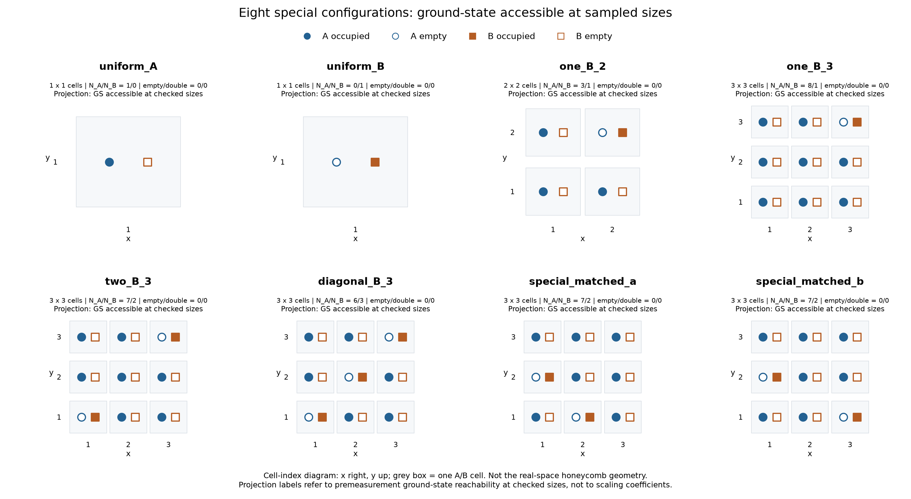

[PNG](figures_scaling_guide/special_patterns.png) · [PDF](figures_scaling_guide/special_patterns.pdf)

### 2.2 四种 general 候选

允许空原胞与双占据原胞；这四种构型在已核验尺寸上可达基态。相同 A/B 数量和空、双占据数量不决定空间排列，也不决定纠缠观测。

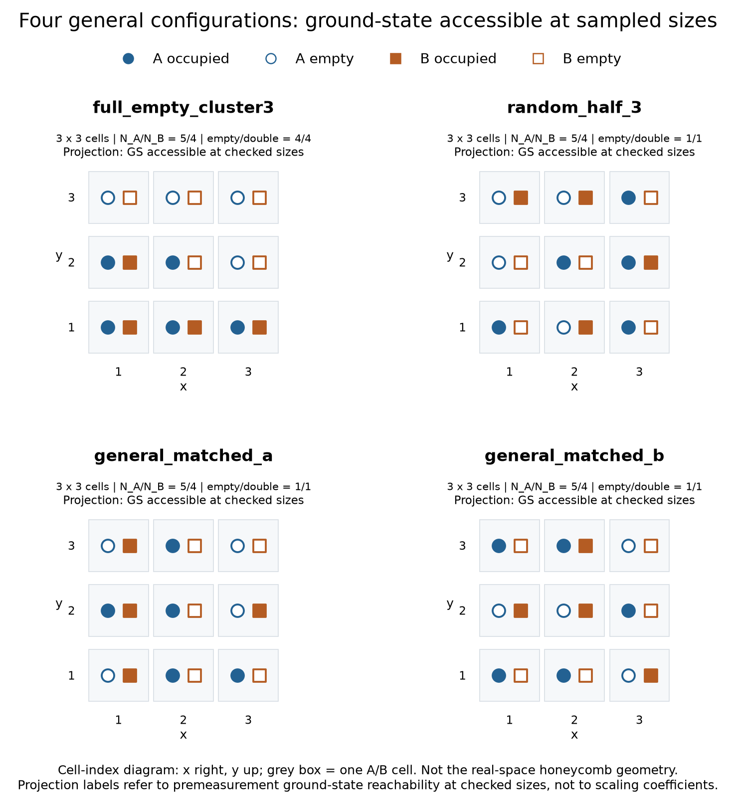

[PNG](figures_scaling_guide/general_patterns.png) · [PDF](figures_scaling_guide/general_patterns.pdf)

### 2.3 五种投影受阻对照

这些构型属于下文证明的 2×2 受阻家族，不是“已到基态但没有 scaling”的反例。

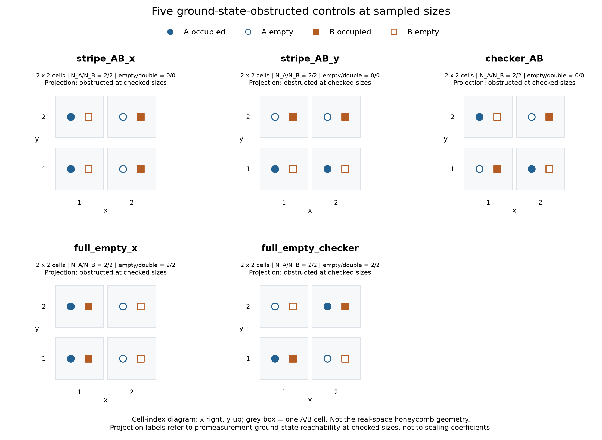

[PNG](figures_scaling_guide/obstructed_patterns.png) · [PDF](figures_scaling_guide/obstructed_patterns.pdf)

精确编码见 [patterns.csv](data/patterns.csv) 与 [arrangement_selection.csv](data/arrangement_selection.csv)。有限尺寸的测量前基态分类见 [平衡数据验证](data/equilibrium_validation.json)；判定时需要区分负能态、零模和正能态，不能只检查缺少多少负能方向。

### 2.4 按每原胞占据数划分的三类：首批七个可达例

这里把原来的 general 再分为“纯空胞／双占胞”和“与单占胞混合”，形成三种互斥分类。下表的数量均指**一个超胞内的原胞数**，不是晶格总粒子数：

| 类别 | 构型 | 超胞 | 空胞数、单占胞数、双占胞数 |
|---|---|---|---|
| 每原胞恰占一个粒子 | one_B_2 | 2×2 | 0，4，0 |
| 每原胞恰占一个粒子 | diagonal_B_3 | 3×3 | 0，9，0 |
| 每原胞只允许空或双占 | pure02_block4 | 4×4 | 8，0，8 |
| 每原胞只允许空或双占 | pure02_irregular4 | 4×4 | 8，0，8 |
| 三种原胞占据混合 | random_half_3 | 3×3 | 1，7，1 |
| 三种原胞占据混合 | general_matched_a | 3×3 | 1，7，1 |
| 三种原胞占据混合 | near02_irregular3 | 3×3 | 4，1，4 |

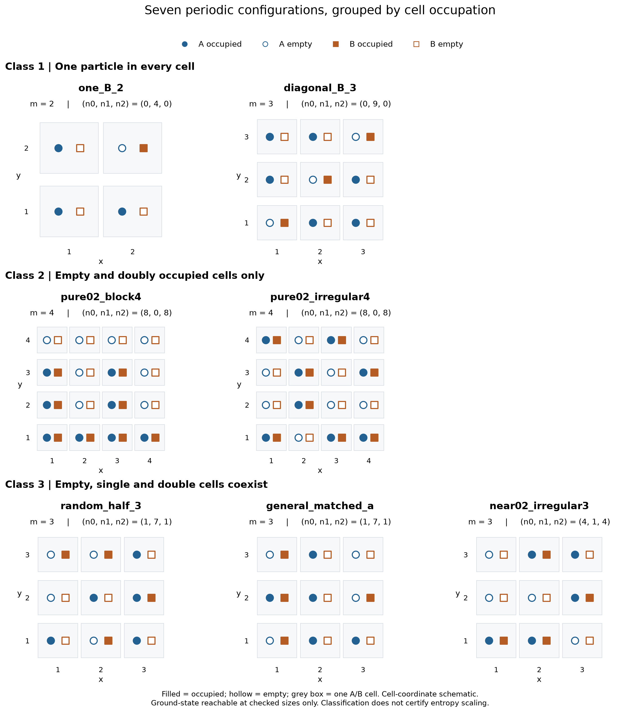

[PNG](figures_pure02_m2/classified_ground_patterns.png) · [PDF](figures_pure02_m2/classified_ground_patterns.pdf) · [原六个构型定义](occupancy_classes_patterns.jl) · [新增第三类定义](irregular_m3_patterns.jl)

**纯 0/2 类也存在能投影到基态的构型。** 上述两个 4×4 例子与其它四个例子，在 L=24、36、…、144、180、216 的全部 78 项检查中均通过，测量前可达能量与基态能量的最大绝对差为 1.82×10⁻¹²。记录见 [逐尺寸检查](data/occupancy_classes_reachability.csv) 与 [汇总](data/occupancy_classes_reachability_summary.json)。这是所列尺寸上的验证；下文的 2×2 受阻证明不能外推为任意超胞的纯 0/2 禁止定理。

两个纯 0/2 例子具有不同的 Γ 块重叠奇异谱；原两个混合例子具有相同的空、单占、双占数量而排列不同，新增第三个混合例子则以空、双占胞为主。选例依据是分类和基态可达性，没有按熵系数是否相等筛选。这些例子不足以证明所属整类具有相同的 scaling 性质；系数和拟合检查集中见 [三类对照结果](RESULTS.md#results-occupancy-classes)。

### 2.5 第三类新增：near02_irregular3

半填充的 3×3 超胞有 9 个粒子，而严格纯空胞／双占胞只能给出偶数粒子，所以这种尺寸不存在半填充的纯 0/2 构型。本次新增 `near02_irregular3`，其空、单占、双占原胞数为 **4、1、4**，单占位于 A 子格；它属于混合类，不能冒称纯 0/2 类。

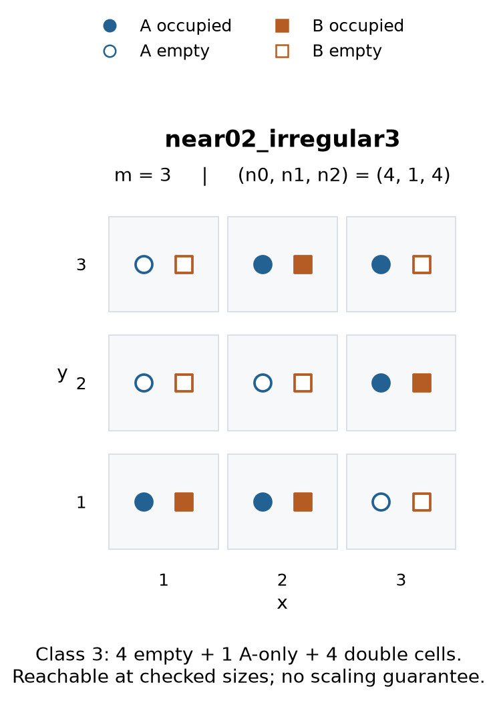

实心表示占据，空心表示空位；一个灰框是一个原胞。新构型按预定空间顺序筛选，只要求基态可达，不按熵结果选择。全部 13 个实验尺寸的两个 rank 条件均通过，但这不保证其熵已进入渐近 scaling 区。

[精确构型定义](irregular_m3_patterns.jl) · [逐尺寸可达性](data/irregular_m3_reachability.csv) · [小系统实空间核验](data/irregular_m3_validation.toml) · [第三类完整结果](RESULTS.md#occupancy-near02-irregular3)

### 2.6 第二类新增：全部六种 2×2 排列均受阻

2×2 半填充有四个粒子，第二类必须选两个原胞双占、另两个原胞全空，共有六种排列。**这些占据图能够构造，但在本模型的周期边界下全部无法投影到基态。** 它们在任何相容偶数尺寸的超胞 Γ 块均只有三个独立负能重叠方向，而基态必须填满四个；该块无零模，不能通过调整零模占据补救。严格证明见下文 3.4。

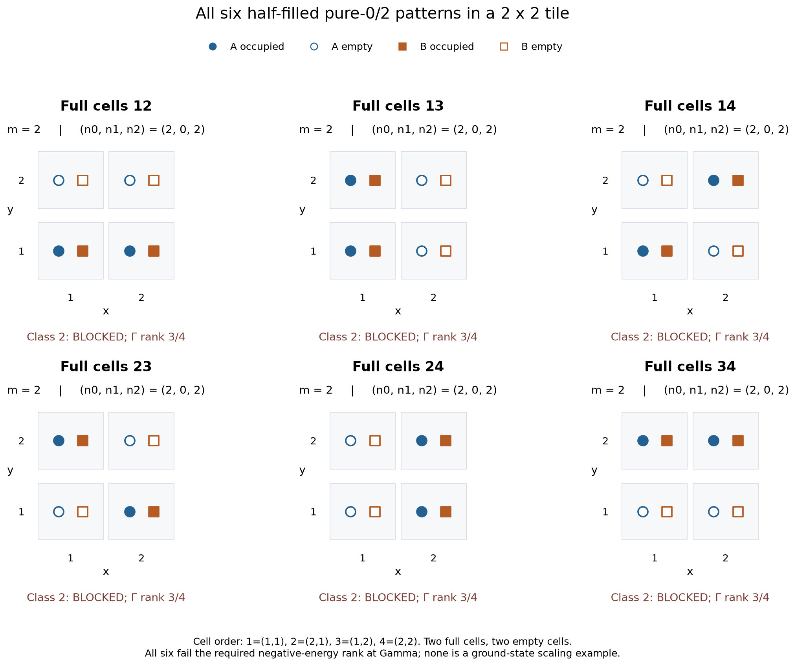

本次重新枚举六种图案并检查多尺寸可达能量，同时以直接实空间逐步 QR 演化核对。**受阻初态的浮点长时演化可能被舍入误差混入的基态分量污染；仅看到能量下降或 QR 收敛，不能推翻严格零重叠。** 投影曲线与数值误差的区分见 [第二类 2×2 结果](RESULTS.md#occupancy-pure02-m2-blocked)。这些例子没有被纳入“先由该初态准备基态，再测量”的角系数列表。

其中条纹与棋盘两种严格交替构型仍可计算有限虚时熵，以及保持真实谱支持的无限虚时极限熵；新增计算与占据图见下文 **2.7**。后者的无限虚时端是可达激发态，不能改称基态平衡端。

<a id="second-class-extra"></a>
### 2.7 第二类追加：两个可达 4×4 构型与两个严格交替对照

本批四种构型的每个原胞都只允许全空或 A/B 双占，**全部属于第二类**。两个 4×4 图案按几何形状与基态秩判据选择，没有按熵或拟合系数筛选；两种 2×2 交替图案则保留为投影受阻对照。

| 构型 | 超胞 | 满胞排列，坐标从 1 开始 | 空胞、单占胞、双占胞 | 基态可达性 |
|---|---|---|---|---|
| `pure02_staircase4` | 4×4 | 从 y=1 到 4，每行从 x=1 起依次填满 4、3、1、0 个原胞 | 8，0，8 | 所列尺寸全部通过 |
| `pure02_notched_stripe4` | 4×4 | 先填满 x=1、2 两列，再把满胞 (1,1) 与空胞 (3,2) 交换 | 8，0，8 | 所列尺寸全部通过 |
| `pure02_alternating_x` | 2×2 | x 为奇数时双占，偶数时全空；沿 y 不变 | 2，0，2 | 严格受阻 |
| `pure02_alternating_checker` | 2×2 | x+y 为偶数时双占，奇数时全空 | 2，0，2 | 严格受阻 |

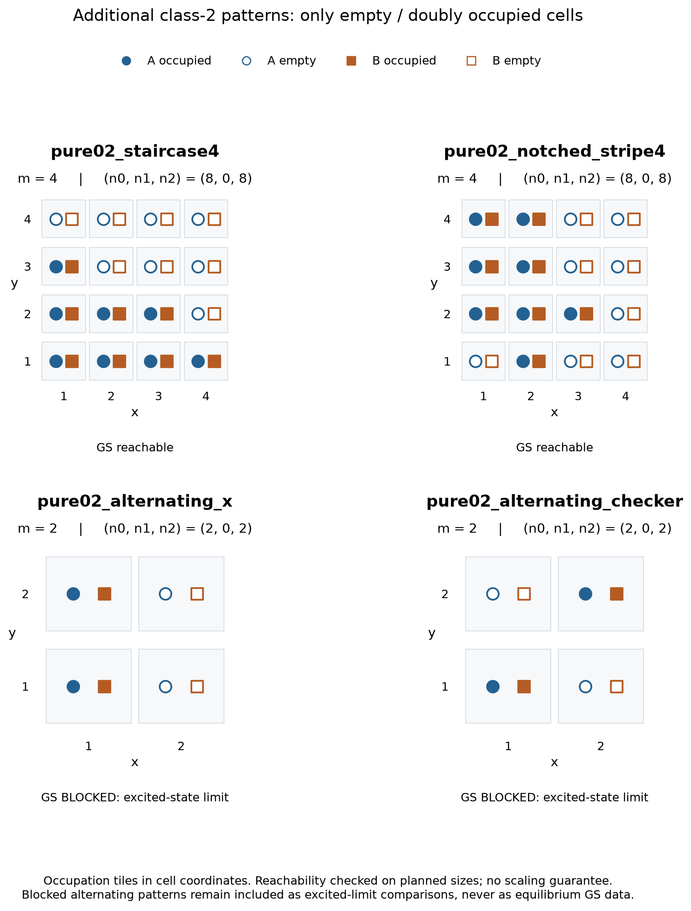

[总图 PNG](figures_second_class_extra/pattern_catalogue.png) · [总图 PDF](figures_second_class_extra/pattern_catalogue.pdf) · [精确构型定义](second_class_extra_patterns.jl)

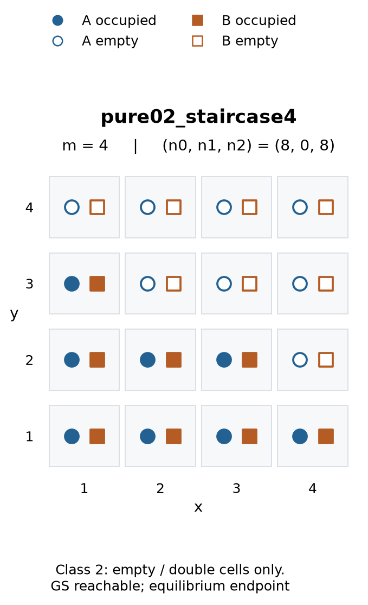

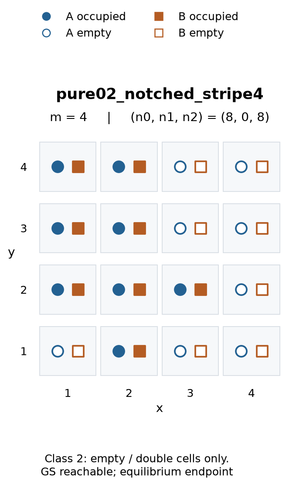

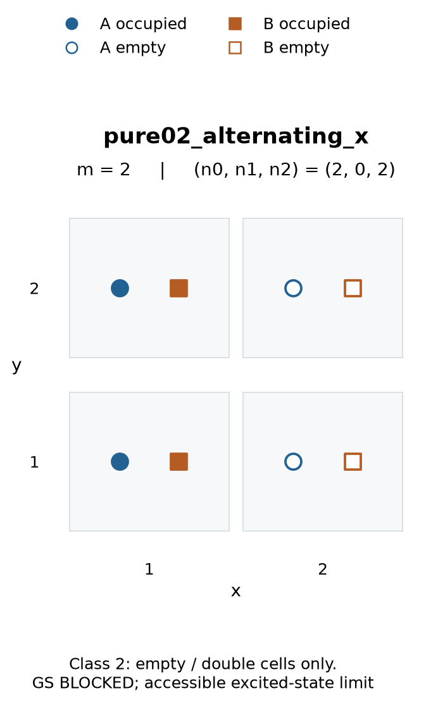

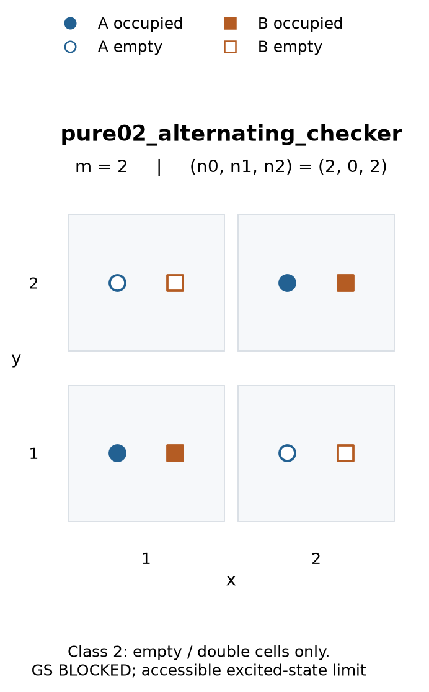

两个 4×4 例子在 L=24、36、…、144、180 共 12 个尺寸逐个动量通过两项秩条件，可达能量与基态能量的最大绝对差为 3.64×10⁻¹²；这是这些尺寸上的验证，不是任意 L 的定理。负能重叠的最小奇异值分别约为 0.00116354 和 0.0106194，虽非零，仍可能带来较长的投影过渡区。**可达不等于当前时间窗口已具有稳定的对数系数。**

这些新增例子不是旧 `pure02_block4`、`pure02_irregular4` 的平移、互补或空间对称复制。按占据诱导最近邻子图统计度数为 1、2、3 的格点数，旧两例分别为 (2,12,2)、(7,8,1)，新两例为 (1,10,5)、(2,8,6)；各图互补后的直方图也不改变。晶格空间对称保持这个图不变量，因此四种排列确实不等价。条带交换的首个候选 (1,1)→(3,1) 没有通过，下一候选 (3,2) 才通过；不能把“破坏规则排列”本身当作充分可达条件。

两个交替构型在 L=18、24、…、90、108、126、144、180 共 17 个尺寸全部受阻；L=180 的阻碍动量数分别为 59 和 118。决定性的共同原因已经是 Γ 块的负能重叠秩 3<4，而该块没有零模；详见 [2×2 解析证明](#m2-obstruction-proof)。这来自图案周期与 hopping 的振幅相消，不能简单归结为 A/B 粒子数相等，也不意味着所有时间下都禁止对数行为。

**受阻对照仍计算有限 θ 的三个区域熵和 D，并计算其可达激发态的无限虚时极限，再施加相同的末端测量。** 这里保持初态真实谱支持，避免舍入误差把严格零重叠变成伪基态分量。其测量前极限是

$$
|\Psi_{\mathrm{acc}}(P)\rangle=
\lim_{\theta\to\infty}
\frac{e^{-\theta H_0}|P\rangle}{\|e^{-\theta H_0}|P\rangle\|},
\qquad E_{\mathrm{acc}}>E_0.
$$

例如 L=180，条纹与棋盘构型的总能量差分别约为 78.45825 和 207.29840。此时的尺寸曲线描述测量后的可达激发态，不能用于声称“平衡基态角系数与非平衡角系数相同”。有限窗口的拟合仍需检查原始局部斜率、时间与尺寸条件以及模型敏感性；不因投影受阻而跳过熵计算，也不预先假定会出现对数区。

[候选筛选记录](data/second_class_extra_candidate_screen.csv) · [58 项逐尺寸秩与能量检查](data/second_class_extra_reachability.csv) · [独立验证与非等价性记录](data/second_class_extra_reachability.json) · [复现脚本](check_second_class_extra.py) · [实测曲线与拟合](RESULTS.md)

## 3. 从图形和模型判断基态可达性

### 3.1 看图之前：必须知道模型、周期和边界条件

同一张占据图用于不同的 hopping、磁通、边界条件或系统尺寸，可有不同的投影结果。因此这里的“看图判断”固定为本文的半填充、单种自由费米子 HoneyComb120 模型，实数等强最近邻 hopping 和周期边界。先读出占据 F、空位 E、图案的实际平移周期及完整系统的 L；不要把人为画大的超胞当成最小周期。

在本代码的原胞坐标中，三条键是

$$
A(x,y)\longleftrightarrow B(x,y),\quad B(x+1,y),\quad B(x,y-1).
$$

下文解析推导采用从 0 开始的 x、y；与图中从 1 开始的坐标仅差整体平移。原胞 Bloch Hamiltonian 为

$$
h(\mathbf k)=\begin{pmatrix}0&f(\mathbf k)\\f(\mathbf k)^*&0\end{pmatrix},
\qquad f(\mathbf k)=1+e^{ik_x}+e^{-ik_y}.
$$

这也解释了为什么只数 A/B 粒子数不够：hopping 会把 A 粒子移到 B，A/B 粒子数差不是守恒量。不能把初态的子格不平衡直接当成与基态不相容的对称量子数。坐标纸上的镜面也未必是这个键图的物理镜面。

### 3.2 一眼可以确定的可达构型：全 A 或全 B

**如果图中所有 A 占据、所有 B 空，或者反过来，那么在上述模型的任意相容有限尺寸上，都能投影到某个半填充基态，包括存在零能简并的情况。** 这比已扫尺寸的数值检查更强，是二分图结构给出的充分条件。

证明不依赖外观上的旋转或镜面对称性。把整个单粒子 Hamiltonian 按 A、B 排序：

$$
h=\begin{pmatrix}0&T\\T^\dagger&0\end{pmatrix},\qquad
T v_j=s_j u_j,\quad T^\dagger u_j=s_j v_j,\quad s_j>0.
$$

每个负能方向都是

$$
\phi_j^-=\frac{1}{\sqrt2}\begin{pmatrix}u_j\\-v_j\end{pmatrix},
\qquad h\phi_j^-=-s_j\phi_j^-.
$$

全 A 初态包含完整的 A 子格轨道空间，所以与这些负能方向的重叠彼此独立且都非零；剩余的 A 方向恰是零模，可以补足半填充粒子数。全 B 同理。它们因此有非零的基态子空间投影。

更一般地，若新图案是一个**已证明可达**图案经 Hamiltonian 的精确空间对称变换得到的，可直接继承基态可达性。本模型半填充下的占据/空位互补也保留这一性质。此处只判断是否到基态，不涉及熵的观测区域；若还要复用完整熵曲线，则需同时变换测量图案和切口，见下文“完整协议的对称变换”。

### 3.3 对称性怎样严格排除一个构型？

**有对称性不等于受阻，破坏对称性也不等于可达。真正的排除条件是：初态所在的守恒对称扇区与整个基态子空间不相容。** 对一个与多体 Hamiltonian 对易的幺正对称操作，如果

$$
[U_g,H_0]=0,\qquad U_g|P\rangle=\chi_P|P\rangle,
\qquad U_g|g_a\rangle=\chi_a|g_a\rangle,
$$

则

$$
\langle g_a|P\rangle=\chi_a^*\chi_P\langle g_a|P\rangle.
$$

若所有基态分量的对称本征值都与初态不同，重叠必为零，虚时演化不能改变这个结论。若基态简并，只与其中一个基态量子数不同不够，必须排除整个基态子空间。若图案被操作后变成另一张图，它本身通常不是该操作的本征态，也不能直接给它贴上“偶”或“奇”的标签。

从图上实际检查时，先找把占据集合映回自身、同时保持所有 hopping 的平移、反射等操作。**即使占据图不变，费米子态也未必是对称本征值 +1：还要计入重排已占据创建算符的置换符号**，以及磁通或规范选择存在时的单粒子相位。然后比较初态和基态的对称扇区。

自由模型还可以逐个单粒子对称扇区数占据轨道。若单粒子对称操作同时保持初态占据空间和 Hamiltonian，在一个本征值扇区 λ 中，初态有 n_P 个轨道，负能态有 n_- 个、零模有 n_0 个，则到达基态必须满足

$$
n_-(\lambda)\le n_P(\lambda)\le n_-(\lambda)+n_0(\lambda).
$$

左边不满足表示填不满该扇区的负能态；右边不满足表示必有粒子留在正能态。这些占据数在自由虚时演化下保持不变。图案的周期常能把这一步简化到很小的矩阵；但基态扇区仍需由 Hamiltonian 得到。**扇区数量匹配只是通过了必要检查，同一扇区内部仍可能有严格零重叠。**

<a id="m2-obstruction-proof"></a>
### 3.4 两条直接数 2×2 图案即可排除的规则

以下两条规则固定为本模型等强 hopping、周期边界，以及**将同一个 2×2 图案周期重复**的系统。它们对所有相容的偶数 L 成立，不要求 L 恰好是已扫的某一个尺寸。

| 从 2×2 超胞图中读到的占据 | 严格结论 | 本文图示中的例子 |
|---|---|---|
| 每原胞一个粒子，其中两个原胞占 A、另两个占 B | 六种排列全部投影受阻 | stripe_AB_x、stripe_AB_y、checker_AB，及其互补图案 |
| 两个原胞的 A/B 都占据，另两个原胞的 A/B 都空 | 六种排列全部投影受阻 | full_empty_x、full_empty_checker 及其平移/方向变体 |

**这两类是可以直接由图案识别的充分受阻条件；全 A/全 B 是可以直接识别的充分可达条件。没有命中这些规则的图案，不能据此判为可达或受阻。** 尤其不能把“2×2、每胞一粒子、A/B 各半”随意推广到任意大超胞，也不能把“不满足 A/B 各半”当成可达保证。

这里的规则来自可解析的布洛赫振幅相消。2×2 超胞的 Γ 块在任何相容尺寸上都存在，包含四个原胞动量：

$$
(0,0),\ (\pi,0),\ (0,\pi),\ (\pi,\pi),
\qquad f=3,\ 1,\ 1,\ -1.
$$

该块没有零模，基态必须填满四个负能方向。将轨道按四个 A、四个 B 排列，其负能子空间的正交基可以取为

$$
Q_-=\frac1{\sqrt2}\begin{pmatrix}I_4\\-U\end{pmatrix},
\qquad U=I_4-\frac12ss^{\mathsf T},\qquad
s=(1,-1,-1,1)^{\mathsf T}.
$$

s 的顺序为 (0,0)、(1,0)、(0,1)、(1,1)。对 special 图，令 J 是 B 占据的原胞集合。因为其它原胞占 A，重叠行列式除非零因子外就是

$$
\det U_{J,J}=1-\frac{|J|}{2}.
$$

两个原胞占 B 时它严格为零，位置如何排列都不改变这个结果。对“两个满胞、两个空胞”的图，令 I 是两个满胞，重叠行列式归结为

$$
\det U_{I,I^c},\qquad
U_{I,I^c}=-\frac12s_I s_{I^c}^{\mathsf T}.
$$

右边是一个秩为 1 的 2×2 矩阵，行列式也严格为零。**一个必需的 Γ 块已经失败，其它动量的零能简并不能补救。** 这说明这些规则并不是凭“图看起来对称”猜出的，而是把该图的周期与本模型的干涉结构结合起来得到的。

条纹还有更直观的解释。若占据图沿 y 完全不变，可按 y 动量分块；偶数 L 允许 k_y=π，此时

$$
f(k_x,\pi)=e^{ik_x}.
$$

两条 hopping 振幅抵消，剩下独立的有效二聚体 A(x)–B(x+1)。**在这个扇区，只要占据图使某个有效二聚体全空或双占，就不能到达其每个二聚体恰占一个负能轨道的基态。** stripe_AB_x 会出现这种情况。沿 x 不变的 stripe_AB_y 同理：在 k_x=π，剩下 A(y)–B(y−1) 配对。这里的二聚体是指定动量下的有效配对，不是要求真实蜂窝晶格断成二聚体；只有图案具有相应平移不变性，才能直接从实空间占据读出这个扇区的初态。

独立谱检查见 [obstruction_witnesses.jl](obstruction_witnesses.jl)：核验全部 70 个半填充 2×2 图案的 Γ 块，其中恰有上述 12 个图案在该块奇异；又核验这 12 个图案在 L=4、6、8、10、12 都受阻。解析 U 与数值负能投影对应矩阵的误差为 2.74e−15。另有 25 个完全支撑在初态空位上的负能子空间见证，非负能泄漏最大为 4.51e−14。结果及哈希见 [验证记录](data/obstruction_checks_manifest.txt)、[Γ 块逐图结果](data/obstruction_gamma_masks.csv) 和 [跨尺寸结果](data/obstruction_gamma_sizes.csv)。这些数值用于复核解析式；“所有相容偶数尺寸”的结论来自上面的证明，而非有限枚举外推。

<a id="alternating-momentum-layer"></a>
#### 交替构型的特殊有限尺寸尺度：β=0 的局部诊断

**对这两种交替态，仅有 θ/L≪1 还不够。** 在严格零重叠的动量附近，非零但很小的基态振幅会产生随时间收缩的动量过渡层。这是下面指定截面的局部结果，不是完整 D 的解析推导。

以条纹交替为例，在原胞动量 (0,δ) 与 (π,δ) 配对的四轨道块中，两个 hopping 振幅为

$$
f_1=2+e^{-i\delta},\qquad f_2=e^{-i\delta}.
$$

当 δ 很小时，负能重叠的最小奇异值约为 |δ|/6；最低激发 Slater 分量与基态分量的振幅比约为

$$
\frac{3}{|\delta|}e^{-2\theta}.
$$

于是该局部块的正能粒子数在小 δ、大 θ 下近似满足

$$
n_+(\delta,\theta)\simeq\frac{1}{1+(\delta/w_\theta)^2},\qquad
w_\theta=3e^{-2\theta}.
$$

棋盘交替在 (π+δ,0) 与 (δ,π) 的配对截面上得到同类形式，但宽度前因子为 2。精确 δ=0 点始终保留一个正能粒子；这里用允许谱支撑处理，不对奇异重叠矩阵求逆。要让有限动量网格分辨这个局部过渡层，还需要

$$
\frac{2\pi/L}{C e^{-2\theta}}\ll1,
\qquad C=3\ \text{（条纹）},\quad C=2\ \text{（棋盘）}.
$$

相应的局部交叉时间为

$$
\theta_{\rm cross}(L)=\frac12\ln\frac{CL}{2\pi}.
$$

分辨过渡层要求 θ 低于此值并留出充分余量，而不是只要求 θ≪L。L=144、180 时，条纹的交叉时间约为 2.115、2.227；棋盘约为 1.913、2.024。所用 θ=4–7 窗口已超过这两个局部交叉尺度。比如条纹在 θ=4 时宽度仅约 0.001006，而 L=144 的网格间隔约为 0.04363。

独立四轨道计算检查了 26 个点；预定 δ/w 网格上的正能占据与上述渐近式最大绝对差约为 3.2×10⁻⁶。**这为“θ/L 很小仍可有明显有限尺寸影响”提供了一个明确局部机制；它不直接算出总熵，不证明完整态只有一个指数关联长度，也不把 β=0 的推导自动推广到测量后的正 β。**

[独立脚本](diagnose_alternating_boundary_layer.py) · [局部数值](analysis_second_class_extra/alternating_boundary_layer.csv) · [推导与核验记录](analysis_second_class_extra/alternating_boundary_layer.json)

### 3.5 为什么还必须问系统尺寸，而不能只收一张图？

一个直接反例是下列逐行条纹。A/B 表示该原胞仅占据相应子格，x 向右，y 向上；图案实际周期为 1×3，画成 3×3 只是方便展示：

```text
y=3    A A A
y=2    A A A
y=1    B B B
```

同一图案在已有全枚举数据中的结果是：

| 完整系统 L | 无限虚时是否到达基态 | 极限能量减基态能量 |
|---|---|---:|
| 9 | 是 | 数值误差内为 0 |
| 18 | 否 | 12 |
| 27 | 是 | 数值误差内为 0 |
| 36 | 否 | 24 |

这个例子也能用上一节的二聚体机制理解：图案沿 x 不变，偶数 L 允许 k_x=π，A(y)–B(y−1) 配对出现双占与全空。奇数 L 不含这个动量，所以这一阻碍消失；表中 L=9、27 的可达性由完整检查确认，**不能仅由“没有这个阻碍”推出任意奇数 L 都可达**。

因此，“A/B 数量不等”“画出的超胞边长为奇数”都不是充分可达条件。镜面对称也不能单独决定结果：全枚举中 mask=43258 与 mask=44203 两个 3×3 general 图案都保持本模型的镜面 (x,y)→(−y,−x)，均有 A/B=2/7、两个满胞和两个空胞、无非零的超胞内部平移对称；但在 L=18，前者可达基态，后者能量仍高 7.85739738。这是在否定这些粗略指标的充分性，并非声称二者具有完全相同的全部空间群表示。

以上图案的逐位占据、源数据行号和能量见 [图形判据反例表](analysis_geometry/geometry_counterexamples.csv)，来源哈希及镜面定义见 [复核记录](analysis_geometry/geometry_provenance.json)，可用 [review_configuration_geometry.py](review_configuration_geometry.py) 重建。它们来自原有全枚举数据，只用于基态可达性判断，不承担 scaling 的通过或失败分类。

### 3.6 其余图案：完整判据及数值边界

对不属于已证明可达家族、也未找到明确对称性或干涉阻碍的图案，应标为“尚未判定”，而不是“看起来一般，所以一定可达”。此时再用完整判据：每个允许的 Bloch 动量 k，令 P_k 为初始占据轨道，V 的列为相应能量子空间的基。本模型每个超胞有 m² 个粒子，到达基态的谱投影秩条件为

$$
\operatorname{rank}(V_{<0}^\dagger P_k)=\dim\mathcal H_{<0},
\qquad
\operatorname{rank}(V_{\le0}^\dagger P_k)=m^2.
$$

它要求所有负能方向可达，其余粒子可放入零模而不占据正能方向。检查应覆盖所有所研究尺寸的允许动量；一个小尺寸通过不能保证所有尺寸通过。数值上还需查看接近秩阈值的奇异值和重构误差。

秩只区分严格零与非零重叠，不限制非零重叠有多小。很小的低能分量、不同能量尺度和测量强度都可能推迟可用时间窗口。因此“能到基态”是本协议比较基态角贡献的前提，不能单独作为“非平衡一定可提取”的判据。

## 4. 有限测量、对称变换与强测量极限

### 4.1 有限 β 保留什么？

固定有限超胞周期、有限 β，并采用连续 Bloch 动量描述。设测量前占据轨道 Q(k) 的列正交，测量矩阵为

$$
W_\beta=\operatorname{diag}(w_r),\qquad
w_r=\begin{cases}1,&r\in F,\\e^{-2\beta},&r\in E.\end{cases}
$$

测量后应先归一化占据子空间，关联矩阵为

$$
G_\beta(k)=W_\beta Q(k)
\big[Q^\dagger(k)W_\beta^2Q(k)\big]^{-1}
Q^\dagger(k)W_\beta.
$$

这也回答了 QR 的作用：一般满列秩轨道矩阵的关联矩阵需要中间的 Gram 矩阵逆；QR 后改用正交列 Q 时，才可直接写成

$$
G=P(P^\dagger P)^{-1}P^\dagger=QQ^\dagger.
$$

有限 β 下 W 可逆，上述占据子空间变换及其逆都是定秩子空间上的实解析映射。因此若测量后的投影矩阵在某邻域解析，逆变换会让测量前的矩阵也解析。**真正的 Dirac 方向依赖非解析性不会被有限、周期的滤波消掉。** 这不包括孤立零模点任意选态造成的赋值差别，也不证明熵必有角对数项或两端系数相等；滤波不是局域幺正，熵及其系数可以改变。

### 4.2 哪些对称变换能复用结果？

在本模型的实数二分图 hopping、半填充和自身空位测量协议下，将构型与测量集合一起取补，有

$$
C_R^{\rm comp}=I_R-\Gamma_R C_R^T\Gamma_R,
$$

其中 Γ 在 A/B 子格取相反符号，区域谱由 ν 变成 1−ν，所有 Rényi-2 熵因此相同。同时平移构型、测量图案与区域也保持熵；仅平移图案而固定切口，会改变微观切口相位。其它空间变换只有同时保持 Hamiltonian、协议及区域对应关系，才能转移完整熵曲线。相同 A/B 数量或相同空、双占据数量不构成这样的等价关系。

[互补和平移对照](data/arrangement_controls.csv)的最大互补熵差为 1.33e−13，[同时平移核验](data/arrangement_covariance.csv)的最大误差为 6.39e−14；排布依赖的实验结果见 [平衡对照](RESULTS.md#equilibrium)。

### 4.3 固定有限系统的强测量指数

令 Q 为测量前正交轨道，F/E 为自身初始满位/空位。精确有限虚时演化与自身初态的重叠非零；对有非零基态投影的无限虚时极限也如此。因此方阵 Q_F 可逆，可以用图表示写占据空间：

$$
t=e^{-2\beta},\qquad X=Q_EQ_F^{-1},\qquad
\operatorname{span}(W_\beta Q)=\operatorname{span}\begin{pmatrix}I\\tX\end{pmatrix}.
$$

按 F、E 排序，归一化关联矩阵为

$$
C(t)=\begin{pmatrix}
(I+t^2X^\dagger X)^{-1}&t(I+t^2X^\dagger X)^{-1}X^\dagger\\
tX(I+t^2X^\dagger X)^{-1}&t^2X(I+t^2X^\dagger X)^{-1}X^\dagger
\end{pmatrix}.
$$

固定有限 L，区域 R 的强测量展开是

$$
S_2(R)=A_R e^{-4\beta}+O(e^{-8\beta}),\qquad
A_R=2\left(
\|X[E\cap R,F\cap\bar R]\|_F^2+
\|X[E\cap\bar R,F\cap R]\|_F^2\right).
$$

跨区域关联矩阵的领先项与 t 成正比，纯态熵的领先项是其 Frobenius 范数平方的两倍。改变 t 的符号等价于 E 上的局域相位变换，故没有奇数次项。展开条件为

$$
e^{-2\beta}\|X\|_2\ll1,\qquad
\|X\|_2=\sqrt{\sigma_{\min}(Q_F)^{-2}-1}.
$$

**领先系数非零时，固定有限系统的足够强测量具有公共指数 4；构型、区域和 L 改变前因子及进入渐近区所需的 β。** 若领先系数为零，X 不跨越该划分，态对该划分完全分解，熵恒为零。该展开并不要求测量前是全局基态，也不能用来交换强测量与热力学极限。它解释了固定 L 下强测量最终回到初始乘积态，而不与有限 β 的 Dirac 非解析性冲突。

[17 种构型、85 行小尺寸验证](data/strong_measurement_controls.csv)使用下文跨区域 SVD 公式；β=8 时相对领先项最大误差约 6.58e−10。旧大尺寸 β=8 的极小熵接近浮点误差底，仅适合确认接近零，不能精确提取指数，见 [旧数据精度对照](data/strong_measurement_previous_pairs.csv)。

### 4.4 全 A 基态的解析测量核与零模

采用第 3 节的 Bloch Hamiltonian，从全 A 投影到负能轨道后测量 B。在非零能量动量上，关联矩阵为

$$
C_\beta(k)=\begin{pmatrix}
\dfrac{1+\tanh(2\beta)}2&-\dfrac{f(k)/|f(k)|}{2\cosh(2\beta)}\\
-\dfrac{f(k)^*/|f(k)|}{2\cosh(2\beta)}&\dfrac{1-\tanh(2\beta)}2
\end{pmatrix},\qquad
\frac{C_{AB}(\beta,k)}{C_{AB}(0,k)}=\operatorname{sech}(2\beta).
$$

两个 Dirac 点上，上式相位未定义；实际演化保留最初占据的 A 零模，应取

$$
C_\beta(k_D)=\operatorname{diag}(1,0).
$$

当 L 为 3 的倍数时，总空位占据因而是

$$
\langle N_E\rangle=(L^2-2)\frac{e^{-4\beta}}{1+e^{-4\beta}}.
$$

[15 组解析核对照](data/uniform_A_measurement_kernel.csv)覆盖 L=6、9、12，β=0、0.5、1、2、4，非零动量块最大误差为 3.89e−16。零模按实际初态保留，不能为了统一不同初态而任意替换。

## 5. 什么时候可以比较两端的角系数？

### 5.1 相等结论需要额外的标度假设

在构型和 β 固定、角项正确分离的前提下，**假设**存在统一标度函数，且没有遗漏的额外增长尺度：

$$
D(L,\theta;P,\beta)=c_{\rm eq}(P,\beta)\ln L
+F_{P,\beta}\!\left(\frac{\theta}{L^z}\right)+\cdots,\qquad
F_{P,\beta}(x)\longrightarrow\text{常数}\quad(x\to\infty).
$$

还需在微观暂态之后、系统饱和之前，D 的主导项与 L 无关。若此区间标度函数的对数系数为 q，则

$$
D\simeq c_{\rm eq}\ln L+q\ln(\theta/L^z)+\text{const}
=q\ln\theta+(c_{\rm eq}-zq)\ln L+\text{const}.
$$

尺寸独立性要求

$$
\boxed{c_\theta=c_{\rm eq}/z}.
$$

本模型低能 Dirac 色散的动力学指数为 1，因而在这些假设成立时两端系数相同。**基态可达、平衡端有对数拟合，或某一时间窗两尺寸重合，都不能单独证明这些假设。** 反向推断同样缺少保证。完整检验应同时覆盖短时和饱和极限，并检查减去平衡对数项后的交叉函数是否按时间与系统尺度之比重合；现有数据尚未逐构型完成这种验证。

### 5.2 实际选窗与判读顺序

“短时”相对于系统弛豫时间，不是趋近零；乘积初态在零虚时熵为零。需要同时满足

$$
\theta_{\rm micro}(P,\beta)\ll\theta,\qquad
v\theta\ll\ell_{\rm geom},\qquad \ell_{\rm geom}=L/3.
$$

最新统一扫描采用以下操作筛选，**不是尺度分离定理**：

$$
\theta\ge4,\qquad \theta/L\le0.05.
$$

先比较至少两个尺寸的相同实测时间点及未经平移的 D，再改变时间下限、上限、整体窗口和逆时间修正阶数。若有第三尺寸，还要看漂移是否递减。2%、1%、5% 等门槛只是本次局部诊断标准，不是统计置信区间或渐近误差界。此前密集 β 扫描的主窗 4–7 跨度不足两倍，五参数模型仅有两个残差自由度；新的 [β=0 专项](RESULTS.md#beta0-study) 改用 4–9 的 11 点主窗及独立确认网格。两批都仍需保留有限窗口的限制，不能把更多拟合点等同于渐近证明。

判断新图案时，依次确认模型/实际周期/尺寸/测量规则，检查测量前可达性，检查平衡面积项与次主导项，检查非平衡尺寸和时间修正，最后比较两端系数。低能重叠虽非零却很小时，进入可用窗口可能较晚；盲目增大虚时又会引入有限尺寸影响。

当前 [三类构型对照](RESULTS.md#results-occupancy-classes)、[uniform A](RESULTS.md#results-uniform-a)、[三个额外构型](RESULTS.md#results-patterns)和 [历史专项](RESULTS.md#history)分别报告了实际覆盖和未稳定点。每胞占据属于 1、0/2 或混合，special/general、A/B 数量、超胞奇偶、镜面对称等标签，都不能替代这些检查。

<a id="beta0-initial-state"></a>
### 5.3 β=0：哪些初态最适合，为什么图案会改变所需时间？

**uniform A/B 是最有依据的基准；一般图案必须另外验证时间侧的尺寸平台和拟合稳定性。** 本次专项按 16 个可达候选逐一检查，再对 10 个构型补大尺寸确认；实际支持名单、未充分确认的候选和明显过渡的例子分开列在 [β=0 结果](RESULTS.md#beta0-study)。没有进入本轮确认网格，不能解释为该构型不能提取。

本轮得到数值支持的是 **uniform A、one_B_2、one_B_3、special_matched_a、general_matched_a**，两端主估计的相对差均不到 0.9%；uniform B 及这些构型的逐格空／占互补图案可由下文恒等式继承相同熵曲线。这是 L=180、216 和 θ=4–9 主窗口及预定移窗、阶数检查下的结论，不是任意精度、任意时间窗的保证。第一类的 diagonal_B_3 仍有阶数漂移，第三类的 general_matched_a 则通过，说明只看每胞占据类别不足以判断当前窗口是否可用。第二类两个完成确认的例子仍未稳定，另外两个只完成探索，不能据此否定整个第二类。

**β=0 的平衡端还有一个严格结论：本模型中，由可达构型得到的精确 Slater 基态，若其 D 的渐近对数系数存在，该系数不随初始构型改变。** 不同零模占据可以改变有界的有限尺寸项；因此不同有限窗口拟合值不能直接解释成不同的普适角系数。这个结论不保证非平衡端已经进入可用时间区。

<details>
<summary>为什么有限个零模不改变渐近对数系数</summary>

这里只讨论本协议产生的数守恒纯 Slater 基态。在同一尺寸上，它们填满全部负能态，只在单粒子零模空间中不同：

$$
C=C_-+V_0 ZV_0^\dagger,\qquad
\operatorname{rank}(C-C_{\rm ref})\le r=\dim\mathcal H_0.
$$

本模型的非对角 Bloch 元素为 1+exp(ikₓ)+exp(−ikᵧ)。方形周期 L×L 系统在 L 是 3 的倍数时有两个 Dirac 动量，每个动量两个零模，因此 r=4；否则 r=0，半填充 Slater 基态唯一。超胞折叠不增加物理零模数。

限制到任意区域 R 不增加差矩阵的秩。Hermitian 矩阵的秩扰动交错关系使两组本征值计数函数相差至多 r。Rényi-2 单本征值熵函数在 [0,1] 上的总变差为

$$
f(t)=-\ln[t^2+(1-t)^2],\qquad
\int_0^1|f'(t)|\,dt=2\ln2.
$$

对计数函数积分即得与 L 无关的界：

$$
|S_2(R)-S_{2,\rm ref}(R)|\le2r\ln2,\qquad
|D-D_{\rm ref}|\le4r\ln2.
$$

因此，只要参考态的角诊断量具有有限的 D/ln L 极限，任一其它精确 Slater 基态具有同一极限。这个界本身不证明面积项已抵消或对数项存在；它只说明有限维零模选择不能改变已经存在的对数系数。有界差也不必是严格常数，所以有限尺寸拟合仍可出现系统偏差。该论证不直接适用于任意非 Gaussian 零模多体叠加，也没有涉及有限 θ。

[自包含推导及小系统核验](analysis_beta0_study/zero_mode_bound.json) · [核验代码](beta0_zero_mode_bound.py)。

</details>

在 β=0，测量算符是恒等算符，问题完全属于初态的虚时弛豫。对于全 A/B，每个非零能量二能级块的负能重叠恒为 1/√2。令能量为正负 ε，则

$$
C_\theta(k)=\frac12\left[I-\tanh(2\varepsilon\theta)\frac{h(k)}{\varepsilon}
\ \pm\operatorname{sech}(2\varepsilon\theta)\sigma_z\right].
$$

它只含 εθ 这一临界变量；Dirac 附近 ε 与距节点的动量成正比，因此没有额外的小重叠投影尺度。文献的自由费米子算例从 AFM 乘积态出发，单种费米子对应这里的全 A/B，并先检查固定虚时的尺寸平台，再提取时间对数系数。[正式论文](https://www.nature.com/articles/s41467-026-75645-x) 没有逐一验证任意超胞图案。

对其它图案，**“重叠非零”和“重叠足够大”是不同条件**。在无零能级的动量处，取初态占据轨道 P 的列正交，令负、正能重叠分别为 A、B；当 A 可逆时定义

$$
A=V_-^\dagger P,\quad B=V_+^\dagger P,\quad
X_\theta=e^{-\theta E_+}BA^{-1}e^{\theta E_-}.
$$

若该处最小跨带能隙为 Δ，A 的最小奇异值为 s，采用谱范数，则

$$
\|X_\theta\|\le e^{-\Delta\theta}\sqrt{s^{-2}-1}.
$$

很小但非零的 s 会增大衰减前因子，推迟进入合适窗口。它不是严格投影受阻，也不能据此断言最终系数不同。本次有隙区域的数值筛查得到：block4 的最小 s 约 0.0906，notched4 约 0.0106，irregular4 约 0.00516，staircase4 约 0.00116。这里的区域按跨带能隙至少 0.3 定义，数值来自有限扫描与局部优化，**不是整个连续动量空间无零点的证明**。

<details>
<summary>低能边界、谷混合和有条件的 scaling 推理</summary>

初态在高能负带投影后留下的低能边界信息，比原图的 A/B 粒子总数更有用。在精确 Dirac 动量处，设 R 的列张成高能负带重叠的零空间，V₀ 为低能零模基：

$$
\operatorname{span}R=\ker(V_{\rm high,-}^{\dagger}P),\qquad
Q_b=\operatorname{orth}(V_0^\dagger P R).
$$

这一步需要先检查高能负带和低能支撑的秩。Q_b 是积分掉已填满高能方向后留下的边界轨道，不是人为给 Hamiltonian 添加质量。

对于 m×m 超胞，m 不被 3 整除时，两谷位于不同的超胞动量；每谷的零模空间是二维。将其单占据投影表示成 Bloch 向量，亚格方向分量为 n_z，则所有 Dirac 方向中的最小负能重叠为

$$
s_{D,\min}=\sqrt{\frac{1-\sqrt{1-n_z^2}}2}.
$$

所以有效 n_z 非零能排除该二维低能块的角向零重叠。**有效 n_z 不等于原图 A/B 占据之差。** 例如同属纯 0/2 的 block4 与 staircase4，原始 A/B 总数都相等，有效边界极化却不同。m 被 3 整除时两谷折叠到同一动量，初态可产生谷混合，必须检查完整的四维边界矩阵，不能只使用一个平均极化数。

本次用 918 个局部动量／时间点核验了高能消去后的 Dirac 边界演化；在固定动量距离与时间的乘积、把动量距离缩小十倍时，完整 Bloch 核与低能核的误差约缩小十倍。它验证的是局部低能缩放极限，**没有直接计算或证明完整区域熵的角系数**。

如果远离 Dirac 节点的重叠存在统一正下界，且有效 Dirac 边界在所有方向都不退化，那么不再出现额外发散的投影尺度。在初态过渡之后，低能核只依赖动量距离与 θ 的乘积，微观尺度与 vθ 之间的关联可趋向基态临界核；这给出两端角对数系数相同的物理理由。该推理仍以角项分离和单一增长尺度为前提，不是从“有限格点 rank 通过”直接推出的熵定理，也不证明 θ=4–9 已足够。

</details>

最后，当前二分图模型有严格的占据互补关系。β=0 时，所有占据与空位交换后的初态满足

$$
C_{P^c}(\theta)=I-\Gamma C_P(\theta)\Gamma,\qquad
S_2(R;P^c,\theta)=S_2(R;P,\theta),
$$

其中 Γ 在两亚格取正负号。因此某个初态若得到可靠的时间系数，其逐格点互补图案具有完全相同的熵曲线；全 A/B 是最简单的例子。这项恒等式与“相同占据数量”的经验分组不同。本次 99 个小系统状态的独立验证中，完整关联矩阵的互补关系误差按 Frobenius 范数除以 L 计，不超过 4.87×10⁻¹⁵；对应 D 的绝对误差不超过 1.42×10⁻¹⁴。[精确位图检查](analysis_beta0_study/complement_audit.json)另确认：当前 16 个候选加 uniform B 中，只有全 A/B 是直接逐格互补对，不能借此把六个未做大尺寸确认的候选自动升级为已确认。

[连续动量与低能诊断](analysis_beta0_study/physics_summary.json) · [逐构型筛查](analysis_beta0_study/physics_pattern_summary.csv) · [有效 Dirac 边界](analysis_beta0_study/physics_dirac_boundary.csv) · [独立小系统核验](data/beta0_study_validation.toml)。这些诊断只用于 β=0，不能直接推广为正 β 下的结论。

## 6. 数值方法附录：保留完整谱的精确熵公式

以下方法只改写熵的计算，不截断低能模，不把有限虚时换成基态，也不改变单种费米子、自然对数的归一化。对合法区域关联矩阵，基本公式是

$$
S_2(R)=-\log\det\left[C_R^2+(I_R-C_R)^2\right].
$$

### 6.1 极小熵：纯态跨区域 SVD

全系统纯 Slater 态的关联矩阵满足

$$
C^\dagger=C,\qquad C^2=C,\qquad
C_R(I_R-C_R)=C_{R\bar R}C_{\bar RR}.
$$

因此可用跨区域关联矩阵的全部奇异值稳定计算

$$
S_2(R)=-\sum_j\ln(1-2s_j^2),\qquad
s_j\in\operatorname{svdvals}(C_{R\bar R}),\quad 0\le s_j\le\tfrac12.
$$

实现可使用 `-sum(log1p.(-2 .* svdvals(C[R,Rbar]).^2))`，避免把接近 0 或 1 的区域本征值舍入误差直接累加为熵。这要求全局投影纯态，不能直接用于有限温度混合态，也不能突破任意小振幅下的浮点限制。

### 6.2 uniform A 矩形的半维计算

矩形有 p 个原胞，按先 A 后 B 排序。J 同时反转矩形的两个坐标；uniform A 协议的实相关矩阵满足

$$
K=C-\tfrac12I=\begin{pmatrix}Z&X\\X^T&-Z\end{pmatrix},\qquad
Z^T=Z,\quad JZJ=Z,\quad XJ=(XJ)^T.
$$

对 B 子格作正交变换 J，令

$$
\widetilde K=\begin{pmatrix}Z&Y\\Y&-Z\end{pmatrix},\qquad
Y=XJ,\qquad M=Z+iY=M^T.
$$

该实矩阵表示复向量上的反线性映射，其平方对应 M 乘其共轭；因 M 复对称，后者也是 M 乘其共轭转置。矩阵又与表示乘 i 的矩阵反对易，故

$$
\operatorname{spec}(\widetilde K)=\{+s_j(M),-s_j(M)\}_{j=1}^{p},
$$

$$
S_2=-2\sum_{j=1}^{p}\ln\left(\tfrac12+2s_j(M)^2\right)
=-2\ln\det\left(\tfrac12I+2M^\dagger M\right).
$$

[实现](uniformA_entropy_extension.jl)用 HERK 和 p 维 Hermitian Cholesky 保留全部奇异值；待分解正定矩阵的本征值在 1/2 与 1 之间。只接受 m=1、每胞占 A 的协议，逐次检查实性、互补块、反演结构和轨道正交性；结构不满足即报错。核来自实际完整状态，Dirac 零模也保留，不计算有奇点的相位除法。

[24 个物理案例验证](analysis_uniformA_dense/half_entropy_validation.csv)同时对照完整本征值法、实 Cholesky、块变换和配对谱；最大熵差为 1.30e−12。源码哈希和检查见 [验证回执](analysis_uniformA_dense/half_entropy_validation.toml)，[验证脚本](validate_uniformA_entropy_extension.jl)。

### 6.3 一般实相关矩阵的复移位行列式

对 n 维 Hermitian 相关矩阵，定义

$$
z=\frac{1+i}{2},\qquad A=C-zI.
$$

因两因子均为 C 的多项式，彼此对易，有

$$
C^2+(I-C)^2=2(C-zI)(C-\bar zI)=2AA^\dagger,
\qquad S_2=-n\ln2-2\ln|\det A|.
$$

使用 `logabsdet` 无需选择复对数分支。合法 C 的移位矩阵奇异值在 1/2 与 1/√2 之间，条件数至多 √2。C 实对称时 A 复对称，可用 LU 或复对称 Bunch–Kaufman 分解；[可选实现](multi_pattern_entropy_extension.jl)检查实性、Hermitian 性和轨道正交性，始终处理完整 n 维矩形矩阵，不借用 uniform A 的半维结构。

**省去矩阵平方并未在已测代表尺寸上加速，正式一般构型扫描仍以实 Cholesky 为默认。** random_half_3、L=108、θ=5、β=1、8 个 BLAS 线程的顺序预热测试中，完整重建与分解时间中值：实 Cholesky 1.12054 秒、复 LU 1.82668 秒、复对称 Bunch–Kaufman 2.22159 秒、rook 变体 2.15641 秒；熵差不超过 3.12e−12。这不是所有尺寸或硬件的性能结论。

[小尺寸验证](analysis_multi_pattern_entropy/small_validation.csv)、[验证回执](analysis_multi_pattern_entropy/small_validation.toml)、[代表尺寸计时](analysis_multi_pattern_entropy/representative_benchmark.csv)和 [方法回执](analysis_multi_pattern_entropy/representative_benchmark.toml)保留全部检查。统计残差、模型敏感性、恒等式核验误差和性能差别不能混作物理系数的置信区间；统一复算入口见 [RESULTS.md](RESULTS.md#reproduce)。
