# 原随机交换更新下的 Born 平均纠缠熵

2026-10-29 的后续研究见 [单层 Born 测量的严格限制](BORN_SINGLE_LAYER_THEOREMS.md)：补充精确平均通道、单区域熵的增长阶界、数涨落角量的对数下界，以及新的独立样本验证。下文保留原随机交换实验及其有限尺寸结论。

**最新的平移平均检验已完成：新增 24 条独立链，共保留 20,480 条构型观测。共有局域直边面积项可以逐构型精确配平，平移平均也复现原来的 Born 均值；但 β=3、L≤36 的形状修正仍明显，不能把剩下的 D 直接认作纯角对数项。需要区分“面积项相消”和“已可靠提取角系数”。**

本文件记录 2026-10-27–28 的计算。使用你原来的提议方式：从目标空位集合 E 和补集 S 中各均匀抽一个格点，交换后按 Metropolis 概率接受。一个 sweep 包含总格点数次交换尝试，在每个 sweep 末记录一次熵；拒绝后的构型仍参与测量。记录之间允许相关，保留的 sweep 数不能直接当作独立样本数。

本次计算的三个问题是：热化需要多少 sweeps；给定误差目标需要多少正式样本；Born 平均的角贡献和无角条带熵怎样随测量强度、尺寸变化。统计收敛和有限尺寸 scaling 的可靠性分别判断。

按你的选择，主计算加入 μ/t=10⁻⁸ 的交错化学势（A 正、B 负）固定零模占据。以下结果对应**固定一半输出属于 E 的条件 Born 平均、代码中的一份 Slater 态**；首批 β 扫描尺寸为 L=6–24，β=3 另扩展至 L=27、30、36，本轮再独立比较 L=6、12、18、24、30、36 的两套几何。条件分布与无条件测量平均的区别、熵的归一化及独立的 β=0 确定性核验均在后文明确说明。

## 当前能得出的结论、物理预期与解释

**截至 2026-10-28，数据支持：Born 测量显著压低无角条带熵，角贡献组合 D 则有很强的有限尺寸修正；β=3 的部分大尺寸窗口能用“对数项＋修正”描述，但新增的两几何检验尚未显示形状无关的角系数。目前既没有确定所有 β 的渐近角系数，也没有证实 D 从 ln L 转成 L。** 以下讨论针对本文件的固定半数输出条件 Born 平均、二阶 Rényi 熵和单次测量层；不直接套用持续监测系统的稳态相变结论。

### 数据已经说明了什么

| 测量强度 | 当前数据支持的结论 | 仍不能确定的部分 |
|---|---|---|
| β=0 | 含 1/L 修正的 L≤36 拟合给出约 0.155 的稳定参考值 | 纯 log 拟合仍有尺寸漂移；0.155 是数值参考估计，不是精确解析值 |
| β=0.5、1 | 当前含修正拟合没有显示相对基线的稳健偏离 | 尚未证明非零 β 的渐近系数严格等于基态值 |
| β=1.5–2.5 | 同一有限尺寸窗口的拟合系数明显上升 | 上升可以包含修正项和外推偏差，不能直接称为普适角系数增强 |
| β=3 | 旧的近线性外观开始弯曲；平移平均复现均值，形状差与无角条带宽度差仍有明显尺寸漂移 | 局部对数斜率尚无明确平台，拟合系数仍依赖窗口、模型和几何 |

固定 L 的熵、固定 L 的 D、由尺寸外推得到的角系数是三个不同量。例如 L=24 时，S_A 从 β=0 的 15.855 降至 β=3 的 0.700；D 在弱测量区略升，随后从约 0.60 降至 0.134。但中等 β 的有限窗口 c_fit 可以同时增大，因为常数项与尺寸修正也在改变。D 是三种熵的差，不能要求它和 S_A 同步变化，更不能从一个尺寸的 D 推出角系数。

**统计收敛与进入渐近 scaling 区间是两件事。** 已有多链诊断、小尺寸全枚举、数值重建和独立拟合复核没有发现实现或采样目标错误；这支持当前均值的可信度，不能消除模型偏差，也不能证明所有稀有事件都已覆盖。尤其不能把 β=3 上一轮主窗口异常小的 χ² 当作对数律已获证明的证据，具体限制见下文“β=3 的大尺寸扩展”一节。

### 从物理上期待什么：弱测量下的工作假说

如果测量后的 Born 系综在长距离仍由同一个无质量 Dirac 固定点控制，并且角点对应的 Rényi 观测量也回到该固定点，那么合理的预期是：**面积项可以随 β 明显改变，而渐近角对数系数保持基态值。** 对固定形状，候选展开为

$$
\overline{S_2(R)}=\alpha_R(\beta)L-c_R^{(0)}\ln L+\gamma_R(\beta)+\delta_R(L,\beta),
\qquad \delta_R(L,\beta)\longrightarrow0,
$$

$$
\overline D(L,\beta)=c_B^{(0)}\ln L+\gamma_D(\beta)+\delta_D(L,\beta),
\qquad c_B^{(0)}=2a_2(\pi/3)+2a_2(2\pi/3)\simeq0.155.
$$

第一式已假定没有额外的非角对数项；若存在，则还需验证其在 D 中相消。无角条带的角系数为零，B 的四个角是两个 60° 和两个 120°。这里的约 0.155 沿用本计算的基线归一化。平滑切割减去有角切割的提取原理可参见[角贡献提取研究](https://arxiv.org/html/2404.13876v4)，但该方法本身不证明测量后的 Born 系综仍属于原固定点。

这个预期有一个**弱测量、低阶展开层面的理由**。测量集中在一个虚时切片；对无质量的 2+1 维自由 Dirac 场，扣除常数后的密度包含标度维数为 2 的费米子双线性算符。对平衡的输出符号作弱测量展开，领先的非平凡局域项具有不同 replica 间的密度乘积形式。示意为

$$
\delta\mathcal I=g\sum_{r\ne s}\int d^2x\,
\mathcal O_r(\mathbf x,0)\mathcal O_s(\mathbf x,0),
\qquad \Delta_{\mathcal O}=2,\qquad y_g=2-2\Delta_{\mathcal O}=-2.
$$

这里 replica 是计算 Born 平均非线性观测量所用的辅助副本。负的 y_g 意味着**这一候选耦合在树级标度分析中不相关**，支持弱测量对长距离普适量影响可能消失的假说；它不等于已经构造并求解了本协议的完整场论。

固定半数输出也不能直接理解成“Born 归一化抵消必然失效”。令 a=L²，在粒子数 N=a 的整个扇区中有精确恒等式

$$
\sum_{|E|=a}M_E^\dagger M_E=Z_a(\beta)I_{N=a},
\qquad K_E=\frac{M_E}{\sqrt{Z_a(\beta)}},
\qquad \sum_{|E|=a}K_E^\dagger K_E=I_{N=a}.
$$

因此这些条件输出在该粒子数扇区内仍能组成完整 POVM。与此同时，固定输出数会使输出符号之间相关，不能直接照搬独立格点测量的 replica 作用量。在 β=0 附近的二阶展开中，固定总粒子数使总密度涨落对应的全局项消失，局域的不同副本密度耦合因而是一个自然的起点。

**本文件尚未证明“任意有限 β 的角系数都等于基态”。** 还要检查高阶展开是否产生对称性允许的边缘或相关缺陷，以及用于 Born 平均 S_2 的归一化、replica 极限和角点算符；仅有普通关联函数的幂次计数不够。强 β 也可能超出弱耦合固定点的吸引域，现阶段不能排除不同长距离行为。有限 β 的滤波算符可逆，或某个构型能虚时投影到基态，都不能替代这些检查。

文献提供的是相关先例：[Weinstein 等](https://arxiv.org/html/2301.08268v2)在一维临界 Ising 链的特定保宇称测量中发现 Born 平均的长距离标度保持不变，而强制选定输出可以改变系数；[Yang、Mao、Jian](https://arxiv.org/abs/2301.08255)对一维弱测量的数值也观察到 Born 平均有效中心荷近似不依赖测量强度。**它们支持研究这一假说，但不是当前二维、固定输出数、角 Rényi 熵问题的证明。**

此外，本计算用极弱交错势选择零模。上述临界预期指 μL≪1 的窗口或适当的无质量极限；严格固定非零 μ 再令 L→∞，初态本身最终就是有隙态。

### 为什么大 β 的现有结果更难出现 ln L 直线

首先，**固定有限 L 的强测量极限与固定有限 β 的大尺寸极限不能默认互换。** 前一种极限确定给出乘积态：有非零极限 Born 权重的输出把粒子全部留在补集 S，其他输出的概率趋零，因此平均 S_A、D 都趋零。这个事实不要求每个有限 β 的渐近角系数也趋于零；反过来，它也不能保证有限 β 时系数不变。

归一化常数精确显示了强测量展开对尺寸的不一致性：

$$
Z_a(\beta)=\sum_{j=0}^{a}\binom aj^2e^{-4\beta j}
=1+a^2e^{-4\beta}+\binom a2^2e^{-8\beta}+\cdots,
\qquad a=L^2,\qquad z=L^2e^{-2\beta}.
$$

固定 L 时，首个修正随 β 增大迅速消失；固定 β 时，它却是 z²，会随 L 增大。β=3 时，L=6、18、24、36 分别给出 z≈0.089、0.803、1.428、3.212。同一个 β 的小尺寸可以很接近强投影极限，大尺寸却已不能使用该极限的首项近似。

**z 只是归一化展开的参数，不是已测得的纠缠关联长度，也不能单靠它推导 D 的交叉曲线。** 微观上，残余叠加的轨道、构型振幅及 Born 权重随尺寸改变，是需要进一步检验的机制；目前没有完成它们与大 L 角熵之间的定量对应。

其次，有限尺寸修正直接影响图上看到的斜率。对当前使用的候选模型，有

$$
\overline D=c\ln L+\gamma+\frac bL+\cdots,
\qquad c_{\rm eff}(L)=\frac{d\overline D}{d\ln L}
=c-\frac bL+\cdots.
$$

上一轮 β=3 原点数据的 L=18–36 拟合给出 c≈0.366、b≈2.876；到 L=36，b/L 仍约为 0.080。因此局部对数斜率约 0.28 与拟合外推的 c≈0.37 并不矛盾，且这个外推值仍不是已确定的普适系数。改变拟合窗口后，c 可移至约 0.42–0.43，进一步说明还未获得稳定平台。β=0 本身也有明显修正，不能把“不是完美 ln L 直线”自动归因于测量产生了新相。

β=3 的新增点同时给出两条有用证据：实际线性局部斜率的中心值随尺寸下降；读取新数据前冻结的旧 log＋1/L 模型能预测新点，旧 L＋log 模型则偏高。它们使有限尺寸交叉成为目前更有依据的解释，但窄窗口仍存在模型歧义，尚未确定最终渐近规律。

### 怎样区分后续可能的物理结果

| 后续在更大尺度上看到的行为 | 可以支持的解释 |
|---|---|
| D 的局部对数斜率形成平台，且趋近 β=0 基线 | 支持角系数恢复基态值；还需同时检查模型、窗口和误差稳定性 |
| 稳定的对数斜率平台随 β 改变 | 支持测量改变渐近角系数，而不只是当前窗口的修正 |
| D 趋于常数，长距离 trajectory 关联出现有限尺度截断 | 在局域边界展开成立时，支持短程纠缠行为；该常数不必为零 |
| D/L 趋于非零常数 | 需要重新检查局域边界展开或非局域形状贡献，不能仅用各向异性面积律解释 |

原因是 D 已按两个方向分别配平边界长度：若三个区域共享同一局域边界展开，即使方向上的面积系数不同，普通局域面积项也相消。因此，**短程态的通常预期是 D 在超过相关长度后饱和；“测量增强、纠缠变短程”本身不意味着 D 应当正比于 L。** 若存在体积项，其几何组合一般留下 L² 项，也不能把近似线性外观直接称为体积律。

下一步最有辨别力的是比较不同 β 的大尺寸局部对数斜率，并检查每条 trajectory 的长距离连通关联或关联平方再作 Born 平均；仅看平均相关矩阵可能掩盖测量态的非线性信息。这些是后续判别标准，尚未作为本轮已完成结果。**当前可报告的结论仍是“强测量下有显著有限尺寸交叉，对数加修正得到支持”；角系数究竟最终恢复基态值、随 β 改变，还是在某个区间失去角对数项，仍待确定。**

## 面积项相消的直接检验：平移平均与两种形状

本轮对同一个测量态比较两套几何，所有区域按相同位移一起移动。令 p=1/m，m=3、2，并取

$$
A_p=(pL)\times L,\qquad C_p=L\times(pL),\qquad B_p=(pL)\times[(1-p)L],
\qquad\mathcal T_m=\{(iL/m,jL/m):i,j=0,\ldots,m-1\},
$$

$$
D_p^{\rm sub}(E)=\frac1{m^2}\sum_{t\in\mathcal T_m}
\left[(1-p)S_2(A_p+t;E)+pS_2(C_p+t;E)-S_2(B_p+t;E)\right].
$$

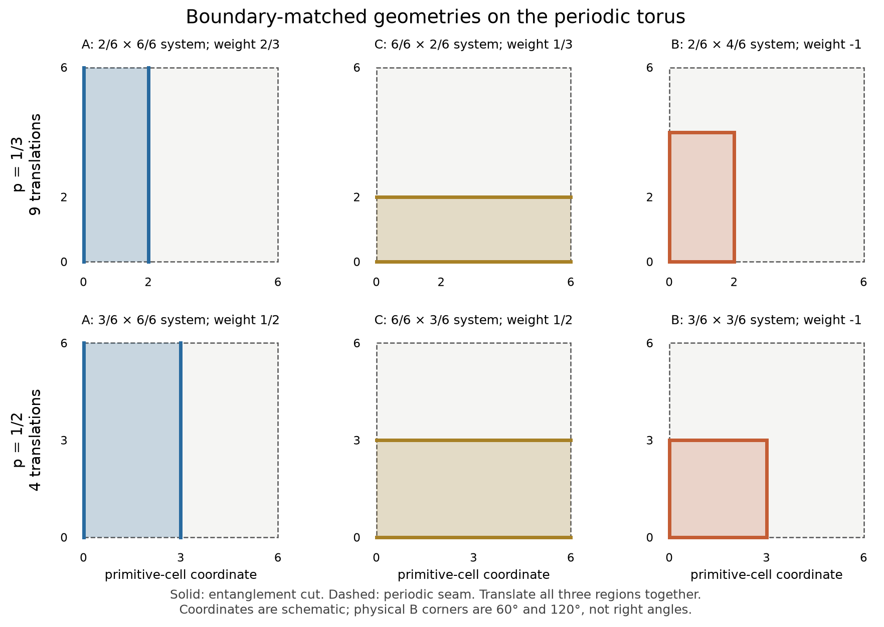

图用原胞坐标画区域，实线表示纠缠切割，虚线表示周期接缝；实空间中 B 仍有两个 60° 和两个 120° 角。上排使用 9 个平移，下排使用 4 个平移。它们的 B 形状不同，但角度组成相同。

### 已精确核验：共有局域直边项逐构型相消

**对这组几何，无需枚举全部 L² 个平移：9／4 个子群平移已经在每条有向切割键上精确配平。** 整数逐键审计分别区分最近邻键型和边界内外方向，在 L=6、12、18、24、30、36、42、48 全部得到零残差。如果局域直边贡献能写成各区域共有的键密度之和，则

$$
S_{\rm loc}(R;E)=\sum_b\chi_R(b)\rho_b(E),
$$

$$
\sum_{t\in\mathcal T_m}
\left[(m-1)\chi_{A_p+t}(b)+\chi_{C_p+t}(b)-m\chi_{B_p+t}(b)\right]=0
\quad\text{对每条有向切割键 }b.
$$

因此这部分在每个 E 中相消，密度可以随位置、方向和整个构型改变。独立程序再次验证整数恒等式；用随机不均匀边界密度测试，固定原点组合通常不为零，子群平均组合则降到浮点舍入误差。[几何审计](data/born_scaling/boundary_check/boundary_audit.json)、[独立复核](data/born_scaling/boundary_check/independent_validation.json)。

**这个结论只针对共有局域直边泛函，不是完整纠缠熵的恒等式。** 角邻域、对边耦合及非局域形状项不由这一步消去；把直边熵写成该泛函仍是物理展开的假设。因而不能把“逐键面积项相消”说成“剩余量必然是纯角对数项”。

原胞平移不改变当前 Hamiltonian、固定半数输出约束及 Born 权重，所以子群平均与固定原点的 Born 期望相同。这项比较检验位置偏差和统计一致性，**不检验态是否临界**。p=1/2 的条带平移半个系统后还恰为补集；纯态的互补区域熵相等，因此该子群的 S_A、S_C 与原点结果逐态相等。这是恒等式，不能当成独立的采样成功证据；D 仍会因有角区域 B 的平移而改变。

这里的平移构成有限群。对 Born 分布不变的群取平均，相当于对观测量作正交投影，故保持均值且不增大单样本方差。记群平均后的观测量为 f_H，原交换核为 K；该核可逆并与这些平移对易，因此在精确平稳链的长链极限，均值的渐近方差也不增大：

$$
\operatorname{Var}_{p_\beta}(f_H)\le\operatorname{Var}_{p_\beta}(f),\qquad
\sigma_K^2(f_H)\le\sigma_K^2(f),\qquad
\sigma_K^2(f)=\lim_{n\to\infty}n\operatorname{Var}(\bar f_n).
$$

有限样本估计的 MCSE 比值仍会波动，而且每次要计算更多区域的熵；这条理论不保证单位计算时间的效率提高。

### β=0 正对照：两种几何得到一致的角系数

在共同窗口 L=18、24、30、36、42、48，用下式拟合确定性基态数据：

$$
D_p=c_p\ln L+\gamma_p+b_p/L.
$$

| 几何 | 含 1/L 修正的 c | 同窗口纯 log 的斜率 |
|---|---:|---:|
| p=1/3 | 0.1551466 | 0.1814 |
| p=1/2 | 0.1551212 | 0.1822 |

含修正拟合的系数差约为 0.0000254，残差自由度均为 3。这支持两种几何提取同一个基态角系数；这些是没有 Monte Carlo 误差条的数值外推参数，不是精确解析值。纯 log 拟合仍有偏移，说明正对照也存在可见有限尺寸修正。本表额外使用 L=42、48；后面的 β=0／β=3 并排图仅使用共同的 L≤36，不能把两套窗口的拟合参数直接比较。[确定性原始数据](data/born_scaling/boundary_check/geometry_baseline.csv)。

### β=3 的配对检验及判据

正式实验采用 L=6、12、18、24、30、36，每个尺寸运行四条独立链，分别从随机 E、全 A、全 B、0/2 条纹 E 起步，保持原来的 E／S 随机交换更新；这些是采样链的起始输出集合，测量前的基态相同。独立试跑只用于预算，正式链使用新种子，统一丢弃前 256 sweeps。L=6、12 的每链保留量为 2048、1024，其余尺寸各为 512；每个 sweep 记录一次。**同一 E 的 13 条平移记录先合成一个观测，不能当成 13 个独立样本。** [冻结计划](data/born_scaling/boundary_check/production/plan.toml)、[试跑预算](data/born_scaling/boundary_check/production/allocation.json)。预算目标是两种 D 的 MCSE 不超过 0.004、配对形状差不超过 0.003；短试跑的方差外推不是精度保证，正式结果须另行检查。

首先检验子群减原点是否与零相容。其次，在同一个 E 中组成两种几何之差；若最终共享同一角系数且其他非角对数项已控制，应有

$$
\Delta D(L)=\overline D_{1/2}^{\rm sub}-\overline D_{1/3}^{\rm sub}
=\gamma_{1/2}-\gamma_{1/3}+o(1).
$$

有限尺寸漂移仍可以来自形状修正，不能直接判成角系数不同或面积项残留。配对差的 log＋1/L 拟合只估计有限窗口的系数差；模型失配时不作普适解释。同时检查两种宽度的无角条带熵之差：它们边界长度相同，可以显示宽度相关修正，但不能排除在两种条带中完全相同、因再次相减而消失的非角对数项。

### 实测结果：局域面积项配平有效，但没有自动得到纯角对数律

**β=3 的 24 条正式链全部完成；以下误差均为考虑自相关的一个 MCSE。两种几何及其差在同一 E 上计算，差的误差保留了它们的协方差。**

| L | 子群平均 D，p=1/3 | 子群平均 D，p=1/2 | 配对差 ΔD |
|---|---:|---:|---:|
| 6 | 0.001530 ± 0.000058 | 0.001849 ± 0.000073 | 0.000319 ± 0.000034 |
| 12 | 0.02079 ± 0.00064 | 0.02518 ± 0.00077 | 0.00439 ± 0.00036 |
| 18 | 0.07144 ± 0.00135 | 0.08842 ± 0.00187 | 0.01698 ± 0.00103 |
| 24 | 0.13563 ± 0.00170 | 0.16474 ± 0.00225 | 0.02911 ± 0.00143 |
| 30 | 0.19552 ± 0.00199 | 0.23085 ± 0.00250 | 0.03533 ± 0.00173 |
| 36 | 0.24526 ± 0.00191 | 0.28328 ± 0.00270 | 0.03802 ± 0.00182 |

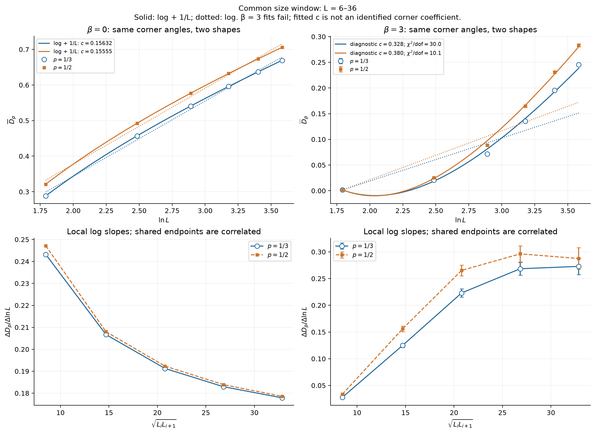

上排分别是 β=0、β=3 的 D 对 ln L，实线为 log＋1/L、点线为纯 log，均使用本轮共同的六个尺寸 L=6–36；下排是相邻尺寸的局部对数斜率。共享端点的斜率相关，完整协方差另存。**β=3 的曲线只是失配模型的展示，不是已提取的角系数。** β=0 图中的拟合窗口与前面 L=18–48 的参考表不同。

| β=3，L=6–36 的 log＋1/L 拟合对象 | 对数参数及其统计误差 | χ²/dof | 残差自由度 |
|---|---:|---:|---:|
| D，p=1/3 | 0.32770 ± 0.00290 | 29.98 | 3 |
| D，p=1/2 | 0.37980 ± 0.00375 | 10.14 | 3 |
| 同态配对 ΔD | 0.05490 ± 0.00224 | 4.51 | 3 |

三者均超过预设的大残差标记阈值 3。因此不能把前两行当成普适角系数，也不能把第三行解释为“两个普适系数显著不同”。表中参数误差只反映 Monte Carlo 均值误差，不包括模型失配。配对差拟合使用自己的误差权重，所以其参数也不必等于两次单独拟合参数的直接相减。

**本轮全窗口失配与此前 L=18–36 的好拟合不矛盾。** 此前窗口含 L=18、21、24、27、30、36；本轮新窗口只含 L=18、24、30、36，共四个点。按事先规定的至少三个残差自由度，本轮不能在这个窄窗口拟合两参数 log 或三参数 log＋1/L；没有为得到好看的曲线而降低要求。不同网格、窗口和权重下的失配参数不能直接比较，原始均值是否复现应另外检验。

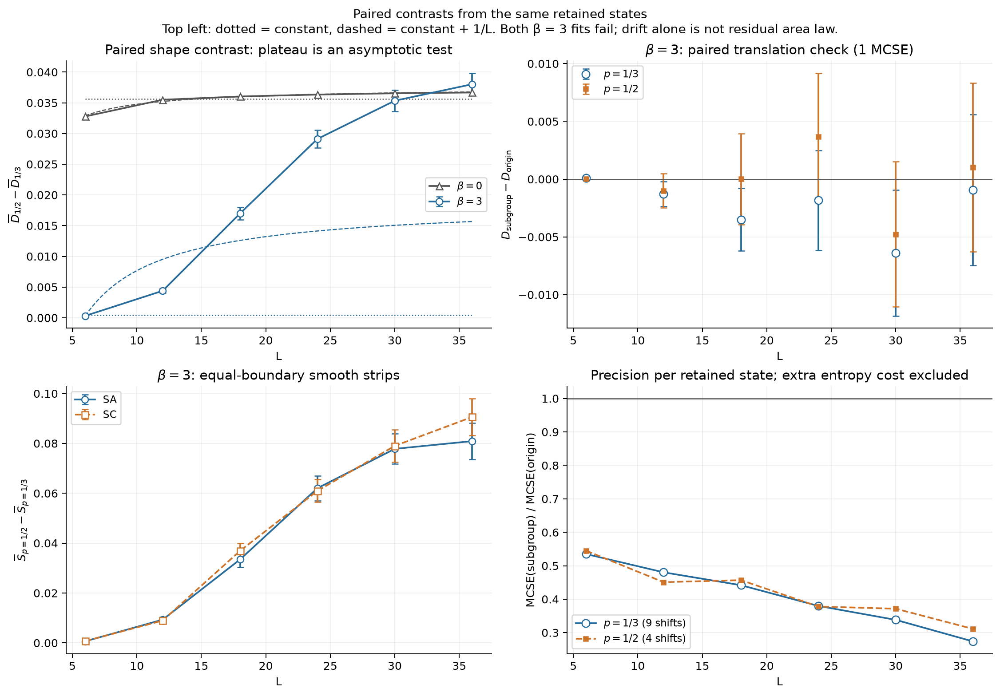

左上：相同角度组成的两种几何之差，β=0 与 β=3 对照；辅助常数／1/L 曲线只展示有限尺寸趋势。右上：同一构型的子群平均减原点结果，检验平移等期望。左下：宽度 L/2 与 L/3 的两种无角条带熵之差，两个方向分别画出。右下：相同采样记录下，子群平均与原点 D 的 MCSE 比值；不计额外熵计算耗时。

这四项检查给出三个直接结果：

- **没有发现原点切割导致均值偏差。** 两几何“子群减原点”的最大绝对偏差分别只有 1.30、0.76 个配对 MCSE。新 p=1/3 子群均值与此前独立数据的最大偏差为 1.46 个合成 MCSE，原点均值为 1.90；六个尺寸均相容。子群平均将本轮 D 的 MCSE 降至原点的约 27%–55%，但这不是单位耗时效率的比较。
- **形状差尚不能视为常数。** 仅取 L=18、24、30、36，ΔD 的常数拟合仍有 χ²/dof=51.41，残差自由度为 3。故目前尚不能通过两形状共同斜率的检查。L=36 的差 0.03802±0.00182 已接近 β=0 同尺寸的 0.03667，但单点接近、最后几个点变平都不足以确立渐近平台。
- **无角区域也有明显的宽度修正。** 同一 L=18–36 窗口，两个方向条带宽度差的常数拟合分别有 χ²/dof=24.56、24.46，残差自由度均为 3。这说明漂移并非只出现在角点观测量中，支持有限尺寸／非局域形状修正尚未消失的解释；它不证明角系数最终一定回到 β=0。

另一个警示是，在 L=12–36 的五点窗口，ΔD 可以得到 χ²/dof=1.47 的纯 log 拟合；但两种无角条带宽度差也能得到看似良好的纯 log 拟合，χ²/dof 分别为 1.18、0.20。这些有限窗口斜率不能仅因“能拟合成 log”就被称为角贡献。

### 统计与独立数值复核

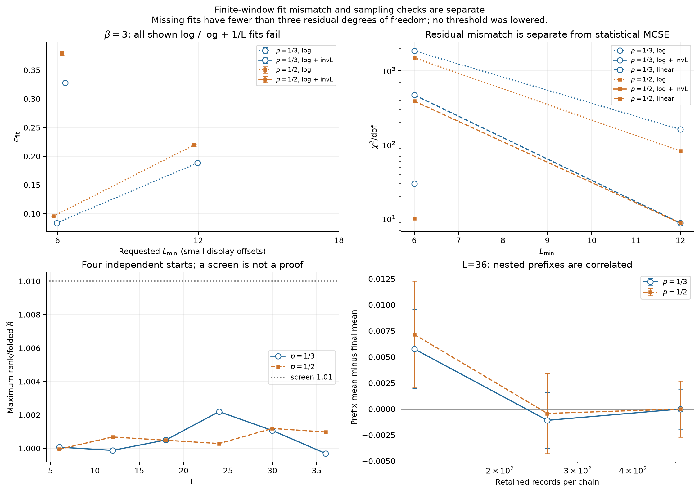

左上是改变最小尺寸后的有限窗口对数参数，右上是相应约化卡方；缺失的拟合因残差自由度不足而未报告。左下显示两种 D 的 Rhat，右下显示 L=36 各累计前缀均值减去最终均值。右下误差棒是各前缀均值本身的 MCSE，**不是这个差值的 MCSE**；前缀和最终均值共享样本，不能当成独立实验或直接据此作差值显著性检验。全部链长在正式计算前固定。

关键观测量的最大 Rhat=1.00266，最小 bulk/tail ESS 约为 1762，全部通过预设采样筛选。两种 D 的最大 MCSE 为 0.00270，配对差的最大 MCSE 为 0.00182，18 个预设精度目标全部达到。统计检查通过与拟合失配可以同时发生：前者支持均值可信，后者说明所选有限尺寸模型还不够。

独立程序从原始记录重建均值、误差和协方差，并用 80 位精度核验拟合，369,410 项数值比较全部通过。另取每个尺寸第一条链的首末保留 E，共 12 个实际构型，以独立 Gram 矩阵／本征值路线重算 156 行熵；熵最大差为 1.40×10⁻¹¹，D 最大差为 7.70×10⁻¹²，logweight 最大差为 3.67×10⁻⁸。24 条链的 26,624 个含热化快照及 136 个文件哈希均通过完整性检查。[统计复核](analysis/born_scaling/boundary_check/production/independent_validation/validation.json)、[实际构型重算](analysis/born_scaling/boundary_check/production_samples_validation.toml)、[完整性检查](analysis/born_scaling/boundary_check/production_snapshot_integrity.json)。

**因此，这次实验支持的结论是：平移平均能严格消去所配平的共有局域直边项，并降低本次均值的统计误差；它不能保证剩余熵只有角对数项。β=3 当前仍需控制形状修正和其他非角项，才能可靠提取角系数。现有结果既不是“面积律残留”的证据，也不足以确定新的普适角系数或排除最终恢复基态系数。**

## β=3 的大尺寸扩展：L=27、30、36

**能得到更好的有限尺寸对数拟合，但“已经进入纯 ln L 渐近区间、角系数已确定”仍不成立。** 新数据的线性局部斜率中心值继续下降；加入 1/L 修正后，L=12–36、15–36、18–36 都能被对数模型描述。另一方面，系数仍有窗口漂移，重新拟合的“L＋log”模型也能描述最窄的大尺寸窗口。

本轮保持原交换更新、测量定义及 μ/t=10⁻⁸ 不变。独立 pilot 只用于热化、方差和耗时评估，不计入正式平均；正式计划在采样前冻结。每个新增尺寸运行四条不同起点的独立链，统一丢弃前 256 sweeps，保留段如下。误差为考虑时间相关性的 MCSE。

| L | 每链保留 sweeps | 平均 D | 平均 S_A |
|---|---:|---:|---:|
| 24（原数据） | 2,048 | 0.13376 ± 0.00223 | 0.69960 ± 0.00437 |
| 27 | 2,048 | 0.16349 ± 0.00253 | 0.89291 ± 0.00512 |
| 30 | 2,560 | 0.19135 ± 0.00252 | 1.08079 ± 0.00492 |
| 36 | 2,816 | 0.24214 ± 0.00284 | 1.45866 ± 0.00490 |

新增 12 条链共保留 29,696 条记录。S_A、D 的最大 Rhat=1.00049，最小 bulk/tail ESS 约 7,267，全部通过预设采样检查；D 的最大 MCSE=0.002836，S_A 的最大 MCSE=0.005125，均达到原误差目标。接受率为 11.40%–11.65%。最大逆矩阵／log-weight 重建漂移分别为 3.02×10⁻⁷、4.71×10⁻⁷，低于 10⁻⁵ 阈值。检查支持本批采样的可靠性，并不证明已经覆盖任意稀有事件。

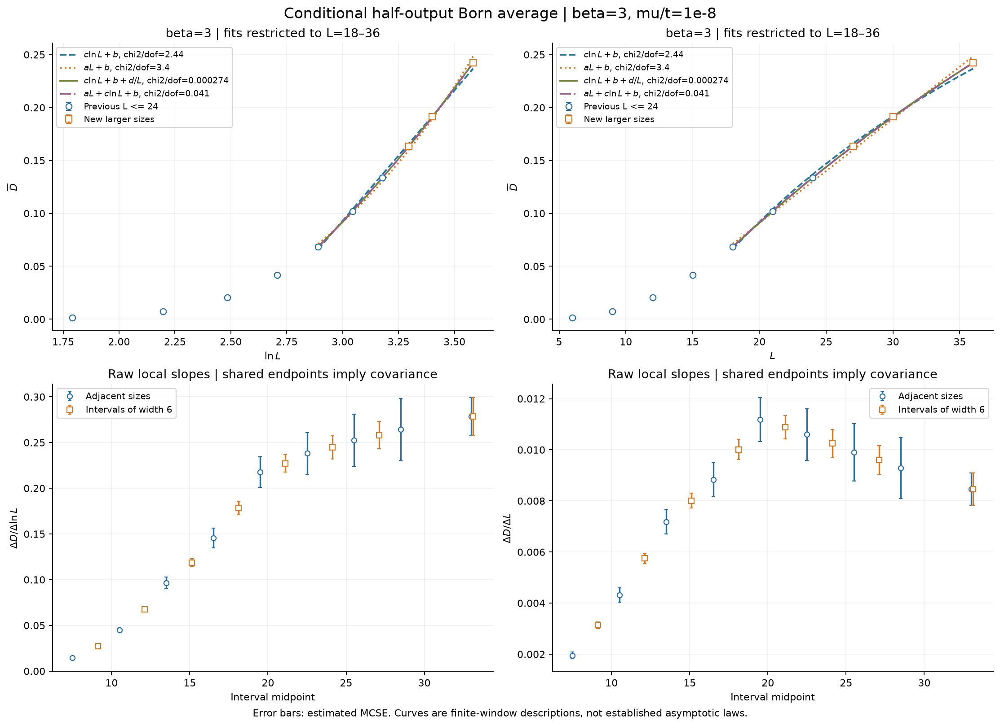

上排是同一组数据分别对 ln L、L 作图；蓝圈为原 L≤24 数据，橙方块为新增尺寸。曲线只画在**采样前规定的主窗口 L=18–36**，包含六个尺寸；小尺寸原始点仍保留展示。下排直接比较对数、线性局部斜率，圆点是相邻尺寸，方块是间隔 6 的尺寸对。共享端点的斜率彼此相关，完整协方差另存，不能将它们当成独立测量。

主窗口的四种模型及约化卡方为：

$$
D_{\log}=c\ln L+\gamma,\qquad
D_{\rm lin}=aL+\gamma,\qquad
D_{\log+1/L}=c\ln L+\gamma+b/L,\qquad
D_{\rm mix}=aL+c\ln L+\gamma.
$$

| 模型 | 对数系数 c | 线性系数 a | χ²/dof | 残差自由度 |
|---|---:|---:|---:|---:|
| 纯 log | 0.2463 ± 0.0039 | — | 2.442 | 4 |
| 纯线性 | — | 0.009848 ± 0.000155 | 3.397 | 4 |
| log＋1/L | 0.3659 ± 0.0385 | — | 0.000274 | 3 |
| L＋log | 0.1337 ± 0.0364 | 0.00453 ± 0.00146 | 0.04097 | 3 |

**log＋1/L 的 χ² 异常偏小，已由原始数据和 80 位精度拟合独立复核，不是把误差缩放到 χ²=1 得到的。** 这组六点均值非常贴近三参数曲线，但如此小的 χ² 不能作为模型成立或测量极高精度的证据；这里仍保留原 MCSE 和参数统计误差。新三点的最终 MCSE 相对原始 ESS 估计仅增加约 0–3%，不足以单独用“误差保守”解释极小残差。如此平滑的来源尚未确定，也不能保证独立再采样会复现同样小的 χ²。混合模型也有小残差，其 a、c 的相关系数约 −0.994，不能将其中的 a 单独解释成已确认的渐近面积项。

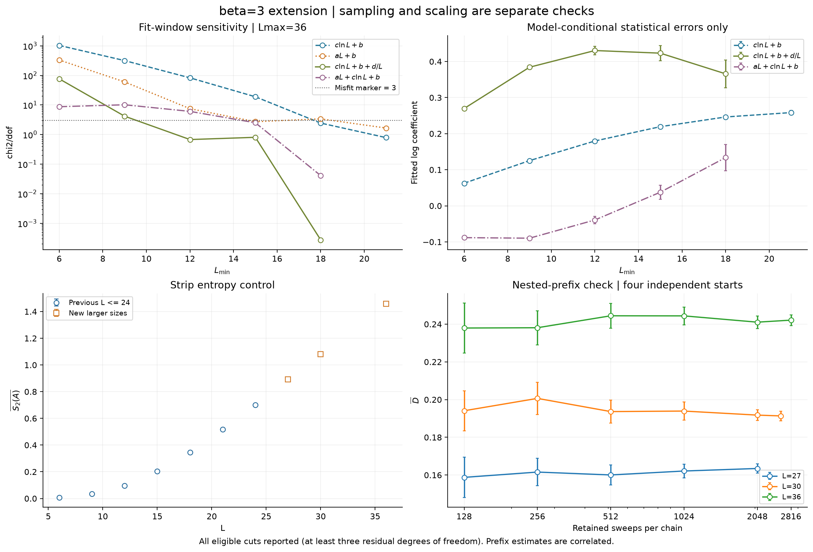

左上改变最小拟合尺寸、固定 L_max=36，检验残差；右上检验对数系数的窗口与模型敏感性。左下为无角条带熵 S_A；右下展示逐步延长保留段后的 D，嵌套前缀彼此相关。全部预设切窗都列入表格；仅在残差自由度至少为 3 时拟合，没有按结果好坏删点。右上不同模型给出不同系数，正是目前不能报一个确定角系数的原因。

同一 log＋1/L 模型的切窗结果：

| 拟合窗 | c_fit | χ²/dof |
|---|---:|---:|
| L=6–36 | 0.2698 ± 0.0024 | 76.37 |
| L=9–36 | 0.3842 ± 0.0056 | 4.175 |
| L=12–36 | 0.4305 ± 0.0114 | 0.677 |
| L=15–36 | 0.4232 ± 0.0215 | 0.807 |
| L=18–36 | 0.3659 ± 0.0385 | 0.000274 |

增加大尺寸不会自动消除小尺寸的交叉行为：包含 L=6、9 的窗口仍失配。后三个窗口提供可接受的有限尺寸描述，但并未确立系数平台；窗口共享数据，不能将表中的误差当成独立误差来比较。主窗口的 b=2.876，即便在 L=36，模型内局部对数斜率的修正 b/L 仍约 0.080，是 c 的约 22%。因此 0.3659 仍是含修正模型的外推参数。

纯 log 在 L=21–36 的敏感性窗口给出 c=0.2584±0.0059、χ²/dof=0.787；同一窗口纯线性也能给出 χ²/dof=1.660。这个更窄窗口不能单独区分两种渐近规律。实际局部对数斜率中心值依次为 0.218、0.238、0.252、0.264、0.279；对应线性斜率为 0.01118、0.01060、0.00991、0.00929、0.00846，区间依次是 18→21、21→24、24→27、27→30、30→36。最后一个区间的误差分别为 0.0208 和 0.000632。这显示旧近线性段在弯曲，同时对数斜率也还没有明确的平台。

**另一个更有区分力的检查是“用旧数据预测新尺寸”。** 在读取新生产数据前，已经冻结了用原 L=12–24 拟合所得的预测，之后没有用新点调整这些旧参数：

| L | 新计算 D | 旧 log＋1/L 预测 | 旧 L＋log 预测 |
|---|---:|---:|---:|
| 27 | 0.16349 ± 0.00253 | 0.16430 | 0.17087 |
| 30 | 0.19135 ± 0.00252 | 0.19416 | 0.20898 |
| 36 | 0.24214 ± 0.00284 | 0.24995 | 0.28922 |

同时计入旧参数预测协方差与新 MCSE 后，三点联合预测偏差统计量 T 分别为 1.751、29.441；各有 3 个预测维度，T/3 分别为 0.584、9.814。**旧 log＋1/L 外推与新数据相容，旧 L＋log 外推明显偏高。** 这为有限尺寸交叉解释增加了证据；但旧拟合只有两个残差自由度，预测误差不含模型偏差，两个统计量也共享数据。基于估计 MCSE 的名义 χ² 解释只是近似诊断，不能据此排除所有含线性项的模型，更不能宣称已证明渐近对数律。

本轮获得了更好的、能够预测新增尺寸的对数修正描述；没有发现采样或数值实现错误的证据。对强 β 的解释应更新为：**新数据更支持 L≤24 上的近线性外观包含明显有限尺寸交叉；截至 L=36，干净的纯对数平台和唯一的渐近角系数仍未确定。** 原 c(β) 图继续保留共同 L_max=24，不单独用扩尺寸的 β=3 拟合替换其中一个点。

数据与复核：[均值](analysis/born_scaling/beta3_large/means.csv)、[全部拟合与误差](analysis/born_scaling/beta3_large/fits.csv)、[逐点残差](analysis/born_scaling/beta3_large/fit_residuals.csv)、[局部斜率](analysis/born_scaling/beta3_large/local_slopes.csv)、[预测检查](analysis/born_scaling/beta3_large/independent_validation/holdout_summary.json)、[独立复核](analysis/born_scaling/beta3_large/independent_validation/validation.json)。独立复核覆盖 38,064 项数值比较、48 组拟合、34 个局部斜率及其 1,156 项联合协方差，全部通过。

## 首批 β 扫描：L=6–24

**所需 sweeps：本次统一丢弃前 256 sweeps，每个参数点运行四条独立链，每链再保留 2,048–8,192 sweeps。** 在 L=6–24、β=0.25–3 的已计算网格中，S_A 与 D 的最大 Rhat 为 1.00122，最小 bulk/tail ESS 为 5,044，均通过预设诊断。S_A 的最大 MCSE 约为 0.005475，低于目标 0.01；D 仅 L=15、β=1.5 的 MCSE=0.003014，比目标 0.003 高约 0.45%，其余点达到目标。没有为使结果达标而事后删样本或改变已冻结的链长。

保留段的接受率按接受／提议总次数计算，各参数点为 11.67%–96.77%；最低点为 L=24、β=3。这里每 sweep 有 1,152 次提议，平均仍约有 134 次接受。因此，本批数据没有显示原提议因接受率过低而无法收敛；这不等于已经证明更大 L、更强 β 的混合或稀有事件覆盖。完整数值见[均值与诊断表](analysis/born_scaling/production/means.csv)、[接受率表](analysis/born_scaling/production/acceptance.csv)。

### 平均熵随测量强度变化

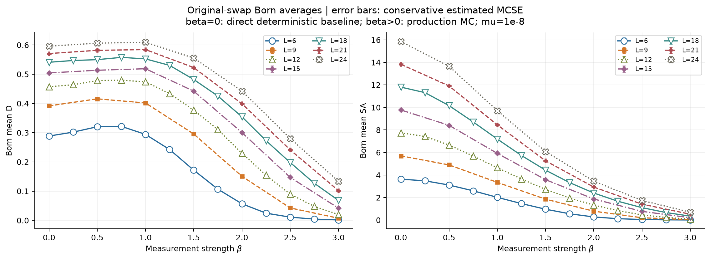

左图是平均 D，右图是平均 S_A；误差条是考虑时间相关性的经验 MCSE，β=0 为确定性结果。**S_A 在本次扫描中随 β 下降；D 在弱测量区略有上升，随后下降，不能把固定 L 的 D 曲线直接叫作角系数曲线。** L=6、12、18 的 β 间隔为 0.25，其余尺寸为 0.5。连线只连接离散计算点。

以首批 β 扫描的最大尺寸 L=24 为例：

| β | 平均 S_A | 平均 D |
|---|---:|---:|
| 0 | 15.855186（确定性） | 0.595933（确定性） |
| 0.5 | 13.65353 ± 0.00257 | 0.60622 ± 0.00202 |
| 1 | 9.71613 ± 0.00359 | 0.60926 ± 0.00262 |
| 1.5 | 6.08454 ± 0.00396 | 0.55544 ± 0.00267 |
| 2 | 3.45447 ± 0.00365 | 0.44225 ± 0.00232 |
| 2.5 | 1.73719 ± 0.00446 | 0.28032 ± 0.00234 |
| 3 | 0.69960 ± 0.00437 | 0.13376 ± 0.00223 |

### D 的拟合系数：哪些可以解释，哪些还不行

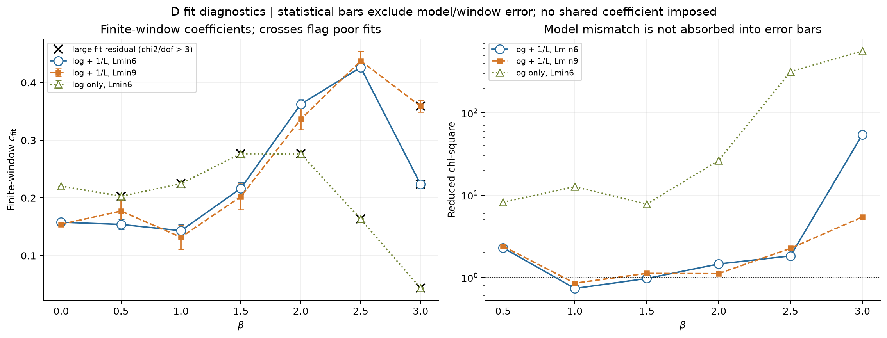

左图比较“log＋1/L”在两个最小尺寸窗口的系数，并保留纯 log 的结果；右图展示对应约化卡方。黑叉表示约化卡方大于 3 的预设大残差标记。参数误差条仅含给定模型下的统计误差，不含模型或窗口偏差；β=0 不画 Monte Carlo 误差。

下面均采用同一模型，最大尺寸固定为 24：

$$
\overline D=c_{\rm fit}\ln L+\gamma+b/L.
$$

| β | c_fit，L_min=6 | χ²/dof | c_fit，L_min=9 | χ²/dof |
|---|---:|---:|---:|---:|
| 0 | 0.15783 | 不适用 | 0.15438 | 不适用 |
| 0.5 | 0.15401 ± 0.00885 | 2.29 | 0.17725 ± 0.01870 | 2.39 |
| 1 | 0.14314 ± 0.01071 | 0.73 | 0.13183 ± 0.02118 | 0.85 |
| 1.5 | 0.21663 ± 0.01032 | 0.97 | 0.20237 ± 0.02233 | 1.12 |
| 2 | 0.36259 ± 0.00779 | 1.46 | 0.33665 ± 0.01820 | 1.11 |
| 2.5 | 0.42623 ± 0.00670 | 1.83 | 0.43776 ± 0.01707 | 2.25 |
| 3 | 0.22365 ± 0.00357 | **54.58** | 0.35909 ± 0.01017 | **5.43** |

这些数值应这样理解：

- **β=0.5、1：** 加修正后的拟合可以描述当前数据，没有显示对 β=0 参考值约 0.155 的稳健偏离；这只是当前精度、窗口下的相容性，不是严格相等的证明。
- **β=1.5、2：** 当前窗口的 c_fit 明显上升，含修正模型的残差可接受。尚不能把这个变化直接认定为渐近角系数的变化。
- **β=2.5：** 虽然两个窗口的拟合残差均不大，修正仍很强。L_min=6 拟合的 b=2.561，在该模型内部，到 L=24 时对局部斜率的修正 b/L 仍约为 0.107，相当于 c_fit 的 25%。大尺寸相邻点的实际斜率约为 0.28–0.29，而拟合外推参数约为 0.43；二者不能混为一谈。
- **β=3：首批两个窗口都失配，而且 c_fit 强烈依赖切窗。因此仅用首批数据没有提取到可靠的角对数系数；图中数值仅保留为失败拟合的诊断。**

在 L=6–24 全窗口，所有非零主网格 β 的纯 log 拟合都超过大残差阈值。**这批结果支持“需要有限尺寸修正”，不支持“所有 β 都已经呈现干净的 ln L 直线”。** 小残差的三参数模型也不能单独证明其外推的 c_fit 就是渐近角系数。

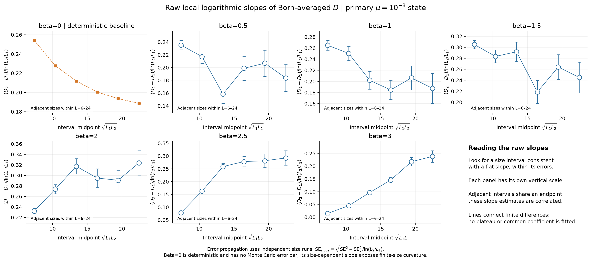

这张图直接用相邻尺寸之差估计局部斜率，没有强制拟合平台。若进入纯对数区间，斜率应在误差内趋于平坦。各子图纵轴范围不同；相邻斜率共享一个数据点，因此彼此相关。β=2.5 的高端点看起来较平，但有限的几个区间不足以排除继续漂移；β=3 仍有明显尺寸依赖。

### 首批 L≤24 的补充检查：大 β 是否从 log L 变成 L

**仅凭首批 L≤24 数据，不能认定发生了这种渐近规律转变。β=3 在这一批最大几个尺寸上有近似线性段，但纯线性模型在所比较的完整窗口中也明显失配；β=2、2.5 的较大尺寸数据反而更接近对数。**

为回应这个问题，保持全部原始生产数据不变，补做同为两个参数的加权拟合：

$$
D_{\rm linear}=aL+b,\qquad D_{\rm log}=c\ln L+b.
$$

下表用新增的 L=12、15、18、21、24 五点窗口，两个模型均有 3 个残差自由度。这是看到现有结果后的补充诊断，不属于原先冻结的窗口，也不能把挑选窗口后的较小残差当作渐近证明。

| β | 线性模型 χ²/dof | 对数模型 χ²/dof | 当前窗口说明 |
|---|---:|---:|---|
| 2 | 23.19 | 0.57 | 对数更合适 |
| 2.5 | 8.92 | 0.83 | 对数更合适 |
| 3 | 11.13 | 45.47 | 线性相对较好，但两者都失配 |

β=3 在 L=6–24、9–24 的纯线性约化卡方也分别为 258.01、60.31。最大两个区间 L=18→21、21→24 的线性斜率为 0.011185±0.000866、0.010599±0.001012，确实接近；但它们共享 L=21，只有两个相关区间，不能据此确定非零的渐近斜率。反过来，在五点窗口加到三个参数后，log＋1/L 和 L＋log 都能描述 β=3，且仅余两个自由度，说明模型解释尚有歧义。

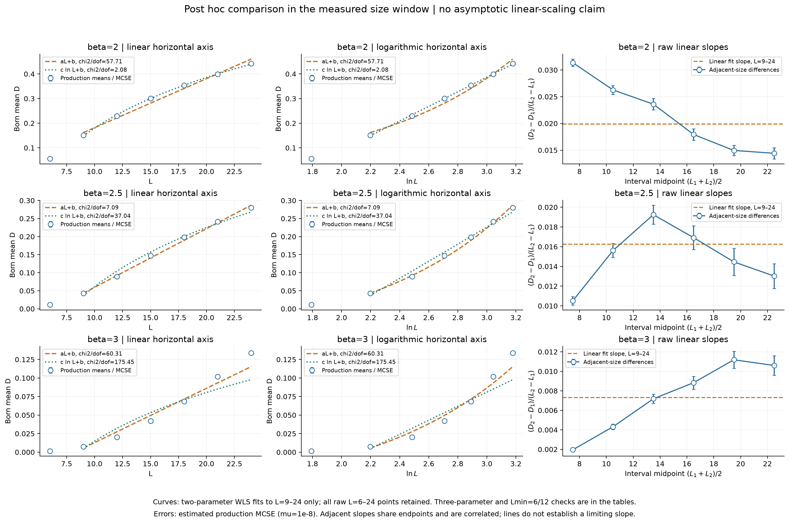

三行依次为 β=2、2.5、3。左列 D 对 L，中列同一组数据对 ln L，右列相邻尺寸的线性斜率。图中的曲线统一使用 L=9–24，因而图例的卡方与上表 L=12–24 的数值不同；L=6 的原始点仍保留展示。原有对数修正拟合也保留，未用新模型覆盖它们。全部 48 组补充拟合见[补充表](analysis/born_scaling/linear_crossover/fits.csv)，[独立高精度复核](analysis/born_scaling/linear_crossover/validation.json)已通过。

物理上，D 的几何定义本身不保证它在任意态、任意尺寸都只包含角项。如果 Born 平均熵能按共同的、仅依赖局部边界方向的系数展开，则不管两个方向是否对称，局域面积项恒有

$$
D_{\rm area}=\frac{2(2\alpha_2L)+2\alpha_1L}{3}
-\left(\frac{2L}{3}\alpha_1+\frac{4L}{3}\alpha_2\right)=0.
$$

因此，若将来更大尺寸确认 D 有非零线性项，就需要检查该局域边界展开是否适用、是否存在形状依赖的非局域贡献；不能仅用“测量后各向异性”解释。平滑边界与有角边界相减提取角对数项也依赖相应的熵展开，见[相关原始研究](https://arxiv.org/html/2404.13876v4)。

**从首批 L≤24 数据出发，优先检验的解释是强测量下的有限尺寸交叉，尚未确定完整微观机制。** 固定 L 时，β→∞ 将有非零极限权重的输出投影为占据数乘积态，平均熵与 D 都趋零；有限但较大的 β 下，残余叠加涉及的轨道数、构型振幅和 Born 权重随 L 改变。三个不同形状区域的有限尺寸项可以不同，因而在 D 中留下显著曲率或局部近线性段。后文 L=3 的强测量展开已展示零振幅输出对平均的实际贡献，但它不能直接解释或外推整个 L=6–24 窗口。

固定半数输出的全局条件化也可能影响有限尺寸项，不过 β=0 时有同样的条件化，因此它本身不足以解释线性外观。归一化辅助分布中的尺寸尺度也不能未经验证就当作纠缠关联长度。本轮没有据这些诊断宣称新相、渐近线性或体积律。

### 无角条带熵的面积项与修正

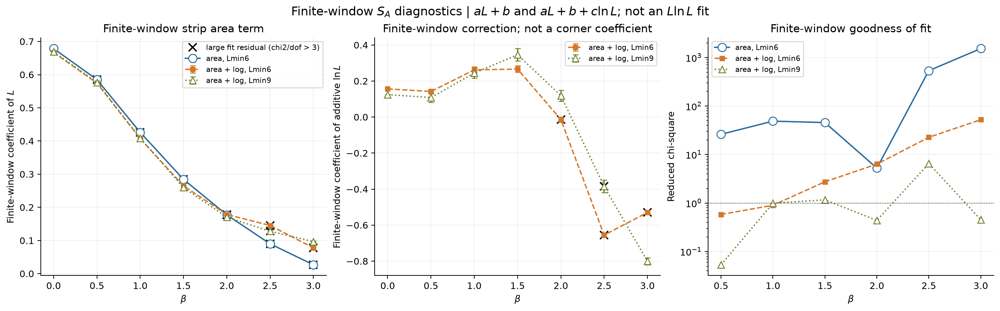

左图是 L 项系数，中图是附加 ln L 项系数，右图是约化卡方。比较模型为“αL＋常数”和“αL＋η ln L＋常数”；η 是条带拟合的修正参数，**不是角贡献系数，也不是 L ln L 项的系数**。黑叉仍表示大残差。

| β | α（带 log 修正，L_min=6） | χ²/dof | α（带 log 修正，L_min=9） | χ²/dof |
|---|---:|---:|---:|---:|
| 0 | 0.66693 | 不适用 | 0.66888 | 不适用 |
| 0.5 | 0.57476 ± 0.00094 | 0.58 | 0.57681 ± 0.00168 | 0.05 |
| 1 | 0.40736 ± 0.00123 | 0.90 | 0.40846 ± 0.00187 | 0.99 |
| 1.5 | 0.26468 ± 0.00135 | 2.74 | 0.25975 ± 0.00226 | 1.16 |
| 2 | 0.17835 ± 0.00113 | **6.35** | 0.17015 ± 0.00202 | 0.44 |
| 2.5 | 0.14528 ± 0.00110 | **22.65** | 0.12798 ± 0.00233 | **6.52** |
| 3 | 0.07789 ± 0.00060 | **52.26** | 0.09669 ± 0.00144 | 0.45 |

单独的“面积项＋常数”在所有非零主网格 β、两个窗口中都留下超过当前统计误差的残差。β=0.5–1.5 加一个 log 修正后可描述当前窗口；β=2、3 对去掉 L=6 很敏感；β=2.5 两个窗口仍不够好。**这说明需要进一步控制有限尺寸修正，不能仅凭这次拟合认定条带具有某个真实的渐近 log 项，或认定面积律被破坏。** 表中面积项系数随 β 整体减小，但大残差行的参数同样只作有限窗口诊断。

### 首批 L≤24：各 β 的完整 scaling 与残差图

每张图左上是 D 对 ln L，右上是 S_A 对 L；下排分别给出“数据减拟合”的残差和原始均值误差。主图拟合窗口为 L=6–24；L_min=9 的完整结果保存在[拟合表](analysis/born_scaling/production/fits.csv)。β=0 的这张图也只用 L≤24，与后文额外延伸至 L=36 的基线检查分开。

**β=0**

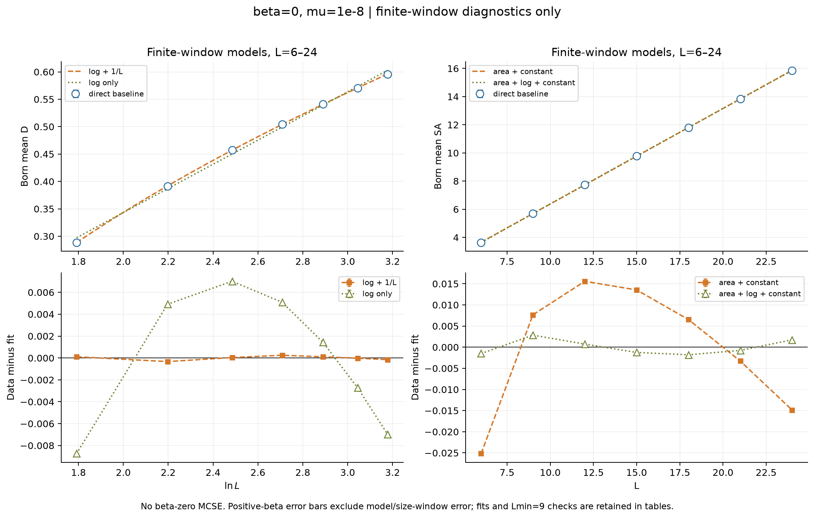

**β=0.5**

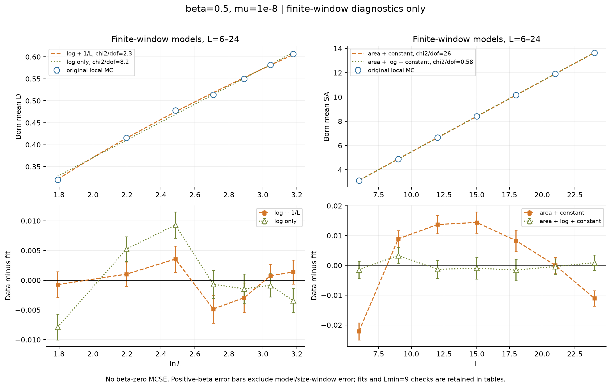

**β=1**

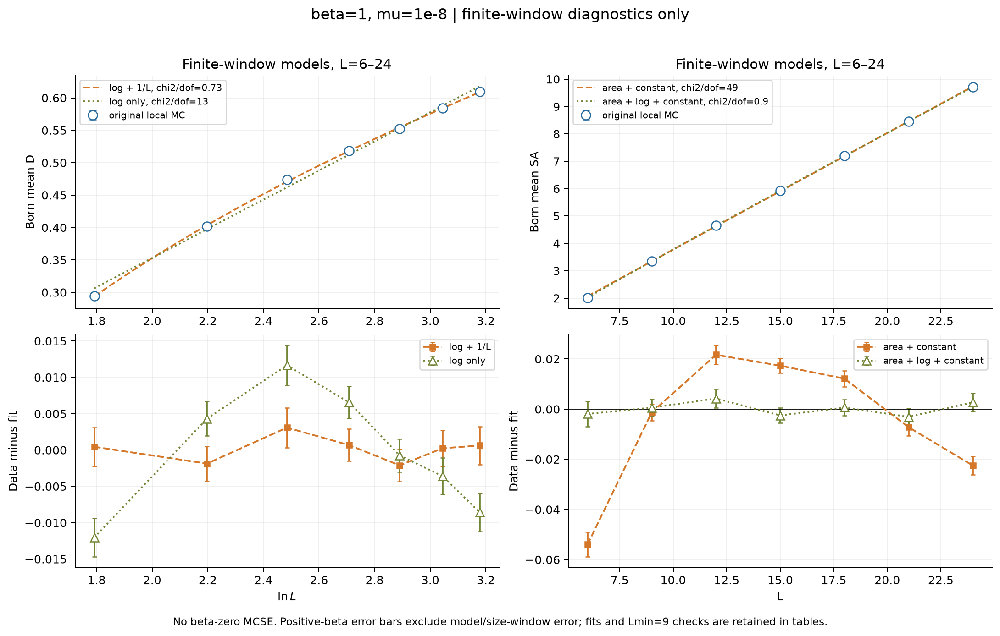

**β=1.5**

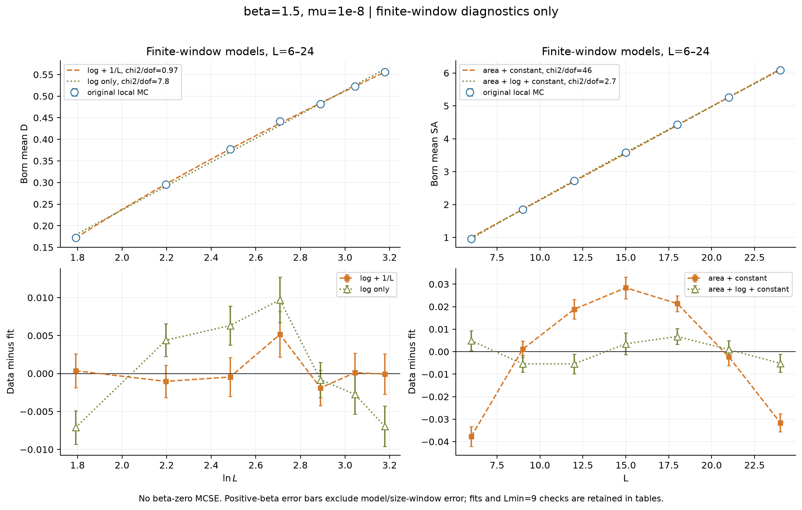

**β=2**

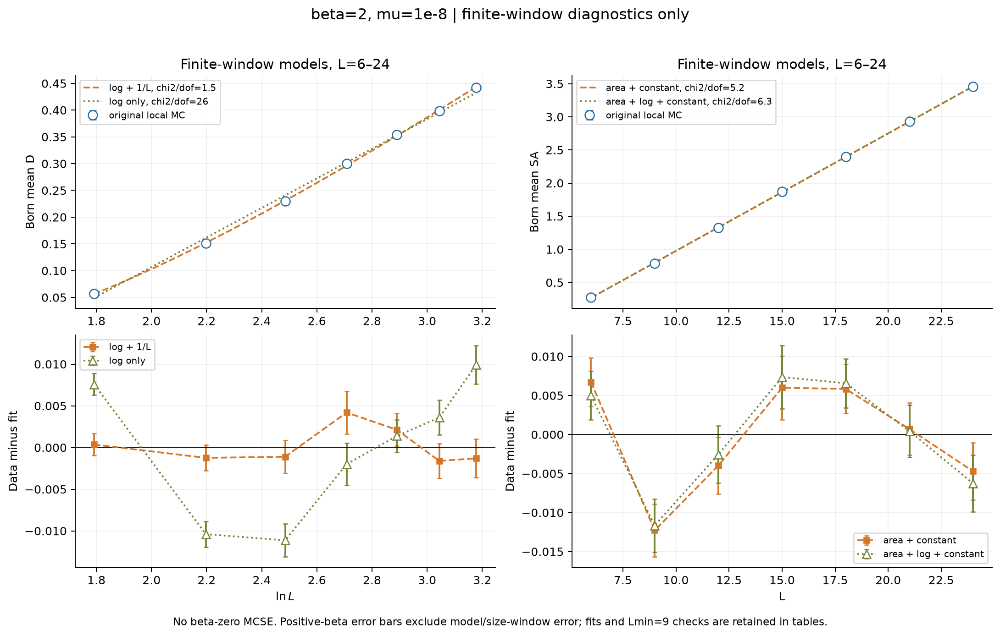

**β=2.5**

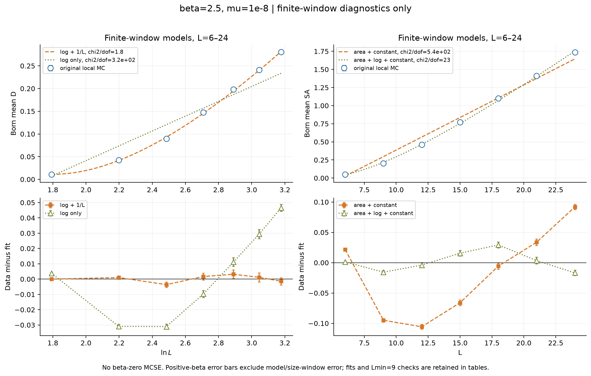

**β=3，首批 L≤24**

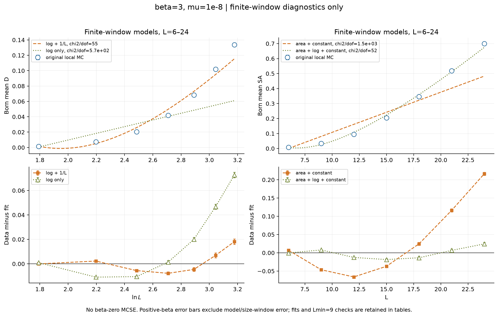

## 测量协议与观测量

系统为半填充、周期边界的自由蜂窝晶格，两个原胞方向均为 L，长度单位取原胞。L 取 3 的倍数。按你的要求，在单粒子 Hamiltonian 中加入极弱交错化学势，A 子格为正、B 子格为负：

$$
H_\mu=H_0+\mu\sum_{r\in A}\hat n_r-\mu\sum_{r\in B}\hat n_r,
\qquad \mu/t=10^{-8}.
$$

占据全部负能单粒子态；利用 A/B 间 hopping 矩阵的 SVD 稳定构造该基态。周期系统的两个 Dirac 零奇异值设为数学上的零，正交错势选中 B 子格零模。主计算始终采用这一规则，另用 10⁻⁹ 检查调节参数敏感性。旧的 μ=0 数值对角化选态只作对照，未混入新尺寸拟合。

固定一半格点为 E，因此这里是固定正负测量输出数目的条件 Born 分布；没有纳入其他输出数目的构型，也没有乘上“输出数目恰好为一半”这个事件本身的概率。采样强度与计算熵的测量强度相同，没有辅助强度重加权：

$$
N_s=2L^2,\quad |E|=|S|=L^2,\quad M_E(\beta)=e^{-2\beta\hat N_E},
\qquad |\Psi_E\rangle=\frac{M_E(\beta)|\Psi_\mu\rangle}{\sqrt{w_\beta(E)}}.
$$

$$
w_\beta(E)=\det\!\left[I-(1-e^{-4\beta})G_E\right],\qquad
p_\beta(E)=\frac{w_\beta(E)}{Z_{L^2}(\beta)},\qquad
Z_a(\beta)=\sum_{j=0}^{a}\binom aj^2e^{-4\beta j}.
$$

这里初态轨道为 P_μ，初态相关矩阵及其限制为

$$
G=P_\mu P_\mu^\dagger,\qquad G_E=G[E,E].
$$

每个构型先计算归一化后的轨道 Q，再计算区域相关矩阵及二阶 Rényi 熵。所有熵使用自然对数，对应当前代码的一份 Slater 态；N_s=2L² 中的 2 来自 A/B 子格，熵没有额外的自旋或味道倍数。平均的是每条 trajectory 的熵，既不是平均相关矩阵的熵，也不是先平均 purity 再取对数：

$$
C_R(E)=Q_RQ_R^\dagger,\qquad
S_2(R;E)=-\ln\det\!\left[C_R(E)^2+(I-C_R(E))^2\right].
$$

几何取

$$
A=(L/3)\times L,\qquad B=(L/3)\times(2L/3),\qquad C=L\times(L/3).
$$

A、C 是绕满周期方向的无角条带，B 有两个 60° 和两个 120° 角。每次使用同一个 E 同时测量三个区域，直接形成 D 的时间序列，从而在 D 的误差中保留区域间协方差：

$$
D(E)=\frac{2S_2(A;E)+S_2(C;E)}3-S_2(B;E),\qquad
\overline D=\sum_Ep_\beta(E)D(E),\qquad
\overline S_A=\sum_Ep_\beta(E)S_2(A;E).
$$

对任意随机 E，原先固定原点的 D(E) 是上述几何组合，单条 trajectory 的值可以为负，也不能保证面积项逐构型完全抵消。完整 Born 平均恢复平移对称后，若各区域边界具有按方向定义的局域面积律展开，这个组合配平两个方向的边界长度；它不要求两个方向的单位边界熵彼此相同。前文新增的子群平移平均还能使共有局域直边项逐构型相消。仍需确认共同的非角项消去、有限尺寸修正受到控制，才能把剩余对数系数解释为角贡献。待检验的拟合形式为

$$
\overline D(L,\beta)=c(\beta)\ln L+\gamma(\beta)+\frac{b(\beta)}L+\cdots.
$$

满足这些解释条件时，c 对应 B 的四个角的总贡献；B 的角度不同，不能把 c/4 直接认作某个单一角度的系数。

无角条带的主要检验是面积律，使用线性的 L 横轴；D 的 scaling 图使用 ln L 横轴。条带的附加对数项和 L ln L 违背面积律是不同问题：

$$
\overline S_A(L,\beta)=\alpha(\beta)L+\gamma_A(\beta)+\cdots.
$$

在**固定有限 L** 下，极强测量的极限可以直接确定：E 上的粒子全部被投影掉，剩余 L² 个粒子只能占满补集 S。只要该输出在 β→∞ 的极限仍有非零 Born 权重，即 det G_S>0，归一化后的态就是一个占据数乘积态，所有区域熵均为零。其余输出的概率趋于零；固定有限 L 的输出数有限、熵有界，所以它们对平均的贡献也消失。因此

$$
\lim_{\beta\to\infty}\overline S_A(L,\beta)=0,\qquad
\lim_{\beta\to\infty}\overline D(L,\beta)=0\quad (L\text{ 固定}).
$$

这说明有限尺寸上强测量会把结果带向乘积态极限；它本身不能确定先取大尺寸极限时的角系数，也不能证明某个有限 β 已经进入渐近 scaling 区间。

## 数值与统计检查

新实现只优化缓存和矩阵更新，提议分布及接受规则保持原样。相同随机种子下已与 `Free_M.jl` 核对逐 sweep 构型及接受次数；每 5 sweeps 重新构造逆矩阵，并记录漂移。三块区域的熵与独立相关矩阵本征值公式核对。

有限 β 时，权重矩阵的本征值都在 exp(−4β) 与 1 之间，因此每个 E 的权重严格为正；任意两个固定半数集合又能由有限次 E/S 交换连接。所以数学上的构型空间没有被零权重隔成不相通的部分。这不保证混合速度快，也不保证有限样本覆盖稀有高熵事件，实际 sweep 数仍由下面的诊断决定。

先用独立的 pilot 选择热化和正式样本量，再用新随机种子的生产链计算平均值；pilot 不加入正式均值。使用不同初始 E 的四条链，检查 rank/folded split-Rhat、bulk/tail ESS、原始均值的自相关误差，以及分块误差和前后半段漂移。诊断方法参考 [Vehtari 等的 Rhat/ESS 研究](https://arxiv.org/abs/1903.08008)。这些检查不能证明没有漏采全部链都未见到的稀有高熵事件，因此另设 L=3 全构型精确平均对照。

β=0 时测量算符为单位算符，所有 E 的熵相同，直接计算确定性基线，不给它虚构 Monte Carlo 误差、ESS 或 Rhat。

另外独立检查同一构型序列上的 S_A−S_C。当前交错势下，Born 平均的两方向熵相等来自坐标／子格交换结合粒子空穴变换，映射 E 到交换坐标后的补集；不是假定每个随机 E 都满足 S_A=S_C。这个差值的经验误差仍保留两区域协方差，未把结果强制对称化。

正式链的最大逆矩阵／对数权重漂移分别为 2.738×10⁻⁷、2.721×10⁻⁷，低于冻结的 10⁻⁵ 检查阈值。逐条 D 的组合恒等式误差为零。全部参数点中，方向差的均值相对于其 MCSE 的最大绝对比值为 1.98，没有强制令两方向相等。

最终[独立核验](analysis/born_scaling_production_validation.json)通过：从原始记录复算全部均值、误差、区域协方差和保留段接受率，并用 80 位精度 QR 核对 70 个拟合。13 组正式 PNG/PDF 已逐张检查，分析和审计均绑定实际源码及数据校验值。

[正式采样六面板诊断图](figures/born_scaling/production_sampling_diagnostics.png)的上排依次是最大 Rhat、最小 bulk/tail ESS、方向差除以其 MCSE；下排依次是 D 的 MCSE／0.003、S_A 的 MCSE／0.01、D 的前后半段均值差绝对值／0.003。最后一个比值不是 z 分数，不能直接当作显著性检验；灰格表示冻结计划没有计算该参数点。

## 热化、精度和精确对照

首轮 pilot 为 L=6、12、18，β=0.5、1.5、3，每点四条独立链、每链 2,048 sweeps。起点分别为随机 E、E 为全部 A 子格、E 为全部 B 子格、0/2 条纹 E。这里的 A/B 起点标签指**被抑制集合 E**，不是目标占据集合 S。

首轮九个参数点在丢弃 32、64、128、256、512 sweeps 的各个候选窗口，都满足所用的 Rhat≤1.01、bulk/tail ESS≥400 筛选标准。这支持“这些试跑点很快消除可见起点差异”，不证明 32 sweeps 对任意尺寸、β 都足够。**正式计算统一丢弃前 256 sweeps，再用新种子产生固定长度的生产段。**

精度目标为合并四链后的绝对 MCSE：D≤0.003、S_A≤0.01。采用原始观测量自相关估计及合格分块误差中的较大值。按首轮 pilot 方差外推，每条链应保留的 sweeps 为：

| L | β=0.5 | β=1.5 | β=3 |
|---|---:|---:|---:|
| 6 | 2,048 | 2,048 | 2,048 |
| 12 | 2,048 | 4,096 | 2,048 |
| 18 | 2,048 | 8,192 | 2,048 |

这是正式扫描前的样本量估计，**不是热化长度，也不是对高相对精度的保证**；正式结果的实际 MCSE 检查见开头。β 很大时均值接近零，绝对误差小并不代表相对误差小。

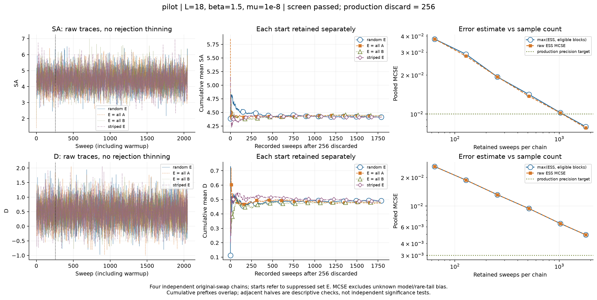

上、下两行分别是 S_A 和 D。左列保留四条原始时间序列，竖线标出正式采用的 256-sweep 热化长度；中列是丢弃热化后各链累计均值；右列是合并四链后的误差随每链样本数的变化，虚线为误差目标。中列的相邻累计点共享样本，不能当成独立重复实验。这个例子也显示，S_A 达到目标时 D 仍可能没有达到。

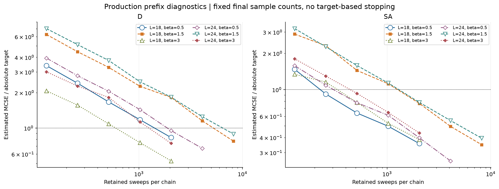

这张图使用正式链的前缀样本，左图是 D，右图是 S_A；纵轴为经验 MCSE 除以各自目标，降到 1 以下表示该经验误差达到绝对精度目标。横轴是每链保留的 sweeps，已经排除 256 sweeps 热化。全部最终链长预先冻结，图中的前缀诊断没有用于事后选择停止点。

L=3 每个 β 枚举全部 48,620 个固定半数集合；另用原 swap 做四条各 16,384-sweep 链，丢弃前 256，合并保留 64,512 个样本。下面误差为一个经验 MCSE：

| β | 精确平均 S_A | swap 平均 S_A | 精确平均 D | swap 平均 D |
|---|---:|---:|---:|---:|
| 0.5 | 1.266433 | 1.268084 ± 0.001299 | 0.155719 | 0.155979 ± 0.000760 |
| 1.5 | 0.149739 | 0.149609 ± 0.000835 | 0.0301365 | 0.0299638 ± 0.0003249 |
| 3 | 0.00043108 | 0.00043377 ± 0.00003301 | 0.000089918 | 0.000097837 ± 0.000013027 |

连同 S_B、S_C，12 个对照项的最大偏差约为 1.27 个经验 MCSE。这个小尺寸核验未发现新基态下的采样目标或熵计算错配。β=3 的 D 相对误差仍约 13%，不能把它称为高相对精度。精确分布中，按 D 从高到低排列的最高 1% Born 概率质量贡献了约 46.4% 的 D 平均值；这里按概率质量截断，边界原子按所需比例计入，不是“构型数量的最高 1%”。

还有一个独立的固定尺寸核验：计入初态零振幅输出对首项的贡献后，L=3 的强测量展开给出

$$
q=e^{-4\beta},\qquad \lim_{q\to0}\frac{\overline D}{q}\simeq14.63775.
$$

β=3 的全构型精确平均给出同一比值 14.63457，相差约 0.022%。相关零振幅分类经过多个阈值下的数值秩检查；这支持固定 L 的强测量极限，不构成大 L 的幂律、对数 scaling 或角系数结论。推导和限定见[强测量展开检查](analysis/born_scaling_strong_measurement.json)。

## β=0 基线和有限尺寸修正

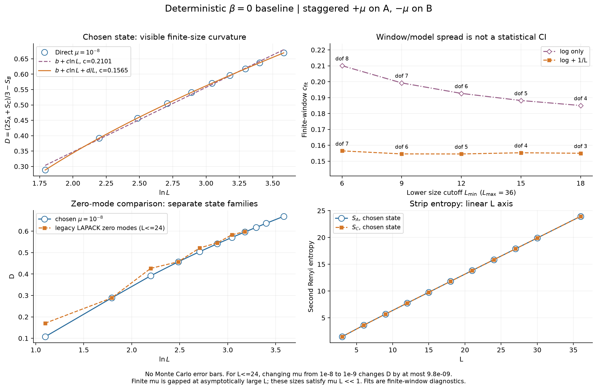

左上：选定基态的 D 对 ln L，纯 log 直线和含 1/L 修正的曲线同时展示。右上：固定 L_max=36，改变最小拟合尺寸所得系数；点之间的差别是窗口／模型敏感性，不是 Monte Carlo 误差。左下：旧数值对角化任意零模选态与本次统一选态分别画出，旧数据未参与新拟合。右下：无角条带 S_A、S_C 对线性 L 的确定性结果，两者重合。

| 拟合窗 | 纯 log 的系数 | 加 1/L 修正后的系数 |
|---|---:|---:|
| L=6–36 | 0.21006 | 0.15650 |
| L=9–36 | 0.19923 | 0.15459 |
| L=12–36 | 0.19264 | 0.15455 |
| L=18–36 | 0.18502 | 0.15499 |

**即使 β=0，也不能把这些尺寸上纯 ln L 拟合的斜率直接当作角系数。** 加入有限尺寸修正后，不同窗口给出约 0.155 的相近结果。非零 β 的拟合也必须保留这个检查，不能用一条看似不错的直线替代它。

L≤24 的 β=0 检查中，把 μ/t 从 10⁻⁸ 减至 10⁻⁹，最大 |ΔD| 为 9.84×10⁻⁹；99 个有限 β、固定同 E 的检查中，最大 |ΔD| 为 3.04×10⁻⁸。后者仅覆盖所列测试构型，并非对全部输出的严格上界。固定非零 μ 在无限大系统中有能隙；本次最大尺寸满足 μL≪1，讨论的是这个近无质量尺寸窗口。

## 首批正式扫描与拟合约定

主尺寸网格为 L=6、9、12、15、18、21、24，非零强度为 β=0.5、1、1.5、2、2.5、3。另在 L=6、12、18 加入 β=0.25、0.75、1.25、1.75、2.25、2.75，使这三个尺寸的强度间隔为 0.25。β=0 使用确定性基线。加密的 β 点用于均值随强度变化的图；尺寸拟合及系数曲线只使用具备完整主尺寸网格的 β=0、0.5、…、3。

正式计划在读取生产数据之前冻结：60 个随机参数点、每点四条链。现已完成全部 240 条链，热化共 61,440 sweeps，实际保留共 958,464 sweeps。每条链保留 2,048、4,096 或 8,192 sweeps，详见[固定分配表](analysis/born_scaling/allocation_proposal.csv)。除已试跑的点外，样本量由 pilot 方差的尺寸包络和相邻 β 较大方差估计；这是预算估算，不能代替对生产数据实际误差的检查。

奇数 L 的条纹起点最后一列只将 A 加入 E，以补足半数；因此它不是纯 0/2 图样。四种图样只用于检查热化起点依赖，正式平均覆盖所有固定半数集合，不按初始图样分类。

正式更新将原来的两次逆矩阵秩一更新合并为一次矩阵遍历。提议分布、随机数顺序、Metropolis 接受规则和每 5 sweeps 重建不变。40 组同种子测试中，原实现与正式入口的构型及接受次数逐 sweep 一致；实际 runner 输出的熵也逐条一致。这个实现优化不属于新的 loop、Gibbs 或独立抽样算法。

正式尺寸拟合检验含 1/L 修正的 D 模型，并将纯 log 拟合、最小尺寸切窗及残差另列。参数统计误差不包含模型选择／有限尺寸偏差。若某个 β 不支持所用对数模型，其拟合参数只作为有限窗口诊断，不认作已测得的普适角贡献系数。

拟合表还保留 D 的“线性项＋对数项＋常数”模型，用来检查残余线性趋势；更小的残差本身不证明某个物理机制。S_A 比较“面积项＋常数”和“面积项＋附加对数项＋常数”，其中附加对数项的系数不叫角系数。

非零 β 的加权最小二乘使用不同尺寸独立链给出的经验 MCSE。以 D 的三参数模型为例，条件于这些误差估计的参数协方差为

$$
X_{L,:}=(1,\ln L,L^{-1}),\qquad W_{LL}=\sigma_D(L)^{-2},\qquad
\operatorname{Cov}(\hat\gamma,\hat c,\hat b)\simeq(X^\mathsf{T}WX)^{-1}.
$$

这里没有用拟合残差重新缩放误差、强制使约化卡方等于 1。预先约定约化卡方大于 3 时加上“大残差”标记，作为描述性模型失配提示，不据此删点或宣称严格显著性。L_min=6、9 两个窗口共享数据，其系数差只作敏感性检查。

## 文件与复现

首批完整生产 manifest 已写出。在仓库根目录运行下列命令可从原始记录重建首批统计表、图和独立核验；这里不重新运行 Monte Carlo：

Python 需 3.11 或以上版本及 NumPy、Matplotlib；独立高精度拟合核验使用仓库中已有的 mpmath。

```powershell
python src/Measure/born_ai/analyze_born_scaling.py --production-stages production --plots
python src/Measure/born_ai/analysis/validate_born_scaling_production.py
```

生产入口按冻结计划核对源文件、基态和已完成链的校验值；已完成且校验通过的链会跳过。每条链的 seed、起点、热化／保留长度均写在计划及 receipt 中，原始 samples.csv 同时保留热化段，分析时才按 sweep 编号排除。

- 计算模块：[original_swap_scaling.jl](original_swap_scaling.jl)。
- 更新与熵基准：[benchmark_original_swap_scaling.jl](benchmark_original_swap_scaling.jl)。
- 正式运行入口：[run_born_scaling_fused.jl](run_born_scaling_fused.jl)；只融合矩阵更新的实现，不改变原提议。
- 正式冻结计划：[production_plan.toml](data/born_scaling/production/production_plan.toml)。
- 固定基态检查：[analysis/born_scaling_state_audit.jl](analysis/born_scaling_state_audit.jl)。
- 统计分析：[analyze_born_scaling.py](analyze_born_scaling.py)。
- 正式数据：[均值](analysis/born_scaling/production/means.csv)、[拟合及参数误差](analysis/born_scaling/production/fits.csv)、[逐尺寸残差](analysis/born_scaling/production/fit_residuals.csv)、[局部对数斜率](analysis/born_scaling/production/D_local_log_slopes.csv)、[分析清单](analysis/born_scaling/production/summary.json)。
- 首批运行清单：[production_manifest.toml](data/born_scaling/production/production_manifest.toml)，记录 240 条链的来源校验值。
- 小尺寸精确对照：[exact_comparison.csv](analysis/born_scaling/smallcheck/exact_comparison.csv)。
- 独立方法审计：[born_scaling_method_audit.json](analysis/born_scaling_method_audit.json)。
- 正式数据独立复核：[born_scaling_production_validation.json](analysis/born_scaling_production_validation.json)。
- 本次新数据保存在 `data/born_scaling/`；未覆盖此前 μ=0 的概率检查或小尺寸精确对照数据。

β=3 扩尺寸使用独立目录，正式计算完成于北京时间 2026-10-28 01:18:56；后续分析及审计不重新采样。

- 扩尺寸冻结计划：[production_beta3_large_plan.toml](data/born_scaling/production_beta3_large/production_beta3_large_plan.toml)，绑定种子、链长、源文件及分析约定。
- 扩尺寸完整数据清单：[production_beta3_large_manifest.toml](data/born_scaling/production_beta3_large/production_beta3_large_manifest.toml)，记录 12 条链及 32,768 条原始记录（含热化）。
- 采样前固定的拟合约定：[beta3_large_protocol.json](analysis/born_scaling/beta3_large_protocol.json)；旧模型冻结预测：[beta3_large_holdout/summary.json](analysis/born_scaling/beta3_large_holdout/summary.json)。
- 扩尺寸分析：[analyze_born_beta3_large.py](analyze_born_beta3_large.py)；[分析清单](analysis/born_scaling/beta3_large/summary.json)保存实际使用的源码快照与文件哈希。
- 独立核验程序：[validate_born_beta3_large.py](analysis/validate_born_beta3_large.py)；[核验回执](analysis/born_scaling/beta3_large/independent_validation/validation.json)。

重现扩尺寸分析时，保留原始数据、首批冻结结果和冻结预测，在独立工作副本的空 `analysis/born_scaling/beta3_large/` 派生输出目录运行下列命令。已发布结果依赖文件哈希；独立核验程序会拒绝覆盖已有回执。

```powershell
python src/Measure/born_ai/analyze_born_beta3_large.py --stages production_beta3_large
python src/Measure/born_ai/analysis/validate_born_beta3_large.py
```

本轮平移／形状检验另存于 `boundary_check`，生产计算在 2026-10-28 完成。原调度器曾因 Windows 状态文件写入权限错误退出，当时的 Julia 链继续完成；恢复入口先核验已有输出，只启动尚未运行的任务，没有覆盖或重跑已完成链。原调度状态、恢复代码及回执均绑定到最终 manifest，并通过独立完整性核验。统计分析另使用仅修正证据文件相对路径解析的兼容入口；冻结计划、科学计算源码及拟合约定未改。

- 几何与 β=0 核验：[check_born_boundary_geometry.jl](check_born_boundary_geometry.jl)、[确定性数据](data/born_scaling/boundary_check/geometry_baseline.csv)。
- 生产入口：[run_born_boundary_check_fast.jl](run_born_boundary_check_fast.jl)；[冻结计划](data/born_scaling/boundary_check/production/plan.toml)与[完整 manifest](data/born_scaling/boundary_check/production/manifest.json)。
- 分析入口：[analyze_born_boundary_check_compat.py](analyze_born_boundary_check_compat.py)，调用未改动的[统计分析器](analyze_born_boundary_check.py)。
- 正式结果：[均值与 MCSE](analysis/born_scaling/boundary_check/production/means.csv)、[模型与窗口拟合](analysis/born_scaling/boundary_check/production/fits.json)、[区域协方差](analysis/born_scaling/boundary_check/production/covariance.csv)、[局部斜率协方差](analysis/born_scaling/boundary_check/production/local_slope_covariance.csv)、[统计清单](analysis/born_scaling/boundary_check/production/summary.json)。
- 独立统计复核入口：[validate_born_boundary_production.py](analysis/validate_born_boundary_production.py)；实际构型重算：[validate_born_boundary_check.jl](validate_born_boundary_check.jl)。
- 展示图只调整注释位置及失配标签，没有重新统计或拟合：[绘图入口](render_reviewed_born_boundary_figures.py)、[输入输出哈希回执](figures/born_scaling/boundary_check/reviewed/presentation_receipt.json)。

从独立工作副本复现本轮分析时，在 `src/Measure/born_ai` 下执行以下命令；保留全部原始数据及冻结依赖，派生输出使用空目录。正式结果已带校验值，不应直接覆盖已发布目录。

```powershell
python analyze_born_boundary_check_compat.py --stage production --baseline data/born_scaling/boundary_check/geometry_baseline.csv --baseline-receipt data/born_scaling/boundary_check/boundary_audit.json --output analysis/born_scaling/boundary_check/reproduction --figures figures/born_scaling/boundary_check/reproduction
```
