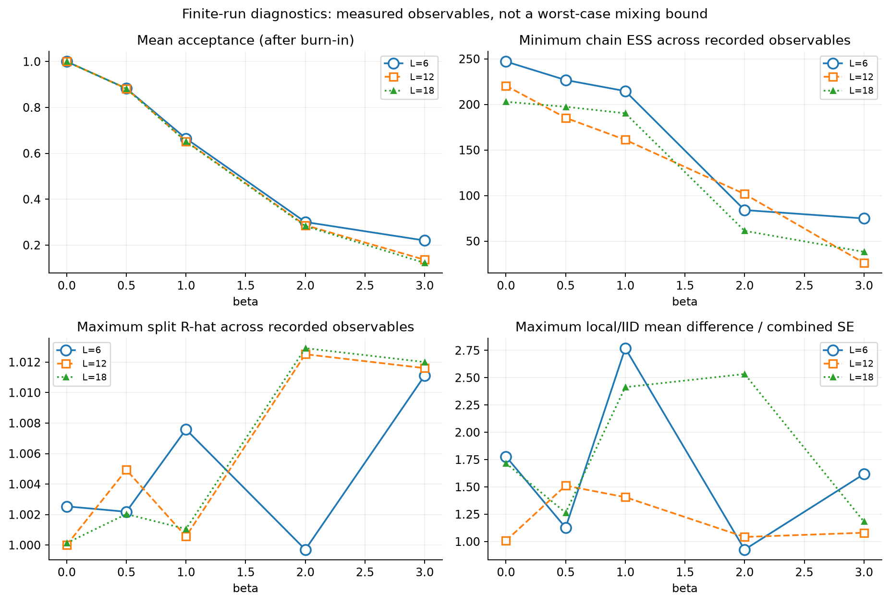
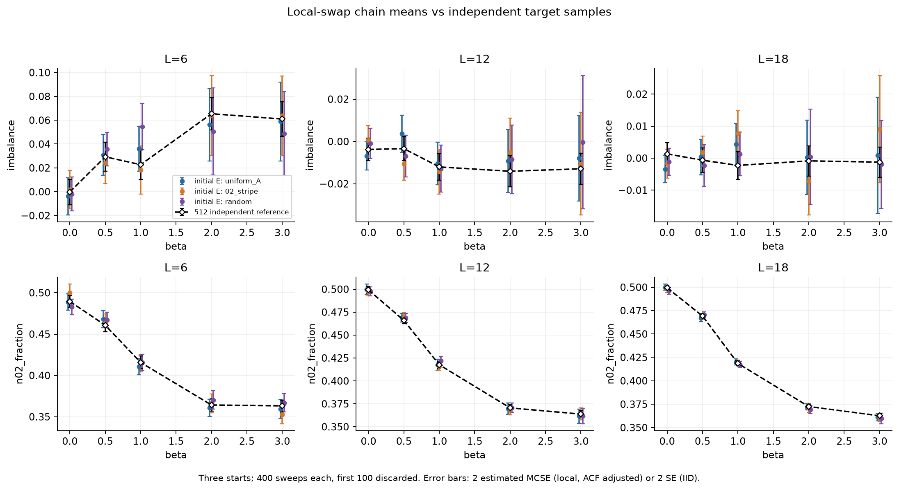
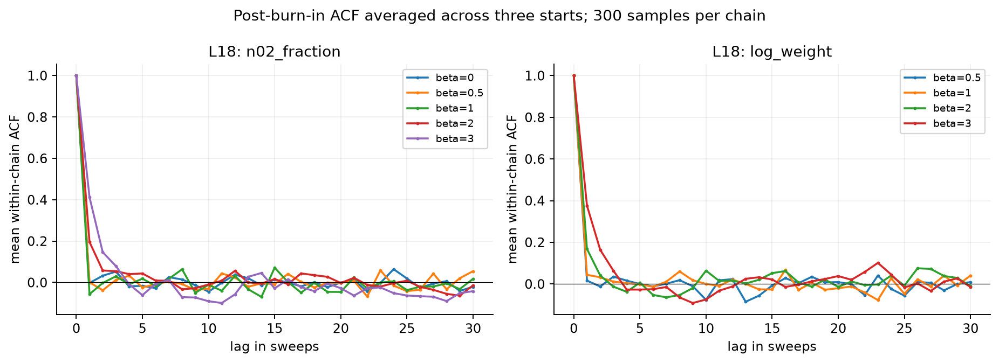
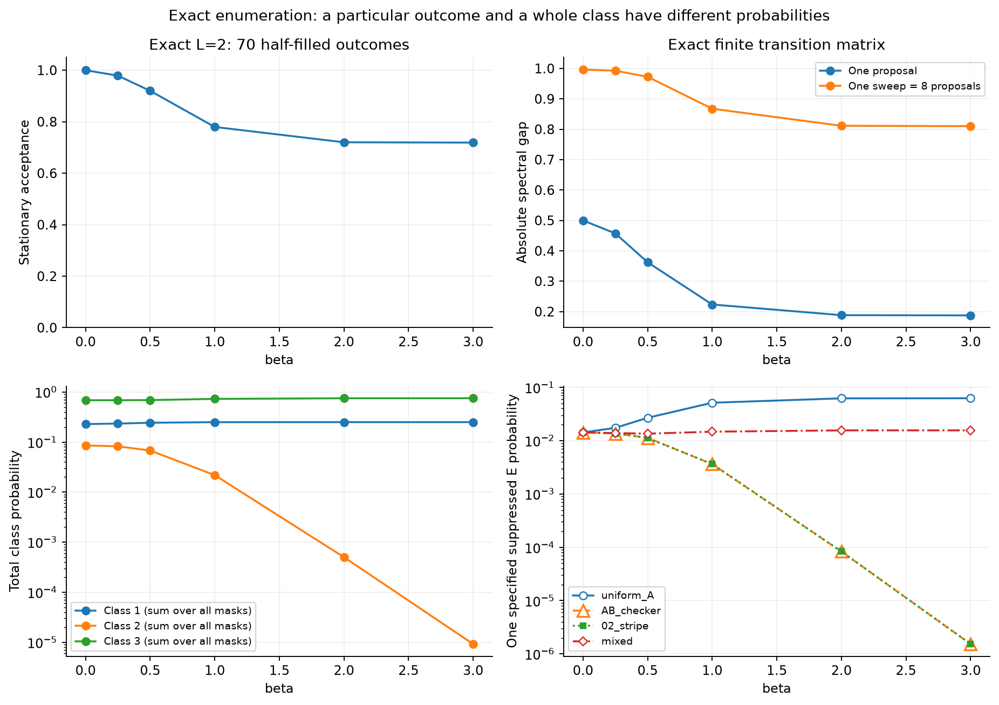
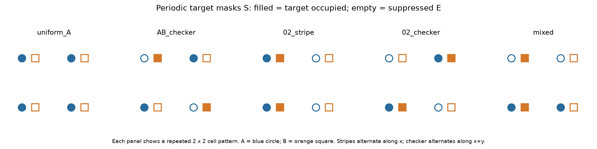
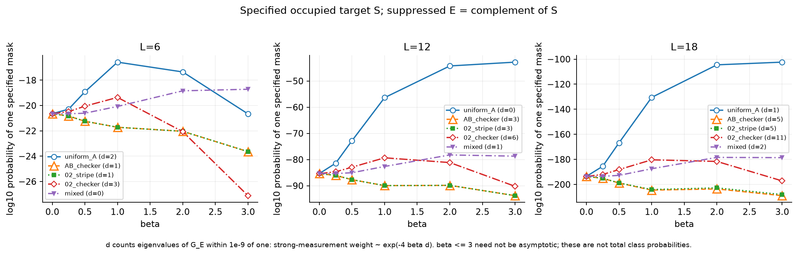
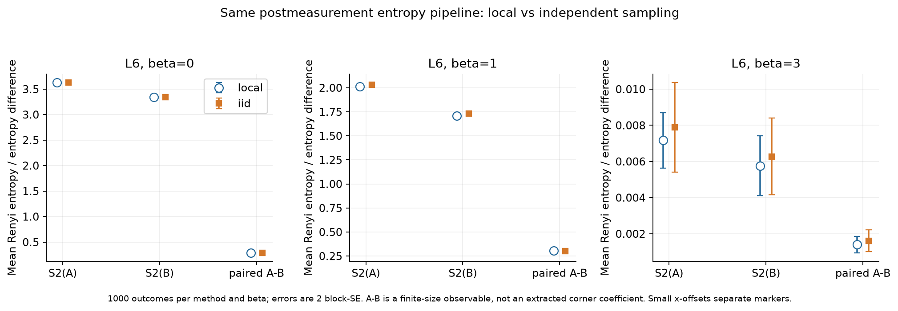
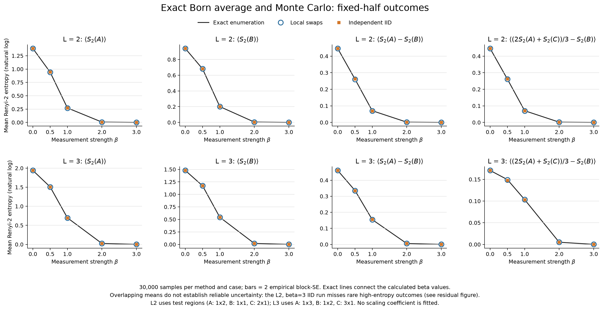
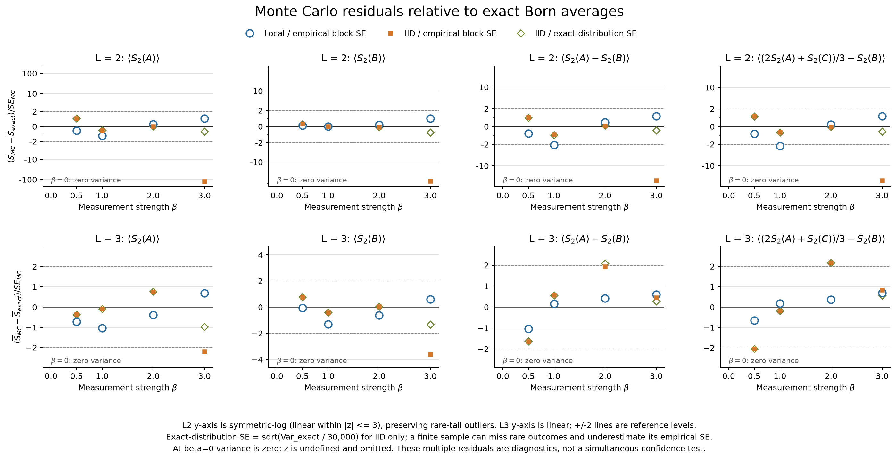

# 测量构型概率与 local update 检查

保留原随机交换提议、采用极弱交错化学势固定零模的新一轮 S_A 与 D 扫描，集中记录在 [Born 平均纠缠熵与尺寸 scaling](BORN_SCALING_RESULTS.md)。该文档包含 sweep 数选择、小尺寸精确对照、完整 β 扫描及尺寸拟合结果；下面仍保留此前的概率与更新检查，两个选态的数据不混合拟合。

本次检查针对 `Free_M.jl` 的周期蜂窝晶格、半填充、一个固定的自由费米子基态，日期为 2026-10-27。构型概率、起点依赖和接受率均是实际计算结果，未运行原来包含大量纠缠熵测量的整套默认扫描。

**新增：全构型 Born 加权纠缠熵已封装在 [ExactBorn.jl](ExactBorn.jl)，小尺寸精确枚举、Monte Carlo 对照图和调用方法见[第 7 节](#7-全构型精确平均与小尺寸-monte-carlo-对照)。强测量下发现了“漏采稀有高熵构型，导致经验误差条过小”的实例；独立采样也不能自动解决这个问题。**

具体的提议概率、接受率、缓存更新公式、伪代码和带权估计方案集中在 [UPDATE_PROPOSALS.md](UPDATE_PROPOSALS.md)。它是后续更新方案的设计文档，区分了已经验证的公式／小尺寸方差与尚未实现的生产入口。

## 1. 先回答问题

**在原来的 β=0–3 范围内，没有发现交换比值或逆矩阵更新公式的代数错误，也没有发现固定半填充构型空间被分成无法互达的部分。强测量会降低接受率，但目前不是“几乎完全拒绝”。**

需要区分四件事：

1. **目标分布有约束。** 程序始终保持一半格点标为目标空位；它不是包含所有正负测量结果数目的完整局域测量平均。
2. **稀有构型可能本来就很稀有。** 某一周期图样的概率很小，不能据此判断链没有遍历到它。
3. **样本之间有相关性。** 一个 sweep 是尝试交换总格点数次，不是获得一个独立样本。原程序没有记录接受率、热化或有效样本数。
4. **更强 β 有实际数值风险。** β=5 的低权重起点已测到明显逆矩阵漂移；这和真实的物理零权重或势垒是不同问题。

对当前固定 Slater 态，已经补充同一目标分布的独立抽样 `sampler=:iid`，可以消除 Markov 链热化和自相关的问题。它不是更改测量协议，也不保证每单位时间总比 local 更高效。

## 2. 权重不等于已经归一化的测量概率

总格点数、粒子数和目标空位集合大小分别为

$$
N_s=2a,\qquad N_{\rm part}=a,\qquad |E|=a,\qquad S=E^c.
$$

用原 Slater 态的正交轨道 Q 定义

$$
G=QQ^\dagger,\qquad Q^\dagger Q=I_a,\qquad q=e^{-4\beta}.
$$

测量后的态及其权重是

$$
|\Psi_E\rangle=\frac{M_E|\Psi\rangle}{\sqrt{w(E)}},\qquad
M_E=e^{-2\beta\hat N_E},\qquad
w(E)=\det[I_a-(1-q)G_E].
$$

**你目前的交换链采样的归一化分布为**

$$
\boxed{p_a(E)=\frac{w(E)}{Z_a(\beta)},\qquad
Z_a(\beta)=\sum_{j=0}^a\binom aj^2 e^{-4\beta j}.}
$$

归一化只依赖粒子数和 β，不依赖具体 Slater 态：全矩阵 I−(1−q)G 的本征值恰为 a 个 1 和 a 个 q，而 Z 是所有 a 阶主子式之和。上述概率来自本协议的直接推导。

β=0 时所有半数集合等概率；强测量极限变成目标占据构型 S 与所选基态的占据基交叠概率：

$$
p_0(E)=\binom{2a}{a}^{-1},\qquad
\lim_{\beta\to\infty}p_a(E)=\det G_S=|\langle S|\Psi\rangle|^2.
$$

所以，之前讨论的“构型能否投影到指定基态”与这里的强测量概率有关。但有限 β 的每个 E 都有正权重，而且在有限尺寸存在零模时，必须说明选的是哪一个简并基态。

### 如果你真正想采样完整的局域 Born 分布

与上述强度约定一致的一种完整逐格点二结果测量为

$$
K_\pm=\frac{e^{\pm\beta(\hat n-1/2)}}{\sqrt{2\cosh\beta}},\qquad
K_+^\dagger K_++K_-^\dagger K_-=I.
$$

此时 E 的大小可以变化。半填充初态并不强迫正负测量结果各占一半。保留所有输出时

$$
p_{\rm full}(E)=\frac{e^{2\beta(|E|-a)}w(E)}{(1+e^{-2\beta})^{2a}},\qquad
p_a(E)=p_{\rm full}(E\mid |E|=a).
$$

**如果研究目标是这个完整局域协议，现有固定数目 swap 确实不能覆盖全部结果；这是采样空间选错，而不是在当前固定数目空间内混合太慢。** 若本来就要后选择等数目的正负结果，现有空间是合适的。也可以把全部固定大小的 M_E 除以平方根 Z，直接定义一个在固定粒子数扇区上完备的全局 POVM。

## 3. 接受率与遍历性

代码随机从 E 和其补集各取一个格点交换，允许任意距离，不是最近邻交换。有限 β 下任意两种等大小的集合均可由有限次交换连接；所有中间权重为正。正反提议概率相同，因此文档中的比值和接受规则成立：

$$
\frac{w(E')}{w(E)}=\Delta_{ij}X_{jj},\qquad
\alpha=\min(1,\Delta_{ij}X_{jj}).
$$

原写法 `rand() < ratio` 与上述规则等价，没有漏乘一个接受因子。数学上还有单步界

$$
e^{-4\beta}\le\frac{w(E')}{w(E)}\le e^{4\beta},\qquad
\alpha\ge e^{-4\beta}.
$$

这是最坏情形界，不是实际平均接受率。当前分布属于固定大小的行列式点过程；标准带自环的交换链有相应混合定理，但不能直接把理论界当作“1000 sweeps 足够”的证据。[Anari、Oveis Gharan、Rezaei，2016](https://proceedings.mlr.press/v49/anari16.html)。

### 实测接受率

每组从 E 为全部 A 子格、0/2 条纹和随机集合三个不同起点各运行 400 sweeps，丢弃前 100。下表汇总每组保留的 900 sweeps；一个 sweep 尝试交换 2L² 次。

| L | β=0 | β=0.5 | β=1 | β=2 | β=3 |
|---|---:|---:|---:|---:|---:|
| 6 | 100% | 88.28% | 66.46% | 30.06% | 22.00% |
| 12 | 100% | 88.24% | 65.25% | 28.65% | 13.60% |
| 18 | 100% | 88.20% | 65.09% | 28.29% | 12.21% |

L=18、β=3 时，每 sweep 平均仍接受约 79 次交换。**这说明提议效率下降，但仅凭 12% 不能判定采样失效；仍须检查目标观测量的自相关。** 三种起点是在测试同一个固定 G 的采样链，不能理解为重新用三个物理初态各自演化到不同基态。

### 自相关与独立样本对照

主实验一共 45 条链、18000 sweeps，保留 13500 个样本；另外对每个尺寸／β 生成 512 个独立样本，共 7680 个作对照。观测量为 E 在 A/B 子格的数目不平衡、0/2 原胞比例、log 权重，以及与各自起点的重合度。主实验每 5 sweeps 重建逆矩阵，最大重建前相对漂移约 3.78×10⁻⁸；这与第 5 节对原默认 100-sweep 间隔的审计分开记录。

在 β=3 时，每条链保留 300 点，四种观测量中最小有效样本数分别约为 **75（L=6）、26（L=12）、38（L=18）**。因此 **“300 行数据=300 个独立样本”确实不成立，强测量下误差分析需要修正。** 有效样本数采用标准初始正、单调自相关配对序列估计，并保守限制不超过实际样本数：

$$
N_{\rm eff}\simeq\frac{N}{1+2\sum_{t\ge1}\rho(t)}.
$$

所测三个起点的最大 split R-hat 约为 1.013；local 与 iid 的 180 项单链均值比较中，最大差约为 2.77 个合并标准误。它是多次比较中的最大诊断值，不是预设的显著性检验或全局通过标准。**本次没有观察到三种起点维持不同长期均值的证据，但短链和这些观测量不能认证任意稀有事件或任意尺寸的熵已经充分采样。**



四个子图依次表示：平均接受率、各观测量中最小单链 ESS、最大 split R-hat、local 与 iid 均值差相对于合并标准误的大小。右上角展示的是每条 300 点链的有效信息量，不是接受次数。



三列对应 L=6、12、18；上排为 E 的子格不平衡，下排为 0/2 原胞比例。彩色点来自三个 local 起点，黑色空心菱形来自独立抽样；误差棒是两倍估计标准误，local 已作自相关修正。不同起点的横坐标仅作 ±0.025 的显示偏移，计算 β 相同。所选零模基态未必保持 A/B 交换对称，所以不平衡的目标均值不一定为零。



两图分别是 0/2 原胞比例和 log 权重的自相关，横轴单位为 sweep。较强测量在相邻几个 sweep 间存在更明显相关。更长延迟处的摆动包括有限样本噪声，不能把一次过零当作严格混合时间。起点记忆和完整轨迹另见 [L18 轨迹图](figures/local_trajectories_L18.png)。

## 4. 不同构型的概率：单个图样与整类质量

这里的第一类是每个原胞恰有一个目标占据位，第二类是每个原胞只有 0 或 2 个目标占据位，第三类是两种原胞的混合。固定全系统半填充时，L=2 的 70 个构型可完全枚举，三类分别含 16、6、48 个构型。

| β | 第一类总概率 | 第二类总概率 | 第三类总概率 |
|---|---:|---:|---:|
| 0 | 0.228571 | 0.085714 | 0.685714 |
| 0.5 | 0.242891 | 0.067707 | 0.689402 |
| 1 | 0.249614 | 0.021827 | 0.728559 |
| 2 | 0.250000 | 0.000501 | 0.749499 |
| 3 | 0.250000 | 0.00000922 | 0.749991 |

这是 L=2 的精确数值，不是热力学极限结论。在 β=3 下，即使有 1000 个独立样本，第二类的期望出现次数也只有约 0.0092；没见到它完全正常。另一方面，单个 uniform A 图样的概率由 β=0 的 1/70 上升到 β=3 的约 0.06250。**一个图样受到偏好，不意味着它所属的整类占主导；第三类的构型数量也必须计入。**



左上是精确平稳接受率，右上是单次提议与一个 sweep 转移矩阵的绝对谱隙，左下为整类概率，右下为指定集合概率。L=2 的 β=3 单提议谱隙仍约 0.1875，没有出现此小系统上的冻结。右下原始枚举按抑制集合 E 命名；该 L=2 基态的补集概率相同。

### 更大尺寸的具体周期图样



图中实心是目标占据 S，空心是被抑制的 E。蓝圆／橙方分别为 A/B 子格；每图展示重复的 2×2 原胞单元。前两种属于第一类，两个 0/2 构型属于第二类，最后一个属于第三类。



这里展示 **一个完整周期图样** 的概率的十进对数，三幅图纵轴范围不同。它不是某一类的总概率，也不是把图样平移、旋转后求和。数值直接由行列式谱和归一化计算，不要求采样链实际碰到这个图样；在 L=18、β=3，图中某些图样的概率低于 10⁻²⁰⁰，普通几千次采样当然不可能分辨。精确数值、占据位串与下述 d 指标在 `data/periodic_target_probabilities.csv`。

主尺寸的 512 个独立样本中，第一、第二类均未出现，样本全部是混合的第三类。**这不是证明前两类概率为零。** 每个单独尺寸／β 设置，对一个零计数类别，512 次独立抽样给出的一侧 95% 概率上限约为 0.00583；不同设置不能混在一起提高这个上限的精度。

有限 β 的构型排序由子块 G_E 的全部本征值决定，不能只看属于哪一类。若恰有 d 个本征值等于 1，则强测量时

$$
w(E)\sim e^{-4\beta d}\prod_{\nu_r<1}(1-\nu_r),\qquad
d=\#\{\nu_r(G_E)=1\}.
$$

这解释了某些与所选基态正交的周期图样为何随 β 被特别强烈压低；d=0 也不保证单个图样具有很大的绝对概率。

### 零模选择会显著影响具体图样的概率

本次严格沿用你代码的 `syevd` 最低 L² 个轨道，并保存这些轨道，确保 local 和 iid 比较的是同一个态。L 为 3 的倍数时有四个单粒子零模、半填充需占两个；数值对角化选择的那一个 Slater 基态并不唯一。

同一 L=18 Hamiltonian 的额外对照如下：

| 零模占据约定 | uniform A/B 的 d | β=3 时单图样 log₁₀概率 |
|---|---:|---:|
| 原保存的 `syevd` 选择 | 1 | −102.38685 |
| A/B 零模等权配对、两子格子块各为 I/2 | 0 | −97.77737 |

两者基态能量相同，概率却相差约 4.61 个数量级。后者从 A/B 子格各两维零空间基等权配对构造，明确只是另一种合法选择；并未替换主实验的 G。**所以，图中某个 uniform 构型的 d>0，不能被解释成“uniform 构型不能投影到任何基态”。它只说明与当前选出的特定零模 Slater 基态正交。** 这也解释了具体图样的概率随 β 未必单调上升。对照数据和正交性／能量验证见 `analysis/zero_mode_sensitivity.csv`、`analysis/zero_mode_sensitivity.toml`。

## 5. 代码与数值审计

原文件已在 `analysis/Free_M_audit_snapshot.jl` 保留快照。独立审计直接比较交换比值、更新后的逆矩阵、滤波后相关矩阵和 Rényi 熵；主要检查脚本为 `analysis/audit_free_m_updates.jl`。

- 在 L=3、6 上穷举不同起点的 24,786 次单点交换，再检查长链增量更新；原更新公式和直接计算一致。
- 原默认每 100 sweeps 重建逆矩阵。在 L=18、β=3 的随机起点 300-sweep 检查中，最大逆矩阵相对漂移约为 1.18×10⁻⁷。
- 超出原扫描范围的 β=5 压力测试：L=12 连续块 E 起点在第一 sweep 后漂移约 1.72×10⁻³，288 次提议中出现 8 次数学上不应存在的负 ratio。原实现会静默拒绝这些提议，新保护会报错。**更强测量不能直接沿用当前双精度逆更新而不监控误差。** 缩短重建间隔并不自动修复单个 sweep 内已经发生的漂移；可以改用独立抽样或更稳定／更高精度的更新。
- `get_G!` 返回空穴相关矩阵 I−C；同一轨迹的 Grover purity 在 C 与 I−C 互换下不变，实测熵误差在浮点精度范围。这不是本次问题的来源。
- `../PD.ipynb` 已经使用逐样本取负对数再平均，平均次序正确。但其 `std/sqrt(N)` 或逐点留一 jackknife 未考虑 Markov 自相关，可能低估误差；应对熵及其差值做分块或自相关修正。
- 原测试辅助函数 `Poss_M` 直接返回行列式，大尺寸很小的权重可能下溢。它不参与 local 接受率计算；比较概率时应使用 `BornSampler.log_probability` 或 log 权重差，不要用两个下溢为零的行列式相除。

为了让后续运行可诊断，`Free_M.jl` 保留 local 更新并新增：接受次数记录、显式 RNG、可选热化与重建间隔、无效比值时报错、可选 iid、独立保存 logdet 得到的熵。现在 `include` 不会自动启动默认全扫描。新的默认输出位于 `born_ai/samples/L=.../`，文件名区分 local 和 iid，避免混入或覆盖之前的数据。

无效比值保护能够检出负值或非有限值，但**不能检出所有仍为正数的数值偏差**；它不替代周期重建与误差监测。

### 实际熵测量也做了对照

除构型观测量外，还通过修改后的真实 `Free_Measure_EE` 入口，在 L=6、β=0、1、3 对 local 和 iid 各计算 1000 个熵样本，使用不同随机种子。每个样本另用加权轨道 QR 和区域相关矩阵本征值独立重算，S₂ 最大误差约 3.33×10⁻¹⁴。

| β | local 的平均 S₂(A)−S₂(B) | iid 的平均 S₂(A)−S₂(B) | 差值／合并分块标准误 |
|---|---:|---:|---:|
| 0 | 0.28852828 | 0.28852828 | 确定相同 |
| 1 | 0.30415785 | 0.29956294 | +0.385 |
| 3 | 0.00140074 | 0.00161420 | −0.566 |



图比较区域熵和逐样本相减后平均的 A−B，误差来自分块统计。这里验证的是原代码的熵观测量，**没有在此次采样审计中重新拟合角贡献系数**。这组结果未显示两种采样方法的可辨系统差异；β=3 的小均值相对误差较大，不能把少量小熵样本理解为高精度结果。完整记录见 `analysis/entropy_pipeline_audit.json`。

## 6. 对同一协议做独立抽样

在原态占据基展开中，引入辅助粒子集合 F：

$$
p_G(F)=|\det Q_F|^2,\qquad
w(E)=\sum_F p_G(F)e^{-4\beta|E\cap F|}.
$$

每次先从原投影行列式分布独立抽 F，再抽交集大小 j：

$$
\Pr(j)=\frac{\binom aj^2e^{-4\beta j}}{Z_a(\beta)}.
$$

从 F 均匀取 j 个格点，从其补集均匀取 a−j 个，合起来就是 E。这样 E 的边缘分布严格等于前面的 p_a。`BornSampler.jl` 用轨道 Householder 旋转实现投影分布抽样；这里的“精确”指无需 Markov 平衡极限的算法，实际计算仍使用 Float64。

**辅助 F 不能拿来替代物理态。得到 E 后，必须把 M_E 作用在原来的基态上，再计算纠缠熵。** 代码按这一顺序执行。仅对单个固定、实轨道 Slater 态实现了这个入口；不能直接移植到一般相互作用态或把平均 G 当作投影 G。原轨道或 β 改变时要重新创建 `IIDSampler`。

独立抽样检查包含 1066 项验证、L=2 的 40 万次抽样；归一化与直接占据基求和的误差分别不超过 1.6×10⁻¹⁵、1.2×10⁻¹⁶。抽样频率与精确分布的最大单格标准化偏差约 3.46，详见 `analysis/iid_validation.txt` 和 `analysis/iid_frequency_check.csv`。

例如，从仓库根目录进入 Julia 后：

```julia
include("src/Measure/born_ai/Free_M.jl")
using Random

# 原交换核；1000 是保留的样本数，另有 100 sweeps 热化。
local_result = Free_Measure_EE(12, 3.0, 1000;
    sampler=:local, burnin=100, refresh_every=5,
    rng=MersenneTwister(20261027))

# 相同固定半填充测量协议的独立样本，不需要热化。
iid_result = Free_Measure_EE(12, 3.0, 1000;
    sampler=:iid, rng=MersenneTwister(20261028))
```

示例的热化长度只是可复现的起点，不是对所有尺寸／观测量的充分性保证。`*_entropy.tsv` 保存逐样本 S₂(A)、S₂(B)；`*_diagnostics.tsv` 保存每次测量前的接受数和提议数。iid 两列记为零，表示没有 Metropolis 提议，不能据此说接受率为零。若沿用 purity CSV 后处理，应继续先取每个样本的负对数，再平均。

复算入口：`local_update_experiments.jl`、`local_iid_reference.jl`、`analyze_local_updates.py`、`check_born_sampler.jl`。原始轨道与 G、种子、源文件哈希及每 sweep 记录保存在 `data/`，审计数据在 `analysis/`。全部比较固定各尺寸的同一个 G；没有把不同简并基态的结果混在一条 Markov 链中。

## 7. 全构型精确平均与小尺寸 Monte Carlo 对照

### 7.1 计算的量与函数接口

用户要求的轨迹平均是：**逐一枚举测量结果，先把测量后的波函数归一化并计算它的纠缠熵，再用该结果的 Born 概率加权。** 对区域 R，程序计算

$$
\overline{S_2(R)}=\sum_{E\in\Omega}p(E)S_2(R;E),\qquad
S_2(R;E)=-\ln\operatorname{Tr}\rho_{R,E}^2.
$$

必须与另一个平均次序区分：

$$
\overline{S_2(R)}\ne-\ln\left[\sum_Ep(E)\operatorname{Tr}\rho_{R,E}^2\right]
\quad\text{（一般情况）}.
$$

[ExactBorn.jl](ExactBorn.jl) 中的 `born_trajectory_entropy` 返回前者 `mean_entropy`，也另存 `mean_purity` 和 `annealed_entropy`，避免两种观测量混用。它接受一个半填充纯 Slater 态的占据轨道矩阵 Pt，支持实数、复数和非正交但满列秩的轨道；不负责把任意初态先投影到基态。所有熵采用自然对数。

从仓库根目录启动 Julia，已有 Pt 和区域指标时：

```julia
include("src/Measure/born_ai/ExactBorn.jl")
using .ExactBorn

r = born_trajectory_entropy(Pt, 1.0, (A=A_idx, B=B_idx, C=C_idx);
    ensemble=:fixed_half)

r.mean_entropy             # [平均 S₂(A), 平均 S₂(B), 平均 S₂(C)]
r.configurations[k]        # 第 k 个测量结果的目标空位集合 E
r.probabilities[k]         # 已归一化的 Born 概率
r.entropies[k, :]          # 该结果测量后的三个区域熵
r.normalization_error      # 修正舍入误差之前的概率归一化检查

c = [2/3, -1.0, 1/3]       # 区域顺序是 A、B、C
D_mean = sum(c .* r.mean_entropy)
D_variance = sum(c .* (r.entropy_covariance * c))
# 若之后取 N 个独立样本，均值的真实标准差为 sqrt(D_variance / N)。
```

`entropy_covariance` 是精确轨迹分布的协方差，不是枚举结果的统计误差；枚举本身没有 Monte Carlo 误差。每个 E 的概率和熵一一对应，没有按概率阈值丢弃构型。实现先将 Pt 正交化，对每个 E 的滤波轨道做 QR，用 R 的对角元计算 log 权重，用 Q 计算区域相关矩阵与熵。

**“严格计算”在这里指完整求和，没有抽样近似；数值仍采用 Float64/ComplexF64，存在舍入和强滤波的条件数限制，不是任意精度的符号精确计算。** 程序检查解析归一化、构型数、相关矩阵谱范围以及轨道失秩；归一化检查不通过时直接报错，不靠任意重新归一化掩盖错误。

### 7.2 “所有构型”有两种不同的含义

| 参数 | 枚举空间 | 概率 | 对应的比较对象 |
|---|---|---|---|
| `ensemble=:fixed_half`（默认） | 所有大小为 a 的 E，共 binomial(2a,a) 种 | 第 2 节的 p_a(E) | 当前 `Free_M.jl` 的 local 和 iid |
| `ensemble=:full_local` | 所有 E，包括空集、全集，共 2^(2a) 种 | 第 2 节的 p_full(E) | 完整逐格点二结果测量，允许正负结果数目变化 |

完整局域协议的调用为：

```julia
r_full = born_trajectory_entropy(Pt, 1.0, (A=A_idx, B=B_idx, C=C_idx);
    ensemble=:full_local)
```

这两种协议一般有不同的平均熵，不能把 `r_full` 与固定数目交换链直接比较。特别是，完整协议不能只把所有 E 的 w(E) 加起来再归一化；还必须包含随 E 的大小变化的 Kraus 因子。函数分别实现了两种正确概率。

周期蜂窝晶格的格点数为 2L²。L=2、3 的固定半数空间分别有 **70、48,620** 种构型；完整空间分别为 **256、262,144** 种。L=4 的固定半数空间已有 **601,080,390** 种，因此默认 `max_configs=1_000_000` 会提前拒绝这次枚举，避免无意启动巨大任务。`keep_trajectories=false` 可省略返回的逐构型数组，但当前实现仍在内部保存权重和熵用于求和，不是常数内存算法。

### 7.3 实际运行设计与平均值

主对照使用同一份 `syevd` 基态轨道，L=2、3，β=0、0.5、1、2、3。每组参数均完整枚举 `fixed_half`；随后使用原 `UpdateMeasure!` 运行 3 条 local 链，每条热化 500 sweeps、保留 10,000 个样本，每 5 sweeps 重建逆矩阵；另用 iid 产生 30,000 个独立样本。**样本数和种子在检查输出之前固定，没有为追求一致而更换种子或追加样本。** 主对照共保存 243,450 条精确轨迹记录和 600,000 个 MC 样本。

这里检验的是概率、熵测量与抽样，不拟合角贡献 scaling。L=3 使用 A=1×3、B=1×2、C=3×1；L=2 采用 A=1×2、B=1×1、C=2×1 作为小系统测试区域。L=3 存在零模，选取的具体 Slater 态可使 A、C 的熵不同；每组比较固定同一个态，不做不同简并基态之间的平均。



**图的读法：** 上下两行分别为 L=2、3；四列依次是平均 S₂(A)、平均 S₂(B)、平均 A−B，以及平均 D=(2A+C)/3−B。黑线连接精确枚举值，蓝色空心圆和橙色实心方块分别表示 local、iid，即使重叠也可区分。误差条为样本估计的两倍分块标准误，每块 100 个样本；这不是对强测量稀有尾部可靠性的保证。S₂(C) 也保存在数据表中。

下表列出 D，MC 的 ± 为**一倍经验分块标准误**，不是精确求和的误差。强测量行需结合下一节判断。

| L | β | 精确平均 D | local | iid |
|---:|---:|---:|---:|---:|
| 2 | 0 | 0.44628710 | 0.44628710（零抽样方差） | 0.44628710（零抽样方差） |
| 2 | 0.5 | 0.26138798 | 0.26065869 ± 0.00087356 | 0.26233461 ± 0.00081906 |
| 2 | 1 | 0.07051177 | 0.06931683 ± 0.00054679 | 0.07012805 ± 0.00060144 |
| 2 | 2 | 0.00155103 | 0.00157139 ± 0.00008547 | 0.00155013 ± 0.00008690 |
| 2 | 3 | 0.0000285133 | 0.0000603584 ± 0.0000274448 | 0.0000222527 ± 0.0000001515 |
| 3 | 0 | 0.17052168 | 0.17052168（零抽样方差） | 0.17052168（零抽样方差） |
| 3 | 0.5 | 0.14947480 | 0.14899382 ± 0.00074485 | 0.14788950 ± 0.00077510 |
| 3 | 1 | 0.10331947 | 0.10347067 ± 0.00084012 | 0.10317021 ± 0.00082738 |
| 3 | 2 | 0.00509053 | 0.00513296 ± 0.00011653 | 0.00533755 ± 0.00011384 |
| 3 | 3 | 0.0000989402 | 0.0001020963 ± 0.0000044849 | 0.0001026481 ± 0.0000044407 |

完整数据及其他区域见 [beta_table.csv](analysis/exact_born/beta_table.csv)。β=0 的所有测量结果给出同一个归一化态，熵的真实抽样方差为零；末位差别来自浮点求和，不能除以零标准误解释为统计偏差。

### 7.4 强测量下的重要发现：独立采样也会低估误差

**不能把均值曲线看起来重合，解释成 Monte Carlo 的误差条已经正确。** L=2、β=3 是一个明确例子：

| S₂(A) 的统计量 | 数值 |
|---|---:|
| 全构型精确平均 | 0.000110377482 |
| 30,000 个 iid 样本的平均 | 0.000089132694 |
| 这些样本估出的分块标准误 | 0.000000169701 |
| 完整分布给出的 iid 均值标准差 | 0.000031365673 |
| 差值／经验标准误 | −125.19 |
| 差值／完整分布标准差 | −0.677 |

完整枚举后，可以直接计算 N 个独立样本平均值的真实标准差：

$$
\sigma_{\bar S,\mathrm{iid}}=
\sqrt{\frac{\sum_Ep(E)\left[S(E)-\overline S\right]^2}{N}}.
$$

在这组参数中，以 S₂(A)>0.01 作事后解释性分界，共有 10 种高熵结果，其总概率仅 1.53592×10⁻⁵，却贡献了约 19.3% 的精确平均熵。30,000 次独立采样的预期命中次数仅 **0.461**，一次也没抽到的概率约 **63.1%**；本次 iid 恰好没有命中，local 合计命中 2 次。这个阈值仅用来解释已经观察到的现象，不是预先定义的检验或丢弃数据规则。

因此，iid 的均值偏低符合这类稀有事件的抽样机制，但它根据当前样本给出的精度**远远过于乐观**。对 D 同样如此：用经验标准误算出的残差为 −41.34，用精确方差则为 −0.568。D 的尾部定义为绝对值大于 0.01，与 S₂(A) 的尾部不同，总概率为 1.84311×10⁻⁵、零命中概率约 57.5%，不能混用两个概率。



**图的读法：** 纵轴是 MC 平均减精确平均，再除以对应标准误。蓝圆和橙方块使用各自的经验分块标准误；绿菱形仍是同一组 iid 样本均值，但改用完整分布给出的真实 iid 标准差。上排使用对称对数纵轴保留大残差，下排为线性纵轴；β=0 因零方差不画残差。±2 虚线仅作参考，多个点不构成同时置信检验；尤其在稀有事件主导时，均值分布未必近似高斯。

还对 L=2 的全部 70 个状态显式建立了交换转移矩阵，每个 sweep 包含 8 次提议。β=3 时该 sweep 转移矩阵的谱隙约 **0.8101**，S₂(A) 的稳态方差膨胀因子约 **1.0000066**，D 约 **1.0000038**。**至少这个小系统中的异常不能归因于 local 链长期困住或很强的时间相关；稀有高熵轨迹本身就难以充分采到。** 转移矩阵给出的是稳态下有限样本均值方差，不包含有限热化可能留下的偏差，也不能直接外推到更大 L。数据见 [stationary local variance](data/exact_born/exact_born_stationary_local_variance.csv)。

实际使用建议：小尺寸以完整枚举作基准；大尺寸同时检查多个独立种子、样本数稳定性和高熵尾部命中。iid 解决 Markov 自相关，但无法保证固定样本数覆盖低概率尾部；仅增加分块长度也不能恢复从未出现的事件。对于本例，不能依据经验 SE 很小就宣称平均熵已高精度收敛。

### 7.5 完整局域测量也单独做了枚举对照

为了验证 `full_local` 分支，另外对 L=2 的全部 **256** 个结果求和，每个 β 独立抽样 30,000 次。抽样时先从原态占据基分布抽辅助 F，再在每个格点独立决定是否属于 E：

$$
\Pr(i\in E\mid F)=
\begin{cases}
r,&i\in F,\\
1-r,&i\notin F,
\end{cases}
\qquad r=\frac{e^{-2\beta}}{1+e^{-2\beta}}.
$$

对 F 求和后恰好得到完整局域 Kraus 概率；额外用占据基行列式展开逐构型核验了这一等式。与前面一样，F 只是辅助随机变量，熵仍由原 Pt 经 M_E 滤波后计算。这组样本**没有使用保持 E 大小的交换更新**。

| β | full_local 精确 D | iid 平均 D | 精确分布的 iid 均值标准差 | 差值／该标准差 |
|---:|---:|---:|---:|---:|
| 0 | 0.44628710 | 0.44628710 | 0（解析值） | 不定义 |
| 0.5 | 0.28855541 | 0.28888060 | 0.00083530 | +0.389 |
| 1 | 0.13685730 | 0.13373319 | 0.00111839 | −2.793 |
| 2 | 0.02244165 | 0.02208520 | 0.00062998 | −0.566 |
| 3 | 0.00313136 | 0.00298412 | 0.00024575 | −0.599 |

β=1 的 D 残差约 −2.79，保留原样报告，没有调整随机种子。这里各量共享样本、彼此相关，不能把每个残差视作互相独立的显著性检验。协议差别很明显：L=2、β=3 的精确 D 在 `fixed_half` 中约为 2.85×10⁻⁵，而在 `full_local` 中约为 3.13×10⁻³。**对照前必须首先确认枚举和 MC 使用的是同一个测量结果空间。** 完整逐构型概率、熵、频数和逐样本记录见 [data/exact_born_full](data/exact_born_full/)。

### 7.6 独立核验与复现入口

为了避免枚举与 MC 共用熵公式而重复同一种错误，[exact_born_validation.jl](analysis/exact_born_validation.jl) 使用完整占据基波函数、显式测量振幅和部分迹计算 Rényi-2 熵，**不调用相关矩阵熵公式**，且对非连续区域保留费米子重排符号。

- N=4、6 的实、复、非正交、乘积态，两种协议，共 64 组情况、1,696 个结果、11,872 次区域熵比较；另含 18 项输入／规模保护检查。
- 逐构型概率最大差约 3.89×10⁻¹⁶；逐构型熵最大差约 5.98×10⁻¹⁴；Born 平均熵最大差约 1.61×10⁻¹⁵。
- β=0 时所有轨迹熵一致；乘积态在全部测试强度下保持零熵；完整协议条件于 E 大小等于 a 后恢复 `fixed_half`。
- 主 MC 的每个样本都用另一个熵实现与精确表逐 E 核对，最大差约 2.83×10⁻¹⁴；local 的逆矩阵最大相对漂移为 6.15×10⁻¹¹。
- 完整局域分支还用独立 Python 占据基部分迹重算了全部 1,280 个结果，概率最大差为 1.25×10⁻¹⁶、熵最大差为 9.85×10⁻¹⁴；15 万个 iid 样本的频数、均值及标准误均与输出吻合，见 [full_local_reference_audit.json](analysis/full_local_reference_audit.json)。
- Python 独立从全部原始记录重算概率和、均值、分块误差、ESS 和逐 E 熵，审计通过。PASS 表示实现与记录通过这些核验，**不表示所有经验 MC 误差条都可靠**。

从仓库根目录复算（写入对应新结果目录）：

```powershell
julia --project=. src/Measure/born_ai/analysis/exact_born_validation.jl
julia --project=. src/Measure/born_ai/compare_exact_born.jl
python src/Measure/born_ai/diagnose_exact_born_tails.py
julia --project=. src/Measure/born_ai/stationary_exact_born_variance.jl
python src/Measure/born_ai/analyze_exact_born.py
julia --project=. src/Measure/born_ai/compare_full_local_born.jl
```

逐构型数据在 `data/exact_born/*_trajectories.csv`，逐样本数据在 `*_mc.csv`，汇总在 `exact_born_summary.csv`；完整局域协议单独存于 `data/exact_born_full/`。运行清单保存参数、种子、源文件和输出 SHA256。主要核验回执为 [exact_born_validation.toml](analysis/exact_born_validation.toml)、[summary.json](analysis/exact_born/summary.json)、[完整局域协议 manifest](data/exact_born_full/manifest.toml)。两张图另提供同名 PDF。
