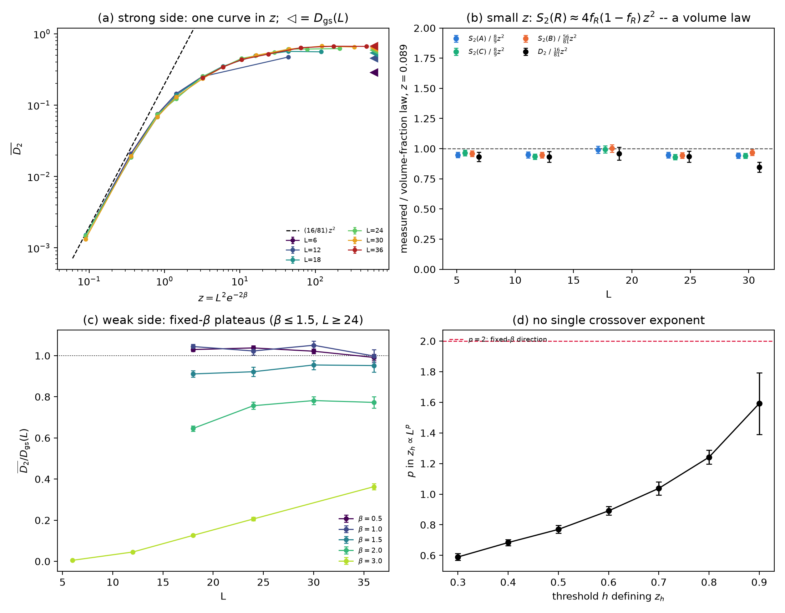
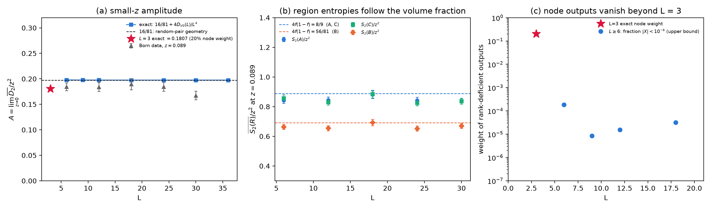
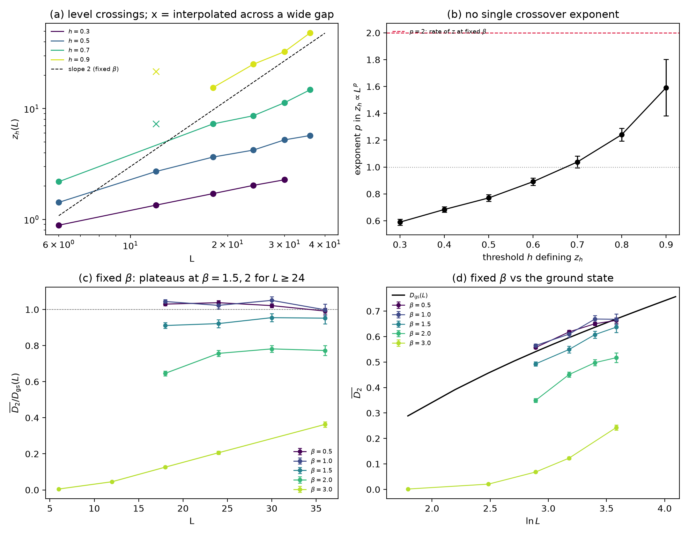
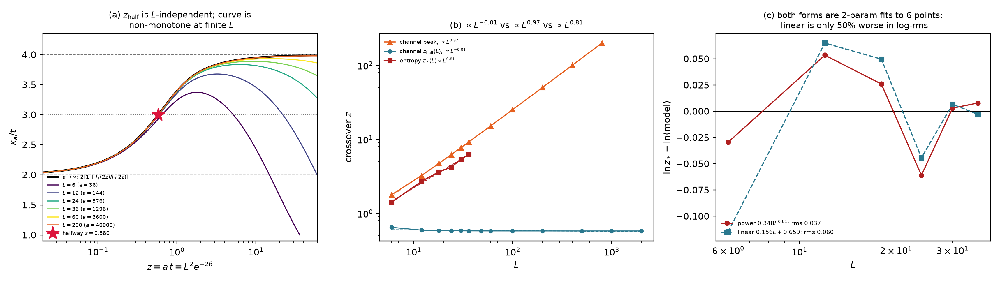
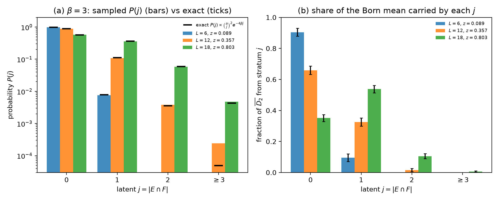
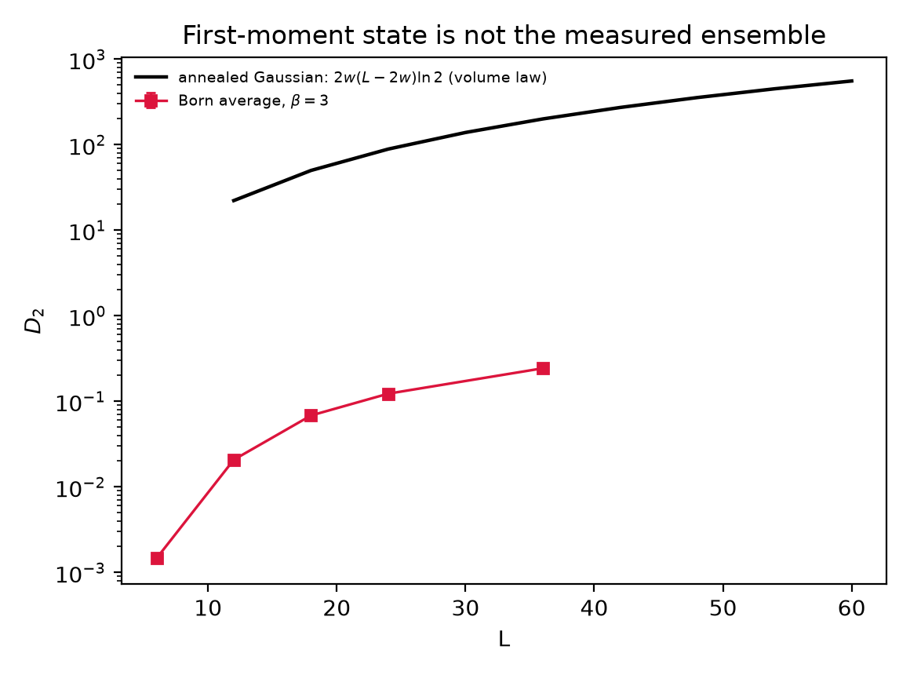
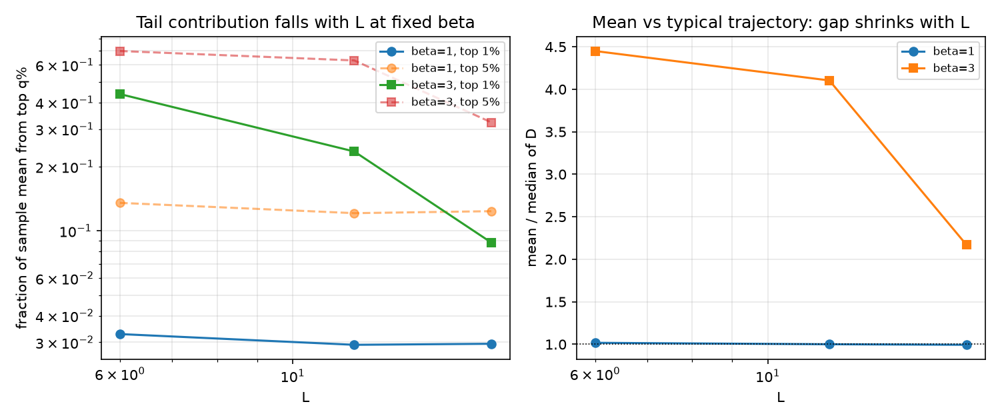

# born_ai 总汇总

蜂窝晶格自由费米子（2D 无质量 Dirac）基态，做**单层 Born 弱密度测量**之后，
二阶 Rényi 纠缠熵的**角贡献**如何随系统尺寸 scaling。

本文件是 `src/Measure/born_ai/` 的总入口。结构：§0 速览 → §1 所有量的定义 → §2 物理图像 →
§3 数值结论 → §4 每张图怎么读 → §5 作废与修正 → §6 文献 → §7 不确定之处 → §8 下一步 →
§9 目录 → §10 状态速查。详细推导与逐项复核在 `research_20261030/docs/`。

> **版本说明（2026-10-31）。** 本版经过四轮独立对抗性复核：数值逐项重算、标度主张的反驳、
> 精确通道与文献核查、终稿审计。复核脚本与表格在 `research_20261030/docs/audit/`。
> 与 2026-10-30 版相比，**核心图像改变了**：那一版的"$z_\ast \propto L^{0.8}$ ⇒ 固定 $\beta$ 必回基态、
> $L_\ast(3) \approx 62$"没有得到证实，已撤回（§5）。

---

## 0. 结论速览

**问题。** 半填充蜂窝晶格的 Dirac 费米子基态，纠缠熵是面积律加角上的 $\ln L$ 修正。对它做一次
Born 规则下的弱密度测量后，每条测量轨迹的纠缠熵怎样随 $L$ 变？观测量是抵消了面积律的角组合
$D_2$，对 Born 轨迹取平均得 $\bar D_2$（§1）。

**物理图像（§2）。** 测量结果是一份"哪些格点是空的"的记录，记录中的错误数由
$z=L^2e^{-2\beta}$ 控制。
- **错误很少（$z\lesssim0.3$，$P(j=0)\ge0.9$）**：测量后态几乎是一个经典粒子构型，剩下的纠缠来自少数几个**跨越整个系统**的
  单粒子涨落。它只认区域的面积分数，没有角，与 $L$ 无关。
- **错误很多（$z\gg1$）**：错误以固定密度 $t/(1+t)$（$t=e^{-2\beta}$）散布，基态的长程结构保留，$\ln L$ 增长保留，
  测量对 $\beta\le1.5$ 表现为近似常数的平移（$\ln L$ 系数是否严格不变未定，§3.5）。
- 两侧由不同的变量控制（错误**数** $z$ 与错误**密度** $e^{-2\beta}$），所以不存在单一的 crossover 尺度。

**主要结果（§3）：**
1. **强测量侧：$\bar D_2=f(z)$ 近似与 $L$ 无关**（$z\lesssim10$）。$z\ge3.2$ 时 $L$ 每增大 $e$ 倍的相对变化
   约 $-2.2\pm1.1\%$（$1.9\sigma$）；全部 $7$ 个 $z$ 组合并有 $-4.2\pm0.8\%$ 的漂移（$5.2\sigma$）。
   **不是 $L=6$ 造成的**：去掉 $L=6$ 后 $g=-6.4\pm2.0\%$，绝对值反而更大。
   "$\bar D_2\propto D_{\rm gs}(L)$"被排除：同一 $z$ 下 $\bar D_2$ 与 $L$ 一致到 $1\sigma$ 以内，
   而 $h=\bar D_2/D_{\rm gs}$ 系统性下降（$z=5.93$：$L=18,30,36$ 给 $h=0.646,0.534,0.509$；
   $z=10.55$：$L=24,30,36$ 给 $h=0.757,0.685,0.648$）。**样本扩充后这一条更干净了**
   ——旧版"在 $z=5.93,10.55$ 被 $5.4\sigma,3.4\sigma$ 排除"中的 $\bar D_2$ 不一致部分
   已降到 $0.7\sigma$、$0.9\sigma$（极值对），原数字混有统计噪声。
2. **小 $z$ 定理**：$A\equiv\lim_{z\to0}\bar D_2/z^2=16/81+4D_{V0}(L)/L^4$（$L\ge6$）$\to16/81$。
   它是体积分数律 $S_2(R)\approx4f_R(1-f_R)z^2$ 的残余，不是角项（$z\lesssim0.1$ 数据支持，比值 $\ge0.93$）。
3. **弱测量侧（$\beta\le1.5$）：$\bar D_2\approx D_{\rm gs}(L)-\Delta(\beta)$。** 固定 $\beta$ 的 $\ln L$ 增长**确实存在**
   （"不增长"被 $4.5\sigma$ 排除）；$\Delta\approx-0.01$（$\beta\le1$）、$+0.035$（$\beta=1.5$）。
   同一 $z=43.85$、$\beta$ 不同的点相差最多 $11.6\sigma$，那里 $z$ 单独不起作用。
4. **没有单一 crossover 尺度。** 等值线指数 $p(h)$ 从 $0.590\pm0.023$ 升到 $1.592\pm0.210$，与两侧形式的预期一致
   （§2.4）。整体检验对单尺度形式不利：等权重下 $\Delta\chi^2=9.8$ 对 5 个参数，
   同 $h$ 内跨 $L$ 置换检验 2000 次无一达到，$p<5\times10^{-4}$；
   位移 $s_L$ 随 $L$ 单调增长（以 $L=6$ 为零点：$0,+0.54,+0.92,+1.06,+1.28,+1.46$）而不收敛。
   （上一版的 $3.0\sigma$ 来自 bracket 宽度权重的任意幂次与一个 $\chi^2$ 公式错误，已作废。）
5. **固定 $\beta$ 下 $L\to\infty$ 的角系数是否等于基态值：未定。** 斜率比 $0.77\pm0.16$（$L\ge24$）、
   $0.94\pm0.07$（$L\ge18$），取决于拟合窗口。
6. 旧工作的"$c(\beta)$ 从 $0.155$ 升到 $0.43$"不是渐近系数，而是第 1 条的 $f(z)$ 沿 $z\propto L^2$ 的局部斜率
   （$\beta=3$、$L\ge24$ 实测 $0.333\pm0.033$）。

总览图 `research_20261030/figures/summary.png` 的逐面板说明见 §4.1。

---

## 1. 定义

### 1.1 晶格与基态

- **晶格。** 蜂窝晶格，$L\times L$ 个原胞。原胞坐标 $(x,y)\in\{0,\dots,L-1\}^2$ 沿两个夹角 $120^\circ$ 的
  晶格矢量 $\mathbf a_1,\mathbf a_2$。每个原胞有 $A$、$B$ 两个格点，格点总数 $M=2L^2$，周期边界。
  格点编号（Python 求解器 `annealed_gaussian.py`）$i=2(xL+y)+\sigma$，$\sigma=0$ 为 $A$、$1$ 为 $B$；Julia 的 `HoneyComb120` 中 $x$ 变化最快，$i=2(x+yL)+\sigma$（0 基）。两种标号对应同一个晶格、区域和熵，只是读 $Q$、$G$ 文件时要注意。
- **哈密顿量。** 最近邻跃迁：$A(x,y)$ 连到 $B(x,y)$、$B(x+1,y)$、$B(x,y-1)$，振幅取 1。二部图上跃迁的正负号
  是规范自由度，不影响任何熵。另加极弱的交错势 $\mu\sum_is_in_i$（$A$ 上 $s_i=+1$、$B$ 上 $-1$，$\mu=10^{-8}$）。
- **为什么 $L$ 取 3 的倍数。** 这时 Dirac 点 $K,K'$ 是允许动量，有 4 个零能态（$A$、$B$ 子格各 2 个）；
  交错势把被占据的 2 个固定在 $B$ 子格上，使基态唯一。同时 $w=L/3$ 是整数。
- **基态。** 半填充，$n=L^2$ 个粒子。$|\Psi_0\rangle$ 是最低 $n$ 个单粒子轨道的 Slater 行列式；轨道矩阵
  $Q\in\mathbb R^{M\times n}$，$Q^TQ=\mathbb 1$。关联矩阵 $G_0=QQ^T$，$(G_0)_{ij}=\langle c_i^\dagger c_j\rangle$，是投影矩阵。
  对角元在 $A$ 上为 $\tfrac12-\tfrac1{L^2}$、在 $B$ 上为 $\tfrac12+\tfrac1{L^2}$，所以任何由整原胞组成的区域
  $R$ 都有 $\langle N_R\rangle=|R|/2$。

### 1.2 区域与角组合 $D_2$

- **区域**（按原胞选取，每个区域包含所选原胞的两个子格），$w=L/3$：
  - $A=\{x<w\}$：$w\times L$ 条带，绕环一圈，$|A|=2wL$，没有角；
  - $C=\{y<w\}$：$L\times w$ 条带，$|C|=2wL$，没有角；
  - $B=\{x<w,\ y<2w\}$：$w\times2w$ 平行四边形，$|B|=4w^2$，四个角，两个 $60^\circ$、两个 $120^\circ$。
- **面积分数** $f_R=|R|/M$：$f_A=f_C=1/3$，$f_B=2/9$。
- **二阶 Rényi 熵**（自然对数）：$S_2(R)=-\ln{\rm Tr}\,\rho_R^2$。对 Slater 态
  $$S_2(R)=-\sum_k\ln\!\big[\nu_k^2+(1-\nu_k)^2\big],$$
  $\nu_k$ 是限制在 $R$ 上的关联矩阵 $G_R$ 的本征值。
- **角组合**
  $$D_2=\frac{2S_2(A)+S_2(C)}{3}-S_2(B).$$
  **为什么这样组合。** 设沿 $\mathbf a_1$、$\mathbf a_2$ 方向的边每单位长度的边界律系数分别为 $\alpha_1$、$\alpha_2$。
  $A$ 有两条沿 $\mathbf a_2$ 的边（总长 $2L$），$C$ 有两条沿 $\mathbf a_1$ 的边（总长 $2L$），$B$ 沿 $\mathbf a_2$ 的边总长 $4w$、
  沿 $\mathbf a_1$ 的边总长 $2w$。于是 $\tfrac13(2\cdot2L\alpha_2+2L\alpha_1)=4w\alpha_2+2w\alpha_1$，恰好等于 $B$ 的边界项：
  边界律逐项抵消，不需要 $\alpha_1=\alpha_2$。$A$、$C$ 没有角，$B$ 的四个角给出
  $S_2(B)\supset-\sum_{\rm 角}a_2(\theta)\ln L$，所以
  $$D_2\simeq c_B\ln L+\text{常数},\qquad c_B=2a_2(\pi/3)+2a_2(2\pi/3).$$
  **注意：$D_2$ 只抵消边界长度项，不抵消体积项**（§2.2 的关键）。
- **基态值** $D_{\rm gs}(L)\equiv D_2(\Psi_0)$，由确定性求解器算到 $L=60$。拟合
  $D_{\rm gs}=c_2\ln L+b+\gamma/L$ 得基态 $\ln L$ 系数 $c_2$（§3.6）。

### 1.3 测量、Born 概率与轨迹平均

- **测量。** 一次测量的结果是一个格点子集 $E$，$|E|=a=L^2$（恰好一半格点）。Kraus 算符
  $$M_E=e^{-2\beta N_E},\qquad N_E=\sum_{i\in E}n_i .$$
  $\beta$ 是每个格点的测量强度。记 $t\equiv e^{-2\beta}$（落在 $E$ 上的粒子的振幅压低因子），
  $q\equiv t^2=e^{-4\beta}$（概率压低因子）。
- **完备性。** 在 $n$ 粒子子空间 $\sum_{|E|=a}M_E^\dagger M_E=Z_a(q)\,\mathbb 1$，$Z_a(q)=\sum_j\binom aj^2q^j$，
  所以 $\{M_E/\sqrt{Z_a}\}$ 是合法的广义测量（POVM）。
- **Born 概率。**
  $$p(E)=\frac{\langle\Psi_0|M_E^\dagger M_E|\Psi_0\rangle}{Z_a(q)}=\frac{\det\!\big(Q^TW_EQ\big)}{Z_a(q)},\qquad
  (W_E)_{ii}=\begin{cases}q,&i\in E\\ 1,&i\notin E\end{cases}$$
- **测量后态（轨迹态）。** $|\Psi_E\rangle\propto M_E|\Psi_0\rangle$ 仍是纯 Slater 态，轨道 $\tilde Q=W_E^{1/2}Q$，
  关联矩阵 $G_E=\tilde Q(\tilde Q^T\tilde Q)^{-1}\tilde Q^T$。
- **轨迹平均。** 任何量 $O$ 的 Born 平均 $\bar O=\sum_Ep(E)\,O(\Psi_E)$。本报告的主角是
  $$\bar D_2=\sum_Ep(E)\,D_2(\Psi_E).$$
  **平均的是每条轨迹的熵，不是平均态的熵。** 后者（§5.3 的"第一矩 Gaussian 态"）完全是另一回事。
- **比值** $h\equiv\bar D_2/D_{\rm gs}(L)$：$h=1$ 表示与未测量的基态相同。

### 1.4 记录错误 $j$ 与控制变量 $z$

- **Cauchy–Binet 展开。**
  $$\det\!\big(Q^TW_EQ\big)=\sum_{|F|=n}\det(Q_F)^2\,q^{|E\cap F|},$$
  $Q_F$ 是 $Q$ 在格点集 $F$ 上的行。$P(F)\equiv\det(Q_F)^2$ 正是基态里"粒子恰好占据 $F$"的概率
  （一个行列式点过程，DPP）。
- **精确独立抽样**（`research_20261029/StratifiedBorn.jl`）。分三步：
  1. 按 $P(F)$ 抽一个占据构型 $F$；
  2. 抽 $j$，概率 $P(j)=\binom aj^2q^j/Z_a(q)$；
  3. 在 $F$ 中均匀选 $j$ 个格点、在 $F^c$ 中均匀选 $a-j$ 个格点，合成 $E$。

  三步的联合分布对 $F$ 求和恰好给出 $p(E)$。$F$ 只是辅助变量，**不是**测量后的物理态。
- **记录错误数** $j=|E\cap F|$：辅助构型 $F$ 中被记录成"空"的粒子数。$j=0$ 时 $E=F^c$，记录完全正确。
  $P(j)$ 只依赖 $(a,\beta)$，与态无关。
  "错误"是对等价表示的说法：$E$ 的分布恰好等于对基态抽出的占据构型 $F$ 做带噪读出的分布（对每个 $F$，$\sum_Eq^{|E\cap F|}=Z_a$）；$F$ 与 $j$ 不能从 $E$ 或 $|\Psi_E\rangle$ 读出（$M_E$ 不是投影，$|\Psi_E\rangle$ 是对 $F$ 的相干叠加），只在 $z\ll1$ 时 $F\approx E^c$ 才近似是可观测的错误数。
- **控制变量**
  $$z\equiv a\,t=L^2e^{-2\beta},\qquad \frac{P(j=1)}{P(j=0)}=z^2 .$$
  固定 $z$、$a\to\infty$ 时 $P(j)\to z^{2j}/[(j!)^2I_0(2z)]$，$\langle j\rangle=z\,I_1(2z)/I_0(2z)$：
  - $z\ll1$：$\langle j\rangle\approx z^2$，几乎没有错误；
  - $z\gg1$（固定 $z$、$a\to\infty$）：$\langle j\rangle\approx z-\tfrac14$。固定 $\beta$ 时错误**密度** $\langle j\rangle/n\to t/(1+t)$（仅 $t\ll1$ 时 $\approx t$），$\langle j\rangle=a\,t/(1+t)$；Bessel 公式只在 $z\ll a$（即 $t\ll1$）有效。

  直观理解：一个错误要付 $q$ 的概率代价，但有约 $a^2$ 种放法（哪个粒子、放到哪个空位），两者之比就是 $z^2$。
- **固定 $\beta$ 的扫描沿 $z$ 轴滑动 $L^2$ 倍：**

| $\beta$ | $t=e^{-2\beta}$ | $z$（$L=6$） | $z$（$L=18$） | $z$（$L=36$） |
| --- | ---: | ---: | ---: | ---: |
| 0.5 | 0.368 | 13.2 | 119 | 477 |
| 1.0 | 0.135 | 4.87 | 43.8 | 175 |
| 1.5 | 0.0498 | 1.79 | 16.1 | 64.5 |
| 2.0 | 0.0183 | 0.659 | 5.93 | 23.7 |
| 3.0 | 0.00248 | 0.0892 | 0.803 | 3.21 |

### 1.5 理论辅助量

- **Thouless 振幅** $X$。对满秩输出（$S=E^c$，$\det Q_S\neq0$）定义 $X=Q_EQ_S^{-1}\in\mathbb R^{a\times n}$。测量后的轨道
  等价于"$S$ 上是单位阵、$E$ 上是 $tX$"：每个粒子主要待在 $S$ 的一个格点上，以振幅 $tX_{ec}$ 跳到 $E$ 中的格点 $e$。
- **节点**（秩亏输出）：$\det Q_S=0$。其 Born 概率是 $O(q)$，熵却是 $O(1)$。
- **数涨落。** $V(R)={\rm Var}(N_R)=\sum_{i\in R,\,j\notin R}|G_{ij}|^2$（对纯 Slater 态成立），$V_0(R)$ 是基态值；
  $D_V$、$D_{V0}$ 是同样的角组合。所有 $\nu_k$ 都接近 0 或 1 的近经典态满足 $S_2\approx2V$。
- **小 $z$ 振幅** $A(L)\equiv\lim_{z\to0}\bar D_2/z^2$（固定 $L$）。
- **平均通道** $\kappa_a$：$\mathbb E_E[(G_E)_{ij}]=\kappa_a\,(G_0)_{ij}$（$i\ne j$），对角元保持 $(G_0)_{ii}$，
  $\kappa_a=1-(1-t)^2Z_{a-1}(q)/Z_a(q)$。**第一矩 Gaussian 态** $\rho_{\bar G}$：以
  $\bar G=\kappa_aG_0+\tfrac{1-\kappa_a}{2}\mathbb 1$ 为关联矩阵的 Gaussian 态，即"先平均关联矩阵、再当成一个态"。注意它的对角元 $\kappa_a(G_0)_{ii}+\tfrac{1-\kappa_a}{2}$ 与 $\mathbb E[G_E]$ 的对角元相差 $(1-\kappa_a)/L^2$，对 §5.3 的结论没有影响。

### 1.6 统计与拟合量

- **样本与误差。** 每个 $(L,\beta)$ 点做 $N=512$–$4096$ 次**独立**的精确 Born 抽样（没有 Markov 链，样本无自相关）。
  $\bar D_2$ 的估计是样本均值，误差棒是标准误 ${\rm SEM}=s/\sqrt N$。同一 $(L,\beta)$ 的多个文件合并样本。
- **pull** $=(\text{预测}-\text{实测})/\sqrt{\sigma_{\rm 预测}^2+\sigma_{\rm 实测}^2}$；$\chi^2/{\rm dof}$ 是 pull 平方和除以自由度。
- **盲预测。** 只用 $L\le24$ 的数据，取同一 $z$ 的加权均值，预测 $L=30,36$ 的绝对 $\bar D_2$，不假设任何函数形式。
- **漂移** $g$：用 $\bar D_2=f(z)\,[1+g\ln(L/18)]$ 拟合全部匹配行，$g$ 是 $L$ 每增大 $e$ 倍的相对变化。
- **等值线** $z_h(L)$：固定 $L$，把测量点按 $z$ 排序，$h(z)$ 第一次从下往上越过阈值 $h$ 的位置
  （相邻两点间按 $\ln z$ 线性插值）。只有当夹住它的两点在 $\ln z$ 上相距不超过 $1.25$ 时才算"测到"。
- **指数** $p(h)$：$\ln z_h$ 对 $\ln L$ 的最小二乘斜率。误差来自 bootstrap：每个点的样本有放回重抽，重算交点和斜率。
- $\Delta(\beta)$：固定 $\beta$，$L\ge24$ 上 $D_{\rm gs}(L)-\bar D_2$ 的加权平均。
- **斜率比** $r$：固定 $\beta$，$L\ge24$ 上 $\bar D_2$ 对 $\ln L$ 的加权斜率，除以基态在同样 $L$ 上的斜率 $0.181$。
  $r=1$ 表示 $\ln L$ 系数不变。
- **不假设形式的整体检验**：$\ln z_h=G(h)+s_L$，$G$ 是过 7 个阈值节点的分段线性函数，$s_L$ 是每个 $L$ 的平移；
  "纯 $z$ 坍缩"即所有 $s_L=0$。36 个 crossing 等权重，显著性由同 $h$ 内跨 $L$ 的残差置换检验给出。

### 1.7 数据与归一化

**数据。** `data_matched_z/`（42 个 CSV）、`data_matched_largez/`（3 个）、`data_gapfill/`
（8 个半文件 = 4 个点，2026-10-31 补 crossover 中段），共 **48 个不同的 $(L,\beta)$ 点**、$3.0\times10^5$ 个独立样本
（样本数随 `extend_errors.py` / `run_shards.py` 追加而增长；2026-11-02 一轮分片并行扩样后从
$1.9\times10^5$ 增到 $3.0\times10^5$，$\le5\%$ 的点数从 20 增到 46）。
$(L=18,\ \beta=1.0)$ 在前两个目录各跑了一次（不同种子，相差 $1.0\sigma$）；所有现行分析脚本按 $(L,\beta)$
**合并**样本。`data_matched_largez/` 的 $L=24$ 只有计划 2048 样本中的 512（运行中止），$L=30$ 未跑；
独立抽样下这只减小样本量，不引入偏差。

**归一化已独立钉死。** 走与 Born 抽样**完全相同**的代码路径跑 $\beta=0$（`data_beta0/`，每尺寸 32 样本）：
每个样本给出相同的 $D$，与确定性求解器 `baseline_D.json` 相差 $\le4.4\times10^{-11}$：

| $L$ | 6 | 12 | 18 | 24 | 30 | 36 |
| --- | ---: | ---: | ---: | ---: | ---: | ---: |
| $D(\beta=0)$ | 0.288528 | 0.457099 | 0.540909 | 0.595933 | 0.636754 | 0.669189 |
| 差 | 1.4e-11 | 4.4e-11 | 6.2e-12 | 2.1e-11 | 4.1e-12 | 1.7e-11 |

---

## 2. 物理图像

这一节是我对结果的物理理解。每一条都标出依据：**[定理]** 有证明；**[数据]** 由数值确立；
**[解释]** 与数据一致的物理图像，但没有证明。

### 2.1 测量记录与它的错误

测量结果 $E$ 是一份"这 $L^2$ 个格点是空的"的记录。Born 规则让记录倾向于正确：每个被记成"空"却有粒子的
格点，概率要乘 $q=e^{-4\beta}$。但一个错误有约 $a^2=L^4$ 种放法（哪个粒子、放到哪个空位），两者之比就是
$z^2=L^4e^{-4\beta}$。所以 **[定理：$P(j)$ 与 $\langle j\rangle$，§1.4；把 $j$ 读成"记录错误数"属 [解释]]**：

- $z\lesssim0.3$：记录几乎无误（$P(j=0)\ge0.9$）；$z\approx1$ 时约有一个错误；$P(j=0)\approx1-z^2$ 只在 $z\ll1$ 成立；
- $z\gg1$：约有 $a\,t/(1+t)$ 个错误（$t\ll1$ 时 $\approx z$），**密度** $j/n\to t/(1+t)$，是一个与 $L$ 无关的强度量。

固定 $\beta$ 增大 $L$ 时 $z\propto L^2$，系统从"几乎无错"滑向"有限错误密度"。要让尺寸为 $L$ 的系统处在无错区，
需要 $e^{2\beta}\gtrsim L^2$，即 $\beta\gtrsim\ln L+O(1)$（常数由 $z\lesssim0.3$ 定）：每个格点的分辨力必须压过 $L^2$ 个可能的出错位置。
所以"强测量"不是一个固定的 $\beta$，而是相对于系统大小而言的。

### 2.2 强测量（$z\lesssim0.3$）：经典构型加上全局的单粒子涨落

无错记录（$j=0$，$E=F^c$）下，测量后态是一个经典 Fock 态 $|F\rangle$ 加 Thouless 涨落 **[定理]**：
$$|\Psi_E\rangle\propto\Big(1+t\!\!\sum_{e\in E,\ c\in F}\!\!X_{ec}\,c_e^\dagger c_c+O(t^2)\Big)|F\rangle .$$
主体是一个确定的粒子构型，量子性只剩"把一个粒子从 $c$ 挪到 $e$"的小振幅 $tX_{ec}$。

这些挪动的 Born 平均权重由一个精确恒等式给出 **[定理，§3.2]**：
$$\sum_F\det(Q_F)^2X_{ec}^2=\langle n_e(1-n_c)\rangle_0=G_{ee}(1-G_{cc})+(G_0)_{ec}^2,\qquad G_{ee}=\tfrac12\mp\tfrac1{L^2}.$$
求和遍历所有含 $c$、不含 $e$ 的构型 $F$；秩亏的 $F$ 按伴随形式 $\det(Q_F)X_{ec}=\pm\det(Q_{F-c+e})$ 计入。
右边是**未测量基态**中"$e$ 有粒子、$c$ 是空的"的概率。半填充时每个格点的占据概率是 $\tfrac12\mp\tfrac1{L^2}$（$A$ 子格取 $-$、$B$ 子格取 $+$），相距很远的两点
几乎独立，所以这个概率趋于 $1/4$（逐对只到 $O(1/L^2)$；$\mp1/L^2$ 项在对整原胞区域的跨界对求和时相消，所以汇总公式是精确的），**与距离无关**。于是测量后的纠缠就是"跨越边界的（粒子, 空位）对"的计数：
$$\bar S_2(R)\approx2q\!\!\sum_{(e,c)\ \text{跨越}\ \partial R}\!\!\langle n_e(1-n_c)\rangle_0
=4f_R(1-f_R)\,z^2+\frac{4V_0(R)}{L^4}\,z^2 .$$
第一项来自 $\tfrac14$，只认面积分数；第二项来自 $(G_0)_{ec}^2$，即基态的短程关联，带着边界律和角的信息，
但被压低了 $L^4$ 倍。

由此有三点物理后果：

1. **这里的 $D_2$ 量的不是角。** $D_2$ 只抵消边界长度项，不抵消体积分数项：
   $\tfrac13\big(2\cdot\tfrac89+\tfrac89\big)-\tfrac{56}{81}=\tfrac{16}{81}$。基态的角信息 $D_{V0}\propto\ln L$ 仍在公式里，
   只是相对体积项小了约 $L^4/(1.5\ln L)$ 倍：$L=6$ 时占 $0.2\%$，$L=36$ 时只占 $3\times10^{-6}$。**[定理（恒等式）+ 数据（$D_{V0}\propto\ln L$ 与节点修正来自数值）]**
2. **为什么与 $L$ 无关。** 涨落是全局的，只认面积分数；面积分数由 $w=L/3$ 固定，所以 $\bar D_2$ 只依赖 $z$。
   这在首阶解释了强测量侧的 $z$ 坍缩 **[定理]**。数据显示坍缩一直延伸到 $z\approx10$（十来个错误）**[数据]**，
   说明涨落变多以后仍然"只认分数"；这一点没有证明 **[解释]**。
3. **纠缠是被抹掉，不是被重新组织。** 测量越强，态越接近经典构型，纠缠 $\propto z^2\to0$。剩下的只是全局涨落的
   体积型残余。

### 2.3 弱测量（$z\gg1$，$\beta\le1.5$）：有限错误密度，基态的长程结构保留

错误密度 $t=e^{-2\beta}$ 是局域的强度量；$\beta\le1.5$ 时 $t\ge0.05$。测量相当于在一个与粒子构型相关联的格点集上
加了一层局域的虚时间势 $e^{-2\beta N_E}$。数据显示：

- 固定 $\beta$ 的 $\ln L$ 增长依然存在，"不增长"被 $4.5\sigma$ 排除；与基态的斜率比是 $0.77\pm0.16$（$L\ge24$）
  到 $0.94\pm0.07$（$L\ge18$）**[数据]**；
- 数据给出 $\bar D_2\approx D_{\rm gs}(L)-\Delta(\beta)$，$\Delta$ 在 $\beta\le1$ 时在误差内为零或略负，
  $\beta=1.5$ 时 $+0.035$ **[数据]**。"$\Delta$ 不随 $L$ 变、测量只平移常数"只是未检出变化（$\Delta(36)-\Delta(24)=+0.017\pm0.012$），$\ln L$ 系数是否严格不变见 §3.5 **[解释]**。

这与"弱测量只改非普适常数"的图像一致 **[解释]**，但该图像只是工作假设：测量缺陷（密度 / 交错密度算符）在二维时间片上树级量纲为 2，是边缘的，不相关性需要另行论证。但 Tang–Wen 在 1D 发现，
测量后共形对称性会丢失（§6），所以不能把它当作已证明的结论。

### 2.4 为什么没有单一的 crossover 尺度

两侧的控制变量不同：强测量侧是错误**数** $z$，弱测量侧是错误**密度** $t$，也就是 $\beta$。两者之间
$z=L^2t$ 本身含 $L$，所以从一侧到另一侧的过渡不可能只由一个 $z_\ast(L)$ 描述。

这可以做一个自洽性检验：只用两侧各自的形式，估计等值线指数 $p(h)$ 的两端。

- **低阈值。** 在 $f(z)$ 一侧，等值线满足 $f(z_h)=h\,D_{\rm gs}(L)$，所以 $z_h$ 只随 $D_{\rm gs}(L)$ 的缓慢
  增长而移动。用各 $L$ 合并的 $f(z)$ 预言：

| $h$ | 0.3 | 0.4 | 0.5 | 0.6 |
| --- | ---: | ---: | ---: | ---: |
| 预言 $p$ | 0.53 | 0.61 | 0.75 | 0.85 |
| 实测 $p$ | $0.590\pm0.023$ | $0.684\pm0.021$ | $0.770\pm0.026$ | $0.891\pm0.027$ |

  预言系统偏低 $0.03$–$0.07$（$1.0\sigma$–$3.5\sigma$，最大在 $h=0.4$；四个阈值共用同一批数据，是同一个效应）。这是**样本内**检验：$f(z)$ 由同一批数据合并得到，检验的是"$L$ 无关的 $f$"的自洽性，不是独立预言。偏差与 §3.2 的弱漂移（$g=-0.0415$，$5.2\sigma$；去掉 $L=6$ 后 $|g|$ 反而更大，所以不是小 $L$ 造成的）方向相容，但没有证明由它产生。
  （旧表的实测行 $0.585/0.648/0.787/0.913$ 是 `two_regime_check.py` 早期硬编码、样本扩充后没再更新的常数，已删除；现在两行都由脚本从 CSV 现算。）
- **高阈值。** 在 $D_{\rm gs}(L)-\Delta(\beta)$ 一侧，等值线对应的 $\beta_h$ 满足 $\Delta(\beta_h)=(1-h)\,D_{\rm gs}(L)$，
  几乎不随 $L$ 变。$h=0.9$ 时模型值 $\beta_h$ 只从 $1.64$ 变到 $1.72$（$L=18\to36$；实测 $\beta_h=1.52,1.57,1.66,1.64$），所以 $z_h\approx L^2e^{-2\beta_h}$，
  $p$ 接近 2：预言 $p=2-2s_D/k=1.77$（$s_D=d\ln D_{\rm gs}/d\ln L$，$k=d\ln\Delta/d\beta$，由 $\Delta(1.5)=0.0372$、$\Delta(2)=0.1439$ 两点得出，在同一组 $L$ 上**与 $h$ 无关**），实测 $p(0.9)=1.59\pm0.21$、$p(0.8)=1.35\pm0.18$（同样的 $L=18$–$36$），后者比预言低 $2.4\sigma$；
  那里 $\beta_h\approx1.9$，落在 $\beta=2$ 的边界区，$\Delta$ 的插值不可靠（同一插值也用于 $h=0.9$）。$h\ge0.8$ 的等值线都钉在 $\beta=1.5$ 一行上，所以这一端的检验很弱。
  （$\Delta(\beta)$ 以前硬编码为 $0.0345/0.1523$，比现在数据给的值偏离 $8\%$/$6\%$；现在由 `two_regime_check.deficit()` 现算。）

所以 $p(h)$ 从 $0.6$ 升到约 $2$，与"低端由强测量侧 $f(z)$、高端由弱测量侧 $D_{\rm gs}-\Delta(\beta)$ 控制"的图像定性一致 **[数据 + 解释]**；高端只是弱检验，不是定量预言。
检验脚本：`research_20261030/two_regime_check.py`。

### 2.5 回到原问题：Born 测量是否改变 Dirac 费米子纠缠的 scaling？

- **渐近（固定 $\beta$，$L\to\infty$）。** $z\to\infty$，系统必然进入有限错误密度的一侧。$\beta\le1.5$ 时这一侧
  保留 $\ln L$ 增长，系数与基态值相容，只有常数被平移；但**系数是否严格不变，未定**。$\beta\ge2.5$ 在现有
  尺寸上还没有进入这一侧，没有数据。
- **有限尺寸。** 强测量（$\beta\gtrsim\ln L$）把角上的 $\ln L$ 换成一个只依赖 $z$ 的函数 $f(z)$，它来自全局涨落的
  体积分数律（$z\lesssim0.3$ 已证明；$z\lesssim10$ 内它是与 $L$ 无关的函数 [数据]，但机制未确立），不是角项。旧工作在固定 $\beta$ 下把 $f(z)$ 沿 $z\propto L^2$ 的斜率读成了"随 $\beta$ 变化的角系数"
  （$\beta=3$ 时 $0.333$），这是误读。
- **方法上的教训。** 测量的物理在轨迹层面。先把轨迹平均掉再算熵（第一矩 Gaussian 态），会得到体积律，比真实值
  大 $10^1$–$10^5$ 倍。精确平均通道 $\kappa_a$ 的交叉点 $z\approx0.58$ 与 $L$ 无关，看不见熵的 $L$ 依赖
  **[定理 + 数据，§5.3]**。
- **没有回答的。** 测量后的态是否仍是同一个 Dirac CFT。$\ln L$ 斜率只约束一个系数。

---

## 3. 数值结论

### 3.1 两个控制变量

定义见 §1.4，物理含义见 §2.1。数值上区分两侧的判据是：固定 $z$ 改变 $L$ 时 $\bar D_2$ 不变（强测量侧，§3.2），
还是固定 $\beta$ 改变 $L$ 时 $D_{\rm gs}(L)-\bar D_2$ 不变（弱测量侧，§3.3）。

另注：$z\propto L^2$ 是因为被测区是**固定比例**（一半）的系统。若只测固定数目 $s$ 个格点，
$z=s\,e^{-2\beta}$ 与 $L$ 无关，强测量侧的整个结构都不会出现。

### 3.2 强测量侧：固定 $z$ 时 $\bar D_2$ 近似与 $L$ 无关

**盲预测。** 只用 $L \le 24$ 的数据，以同一 $z$ 的加权均值预测 $L = 30, 36$ 的**绝对** $\bar D_2$：
rms pull $1.37$，max pull $2.19$，$\chi^2/{\rm dof} = 1.89$（10 个预测点，$z = 0.089 \ldots 10.55$），
且 10 个 pull **全部**为负——均值系统性偏低，与下面 $g<0$ 是同一件事。
各固定-$z$ 行对常数的 $\chi^2/{\rm dof}$：
$0.95,\ 2.49,\ 1.77,\ 5.54,\ 0.94$（$z = 0.089,\ 0.357,\ 0.803,\ 1.428,\ 3.21$），
最差的是 $z=1.428$ 行（$\chi^2/{\rm dof}=5.54$，即 $\chi^2=22.2$ 对 4 个自由度，$p=1.8\times10^{-4}$，约 $3.7\sigma$；
旧版写的"约 $3.0\sigma$"换算有误）。gapfill 的两行 $z=5.93,\ 10.55$ 为 $0.34,\ 0.61$（各 3 点）。

**延伸到 $z \approx 10$。** 在已有点的 $z$ 上补测 $L = 30, 36$（`extend_samples.jl`，样本已扩充）：

| $z$ | 参照点 | $L=30$ | $L=36$ |
| --- | --- | ---: | ---: |
| 5.93 | $L=18$：$0.3495 \pm 0.0071$ | $0.3402 \pm 0.0147$（$-0.6\sigma$） | $0.3406 \pm 0.0103$（$-0.7\sigma$） |
| 10.55 | $L=24$：$0.4509 \pm 0.0103$ | $0.4361 \pm 0.0136$（$-0.9\sigma$） | $0.4337 \pm 0.0153$（$-0.9\sigma$） |

$\bar D_2$ 在同一 $z$ 下与 $L$ 一致到 $1\sigma$ 以内，但 $h = \bar D_2/D_{\rm gs}$ 系统性下降
（$z=5.93$：$0.646, 0.534, 0.509$；$z=10.55$：$0.757, 0.685, 0.648$）——因为 $D_{\rm gs}(L)$ 在涨。
（上一版表里 $L=36,z=5.93$ 的 $0.3190$ 与 $L=30,z=10.55$ 的 $0.4327\pm0.0175$ 是更早一轮样本的值；
$L=36$ 两点另含 gapfill 重复样本，去重后如上。）
**所以 $D_{\rm gs}$ 不是强测量侧的标尺，$h$ 也就不是坍缩变量。**

（**修正：** 旧版本这里写"在 $z=5.93$ 被 $5.4\sigma$、$z=10.55$ 被 $3.4\sigma$ 排除"。
样本扩充并去重后，$\bar D_2$ 自身的不一致降到 $0.7\sigma$ 和 $0.9\sigma$——**旧数字里混着一部分统计噪声。**
结论不变而且更清楚，但依据要从"$\bar D_2$ 不一致"换成"$\bar D_2$ 一致而 $h$ 不一致"。）

**定量的 $L$ 依赖。** 以 $\bar D_2 = f(z)\,[1 + g\ln(L/18)]$ 拟合全部匹配行
（$\Delta\chi^2=1$，样本扩充并去重后重算）：全部 7 个 $z$ 组 $g = -0.0415$，区间 $[-0.0495,-0.0335]$（$5.2\sigma$）；
去掉 $L=6$ 后 $g=-0.0635$，$\Delta\chi^2(g=0)=10.1$（$3.2\sigma$）——**绝对值反而更大，所以不是 $L=6$ 造成的**；
只看 $z\ge1.4$ 时 $3.9\sigma$，只看 $z\ge3.2$ 时 $1.9\sigma$。
**漂移在小 $z$ 处更显著，但符号在大 $z$ 一侧仍为负。**
所以准确的说法是**近似与 $L$ 无关**，不是精确无关。
（这张表随样本增加而漂移，是全文最不稳定的一处定量结论。）

**小 $z$ 定理。** 到 $q = t^2 = z^2/L^4$ 的首阶：

1. 满秩输出 $S = E^c$（权重 $\det(Q_S)^2$）是 $S$ 上的乘积态加 Thouless 振幅 $tX$，
   $X = Q_E Q_S^{-1}$。所有占据本征值贴近 0 或 1，故
   $S_2(R) = 2V(R) = 2t^2\sum_{(e,c)\ \text{被}\ R\ \text{隔开}} X_{ec}^2$（因此 $D_2 \approx 2D_V$，§5.3）。
   秩亏（"节点"）输出的 $p = qW_S$，熵为 $O(1)$。
2. **恒等式（定理）。** 对 $M = 2n$ 格点上任意秩 $n$ 的投影态和任意区域 $R$，令 $r = \lvert R\rvert$、
   $k = \lvert S'\cap R\rvert$：

   $$
   \sum_S \det(Q_S)^2\cdot 2\!\!\sum_{(e,c)\ \text{被}\ R\ \text{隔开}}\!\! X_{ec}^2
   = 2\,\mathbb E_{\rm DPP}\!\left[nr - 2kr + 2k^2\right]
   = 2nr - 4r\langle N_R\rangle + 4\langle N_R\rangle^2 + 4V_0(R) .
   $$

   左边取伴随形式，秩亏 $S$ 也计入。证明三行：Cramer 法则 $\det(Q_S)\,X_{ec} = \pm\det(Q_{S-c+e})$；
   把 $S' = S - c + e$ 重新标号后，$nr - 2kr + 2k^2$ 恰好是 $S'$ 中被 $R$ 隔开的（占据, 空）格点对数目；
   DPP 下 $\mathbb E k = \langle N_R\rangle$、${\rm Var}\,k = V_0(R)$。$\langle N_R\rangle = r/2$ 时化为 $r(M-r) + 4V_0(R)$。
   蜂窝的 $A, B, C$ 都满足 $\langle N_R\rangle = r/2$（零模的 $\pm 1/L^2$ 在整原胞内相消）。
   数值核对：随机投影态（含非粒子–空穴对称）$M = 8$–$12$ 全枚举误差 $\le 7\times 10^{-13}$；
   蜂窝 $L=3$ 逐区域 $\le 3\times 10^{-13}$。组合到 $D$ 上：$16L^4/81 + 4D_{V0}(L)$。
3. **节点修正。** 真值 = 恒等式 + 各节点 $W_S\,\{[f(x)+f(y)] - 2[x+y-2xy]\}$，
   $f(x) = -\ln[x^2+(1-x)^2]$，$x$、$y$ 是被挤出的粒子与留下的空穴落在 $R$ 内的权重。
   $L=3$ 全枚举：48620 个输出中 14248 个秩亏（14067 个余秩 1，即节点；181 个余秩 $\ge 2$，
   只在 $O(q^2)$ 起作用），节点占 $O(q)$ 权重的 $20.5\%$。满秩 $12.2771$ + 节点 $2.3607$
   $= \mathbf{14.6377513890}$，与已知精确值的 10 位全部吻合。节点权重 $= \mathbb E_{\rm DPP}[X\ \text{的精确零元个数}]/n^2$：
   $L=6$ 为 $1.9\times 10^{-4}$（零元在 $10^{-17}$–$10^{-13}$ 自成一簇，对 $A(6)$ 的修正 $\lesssim 6\times 10^{-5}$）；
   $L \ge 9$ 未检出（$L = 15, 18$ 的最小 $\lvert X\rvert$ 约 $3$–$4\times 10^{-9}$）。
4. 结果（$L \ge 6$ 为精确公式，节点修正 $\lesssim 10^{-4}$）：

| $L$ | 3 | 6 | 9 | 12 | 18 | 36 | $\infty$ |
| --- | ---: | ---: | ---: | ---: | ---: | ---: | ---: |
| $A(L)$ | 0.18071 | 0.19793 | 0.19763 | 0.19757 | 0.19754 | 0.19753 | $16/81 = 0.19753$ |

DPP 抽样的样本均值因 $\lVert X\rVert^2$ 重尾而偏低（$L=6$ 单个样本可达均值的 216 倍），不能用来
核实公式；Cauchy–Binet 钉死 $\mathbb E\lVert X\rVert^2 = n^2$。

**物理含义：小 $z$ 的 $\bar D_2$ 是体积分数律，不是角项。** $C_R \equiv \lim_{q\to0}\mathbb E[S_2(R)]/q$ 等于基态占据
分布中跨过 $R$ 边界的（占据, 空）格点对数目的两倍，**与两格点距离无关**。所以首阶下
$S_2(R) \approx 4f_R(1-f_R)\,z^2$，$f_R$ 是体积分数（$A, C$ 为 $1/3$，$B$ 为 $2/9$），几何上等同于
随机放置的格点对。$D$ 组合抵消边界项、不抵消体积项：$\tfrac13\!\left(2\cdot\tfrac89 + \tfrac89\right) - \tfrac{56}{81} = \tfrac{16}{81}$。
Born 数据与首阶之比（$L = 6$–$30$ 合并）：

| $z$ | $S_2(A)$ | $S_2(B)$ | $S_2(C)$ | $D_2$ |
| --- | ---: | ---: | ---: | ---: |
| 0.089 | $0.985 \pm 0.046$ | $0.954 \pm 0.045$ | $0.930 \pm 0.039$ | $0.950 \pm 0.076$ |
| 0.357 | $\approx 0.82$ | | | $0.78 \pm 0.03$ |
| 0.803 | $\approx 0.62$ | | | $0.58 \pm 0.01$ |

所以这一读法**只在 $z \lesssim 0.3$ 成立**（比值 $\ge 0.9$）。到 $z = 3.2$，$\bar D_2/z^2$ 只剩 $16/81$ 的 $12\%$。
把它推广成"整个强测量侧量的都是体积涨落"是**猜测**。

各 $L$ 的实测 $\bar D_2/z^2$：

| $z$ | $L=6$ | $L=12$ | $L=18$ | $L=24$ | $L=30$ | 误差范围 |
| --- | ---: | ---: | ---: | ---: | ---: | --- |
| 0.089 | 0.181 | 0.248 | 0.178 | 0.224 | 0.124 | 0.025–0.063 |
| 0.357 | 0.168 | 0.151 | 0.140 | 0.136 | 0.219 | 0.011–0.031 |
| 0.803 | 0.121 | 0.114 | 0.107 | 0.117 | 0.113 | 0.005–0.010 |
| 3.21 | 0.024 | 0.024 | 0.024 | 0.025 | 0.024 | 0.0005–0.0012 |

（$z = 0.089$ 时只有 8–29 个 $j \ge 1$ 样本。）

**典型轨迹主导小 $z$。** $j$ 是对**辅助**行列式 $F$ 的交叠，不是物理占据。$j = 0$ 恰对应满秩输出
$E = F^c$，承载 $L \ge 6$ 的全部首阶。$\beta = 3$ 时 $j=0$ 层对 $\bar D_2$ 的贡献份额为
$0.85 \pm 0.08$（$L=6$，$z=0.089$）、$0.75 \pm 0.04$（$L=12$，$z=0.357$）、$0.35 \pm 0.02$（$L=18$，$z=0.803$）：
$z$ 增大后 Born 重加权把权重推向 $j \ge 1$ 层。抽样的 $P(j)$ 与精确分布吻合
（唯一偏离是 $L=6$ 的 $j=1$：29 次对期望 16 次，$3.2\sigma$，48 个点中出现一个属正常涨落）。
图：`figures/j_decomposition.png`。

### 3.3 弱测量侧（$\beta \le 1.5$）：$\bar D_2 \approx D_{\rm gs}(L) - \Delta(\beta)$

固定 $\beta$、直接用测量点（不内插），表中是 $h = \bar D_2/D_{\rm gs}$：

| $\beta$ | $L=18$ | $L=24$ | $L=30$ | $L=36$ | $\Delta(\beta)$（$L \ge 24$ 常数拟合） |
| --- | ---: | ---: | ---: | ---: | ---: |
| 0.5 | 1.026 | 1.035 | 1.010 | 0.993 | $-0.012 \pm 0.006$ |
| 1.0 | 1.046 | 1.009 | 1.029 | 1.011 | $-0.009 \pm 0.011$ |
| 1.5 | 0.915 | 0.948 | 0.943 | 0.937 | $+0.035 \pm 0.011$ |
| 2.0 | 0.639 | 0.761 | 0.742 | 0.744 | $+0.152 \pm 0.009$（**边界**，见下） |

（$L = 24, 30, 36$ 的 $h$ 误差约 $\pm 0.02,\ \pm 0.03,\ \pm 0.035$。）

1. **$\beta$ 控制而非 $z$ 控制。** $z = 43.85$ 处 $L = 12/18/24$（$\beta = 0.59/1.0/1.29$）给出
   $\bar D_2 = 0.471/0.566/0.608$，两两相差 $11.6\sigma$（12 对 18）、$5.8\sigma$（12 对 24）、$1.8\sigma$（18 对 24），
   而 $h = 1.03/1.05/1.02$ 都贴着各自的 $D_{\rm gs}(L)$。$\beta = 2$ 在两区之间：它的 $L=24$ 点
   （$z = 10.55$）由 §3.2 的匹配测量证明仍在 $z$ 控制侧，所以 $\Delta(2)$ 不是干净的弱测量侧数字。
2. **$\ln L$ 增长确实存在。** $\beta \le 1.5$、$L \ge 24$ 联合拟合：斜率比 $r = 0$ 时 $\chi^2 = 24.0$，
   加法亏损 $3.35$，乘法亏损 $3.58$（各 6 个自由度）。"不增长"被 $4.5\sigma$ 排除，$r < 0.3$ 被 $2.7\sigma$
   排除，$r = 0.6$–$1$ 之间 $\Delta\chi^2 < 1$，分不开。
3. **"$\Delta$ 与 $L$ 无关"只是没测出变化。** $d\Delta/d\ln L = +0.042 \pm 0.029$，即
   $\Delta(36) - \Delta(24) = +0.017 \pm 0.012$。$\beta = 1.5$ 的平台（$h(36) - h(24) = -0.010 \pm 0.045$）
   只在约 $2\sigma$ 上排除 $p \lesssim 0.8$ 的单尺度形式，排除不了缓慢上升到 $h = 1$。
4. **$\beta \le 1$ 时 $\bar D_2$ 高于基态，但只在 $L \le 24$ 显著。** 9 个点合并：
   $\bar D_2 - D_{\rm gs} = +0.0152 \pm 0.0027$（$5.7\sigma$，相对 $+2.7 \pm 0.5\%$）。
   逐 $L$：$+0.014,\ +0.018,\ +0.017,\ +0.009,\ -0.002$（$L = 12 \ldots 36$）。
   $L \ge 24$：$+0.011 \pm 0.005$（$2.2\sigma$）；$L \ge 30$：$+0.004 \pm 0.008$。
5. **斜率比（$L \ge 24$，基态同区间斜率 $0.181$）：** $0.65 \pm 0.20$（$\beta=0.5$）、$1.10 \pm 0.38$（$\beta=1$）、
   $0.86 \pm 0.39$（$\beta=1.5$），与 1 分别差 $1.7\sigma$、$0.3\sigma$、$0.4\sigma$。$\beta \le 1.5$ 合并 $0.77 \pm 0.16$（$1.4\sigma$）。
   $\beta=2$ 为 $0.58 \pm 0.33$，但它在边界上。

### 3.4 两者之间：单尺度 crossover 被不利

定义 $z_h(L)$ 为 $h(z) = \bar D_2/D_{\rm gs}$ 首次越过阈值 $h$ 的位置（相邻测量点间按 $\ln z$ 线性插值），
只用括住它的两点间距 $\le e^{1.25}$ 的交点：

| $h$ | 0.3 | 0.4 | 0.5 | 0.6 | 0.7 | 0.8 | 0.9 |
| --- | ---: | ---: | ---: | ---: | ---: | ---: | ---: |
| $p$（$z_h \propto L^p$） | 0.590 | 0.684 | 0.770 | 0.891 | 1.038 | 1.242 | 1.592 |
| 误差（bootstrap） | 0.023 | 0.021 | 0.026 | 0.027 | 0.045 | 0.047 | 0.210 |
| 所用 $L$ | 6,12,18,24,30 | 6–36 | 6–36 | 6,18,24,30,36 | 6,18,24,30,36 | 6,18,24,30,36 | 18,24,30,36 |

（`crossover_structure.py`，去除 gapfill 重复样本后重算；`docs/audit/ref2_I_contours.py` 的独立实现给出相同的点估计。
旧版这里有一条脚注说 $h=0.4$ 的 bootstrap 丢掉约 25% 重抽样，那是 $L=36,\ z=3.21$ 还只有 512 样本、
$h=0.388$ 贴着阈值时的情况；现在该点 $h=0.363$，1500 次重抽样全部找得到交点。）

各阈值用的尺寸不同，直接比较会夸大显著性。在共同的 $L = 18$–$36$ 上：$p(0.8) - p(0.5) = 0.67 \pm 0.20$（$3.4\sigma$）、
$p(0.8) - p(0.4) = 0.74 \pm 0.19$（$3.8\sigma$）、$p(0.9)-p(0.5)=0.92\pm0.23$（$4.0\sigma$）；
只用 $L \ge 24$ 时 $p(0.8)-p(0.5)=0.96\pm0.40$（$2.4\sigma$）。
（旧版的 $0.89\pm0.24$、$1.14\pm0.23$（$4.9\sigma$）是样本扩充前的值，已过期。）
换插值方式或改间距阈值，$p(h)$ 变化不超过 $0.05$。注意 $h \ge 0.8$ 的等值线在 $L = 24$–$36$
落在 $\beta = 1.5$ 的点上，$p \approx 2$ 在那里部分是数据布点造成的。

**不假设形式的整体检验**（$\ln z_h = G(h) + s_L$，$G$ 过 7 个阈值节点分段线性，
36 个 crossing，$L = 6$–$36$，等权重；`headline_numbers.py:single_scale_test`）：

| 模型 | $\chi^2$ / 自由度 |
| --- | --- |
| 纯 $z$ 坍缩（$s_L = 0$） | 10.5 / 29 |
| 每个 $L$ 自由平移 | 0.7 / 24 |

$\Delta\chi^2 = 9.8$ 对 5 个参数。零假设"所有 $L$ 共用一条 $G(h)$"下残差在同一 $h$ 内对 $L$ 可交换；
在每个 $h$ 内随机置换残差 2000 次，零分布中位数 $1.5$、95 分位 $3.6$，**无一达到 $9.8$，$p<5\times10^{-4}$**。
位移（以 $L=6$ 为零点）$0,+0.54,+0.92,+1.06,+1.28,+1.46$ **单调增长不收敛**，是"没有单一 $z_*(L)$"的形态。
$p \ge 1$ 的单尺度形式与此不符。

（历史：这一节先后有三个版本，前两个都不能引用。
(i) $h = H(\ln z - s_L)$ 的直接拟合，$224/21 \to 42.3/17$、"$3.4\sigma$ 且全部来自 $L=36$"——
$L \ge 18$ 时 $h$ 对 $z$ 不单调，拟合穿过饱和的噪声尾部，结果对节点与窗口敏感。
(ii) crossing 形式按 bracket 宽度 $1/\Delta\ln z$ 加权，报 $3.0\sigma$——该权重不是 $1/\sigma^2$，
显著性随权重幂次从 $1.7\sigma$ 变到 $3.0\sigma$，且 $\chi^2$ 被误算成 $\sum w^2 r^2$。
用误差传播得到的真实 crossing 方差加权也不行：带平移模型 $\chi^2/{\rm dof}\approx 675/24$，
即分段线性 $G$ 在那个精度上本身设定错误，加权 $\chi^2$ 量的是模型误差。）
这同时说明了旧形式为何失败：两参数 $\bar D_2 = D_{\rm gs}\,h(z/z_\ast)$ 训练 $\chi^2/{\rm dof} = 30$、
盲预测最大 pull $10.6$；单变量 $z$ 坍缩在 85 组 $(\alpha,\gamma)$ 扫描中无一 $\chi^2/{\rm dof} < 3$。

图：`figures/crossover_structure.png`、`figures/summary.png`（读法见 §4）。

### 3.5 渐近问题：固定 $\beta$ 下 $L\to\infty$ 的角系数

若 §3.3 的加法形式一直成立，固定 $\beta$ 的角系数就是基态值，测量只改变非普适常数。
这是"测量对临界态是 RG 无关扰动"的通常预期。现有数据：

- $\beta \le 1.5$ 的 $\ln L$ 增长确定存在（$4.5\sigma$）；斜率比依窗口而定：$0.77 \pm 0.16$（$L \ge 24$）、
  $0.94 \pm 0.07$（$L \ge 18$，95% 区间 $0.80$–$1.07$）、$0.99 \pm 0.09$（$L = 18$–$30$）。
  若以渐近 $c_2 = 0.155$ 而非局部 $0.181$ 为基准，$L \ge 24$ 的比值为 $0.90 \pm 0.19$；
- $\beta \ge 2.5$ 的全部现有点都在强测量侧（$\beta=3$：$z \le 3.2$），对渐近行为**没有**约束；
- 强测量侧何时让位于弱测量侧，取决于 $f(L^2e^{-2\beta})$ 何时追上 $D_{\rm gs}(L) - \Delta(\beta)$。
  $\Delta(\beta)$ 在 $\beta = 1.5\to 2$ 间增长约 4 倍，$\beta = 3$ 的值未知，因此**无法**给出 $L_\ast(3)$。

**结论：系数与基态值相容（取决于窗口，差 $0$–$1.4\sigma$），但没有证明相等。**

### 3.6 基态 $c_2 = 0.155 \pm 0.02$

确定性求解器，$L = 6$–$60$。$\log + a/L$ 是最优拟合（$L \ge 24$：$c_2 = 0.15543$，
rms $2.4\times 10^{-6}$，比次优小一个数量级）；常数项 $+0.133$，$1/L$ 系数 $-0.737$。
**模型误差远大于统计误差：**

| 修正项 | $L \ge 24$ | $L \ge 6$ |
| --- | ---: | ---: |
| 纯 log | 0.1750 | 0.1963 |
| $+a/L$ | **0.1554** | 0.1558 |
| $+a/L^{1/2}$ | 0.1358 | 0.1147 |
| $+a/L^{3/2}$ | 0.1620 | 0.1693 |

诚实写法 $0.155 \pm 0.02$。这是**基态**数，不是任何有限 $\beta$ 的测量后系数。

---

## 4. 图的读法

**通用约定。** 每个数据点是一个 $(L,\beta)$ 上 $5\times10^2$–$3.9\times10^4$ 个独立 Born 样本的均值，
误差棒是标准误（§1.6）。样本数随 `extend_errors.py`/`run_shards.py` 追加而增长。
**同一 $(L,\beta)$ 的所有文件（含 `.shardKofN.csv` 分片）必须合并后再统计**：
按 $L$ 单独取文件会丢掉 $13/14$ 的样本，把误差棒放大约 $3.7$ 倍。
同一 $L$ 的点之间的连线只是导引，不是数据。记号：$\bar D_2$ 是 Born 平均的角组合，$D_{\rm gs}(L)$ 是未测量基态的值，
$h=\bar D_2/D_{\rm gs}$，$z=L^2e^{-2\beta}$（全部定义见 §1）。图都在 `research_20261030/figures/`，PNG 旁多有同名 PDF。

### 4.1 `summary.png`：总览（`summary_figure.py`）



**(a) 强测量侧只有一条曲线。**
- 横轴：$z=L^2e^{-2\beta}$，对数轴。$z$ 越小测量越强（§1.4）。
- 纵轴：$\bar D_2$，对数轴。
- 颜色：$L=6,12,18,24,30,36$。每种颜色是该 $L$ 的全部测量点按 $z$ 排序。
- 右端的 ◁：画在 $x=600$（大于最大测量值 $z=477$），纵坐标是该 $L$ 的 $D_{\rm gs}(L)$，代表 $z\to\infty$，即不测量。
- 黑虚线：$(16/81)\,z^2$，§3.2 证明的小 $z$ 精确律。
- 怎么读：$z\lesssim10$ 时所有颜色重合成一条线，$\bar D_2$ 只由 $z$ 决定（§2.2）。$z\lesssim0.3$ 时贴着虚线，之后逐渐
  落到虚线以下。$z$ 很大时每个 $L$ 各自走向自己的 ◁，曲线散开；对数轴上看着不大，但很显著，例如 $z=43.85$ 处
  $L=12,18,24$ 分别是 $0.471,\ 0.566,\ 0.608$。$L=12$ 有一段从 $z=3.2$ 直连到 $43.85$ 的长直线，中间没有数据。

**(b) 小 $z$ 是体积律，不是角项。**
- 横轴：$L=6,\dots,30$。同一 $L$ 的四个量左右错开画，避免重叠。
- 纵轴：实测值除以首阶理论值，都取在 $z=0.089$（随 $L$ 不同对应 $\beta=3.0$ 到 $4.6$）：$S_2(A)$、$S_2(C)$ 除以
  $\tfrac89z^2$，$S_2(B)$ 除以 $\tfrac{56}{81}z^2$，$D_2$ 除以 $\tfrac{16}{81}z^2$。这些系数就是 $4f_R(1-f_R)$（§1.2）。
- 虚线 1：与首阶理论完全一致。
- 怎么读：四个比值都在 1 附近（合并后 $0.91$–$0.98$），区域熵只看面积分数，与边界形状无关（§2.2）。
  $L=30$ 的误差棒最大（扩样前 576 样本时约 $46\%$，现在 $4.9\%$；分片样本按 $(L,\beta)$ 合并后才算得对）。

**(c) 弱测量侧：固定 $\beta$ 时 $\ln L$ 增长还在。**
- 横轴：$L$。纵轴：$h=\bar D_2/D_{\rm gs}(L)$。点线 $h=1$ 表示与基态相同。
- 每条线固定一个 $\beta=0.5,1,1.5,2,3$，直接用测量点，不内插。
- 怎么读：$\beta\le1$ 时 $h\approx1.00$–$1.05$；$\beta=1.5$ 在 $L\ge24$ 平在 $0.94$ 左右；$\beta=2$ 从 $0.64$ 升到 $0.76$
  后变平。平坦意味着 $\bar D_2$ 仍随 $L$ 增长、$h$ 不随 $L$ 下降。"$\ln L$ 系数不变"（$\bar D_2=D_{\rm gs}-\Delta$，$h$ 应缓慢上升）与"系数按固定比例缩小"（$\bar D_2=h_\infty D_{\rm gs}$，$h$ 严格平坦）在现有误差内都相容，需要更大 $L$ 才能区分（§3.3）。
  $\beta=3$ 一路爬升，但它的 $z$ 只从 $0.089$ 走到 $3.2$，仍在 (a) 的强测量曲线上，这不是在"恢复"。
  平台也容许缓慢上升，误差内分不开（§3.3）。

**(d) 不存在单一 crossover 尺度。**
- 横轴：阈值 $h$，从 $0.3$ 到 $0.9$。
- 纵轴：指数 $p$，定义为 $z_h\propto L^p$（§1.6）：对每个 $L$ 找 $h(z)$ 首次越过阈值的 $z_h$，再用 $\ln z_h$ 对 $\ln L$
  拟合直线。误差棒来自 bootstrap。
- 红虚线 $p=2$：固定 $\beta$ 时 $z\propto L^2$ 的方向。
- 怎么读：若 crossover 只有一个尺度 $z_\ast(L)$，各阈值的 $p$ 应相同，曲线是平的。实际 $p$ 从 $0.590\pm0.023$ 升到 $1.592\pm0.210$：
  低阈值的等值线落在强测量侧，只随 $D_{\rm gs}(L)$ 缓慢移动；高阈值的落在弱测量侧，几乎沿固定 $\beta$ 线走。
  两端与这一图像定性一致（§2.4）。
- 两个注意点：(1) 不同阈值用到的 $L$ 集合不同；限制到共同的 $L=18$–$36$ 后，
  $p$ 仍是 $0.57,\ 0.61,\ 0.67,\ 0.79,\ 1.02,\ 1.35,\ 1.59$（$h=0.3\ldots0.9$，去重后重算），**趋势不来自 $L$ 集合的差别**。
  (2) $h=0.9$ 的误差棒最大（$\pm0.21$），因为等值线落在两个采样点之间的宽间隙里，是插值不是测量。
  整体检验见 §3.4 末尾的置换检验（$p<5\times10^{-4}$ 不利）。

### 4.2 `small_z_mechanism.png`：小 $z$ 定理（`small_z_mechanism.py`）



- **(a)** 横轴 $L$，纵轴 $A(L)=\lim_{z\to0}\bar D_2/z^2$（§1.5）。蓝方块是精确公式 $16/81+4D_{V0}(L)/L^4$，虚线是 $16/81$。
  红星是 $L=3$ 的精确值 $0.1807$，它偏低是因为 $L=3$ 的 $O(q)$ 权重中有 $20.5\%$ 落在秩亏输出（节点）上。灰三角是 $z=0.089$ 的 Born 数据，
  在误差内一致。
- **(b)** 横轴 $L$，纵轴 $S_2(R)/z^2$，与两条虚线 $8/9$（$A$、$C$）、$56/81$（$B$）比较。与 4.1(b) 是同一信息，
  只是没有做比值。
- **(c)** 横轴 $L$，纵轴是节点输出的权重，对数轴。红星 $0.205$ 是 $L=3$ 的精确值。蓝点（$L\ge6$）是 $|X|<10^{-6}$ 元素
  的比例，作为节点权重的上界。**注意**：$L\ge9$ 的蓝点只是 $|X|$ 连续分布在小值处的密度，不是真正的节点；图标题
  "vanish" 说过了头，准确说法是"$L\ge9$ 未检出节点"。$L=6$ 的节点权重 $1.9\times10^{-4}$ 来自精确零元（图中蓝点是 $|X|<10^{-6}$ 的占比 $1.8\times10^{-4}$，二者接近）。

### 4.3 `crossover_structure.png`：等值线与固定 $\beta$（`crossover_structure.py`）



- **(a)** 横轴 $L$，纵轴 $z_h(L)$，双对数，画 $h=0.3,0.5,0.7,0.9$ 四条等值线（§1.6）。实心点是两侧都有测量点夹住的交点；
  × 是跨大间隙内插出来的交点，不参与拟合。黑虚线斜率 2，是固定 $\beta$ 的方向；$h=0.9$ 在大 $L$ 端几乎与它平行。
- **(b)、(c)** 与 4.1 的 (d)、(c) 相同。
- **(d)** 横轴 $\ln L$，纵轴 $\bar D_2$，黑线是 $D_{\rm gs}(L)$。**在这张图上曲线的斜率就是 $\ln L$ 系数**，所以它是看
  "系数变没变"最直接的图：$\beta\le1$ 贴着黑线；$\beta=1.5$ 在黑线下方大致平行；$\beta=2$ 更低；$\beta=3$ 的陡斜率
  正是旧工作误读为"$c(\beta)$ 升到 $0.43$"的来源，它其实是在沿 $z\propto L^2$ 爬强测量曲线（§2.5）。

### 4.4 `bessel_crossover.png`：平均通道为什么解释不了（`bessel_check.py`）



- **(a)** 横轴 $z$（对数），纵轴 $\kappa_a/t$。$\kappa_a$ 是精确平均通道对非对角关联的压缩因子（§1.5），$t=e^{-2\beta}$。
  粗黑线是 $a\to\infty$ 极限 $2[1+I_1(2z)/I_0(2z)]$，从 2 升到 4；彩线是有限 $L$，大 $z$ 处回落（$\beta\to0$ 时
  $\kappa_a/t\to1$）。红星是中点 $\kappa_a/t=3$，位于 $z=0.58$。
- **(b)** 横轴 $L$，纵轴是各种 crossover 的 $z$，双对数。蓝圆是通道中点，平的（$\approx0.58$，与 $L$ 无关）；红方是熵的
  $z_\ast$（$h=0.5$ 交点），在增长；橙三角是通道曲线的峰位。结论：通道的尺度不动，熵的尺度在动，单粒子平均通道
  看不见熵的 $L$ 依赖。
- **(c)** 熵的 $z_\ast$ 分别用幂律和线性拟合后的对数残差。它属于已撤回的"$z_\ast$ 指数"讨论（§5.1），可以忽略；(b) 图例里的 $L^{0.80}$、$L^{0.97}$、$L^{-0.01}$ 同属该讨论，只保留"通道尺度平、熵尺度在动"这一对比。红方块来自旧加载器（未合并 `data_gapfill` 与重复的 $(18,1.0)$，并含旧的 $L=36$ 锚点），其中 $z_\ast(L=30)$ 为 $5.40$，合并数据为 $5.16$。

### 4.5 `j_decomposition.png`：按记录错误数分层（`mechanism_figures.py`）



- 横轴：辅助变量 $j=|E\cap F|$（记录错误数，§1.4），按类别画成 $0,1,2,\ge3$。
- 固定 $\beta=3$：$L=6,12,18$ 分别对应 $z=0.089,\ 0.357,\ 0.803$。
- **(a)** 纵轴 $P(j)$，对数轴。柱是抽样频率，黑横线是精确的 $\binom aj^2e^{-4\beta j}$（归一化）。两者吻合，唯一偏离是
  $L=6$ 的 $j=1$：29 次对期望 16 次，$3.2\sigma$，在 48 个点里出现一个属于正常涨落。
- **(b)** 纵轴是各 $j$ 层对 $\bar D_2$ 的贡献份额，误差棒来自 bootstrap。$j=0$（无错记录）的份额是
  $0.85\to0.75\to0.35$：小 $z$ 时典型的无错轨迹占主导（§2.2），$z$ 增大后份额移向 $j=1$。
- 旧版这张图把 $j=0$ 放在对数轴的 $x=0$ 处，被画图程序丢掉了，已修复。

### 4.6 `annealed_vs_born.png`：先平均再算熵是错的（`mechanism_figures.py`）



- 横轴 $L$，纵轴 $D_2$，对数轴。
- 黑线：把平均关联矩阵当成一个 Gaussian 态（第一矩态 $\rho_{\bar G}$，§1.5），在 $\kappa\to0$ 极限得到体积律 $2w(L-2w)\ln2$（$L\ge24$ 的黑线是该极限的外推，只在 $L=6,12,18$ 用精确 $\kappa$ 直接验证过）。
- 红方块：$\beta=3$ 的 Born 平均 $\bar D_2$。
- 结论：$\beta=3$ 时两者差约 $700$–$4000$ 倍（$2.9$–$3.6$ 个数量级：$L=6,12,18,24,36$ 依次为 $3872,1153,724,710,768$）。先平均再算熵丢掉了"每条轨迹是纯态"这一信息，得到的是混合态的体积律（§5.3）。
  旧版连线按文件名排序、从 $L=36$ 跳回 $L=6$，已修复。

### 4.7 `fig1_tail_share_vs_L.png`：统计可信度（`docs/verify_tails.py`）



- 数据来自另一组 iid 数据（`research_20261029/iid_targeted`，$L=6,12,18$，$\beta=1,3$）。
- **左**：横轴 $L$，纵轴是最大的 1%（实线）/5%（虚线）样本占均值的份额，双对数。$\beta=3$ 的份额随 $L$ 下降，
  $\beta=1$ 平在约 3%。
- **右**：纵轴是均值与中位数之比。$\beta=3$ 从 $4.45$ 降到 $2.17$，$\beta=1$ 约为 1。
- 结论：重尾随 $L$ 收缩，所以均值和标准误是可信的统计量（§5.4）。

### 4.8 可以不看的图

- `regimes.png`：已被 4.1(a) 取代；其中的参考线仍是旧值 $0.1807$。
- `small_z_law.png`：与 4.1(a) 重复（参考线已改为 $16/81$）。
- `final_collapse.png`、`final_phi.png`：已撤回的两参数坍缩，只作反例保留（§5.1）。
- `fig2`–`fig6`、`verify_decay*.png`、`referee_checks.png`、`annealed_claim_check.png`、`D_vs_lnL_vs_gs.png`、
  `collapse_h_vs_z.png`：复核过程的中间图，结论已并入 §5。

---

## 5. 作废与修正

### 5.1 本轮撤回或改写的（包括 2026-10-30 版我自己写的）

| 说法 | 处理 | 依据 |
| --- | --- | --- |
| $\bar D_2 = D_{\rm gs}(L)\,h(z/z_\ast(L))$ 两参数坍缩 | **作废** | 训练 $\chi^2/{\rm dof} = 30$、盲预测 $10.6\sigma$；$D_{\rm gs}$ 不是强测量侧的标尺 |
| $z_\ast \propto L^{0.80\pm0.05}$ 是 crossover 指数，$p=1$ 被 $4.3\sigma$ 排除 | **作废** | $0.8$ 是 $h = 1/2$ 约定的性质；不假设形式时最优 $p = 0.62$；$z_\ast$ 本是 $f^{-1}(D_{\rm gs}/2)$ |
| 固定 $\beta$ 时 $z/z_\ast \sim L^{1.2} \to \infty$，故必回基态；$L_\ast(\beta) = (0.348\,e^{2\beta})^{1/1.2}$ | **撤回（未证实）** | 依赖单尺度形式，而它被 $3.4\sigma$ 不利；固定 $\beta = 1.5$ 在 $L \ge 24$ 未见上升 |
| 维度计数 $z \sim L^{d-1}$ 解释 1D 受保护、2D 不受 | **作废** | 代入后 $d$ 被约掉，对每个 $d$ 给出同一 $L_\ast = c\,e^{2\beta}$ |
| "大 $z$ 时 $h = 1.01$–$1.06$，1–3% 正偏差" | **改写** | $z \ge 40$（合并）为 $0.937$–$1.046$；$\beta \le 1$ 偏高 $+2.7\%$（绝对 $+0.015$，主要在 $L \le 24$），$\beta = 1.5$ 偏低 $5.6 \pm 1.8\%$ |
| $L=18$ 的非单调 $1.034,\ 1.057,\ 1.026$ | **作废** | 前两个是同一 $(L,\beta)$ 两次独立运行的 $h$；合并后为 $1.046$ |
| 第一矩 Gaussian 态给出 Born 平均的**下**界 | **作废，方向反了** | $L=2$ 全枚举：$S_2(\rho_{\bar G}) > S_2(\bar\rho)$ 在所有 $\beta$ 成立（§5.3） |
| $\bar D_2$ 重尾主导、非自平均 | **作废** | 重尾份额随 $L$ 收缩；均值服从 CLT（§5.4） |
| 精确通道 $\kappa_a/t$ 的交叉给出熵的 $z_\ast$ | **作废** | 通道交叉点 $z \approx 0.58$ 与 $L$ 无关（§5.3） |
| $j = 0$ 给出严格乘积态、$D = 0$ | **作废** | $F$ 是辅助行列式；$\langle D \mid j=0\rangle \ne 0$ 且在小 $z$ 主导 |
| $A = 0.18$ 对所有 $L$；"$L=3$ 精确值 $0.1807$ 与 $L=6$ 数据相符到 $0.03\%$" | **作废，是巧合** | $L=3$ 有 $20.5\%$ 节点权重；$L \ge 6$ 精确 $A = 0.1979 \to 16/81$（§3.2） |
| 小 $z$ 的 $\bar D_2 \propto z^2$ 是角贡献 | **作废** | 是体积分数律 $S_2(R) \approx 4f_R(1-f_R)z^2$（$z \lesssim 0.3$，§3.2） |
| "固定 $z$ 时 $\bar D_2$ 与 $L$ 无关" | **改写为"近似"** | 合并漂移 $-3.4 \pm 1.4\%$ / $e$ 倍（$2.4\sigma$，主要 $L=6$）；$z \ge 3.2$ 时 $< 3.6\%$ |

### 5.2 更早的框架性作废（仍然成立）

| 旧说法 | 现在怎么说 |
| --- | --- |
| "每个 $\beta$ 有渐近角系数 $c(\beta)$，$0.155 \to 0.43$" | 强测量侧 $\bar D_2$ 沿 $z \propto L^2$ 的局部斜率，不是渐近系数 |
| $\kappa \to {\rm sech}^2\beta$ 的下界能约束 $\bar D_2$ | 第一矩方法在强测量区必然很松（§5.3） |
| $D_V$ 的对数下界可以代理 $D_2$ | $D_2 < 2D_V$ 有精确反例；且 $D_V$ 本身跟着 $D$ 走（下） |

### 5.3 几个否定结果的数字

**$D_V$ 跟 $D$ 同步，不是独立观测量。** $\beta=3$：

| $L$ 区间 | 6→12 | 12→18 | 18→24 | 24→36 |
| --- | ---: | ---: | ---: | ---: |
| $d\ln D/d\ln L$ | +3.75 | +3.15 | +2.07 | +1.81 |
| $d\ln D_V/d\ln L$ | +3.57 | +3.04 | +2.03 | +1.78 |

小 $z$ 时所有占据本征值 $\nu$ 接近 0 或 1，$S_2 = 2V + O(\nu^2)$，所以 $D_2 \approx 2D_V$。
实测 $D/D_V$：$z = 0.089$ 时 $2.06$–$2.21$（合并 $2.14$），$z = 3.2$ 时 $2.50$；基态 $2.23$（$L=6$）
到 $2.59$（$L=36$）。$+3.5$ 超过任何 $r^{-\alpha}$ 关联所能给的 $+2$ 上限，说明增长来自
$z \propto L^2$，不是关联的幂律。

**精确通道的交叉点与 $L$ 无关。** 固定 $z$、$a\to\infty$：$\kappa_a/t \to 2[1 + I_1(2z)/I_0(2z)]$，
从 2 升到 4。有限 $a$ 与极限的相对误差严格 $\propto a^{-1}$（$L=36$、$z=3.21$ 时 $4.7\times 10^{-3}$）。
中点 $\kappa/t = 3$ 处 $z_{\rm half} = 0.649,\ 0.594,\ 0.586,\ 0.583,\ 0.582,\ 0.581$（$L = 6 \ldots 36$）$\to 0.5797$，
修正 $\propto L^{-2}$。熵的交点却在移动：$h=0.3$ 从 $0.86$ 到 $2.20$（$L = 6\to 30$），$h=0.5$ 从 $1.39$
到 $5.98$（$L = 6\to 36$）。**单粒子平均通道看不见熵的 $L$ 依赖。**

**第一矩 Gaussian 态是上参考，且松到没用。** 精确平均通道 $\bar G = \kappa G_0 + (1-\kappa)/2$ 当作
Gaussian 态，$\kappa\to 0$ 给体积律 $2w(L-2w)\ln 2$（$L = 12, 18, 24, 36, 60$：
$22.2,\ 49.9,\ 88.7,\ 199.6,\ 554.5$）。$L=2$ 全枚举（70 个输出）：

| $\beta$ | $S_2(\bar\rho)$ | $S_2(\rho_{\bar G})$ |
| --- | ---: | ---: |
| 0.25 | 0.278 | 0.549 |
| 1.00 | 2.913 | 4.713 |
| 3.00 | 3.840 | 5.545 |

在 48 个数据点上，Gaussian 的 $D$ 是 Born 平均的 20 到 $1.4\times 10^5$ 倍（$\beta=3$：$L = 6, 12, 18, 24, 36$
为 3872, 1153, 724, 710, 768 倍）。$\rho_{\bar G}$ 还不守恒粒子数：${\rm Var}\,N = 0.27$（$\beta = 0.25$）、
$1.78$（$\beta = 1$）、$2.00$（$\beta = 3$），真实态为 0。

### 5.4 统计误差可信

iid 数据（$L = 6, 12, 18$，$\beta = 1, 3$）上：顶层 1% 对均值的贡献在 $\beta=3$ 为
$0.438 \to 0.236 \to 0.088$（随 $L$ 收缩，log-log 斜率 $-1.40$）；超额峰度 $914 \to 23 \to 3.5$；
子样本均值对 $n$ 的 log-log 斜率 $-0.503,\ -0.495,\ -0.499,\ -0.497,\ -0.501,\ -0.502$
（CLT：$-0.500$；换随机种子会有 $\pm 0.01$ 的散布）。$(L=6,\ \beta=3)$ 的峰度 914 是小尺寸局部效应。
**$L \ge 12$ 的 MCSE 可信。**

### 5.5 附带的记账修正

| 项 | 旧 | 新 |
| --- | --- | --- |
| $\beta=0$ 锚点差 | $\le 1.7\times 10^{-11}$ | $\le 4.4\times 10^{-11}$ |
| 固定-$z$ 行偏离常数 | "2.2–3.3σ" | $\chi^2$ 对应 $1.9\sigma$、$2.5\sigma$ |
| 数据点数 | "41 个" | 48 个不同 $(L,\beta)$（含 1 个重复点与 4 个补测点） |
| 平均通道体积律 | $8.2/43.6/241.6$（非 3 倍数尺寸） | $22.2/49.9/88.7/199.6/554.5$ |
| $L=30$ 在 $z=0.089,\ 0.357$ | 标"—" | $0.00098 \pm 0.00050$、$0.02788 \pm 0.00398$ |
| $L=36,\ \beta=3$ | 单值 $0.24214$ | 两个独立值 $0.24214 \pm 0.00284$ / $0.25993 \pm 0.01164$，差 $1.48\sigma$ |
| $\beta=3,\ L=48, 60$ 的 $z$ | 3.2 / 5.0 | 5.71 / 8.92 |
| $\langle j\rangle \simeq z$ | 无条件 | 只在 $z \gg 1$；$z \ll 1$ 时 $\langle j\rangle \approx z^2$ |

---

## 6. 与文献的关系

**两列不是同一个量。** 1D 的 $\ln L$ 系数是中心荷 $c$，由应力张量代数固定。本项目的
$c_2$ 是角系数组合 $c_B = 2a_2(\pi/3) + 2a_2(2\pi/3)$，属 CFT 数据，**没有**保护定理。

| 结果 | 1D（中心荷 $c$） | 2D Dirac（角系数 $a_2(\theta)$） |
| --- | --- | --- |
| Born 平均不改变 $\ln L$ 系数 | Weinstein et al. PRB 107, 245132 (2023)；Yang–Mao–Jian PRB 108, 165120 (2023)。先例而非依据：量的是 $c$，且只针对临界横场 Ising 的特定测量 | 检索未见先例（截至 2026-10） |
| forcing／后选择改变系数 | 同上的 postselect 分支 | 未研究 |
| 测量后不再是同一 CFT | Tang–Wen arXiv:2411.13705 | 最尖锐的现有挑战（跨维度推断，非 2D 的 no-go） |

**Tang–Wen.** 1D 自由费米子中，任意小的测量强度都会丢失共形对称性（纠缠哈密顿量
有隙），而 log 项仍在。$a_2(\theta)$ 是相对共形对称性定义的量：态若不再是 CFT，就**没有
定理**要求它取 Dirac 值。log 项存在与其系数取值是两个独立断言；本项目确立了前者
（$\beta \le 1.5$，§3.3），后者只给出 $0.77$–$0.94$ 倍的窗口依赖估计。

**$c_B \approx 0.155$ 的出处。** $a_2(\pi/3)$、$a_2(2\pi/3)$ 取自 Helmes et al. arXiv:1606.03096
（PRB 94, 125142）的格点数值与场论估计（不是闭式解），按 $B$ 的两个 $60^\circ$、两个 $120^\circ$
加权。平滑减有角切割的提取方法见 Liao–Song–Zhao–Meng arXiv:2404.13876。

**文献空白。** 检索未见（截至 2026-10）计算、估计或界定二维单层 Born 平均角系数的
工作。最近的邻居是 1D（Tang–Wen；Khanna–Vasseur arXiv:2508.02788）或带动力学的
2D 连续监测（Chahine–Buchhold arXiv:2309.12391），都不算 Born 平均基态的 $a_2(\theta)$。
所以本项目的测量后结果目前只有自洽性检验，没有可对照的先例。

---

## 7. 尚不确定（不要过度解读）

1. **固定 $\beta$ 的渐近角系数**（§3.5）：斜率比 $0.77 \pm 0.16$ 到 $0.94 \pm 0.07$，依窗口而定；
   加法/乘法亏损分不开。
2. **单尺度 crossover 的否定只靠 $L = 36$**（每点 512 样本）。$L \le 30$ 时单尺度形式
   $z_\ast \propto L^{\sim 0.6}$ 可以接受。
3. **强测量侧的弱漂移**：$-3.4 \pm 1.4\%$ / $e$ 倍（$2.4\sigma$），去掉 $L=6$ 后 $1.2\sigma$。
4. **$\beta \le 1$ 的 $+0.015$ 是 $L \le 24$ 的效应**：$L \ge 30$ 为 $+0.004 \pm 0.008$。
   方向与体积分数律一致（$D$ 对离域涨落给正贡献），但这只是推测，弱测量侧没有算过。
5. **体积分数律只在 $z \lesssim 0.3$ 成立**；$\varphi(z) \equiv \bar D_2/(\tfrac{16}{81}z^2)$ 没有解析形式（$z = 0.357$ 时已低约 20%）。
6. **$\beta = 2$ 在两区边界上**：$L = 30, 36$（$z = 16.5,\ 23.7$）属于哪一侧没有直接检验。
7. **测量后态是否仍是 Dirac CFT**：没有回答。$\ln L$ 斜率只约束一个系数。
8. **$c_2$ 依赖修正项选择**，$\pm 0.02$。
9. **$L=36,\ \beta=3$ 两个独立值差 $1.48\sigma$**，统计相容，但界定了 MCSE 的可信下限。

---

## 8. 下一步（按性价比）

1. **加密 $L = 36$**：把 $z = 3.21,\ 5.93,\ 10.55,\ 23.7,\ 64.5$ 五个点各从 512 加到 2048 样本
   （约 14 CPU-小时，10 进程约 1.5 小时）。§3.4 的单尺度否定、§3.2 的漂移、§3.3 的平台都
   直接取决于这五个点。
2. **压弱测量侧误差**：$\beta = 1,\ 1.5$ 在 $L = 24, 30, 36$ 各加到 8192/4096/2048 样本
   （约 10 CPU-小时），加 $L = 42$（约 +5 CPU-小时），把斜率比误差压到 $\pm 0.14$。
   这是区分"系数不变"与"系数缩小"的直接测量。
3. **纠缠哈密顿量谱**（$z \approx 4$ 与 $\beta = 1.5$），检验态是否有隙，直接回应 Tang–Wen。

---

## 9. 目录

```
born_ai/
├── SUMMARY.md                     ← 本文件
├── BORN_SCALING_RESULTS.md        2026-10-27/28  local 链主扫描（解释框架已作废，数据有效）
├── BORN_SINGLE_LAYER_THEOREMS.md  2026-10-29     精确通道 κ、增长阶界、D_V 角核、Bessel 极限（定理有效）
├── SAMPLING_RESULTS.md            采样器与概率核验（有效）
├── UPDATE_PROPOSALS.md            更新方案（设计文档）
├── Free_M.jl / BornSampler.jl / ExactBorn.jl / original_swap_scaling.jl   核心代码
├── analysis/                      legacy local 链分析与 means.csv（0.24214 等旧值的出处）
├── research_20261029/             StratifiedBorn.jl（所有 run_*.jl 都 include 它）、theory_review.md、
│                                  iid_targeted/（§5.4 的数据）、exact_strata/（§5.3 的 L=2 表）
└── research_20261030/             本轮
    ├── 生产入口  run_matched_z.jl, run_matched_largez.jl, run_gapfill.jl, run_beta0_anchor.jl
    ├── 求解器    annealed_gaussian.py（平均通道与基态）, baseline_D.py(.json)（D_gs, L=6..60）
    ├── 现行分析  crossover_structure.py（§3.3–2.4）, small_z_mechanism.py(.json)（§3.2 定理与节点）,
    │             summary_figure.py（总览图）, two_regime_check.py（§2.4）,
    │             mechanism_figures.py（j 分层、平均通道、小 z 律）
    ├── 核查      bessel_check.py(.json)（§5.3 通道）；
    │             fermionic_partial_trace.py, exact_l2_gaussian.py(.json), verify_annealed_claim.py(.json),
    │             verify_concavity.py, check_*.py（§5.3 Gaussian 上参考）
    ├── 留档      final_analysis.py, final_fit.json（两参数坍缩，结论已作废，作反例保留）
    ├── 数据      data_matched_z/（42）, data_matched_largez/（3）, data_gapfill/（8 文件 = 4 点）, data_beta0/（6）
    ├── figures/  全部图（PNG；多数另有 PDF）
    └── docs/     REPORT（详细版，早于本版）、RUNBOOK、LITERATURE、DATA_STATUS（legacy 盘点）、
                  NUMBER_AUDIT、CRITIQUE、THEORY_STATUS；final_regimes.py（盲预测）、
                  referee_*.py、verify_tails.*、verify_decay.*；tables/；audit/（四轮复核的脚本与表）
```

各图的坐标、记号与读法见 §4。

---

## 10. 数字状态速查

| 结论 | 状态 |
| --- | --- |
| $\bar G_{ij} = \kappa\,G_{0,ij}$（精确平均通道）；$2\kappa^2V_0 \le \bar S_2 \le 4\ln 2\cdot V_0$ | **已证明**（2026-10-29） |
| $\kappa_a/t \to 2[1+I_1(2z)/I_0(2z)]$，误差 $\propto a^{-1}$ | **已证明 + 数值核实** |
| $\beta=0$ 的 Born 路径复现 $D_{\rm gs}$ | **已确认**（$\le 4.4\times 10^{-11}$，6 个尺寸） |
| 强测量首阶恒等式 $= 2nr - 4r\langle N_R\rangle + 4\langle N_R\rangle^2 + 4V_0$ | **已证明**（三行；数值 $\le 7\times 10^{-13}$） |
| 小 $z$：$A = 16/81 + 4D_{V0}(L)/L^4$（$L \ge 6$）$\to 16/81$ | **已证明**，节点修正由抽样界定（$L=6$：$1.9\times 10^{-4}$；$L \ge 9$ 未检出） |
| $L=3$：$A(3) = 0.18071$（节点权重 $20.5\%$） | **已确认**（10 位吻合） |
| 小 $z$ 的 $\bar D_2$ 是体积分数律，不是角项 | **$z \lesssim 0.3$ 已证明 + 数据支持**；更大 $z$ 是猜测 |
| 强测量侧固定 $z$ 时 $\bar D_2$ 近似与 $L$ 无关 | **数值支持**（漂移 $-3.4 \pm 1.4\%$；$D_{\rm gs}$ 速率被 $3.4$–$5.4\sigma$ 排除） |
| 弱测量侧 $\bar D_2 \approx D_{\rm gs}(L) - \Delta(\beta)$ | **数值支持**（$\beta \le 1.5$；$\Delta$ 不随 $L$ 变是"未检出"） |
| 固定 $\beta \le 1.5$ 的 $\ln L$ 增长存在 | **数值支持**（"不增长"被 $4.5\sigma$ 排除） |
| $\beta \le 1$ 时 $\bar D_2$ 高于基态 $+0.015$ | **数值支持**（$5.7\sigma$，但只在 $L \le 24$ 显著） |
| 不存在单一 crossover 标度 | **不利，置换检验 $p<5\times10^{-4}$**（36 个 crossing，$L=6$–$36$）；$s_L$ 单调不收敛 |
| 固定 $\beta$ 下 $L\to\infty$ 角系数 = 基态值 | **未定**（$0.77 \pm 0.16$ / $0.94 \pm 0.07$，依窗口） |
| $c_2 = 0.155$ | **数值**，$\pm 0.02$ 模型误差 |
| 两参数坍缩 / $z_\ast \propto L^{0.8}$ / $L_\ast(\beta)$ / 单变量 $z$ 坍缩 | **已否定或撤回** |
| 第一矩 Gaussian 态是下界 | **已否定**（是上参考，在 $D$ 上大 $20$–$10^5$ 倍） |
| $\bar D_2$ 重尾、非自平均 | **已否定**（CLT） |
| $D_2 \ge 2D_V$ | **已否定**（精确反例） |
| 维度计数解释 1D vs 2D | **已删除** |
| 测量后态是否仍是 Dirac CFT | **未回答** |
