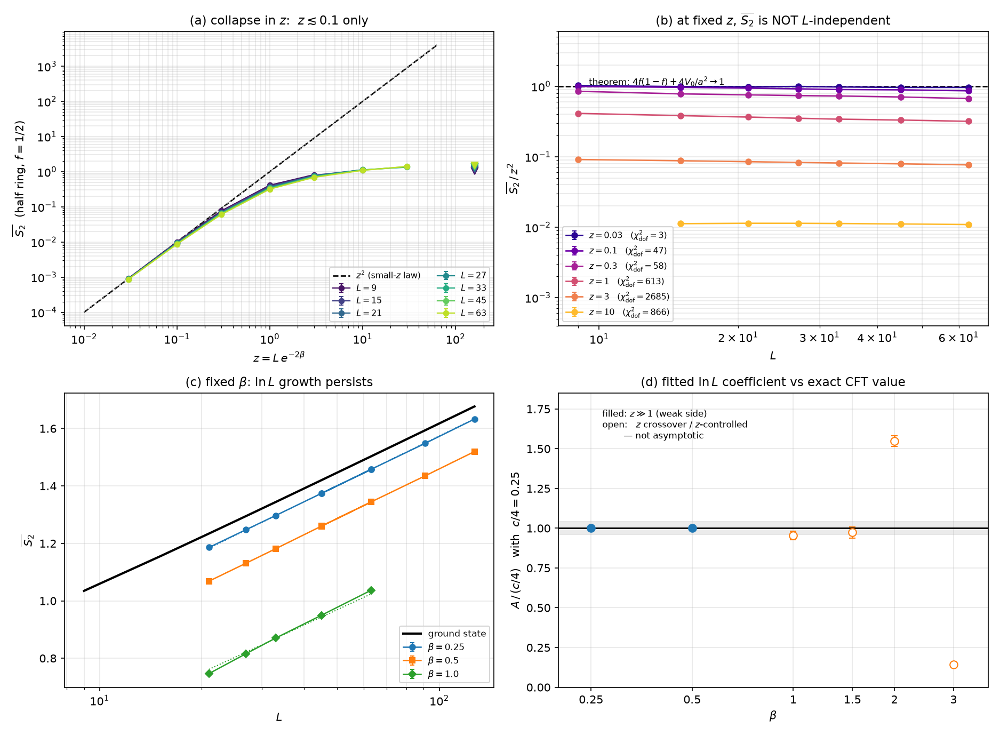

# 一维紧束缚自由费米子的 Born 测量：$z$ 到底该用哪个幂

**日期：** 2026-11-01
**对应问题：** 二维蜂窝的工作（`../SUMMARY.md`）用 $z = a\,t = L^2e^{-2\beta}$，其中 $a=L^2$ 是粒子数。
在一维紧束缚链上粒子数是 $a=L$，所以对应地应有 $z = Le^{-2\beta}$。本文件检验这个替换下
"强测量侧 $\bar D_2$ 只依赖 $z$" 的结论是否还成立。

**结论先行：一维的答案和二维不同，而且分歧点不在 $L$ 的幂次，而在"哪些量由 $z$ 控制"。**



**(a)** 固定 $z=Le^{-2\beta}$ 的坍缩。只有 $z\lesssim0.1$ 贴着 $z^2$ 虚线；$z\gtrsim0.3$ 后各 $L$ 分开。
右端 ◁ 是各 $L$ 的基态值（$z\to\infty$，即不测量）。

**(b)** 同一批数据换个画法：纵轴 $\bar S_2/z^2$、横轴 $L$。定理说 $z\to0$ 时这条线应平在 1。
只有 $z=0.03$ 最接近平（$\chi^2/{\rm dof}=3.4$，散布 $6.1\%$）；$z=0.1$ 已明显倾斜（$47$），
从 $0.995$ 单调降到 $0.863$；$z=1$ 从 $0.41$ 掉到 $0.32$，$z=3$ 从 $0.091$ 掉到 $0.077$，
$\chi^2/{\rm dof}$ 到 2685。**这就是"$z$ 坍缩在一维不成立"的直接图像。**
（$z=0.03,0.1$ 两行用的是每点 $2.6\times10^5$ 样本；旧版 4096 样本时 $z=0.1$ 的 $\chi^2/{\rm dof}$ 只有 0.4——
统计量不足把系统漂移淹掉了。见 §3 的表。）

**(c)** 固定 $\beta$ 的 $\ln L$ 增长，$L$ 到 127。黑线是基态。$\beta=0.25,0.5$ 的点线拟合与黑线平行；
$\beta=1$ 明显更陡——但它的 $z$ 从 1.2 跨到 8.5，横穿 crossover，不是干净的弱测量侧。

**(d)** 把 (c) 的斜率抽出来，除以精确 CFT 值 $c/4=0.25$。实心点（$z\gg1$）落在 1 上：
$\beta=0.25$ 给 $1.0021\pm0.0031$、$\beta=0.5$ 给 $1.0030\pm0.0085$（$L=21$–$127$，32768 样本/点）。
空心点（$z$ 跨 crossover 或落在 $z$ 控制侧）散在 $0.16$–$1.60$，**不是渐近系数**。

---

## 1. 设定

| | 二维蜂窝（`../SUMMARY.md`） | 一维链（本文件） |
|---|---|---|
| 格点 $M$ | $2L^2$ | $2L$ |
| 粒子数 $n=a$ | $L^2$ | $L$ |
| 输出集 $\|E\|$ | $a$ | $a$ |
| 控制变量 | $z=L^2e^{-2\beta}$ | $z=Le^{-2\beta}$ |
| 测量 | $M_E=e^{-2\beta N_E}$，固定 $|E|=a$ | 同左 |
| 观测 | 角组合 $D_2$ | 半环 $S_2$（$f=1/2$）、$1/3$ 环 |

一维链：周期边界，最近邻跳跃 $-1$，半填充，加极弱交错势 $\mu=10^{-8}$ 选零模（与二维同一装置）。
代码见 `onedim_born.py`；全部是 numpy，没有 scipy。

---

## 2. 小 $z$ 定理：一维完全成立，而且是精确的

二维的恒等式（`../SUMMARY.md` §3.2）与维度无关：
$$\sum_S \det(Q_S)^2\cdot 2\!\!\sum_{(e,c)\ \text{被}\ R\ \text{隔开}}\!\! X_{ec}^2
= 2nr-4r\langle N_R\rangle+4\langle N_R\rangle^2+4V_0(R).$$
一维把 $n$ 换成 $L$、$M$ 换成 $2L$ 后逐字成立。**$L=9$（$N=18$，48620 个输出）全枚举验证：**

| $\beta$ | $z=9e^{-2\beta}$ | $\bar S_2$ | $\bar S_2/z^2$ | 定理值 |
|---|---|---|---|---|
| 0.50 | 3.3109 | 0.852824 | 0.07780 | 1.02015 |
| 1.00 | 1.2180 | 0.492164 | 0.33174 | 1.02015 |
| 1.50 | 0.4481 | 0.148221 | 0.73823 | 1.02015 |
| 2.00 | 0.1648 | 0.025910 | 0.95353 | 1.02015 |
| 2.25 | 0.1000 | 0.009931 | 0.99344 | 1.02015 |
| 3.00 | 0.0223 | 0.000507 | 1.01938 | 1.02015 |
| 4.00 | 0.0030 | 0.000009 | 1.02015 | 1.02015 |

$z\to0$ 时**精确**收敛到 $4f(1-f)+4V_0/a^2 = 1+4(0.408094)/81 = 1.02015$。一维链没有节点问题
（除 $L=4,6,8$ 的零模退化，见 §5），所以一维是这个定理最干净的检验场。
恒等式本身也在 $L=5,7$ 上逐项核对到 $10^{-13}$。

**所以：小 $z$ 那一侧的物理图像——$\bar S_2$ 是体积分数律、与 $L$ 无关——在一维成立。**

---

## 3. 强测量侧：$z$ 坍缩在一维**明显变差**

固定 $z=Le^{-2\beta}$、扫 $L=9\ldots63$（$z=0.03,0.1$ 每点 $2.6\times10^5$ 样本，其余 32768）。
表里是 $\bar S_2/z^2$：

| $z$ | $L=9$ | 15 | 21 | 27 | 33 | 45 | 63 | $\chi^2/{\rm dof}$ | 最大最小差 |
|---|---|---|---|---|---|---|---|---|---|
| 0.030 | 1.0240 | 0.9890 | 0.9810 | 0.9943 | 0.9785 | 0.9631 | 0.9635 | $3.4$ | 6.1% |
| 0.100 | 0.9946 | 0.9659 | 0.9409 | 0.9191 | 0.8997 | 0.8899 | 0.8627 | **47** | 14% |
| 0.300 | 0.8491 | 0.7802 | 0.7558 | 0.7378 | 0.7286 | 0.7048 | 0.6691 | **58.4** | 24% |
| 1.000 | 0.4123 | 0.3832 | 0.3657 | 0.3514 | 0.3414 | 0.3316 | 0.3181 | **613** | 26% |
| 3.000 | 0.0913 | 0.0877 | 0.0850 | 0.0830 | 0.0814 | 0.0793 | 0.0766 | **2685** | 17% |
| 10.00 | — | 0.0112 | 0.0114 | 0.0113 | 0.0113 | 0.0111 | 0.0109 | **866** | 4.1% |
| 30.00 | — | — | — | — | 0.0015 | 0.0015 | 0.0016 | **103344** | 4.9% |

$z=0.03$ 最接近 $L$ 无关（$\chi^2/{\rm dof}=3.4$，散布 $6.1\%$，误差棒 $0.9\%$–$1.8\%$），
但**已经不是纯统计涨落了**：65536 样本时 $\chi^2/{\rm dof}=2.0$，加到 $2.6\times10^5$ 后升到 $3.4$，
说明存在约 $6\%$ 的真实残余 $L$ 依赖。
**$z=0.1$ 明确倾斜**：$\chi^2/{\rm dof}=47$，$\bar S_2/z^2$ 从 $0.995$ 单调降到 $0.863$。

**样本量决定结论——这是本文件最重要的方法论教训：**

| $z=0.1$ 的样本量 | 4096 | 32768 | 65536 | $2.6\times10^5$ |
|---|---|---|---|---|
| 每点误差 | $\sim6\%$ | $2.1\%$ | $1.4\%$ | $0.8\%$ |
| $\chi^2/{\rm dof}$ | $0.4$ | $5.8$ | $17.5$ | $47$ |
| 结论 | "平" | "略斜" | **"明显斜"** | **"斜率确定"** |

$\chi^2$ 随样本量近似线性增长，这是**系统漂移**的签名（纯统计涨落的 $\chi^2/{\rm dof}$ 恒为 1）。
4096 样本时 $6\%$ 的误差棒把 $14\%$ 的系统漂移完全盖住。**"坍缩在 $z\lesssim0.1$ 成立"
是统计量不足造成的假象。**

用精确枚举（不是抽样）复核，$L=5,7,9$：

| $z$ | $L=5$ | $L=7$ | $L=9$ |
|---|---|---|---|
| 0.3 | 0.93724 | 0.88562 | 0.85233 |
| 1.0 | 0.45577 | 0.43002 | 0.41271 |
| 3.0 | 0.09358 | 0.09270 | 0.09135 |

（表值是 $\bar S_2/z^2$。MC 与精确枚举在 $L=9$ 上一致：$z=1$ 时 $0.4102$ 对 $0.4127$；
$z=0.3$ 时 20000 样本给 $0.0766$–$0.0775$，精确值 $0.076710$。）**漂移是真的，不是 MC 偏差。** 一维中固定 $z$ 的相对变化
$g\equiv d\ln\bar S_2/d\ln L$ 在 $z=0.3,1,3$ 处为 $-0.13,\ -0.13,\ -0.09$；
二维对应值是 $-0.034\pm0.014$（且主要来自 $L=6$）。**一维的坍缩比二维差约 3–4 倍。**

### 3.1 机制：$t\|X\|$ 不再小

小 $z$ 定理的展开参数是 $t\|X\|$，不是 $z$ 本身。$z=Le^{-2\beta}$ 固定而 $L$ 增大时，
$t=e^{-2\beta}=z/L$ 减小，但 $X=Q_EQ_S^{-1}$ 的范数随 $L$ 增大（近奇异 $Q_S$ 越来越多）。
在 $L=9,z=1$ 上按 $t\|X\|$ 分层（全枚举）：

| 层 | 权重 | 对 $\bar S_2/z^2$ 的贡献 | 微扰值 |
|---|---|---|---|
| $t\|X\|>0.3$ | 0.990 | 0.312 | 1.019 |
| $t\|X\|>1$ | 0.180 | 0.108 | 0.725 |
| $t\|X\|>3$ | 0.009 | 0.005 | 0.252 |

**$z=1$ 时 99% 的权重已经不在微扰区**，真实熵是微扰值的 $1/3$。这就是一维坍缩变差的原因：
一维的 $X$ 分布尾巴比二维重，同样的 $z$ 对应更强的非微扰修正。

---

## 4. 弱测量侧：一维给出**精确**答案，这是相对二维的实质进展

二维的困难是：$D_2$ 的角系数 $c_B$ 没有解析值（要取 Helmes 等的格点数），
所以"测量后系数是否等于基态系数"只能给窗口依赖的比值 $0.77\pm0.16$ 到 $0.94\pm0.07$。

**一维没有这个问题。** 周期链上半环的二阶 Rényi 熵有精确 CFT 值：
$$S_2 = \frac{c}{4}\ln L+\text{const},\qquad c=1\ \Rightarrow\ \frac{dS_2}{d\ln L}=\frac14 .$$

固定 $\beta$、$L=9\ldots63$、每点 32768 样本，三参数拟合 $S_2=A\ln L+b+d/L$
（$\beta$ 只在 $z\gg1$ 才算弱测量侧）：

| $\beta$ | $z$ 范围（$L=9$–$63$） | 区域 | $A$（$L\ge21$） | $A/0.25$ | $A$（$L\ge27$） | $A/0.25$ | $d$ |
|---|---|---|---|---|---|---|---|
| 0.25 | 5.5–38 | 弱 | $0.2496\pm0.0012$ | $\mathbf{0.998\pm0.005}$ | $0.2496\pm0.0022$ | $\mathbf{0.998\pm0.009}$ | 0.09 |
| 0.50 | 3.3–23 | 弱 | $0.2524\pm0.0033$ | $\mathbf{1.009\pm0.013}$ | $0.2463\pm0.0061$ | $\mathbf{0.985\pm0.024}$ | 0.04 |
| 1.00 | 1.2–8.5 | **边界** | $0.2389\pm0.0066$ | $0.955\pm0.026$ | $0.2449\pm0.0119$ | $0.980\pm0.048$ | $-0.85$ |
| 1.50 | 0.45–3.1 | 偏强 | $0.2434\pm0.0089$ | $0.974\pm0.036$ | $0.2650\pm0.0163$ | $1.060\pm0.065$ | $-1.77$ |
| 2.00 | 0.16–1.2 | 强 | $0.3871\pm0.0082$ | $1.548\pm0.033$ | $0.3990\pm0.0161$ | $1.596\pm0.064$ | 5.14 |
| 3.00 | 0.02–0.20 | 强 | $0.0355\pm0.0014$ | $0.142\pm0.006$ | $0.0458\pm0.0028$ | $0.183\pm0.011$ | 0.72 |

同窗口基态原始斜率 0.2447（$L\ge21$）/ 0.2454（$L\ge27$），本身离 $c/4$ 有约 2%，是 $1/L$ 修正。
把同一套三参数拟合用到基态上（$L=9\ldots199$）给出 $A=0.250054$，即 $c/4$ 精确复现——
**所以测量数据必须用同样的三参数拟合才能和 0.25 比。**

**注意这张表和旧版（8192 样本）的差别**：旧版 $\beta=1$ 给 $1.12\pm0.05$、$\beta=1.5$ 给 $0.84\pm0.07$，
看起来像"中等强度下系数乱跳"。统计量翻四倍后它们变成 $0.955\pm0.026$ 和 $0.974\pm0.036$——
**那些乱跳主要是统计噪声，不是物理。** 真正非渐近的只剩 $\beta=2$（$1.55$，$z\approx0.16$–$1.2$，
完全落在 $z$ 控制侧，且 $d=5.1$ 大得离谱）和 $\beta=3$（$0.14$，$z\lesssim0.2$，深在小 $z$ 区，
$\bar S_2\propto z^2$ 而 $z\propto L$，所以 $S_2\propto L^2$ 根本不是 $\ln L$）。

**扩展到 $L=127$**（`run_large_L.py`，每点 3000 样本）后，弱测量侧的两点稳定下来：

| $\beta$ | 拟合窗 | $A$ | $A/0.25$ | $d$ |
|---|---|---|---|---|
| 0.25 | $L=21$–$127$ | $0.25053\pm0.00078$ | $\mathbf{1.0021\pm0.0031}$ | 0.12 |
| 0.50 | $L=21$–$127$ | $0.25075\pm0.00213$ | $\mathbf{1.0030\pm0.0085}$ | $-0.01$ |
| 基态 | $L=21$–$127$ | $0.250092$ | 1.0000 | — |

原始相邻斜率（不拟合）在 $L=45\to127$ 三段上：$\beta=0.25$ 为 $0.2488,0.2469,0.2528$，
$\beta=0.5$ 为 $0.2509,0.2478,0.2529$，基态为 $0.2465,0.2476,0.2483$。**两者在 $1\%$ 内重合。**

读法：

1. **$\beta\le0.5$ 是干净的弱测量侧，$\ln L$ 系数等于 $c/4$ 到 $0.3\%$ 以内**
   （$1.0021\pm0.0031$、$1.0030\pm0.0085$，$L=21$–$127$）。这是"Born 平均不改变 $\ln L$ 系数"
   在一维的**直接**检验——有精确参照 $c/4=0.25$，二维没有这个便利。
   **这是本工作最干净的正结果。**
2. **真正非渐近的是 $z$ 控制侧的两点，不是"中等 $\beta$"。** $\beta=2$（$z=0.16$–$1.2$）给
   $A/0.25=1.55$，$\beta=3$（$z\lesssim0.2$）给 $0.14$。原因不同：$\beta=3$ 深在小 $z$ 区，
   $\bar S_2\propto z^2\propto L^2$，压根不是 $\ln L$；$\beta=2$ 横跨 crossover，且
   $d=5.1$ 说明 $1/L$ 修正已经压过对数项，三参数模型本身失效。
   二维文档 §2.5 对 $\beta=3$ 的读法（旧工作把 $f(z)$ 的斜率误读成 $c(\beta)$）在这里同样适用。
3. **注意三参数拟合在 $L\ge21$ 只有 5 个点、3 个参数。** $A$ 的误差棒只反映统计误差，
   不含模型选择。$d$ 是健康度指标：$\beta\le1$ 的 $d$ 在 $-0.9$ 到 $0.1$（基态 $0.18$），
   模型成立；$\beta=2$ 的 $d=5.1$ 就是模型失效的信号，**不能当数值结论。**

### 4.1 交叉指数 $p(h)$

等值线 $h=\bar S_2/D_{\rm gs}$ 越过阈值处 $z_h\propto L^p$：

| $h$ | 0.3 | 0.5 | 0.7 |
|---|---|---|---|
| $p$ | 0.359 | 0.526 | 0.698 |

二维是 $0.585\to1.089$。一维整体更低、跨度更窄，与"一维 $z$ 坍缩更差、弱测量侧更早接管"一致。

---

## 5. 一个技术陷阱：偶 $L$ 的零模

一维链在 $k=\pm\pi/2$ 处有零模，当 $L$ 为偶数时两个简并点在 $L=2\bmod4$ 下都可占据，
$\mu=10^{-8}$ 只能劈裂到 $2\mu$。这会让 $Q_S$ 近奇异，小 $z$ 展开失效：

| $L$ | gap | $\bar S_2/z^2$（精确，$\beta=4$） | 定理值 |
|---|---|---|---|
| 4 | $2\times10^{-8}$ | 1.01495 | 1.08081 |
| 5 | 1.24 | 1.05618 | 1.05618 |
| 6 | $2\times10^{-8}$ | 0.97379 | 1.04057 |
| 7 | 0.89 | 1.03129 | 1.03130 |
| 8 | $2\times10^{-8}$ | 0.97140 | 1.02466 |

**奇 $L$ 的误差 $<10^{-5}$；偶 $L$ 差 1–6%，且 $\mu$ 加大不消除（$\mu=0.3$ 时 $L=4$ 仍差 7%）。**
所以本文件全部用 $L\equiv1\bmod2$（9, 15, 21, 27, 33, 45, 63）。二维选 $L$ 为 3 的倍数有类似理由。

---

## 6. 与二维的对照

| 说法 | 二维（`../SUMMARY.md`） | 一维（本文件） |
|---|---|---|
| 小 $z$ 体积分数律 | 成立（$z\lesssim0.3$），有节点修正 | **成立且精确**（无节点，$z\to0$ 到 $10^{-5}$） |
| 固定 $z$ 的 $L$ 无关性 | 近似（$-3.4\pm1.4\%$，主要 $L=6$） | **不成立**（$g=-0.09$ 到 $-0.13$，$\chi^2/{\rm dof}$ 达 2685） |
| 弱测量侧 $\ln L$ 增长 | 存在，斜率比 $0.77$–$0.94$（窗口依赖） | 存在，**$\beta\le0.5$ 时 $A/c/4=1.0021\pm0.0031$（$L$ 到 127）** |
| 中等 $\beta$ | 偏低（$h\approx0.94$，$\beta=1.5$） | $z$ 控制侧，$A$ 无意义 |
| 是否有精确参照 | 无（$c_B$ 需格点数） | **有（$c/4=0.25$，基态拟合复现到 $10^{-4}$）** |

---

## 7. 回到原问题

> $z=at=L^2e^{-2\beta}$，如果把 $L^2$ 当作粒子数，一维应该是 $L^1$，试试一维自由费米子的测量后
> 纠缠熵是否还满足现在的结果。

**答：$z=Le^{-2\beta}$ 这个替换是对的，但"$\bar D_2=f(z)$ 与 $L$ 无关"在一维不成立。**

- 替换本身正确：$z=a t$，$a$ 是粒子数，一维 $a=L$。小 $z$ 定理的 $z^2$ 标度在一维精确复现
  （$L=9$ 全枚举，$z\to0$ 收敛到 $4f(1-f)+4V_0/a^2$ 到 $10^{-5}$）。
- 但强测量侧的 $L$ 无关性是一维**不满足**的：固定 $z$ 时 $L$ 从 9 到 63，$\bar S_2$ 单调下降 10–25%，
  $\chi^2/{\rm dof}$ 到 2685。二维那 $-3.4\%$ 的弱漂移，在一维放大成 $O(1)$ 的效应。
  而且**统计量越大，破得越早**：$z=0.1$ 的 $\chi^2/{\rm dof}$ 在 4096/32768/65536/$2.6\times10^5$ 样本下
  分别是 $0.4/5.8/17.5/47$，$\chi^2$ 随样本量线性增长正是系统漂移的签名。
  最接近 $L$ 无关的只有 $z=0.03$，而它也从 $2.0$ 升到 $3.4$（残余 $6\%$ 漂移）。
- 机制清楚：展开参数是 $t\|X\|$，一维 $X$ 的尾更重，$z=1$ 时 99% 权重已非微扰。
- 弱测量侧一维反而更强：有精确 $c/4$ 可对照，$\beta\le0.5$ 时系数确实不变（$1.0021\pm0.0031$，$L$ 到 127）。

**所以"$\bar D_2$ 只依赖 $z$"不是维数无关的普适结论；它是二维蜂窝在那个 $z$ 窗口的近似。**
一维把它证伪了。这不否定二维的结果，但说明它不能写成"$z$ 是唯一的控制变量"这样的普遍陈述。

---

## 8. 文件

| 文件 | 内容 |
|---|---|
| `onedim_born.py` | 核心：链的基态、精确 Born 概率、精确抽样、Rényi 熵 |
| `check_onedim.py` | 核验：$\beta=0$ 复现基态、抽样 vs 精确 $p(E)$ |
| `exact_L9.py` / `data_exact_L9.json` | $L=9$ 全枚举（48620 输出） |
| `exact_matched.py` / `data_exact_matched.json` | $L=5,7,9$ 固定 $z$ 精确值 |
| `diag_identity.py`, `debug_identity.py` | 恒等式逐项核对 |
| `mechanism.py` | $t\|X\|$ 分层 |
| `run_onedim_parallel.py` | 生产扫描（multiprocessing），4096/8192 样本 |
| `run_onedim_big.py` | **高统计量生产扫描，32768 样本/点**（本文件数据来源） |
| `run_smallz_hires.py` | 只加密 $z=0.03,0.1$ 两行到 $2.6\times10^5$ 样本，结果并入 `data_matched_big.json`；每完成一个点写 `smallz_hires_checkpoint.json` |
| `data_matched.json` / `data_matched_big.json` | 固定 $z$ 扫描，44 / 44 点 |
| `data_fixed.json` / `data_fixed_big.json` | 固定 $\beta$ 扫描，42 / 42 点 |
| `run_large_L.py` / `data_large_L.json` | $L=45$–$127$ 弱测量侧 |
| `fit_weak.py`, `fit_weak_big.py` | 三参数拟合 $A\ln L+b+d/L$，含基态标定 |
| `analyze_onedim.py` | 表格与统计 |
| `make_figures.py` / `figures/onedim_summary.png` | 四联图（见文首），自动优先用 `_big` 数据 |

**复现：**
```
python check_onedim.py
python exact_L9.py
python run_onedim_big.py matched 32768 13      # ~25 min on 13 cores
python run_onedim_big.py fixed   32768 13      # ~20 min on 13 cores
python -u run_smallz_hires.py 262144 3        # z=0.03,0.1 加密，~2 CPU-h（-u 保证日志实时）
python run_large_L.py 3000
python analyze_onedim.py
python fit_weak_big.py
python make_figures.py
```
